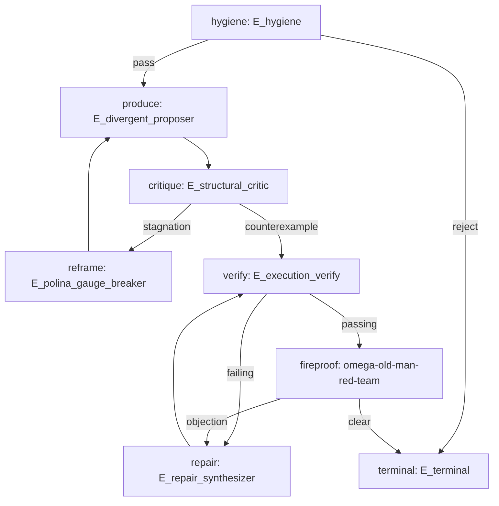

# Four-Layer Operator Architecture & Machine Invariants

**AuthorityEffect:** None (Architectural Specification & Operator Contract Register)  
**Governing Loci:**
- [`operator_registry.yaml`](../../../../omega_engine_woland/the_master_and_margarita/operator_registry.yaml)
- [`persona_registry.yaml`](../../../../omega_engine_woland/the_master_and_margarita/persona_registry.yaml)
- [`topology_profiles.yaml`](../../../../omega_engine_woland/the_master_and_margarita/topology_profiles.yaml)
- [`wolands_retinue.yaml`](../../../../omega_engine_woland/the_master_and_margarita/wolands_retinue.yaml)
- [`scenes.yaml`](../../../../omega_engine_woland/the_master_and_margarita/scenes.yaml)

---

## 1. The Fundamental Architectural Invariant

The Anomalon Omega Engine enforces strict mathematical and functional factorization across the Woland Swarm and its collaborating environments (Symbol Game, OEWAS, OEEIS, and host-native teamwork through Woland):

$$\boxed{\text{Persona} \neq \text{Operator} \neq \text{Skill} \neq \text{Verifier} \neq \text{Authority}}$$

The four distinct architectural layers are decoupled:

```text
+-----------------------------------------------------------------------------------+
| LAYER 4: HOST GOVERNANCE                                                          |
| Mandatory frozen task contract, Symbol Game invariants, AuthorityEffect: None,    |
| OEWAS residual-driven skill routing, OEEIS epistemic immune system, Blackrod axis |
+-----------------------------------------------------------------------------------+
                                         │
                                         ▼
+-----------------------------------------------------------------------------------+
| LAYER 3: SCENE ROUTING & TOPOLOGY                                                 |
| Execution DAGs (developer_standard_v1, seven_act_v1), typed scene locations       |
| (ACTIVE, REPOINTED, RETIRED, UNRESOLVED), binding status and workflows            |
+-----------------------------------------------------------------------------------+
                                         │
                                         ▼
+-----------------------------------------------------------------------------------+
| LAYER 1: FUNCTIONAL OPERATOR SEMANTICS (Executable Primitive)                     |
| Machine contracts (E_hygiene, E_divergent_proposer, E_structural_critic, etc.)   |
| Role classes, inputs, outputs, residual sorts, allowed actions, tools, no lore    |
+-----------------------------------------------------------------------------------+
                                         │ (presentation overlay)
                                         ▼
+-----------------------------------------------------------------------------------+
| LAYER 2: PERSONA / VOICE PRESENTATION PROFILES                                    |
| Removable presentation aliases (Woland, Begemot, Koroviev, Hella, etc.)           |
| Structured strategy controls (adversariality, divergence, style), zero private bio|
+-----------------------------------------------------------------------------------+
```

Removing all literary persona overlays leaves execution topologies, test suites, state transitions, work packets, and cryptographic receipts 100% byte-identical.

---

## 2. Layer 1: Functional Operator Semantics (The Executable Primitive)

The runtime dispatches machine operators, **not** characters. Every operator conforms to a normalized machine contract registered in [`operator_registry.yaml`](../../../../omega_engine_woland/the_master_and_margarita/operator_registry.yaml).

### 2.1 Operator Machine Contract Schema

```yaml
operator:
  id: string                   # e.g., E_structural_critic
  version: integer             # Schema version (e.g., 1)
  role_class: string           # CRITIC | PROPOSER | SYNTHESIZER | FILTER | AUDITOR | VERIFIER | ADAPTER | RECORD | TERMINAL
  inputs:
    - string                   # e.g., CandidateArtifactV1, TaskContractV1
  outputs:
    - string                   # e.g., FindingV1
  residual_sorts:
    - string                   # e.g., isolation_residual
  allowed_actions:
    - string                   # e.g., inspect, challenge, produce_counterexample
  tools:
    - string                   # Tools permitted (or [] if pure model / deterministic)
  deterministic: boolean       # True if no LLM required (e.g., E_hygiene, E_execution_verify)
  authority_effect: None       # Strictly None for all swarm operators
```

### 2.2 Operator Invariant Register
- **`unique(operator_id)`**: Every operator ID is globally unique.
- **Role Purity**: Operators execute only their declared `allowed_actions`.
- **Zero Sovereign Authority**: Every operator produces proposals, findings, or verifications; none possesses admission or merge authority.

---

## 3. Layer 2: Persona Presentation Profiles & Strategy Controls

Personas are presentation-only overlays registered in [`persona_registry.yaml`](../../../../omega_engine_woland/the_master_and_margarita/persona_registry.yaml).

### 3.1 Persona Machine Contract Schema

```yaml
persona:
  id: string                   # e.g., koroviev
  presentation_only: true      # Always true
  operator_bindings:
    - string                   # List of operator IDs bound to this persona
  strategy:
    adversariality: string     # low | medium | high | extreme
    divergence: string         # low | medium | high | very_high
    evidence_requirement: string # counterexample_required | working_code_or_test | etc.
    verbosity: string          # low | medium | high
    rhetorical_style: string   # satirical | severe | methodical | etc.
    repair_permission: boolean # true | false | proposal_only
```

### 3.2 Strategy Profiles vs. "Voice"
Model prompts must not rely on ambiguous character prose. Instead, explicit quantitative/qualitative strategy fields guide generation:
- **Koroviev:** `adversariality: extreme`, `divergence: low`, `evidence_requirement: counterexample_required`, `repair_permission: false`.
- **Begemot:** `adversariality: medium`, `divergence: very_high`, `evidence_requirement: gauge_break_novelty`, `repair_permission: proposal_only`.
- **Jeremy:** `adversariality: medium`, `divergence: medium`, `evidence_requirement: working_code_or_test`, `repair_permission: true`.
- **Liudmila:** `adversariality: low`, `divergence: low`, `evidence_requirement: calm_crisis_triage`, `repair_permission: true`.
- **Polina:** `adversariality: high`, `divergence: high`, `evidence_requirement: assumption_inversion`, `repair_permission: false`.

### 3.3 Exclusion of Private Real-Person Biography
Runtime prompts and character profiles must contain **zero personal, family, or minor biographical data**. Fictional characters are literary satire; Russian-American Salon profiles represent technical cognitive strategies (pragmatic code synthesis, calm operational triage, ego-puncturing gauge breaks, methodical audit custody).

---

## 4. Layer 3: Scene Routing & Execution Topology

Execution sequences are defined as directed graphs in [`topology_profiles.yaml`](../../../../omega_engine_woland/the_master_and_margarita/topology_profiles.yaml), decoupled from literary scene catalogs.

### 4.1 Canonical Developer Topology (`developer_standard_v1`)



### 4.2 Typed Scene Location Registry
In accordance with Omega registry law, no operator, scene, antibody, or contract is ever silently deleted. Scene targets in [`scenes.yaml`](../../../../omega_engine_woland/the_master_and_margarita/scenes.yaml) use structured status objects:

```yaml
location:
  status: ACTIVE | REPOINTED | RETIRED | UNRESOLVED
  former_path: string | null
  successor: string | null
  evidence:
    - string
```

---

## 5. Universal Adversarial Finding Schema (`FindingV1`)

All adversarial operators, critics, auditors, and red teams emit a standardized machine-readable finding record:

```yaml
FindingV1:
  finding_id: string           # UUID or content digest
  run_id: string               # Task run identifier
  operator_id: string          # e.g., E_structural_critic
  persona_id: string | null    # e.g., koroviev (presentation only)

  target_artifact_id: string   # File path or artifact ID under test
  target_digest: string        # SHA-256 of target artifact

  finding_class: string        # SYNTAX | BOUNDARY | ASSUMPTION | LOGIC | PERFORMANCE | SECURITY
  residual_sort: string        # One of declared residual_sorts
  severity: string             # P0_BLOCKER | P1_DEFECT | P2_RESIDUAL | P3_OBSERVATION

  claim: string                # Exact claim being challenged
  evidence_refs:               # Clickable references to evidence
    - string
  counterexample: string | null # Minimal concrete counterexample
  reproducer: string | null    # Executable reproduction command or test snippet

  proposed_action: string      # HOLD | REPAIR | REFRAME | REFUSE | ROUTE
  deterministic_check_required: boolean # True if host check is mandatory
  authority_effect: None       # Always None
```

---

## 6. OEWAS Residual-to-Skill Routing Table

The swarm generates typed residuals. OEWAS routes the residual to specialized capabilities:

| Measured Residual Sort | Primary Operator | Routed OEWAS Skill Package | Primary Function |
|:---|:---|:---|:---|
| `syntax_hygiene_residual` | `E_hygiene` | deterministic pre-filter | Schema, UTF-8, AST, duplicate check |
| `presentation_gauge_residual` | `E_divergent_proposer` | `ow-bureau-gauge-breaks` | 9-dot gauge break & surprise injection |
| `isolation_residual` | `E_structural_critic` | `techne-code-contracts-adversary` | Assumption inversion & boundary attack |
| `executable_runtime_residual` | `E_yankee_solver` | `techne-code-python-principal-developer` / `techne-code-rust-principal-developer` | Working code & executable test synthesis |
| `exactness_witness_residual` | `E_formal` | `governance-exact-solvers` / `governance-lean4-estate` | Exact rational arithmetic & Lean 4 replay |
| `provenance_theft_residual` | `E_custody` | `aletheia-phantom-citation-auditor` / `adversarial-receipt-audit` | Source citation & hash custody verification |
| `quarantine_residual` | `E_flow` | `techne-test-silent-skip-detector` | Hallucination isolation & sanatorium fence |
| `claim_hygiene_residual` | `E_anti_hype` | `glossa-claim-hygiene-linter` | Anti-hype filtering & 4-part claim audit |
| `physical_constraint_residual` | `E_ratslayer` | `techne-run-tests` | Memory, CPU, timeout & basetemp bounds |
| `governance_audit_residual` | `E_pilate` | `governance-clean-arch` | Inward dependency & cowardice audit |
| `stable_equilibrium_residual` | `E_luda_resilience` | `techne-sprint-execution` | Crisis triage & minimal forward action |
| `stochastic_friction_residual` | `E_environmental_fuzz` | deterministic fuzzer | Seeded environmental fuzzing & race stress |

---

## 7. OEEIS Native Epistemic Immune Operators

Five retinue operators map directly to the layers of the Epistemic Immune System (OEEIS):

```text
Incoming Mutation / Candidate
  │
  ▼
[Hella: E_hygiene] ───────────────► Innate Barrier (UTF-8, schema, forbidden tokens, no LLM)
  │ pass
  ▼
[Annushka: E_environmental_fuzz] ──► Antigen / Fuzz Generator (seeded environmental stress fixtures)
  │
  ▼
[Koroviev: E_structural_critic] ──► Defect Localizer (counterexamples, candidate antibodies)
  │ defect
  ▼
[Bezdomny: E_predictive] ──────────► Immune Recorder (failure pattern != antibody; strict promotion pipeline)
  │
  ▼
[Stravinsky: E_flow] ─────────────► Sanatorium Quarantine (isolate without silent deletion)
```

### 7.1 The Bezdomny Immune Promotion Law
A raw failure pattern is **not** an antibody:
$$\text{FailurePattern} \neq \text{Antibody}$$
To become an admitted OEEIS rule, a defect must traverse the strict promotion pipeline:
1. **Failure Observation** recorded by `E_predictive`.
2. **Deterministic Reproducer** synthesized.
3. **Host Verification** reproduces the typed defect in isolated environment.
4. **Candidate Antibody** minted with `AuthorityEffect: None`.
5. **Independent Replay** succeeds on pristine worktree.
6. **Human / Master Promotion** admits rule to active immune gate.

---

## 8. Host-Facing Verification Adapters

Aphranius and Levy Matvei are host-facing deterministic adapters, not free-form LLM agents:

### 8.1 Aphranius (`E_execution_verify`)
- **Inputs:** `job_id`, `expected_command_digest`, `process_receipt`, `exit_status`, `stdout_stderr_digest`, `artifact_digests`.
- **Function:** Deterministically verifies that background execution completed, logs match cryptographic commitments, and exit status was 0.
- **LLM Requirement:** None.

### 8.2 Levy Matvei (`E_custody`)
- **Inputs:** `artifact_set`, `parent_hashes`, `source_references`, `canonicalization_profile`.
- **Function:** Deterministically asserts content-addressed SHA-256 integrity, UTF-8 normalization without BOM, and provenance continuity.
- **LLM Requirement:** None.

---

## 9. Abadonna Semantic Redefinition

The historical sketch of Abadonna ("completely zeroizes failed candidates and destroys failed execution branches") violated the core Omega principle of Cemetery Mining and empirical evidence custody.

Abadonna is strictly redefined as **Execution Annihilation, Evidence Preservation**:

$$\boxed{E_{\text{annihilate}}: \text{execution\_state} \to \text{TERMINATED}, \quad \text{retained\_evidence} \to \text{IMMUTABLE}}$$

- **Permitted Annihilation:** Kill runaway processes, destroy temporary worker sandboxes, wipe ephemeral memory allocations, abort unauthorized side effects.
- **Strictly Prohibited:** Annihilating, truncating, or corrupting evidence, refusal bundles, DDA traces, or error logs already admitted to custody.

---

## 10. Old Man Red Team: The OEWAS Fireproof Aside

Old Man Red Team (`omega-old-man-red-team`) is **not** a permanent seat in `wolands_retinue.yaml`. He is an external examiner invoked via OEWAS as a "fireproof aside" when the task contract or residual demands independent verification:
- `natural_science_claim_residual`
- `continuum_overclaim_residual`
- `dual_optimality_residual`
- `formal_claim_coverage_residual`
- `publication_fireproof_residual`

```text
Woland Swarm Candidate
         │
         ▼ (residual trigger)
       OEWAS
         │
         ▼
omega-old-man-red-team
         │
         ▼
   AuditFindingV1 (External Examiner Report)
```
This guarantees Old Man's absolute epistemic independence from the dramatic consensus of Apartment 50.
