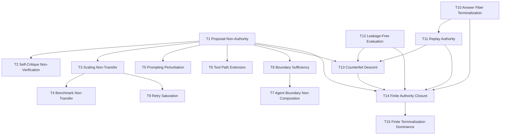

<div align="center"># Finite Authority and Non-Terminal Computation</div>
<div align="center">Jeremy H. Carroll</div>
<div align="center">2026-10-23</div>
<div align="center">Version 2.0.3</div>

## Abstract

Large Language Models, agentic AI systems, formal programs, and general symbolic machines generate traces. They emit strings, code, plans, proofs, critiques, tool calls, simulations, and candidate answers. None of those traces acquire authority by generation alone. Authority requires finite descent through declared representation, evaluation, verification, replay, obstruction accounting, leakage control, and terminalization.

This paper consolidates four overlapping drafts into one publication-facing companion to the current Layered Authority Framework v1.3 controlling preprint. Earlier drafts were written against Layered Authority Framework v1.2; v1.3 now controls the authority spine and theorem ledger. It does **not** reproduce the Layered Authority Framework authority spine, proof ledger, or higher-categorical machinery. Those documents control the formal definitions. This paper imports their authority object and compressed kernel, then applies them to LLM reasoning and formal computation.

The central claim is structural. A model output, benchmark score, tool trace, self-critique, program halt, or multi-agent local validation is a proposal unless it descends through a declared finite packet and reaches an authority-bearing terminal. Scaling, prompting, self-critique, benchmarks, tool use, retry, and agent orchestration can improve proposal quality or coverage. None replaces the terminalizer.

The paper develops five consequences: self-critique is not verification; scaling moves proposal mass but does not transfer authority; benchmark scores are packet-local; local agent validation does not compose without boundary sufficiency; and retry saturates unless it changes the evaluated packet. It then connects those results to the older computation boundary: Turing computation supplies the definitive abstraction of formal symbol motion, but halting is a syntactic terminal, not automatically an evidence terminal.

The final sections address the modern security risk: counterfeit descent. Generative systems reduce the cost of imitating authority signs—citations, proof style, JSON certificates, audit logs, institutional language, and review tone—faster than human institutions can scale verification. The defense is not trust in model fluency. The defense is terminalized finite descent: independent verifiers, replayable packets, typed refusals, obstruction signatures, and sovereign terminal gates.

In primitive-difference form, **Local Green != Global Red** means: a local dashboard may factor through the residual quotient while the paired local/global dashboard does not. This deposit verifies the finite split, the two-point witness, the three-point refusal, the class-increase identity, the halt-status separation, and the counterfeit-status separation in `lean4/FiniteAuthority.lean`. The quotient-modulo generalization and the evaluator-sovereignty witness are not theorems of this deposit. `omega_engine/lean4/PaperAF003` is not bundled here.

$$
\boxed{
\text{Fluency proposes. Descent authorizes.}
}
$$

## Context

$$
\boxed{
\text{Reasoning authority is not generated. It is terminalized.}
}
$$

$$
\boxed{
\text{General symbol manipulation is not autonomous authority.}
}
$$

0. Relation to Layered Authority Framework

This paper is a **companion application**, not a replacement for Layered Authority Framework.

Layered Authority Framework is the controlling authority spine. It defines the Omega Tower, the typed terminal taxonomy, the Kleisli authority normal form, the soundness axioms, the role tower, and the proof ledger. This paper imports those results rather than reprinting them.

**Ownership split (Finite Descent Verification / Layered Authority Framework / Finite Obstruction Calculus).** Under the tower ownership split, the **Authority type, the $\mathsf{IsAuth}$ guard, and descent-packet data are owned by Finite Descent Verification**; **Layered Authority Framework** owns the governance capstone, terminalization discipline, and the authority non-promotion rules; **Finite Obstruction Calculus** routes and diagnoses obstruction packets and mints no authority. Earlier drafts of this paper attributed the dependent authority object to Layered Authority Framework. That attribution is corrected here: this paper imports the authority object and $\mathsf{IsAuth}$ from **Finite Descent Verification**, and imports terminalization and non-promotion discipline from **Layered Authority Framework**. It owns neither, and it mints neither.

**Reference lineage (v1.1 note).** This paper was drafted against Layered Authority Framework v1.2. The controlling preprint is now `999_Layered Authority Framework/v1.3_preprint.md` (which contains the Layered Authority Framework theorem ledger tables; `999_Layered Authority Framework/` carries no separate ledger file), together with `999_Layered Authority Framework/math_spine.md`. The LLM-spine theorem files for T1–T15 (§5) live at `omega_engine/research/encyclopedia/archived_research/encyclopedia_anomalon/` (files `08`–`37`). **Path correction (this pass).** Earlier revisions cited these files at `research/archive/encyclopedia_anomalon/`; that path does not exist in the repository (nor does `omega_engine/research/archive/`). The files themselves are present at the corrected path above and were read in this pass. **Status of those homes (verified, not assumed).** They carry `Status: PROVED-PROSE` — prose proofs, not mechanized — and `archived_research/` is a harvest folder, not the indexed canonical encyclopedia (`encyclopedia/indexes/by_layer.md`, `indexes/ledgers/`). Verifying and migrating them remains open as **PL-027-2**. **Namespace note:** this paper's T1–T15 are the *LLM-spine* theorems; they are distinct from the `Layered Authority Framework-T*` identifiers used inside the Layered Authority Framework v1.3 ledger (e.g., Layered Authority Framework-T15 is a different result from this paper's T15). One v1.3 change is load-bearing here: v1.3 declares a **Known Gate** — the gauge $\Phi$ is *assumed*, not proved, positive-definite on nonzero quotient classes — which conditions the counterfeit-detection test of §14 (see the hedge there).

The imported compressed kernel is:

$$
\boxed{
\text{Difference}\to\text{Repair}\to\text{Quotient}\to\text{Closure}\to\text{Authority}.
}
$$

**Root fence.** This arrow chain is a pipeline of declared packet stages. It is **not** a genesis order and **not** a derivation of the system from a single primitive. `Difference` here names the **non-sameness aspect of an admitted cut**, co-admitted with that cut's exhibited-retention aspect; neither aspect precedes, contains, creates, produces, or explains the other. This paper does not claim that difference alone derives the system, that difference creates structure, or that either requires the other as a prior carrier. The chain is imported; its root pricing is tracked at its home, not re-derived here.

For this paper:

| Layered Authority Framework primitive | LLM/computation reading |
|---|---|
| Difference | parser deltas, verifier failures, local/global mismatch, trace defects |
| Repair | declared transformations preserving the task boundary |
| Quotient | residual distinction modulo admissible repair |
| Closure | failure or success of local residuals to glue globally |
| Authority | finite terminalization under a declared verifier and terminalizer |

The controlling authority object — **Finite Descent Verification-owned, imported here, defined by neither this paper nor Layered Authority Framework** — is:

$$
\boxed{
\mathsf{Authority}_S(x)
:=
\Sigma(t:\mathbb T_S)
\bigl(
\Pi_S^\sharp(x)=\mathsf{inl}(t)
\wedge
\mathsf{IsAuth}_S(t)
\bigr).
}
$$

This paper uses the same object in the LLM-specific form:

$$
\mathsf{Authority}_D(x,a)
:=
\Sigma(t:\mathbb T_D)
\bigl(
\Pi_D^\sharp(x,a)=\mathsf{inl}(t)
\wedge
\mathsf{IsAuth}_D(t)
\bigr).
$$

Here $D$ is the declared descent packet for a task, model output, program trace, or benchmark claim.

**Non-duplication rule.** This paper does not restate the full Layered Authority Framework theorem ledger. It summarizes only the LLM/computation consequences needed for a reader to apply the finite-authority discipline.

This paper owns the consolidation, terminology, and LLM/computation-facing exposition. It does not own the Finite Descent Verification authority object, the Layered Authority Framework terminalization discipline, the EPK theorem, or the T1–T15 theorem proofs.

**Scope of Mechanization & Verification Grounding.** `lean4/FiniteAuthority.lean` mechanizes the finite statements named in the claim ledger (D1, D5, D6, D16). `code/tests/test_finite_authority.py` calls the shipped checkers in `code/mod_finite_authority_core.py` on those same finite cases. `PaperAF003` is not in this deposit. The halt and counterfeit theorems are equalities of finite enumerations. They are not $\mathsf{Authority}_D$, they do not use the §6 C1–C8 stack as a Lean structure, and they discharge no Finite Descent Verification obligation.

0.1 Verifier Soundness Is the Trust Root

All authority in this paper is verifier-relative. Layered Authority Framework does not declare V sound by fiat. It exposes V as the trust root and prevents proposal systems from silently replacing it.

0.2 Authority Scope Typing

"Verifier-relative" is a scope, and this paper now names it. Every occurrence of $\mathsf{Authority}_D$, $\mathsf{CertifiedAuthority}_D$, "certified", and "terminalized" in this paper is to be read at exactly one of these scopes:

| Scope | Available here? | Meaning |
|---|---|---|
| `ContractAuthority` | **yes, where a packet $D$ is declared** | the claim satisfies a declared, replayable contract — the packet fields of §3, discharged and logged per §17 |
| `VerifierScopedAuthority` | **yes, relative to a declared $V$** | the claim survives descent under a *named* verifier $V$, and inherits every unsoundness of $V$ (§0.1, §16 fatal row) |
| `SemanticAuthority` | **NO — UNAVAILABLE** | that the claim is *true*. This paper declares **no semantic adapter**, so this scope is not available at any degree of this paper and is not claimed anywhere in it |

$\mathsf{Authority}_D$ is therefore always `ContractAuthority` ∧ `VerifierScopedAuthority`, never `SemanticAuthority`. §20's closing claim, §6's gate stack, and §21's conclusion are all to be read at that scope. The paper's own §15 already says this in prose — "we moved trust from an opaque generative system … to a declared, inspectable, replayable finite predicate over a specific packet" — and §16's "Verifier regress" row prices the residue. **An exact repair, a green gate vector, or a signed terminal does not imply semantic truth.**

0.3 What Authority-Bearing Use Requires

This paper is an authority paper, so it must state its own price. Nothing in this paper mints authority. Any *authority-bearing* use of its results — anything that would let a terminal act on a claim — requires all of the following, and this paper supplies only the ones marked:

| Requirement | Supplied here? |
|---|---|
| `SpecificationIdentity` — which spec is being certified, fixed and named | **no.** §9's transport map $\chi$ is the same concern, left as a declared obligation, not a typed object |
| `DetectorAdequacy` — the detectors protect the distinctions the claim needs | **no.** See the warning below; this is the sharpest gap in the paper |
| `ExhaustionWitness` — the accepted set was actually exhausted, not sampled | **no.** Required by gate C5 / §12.1; see the note there |
| `EvidenceCeiling` — the declared bound past which evidence stops | **partial.** Named as a terminal (§13) and as `BudgetUnknown` (Appendix B); not required as a packet field |
| `ReplayWitness` — the descent path reruns and reproduces the terminal | **yes.** §12.2, gate C6, §17 log fields |
| `Terminalizer` — a declared $\tau$ mapping verified states to typed status | **yes.** §3, gate C8, §17 |
| `IsAuth` — the Finite Descent Verification guard on the terminal | **no.** Imported and displayed in §0; never constructed in this paper, and absent from its Lean module (see the formalization firewall) |

**Detector adequacy warning.** A replayable detector/profile is not automatically adequate for a claim. **A collapsing detector can make every profile exact.** Any authority-bearing Layered Authority Framework use requires a `DetectorAdequacy` certificate naming the protected distinctions, adversarial cases, and known blind spots for the declared claim scope. This paper carries no such certificate, and the gap is live rather than theoretical: §16 already books "Parser insufficiency" and "Canonicalizer collapse" as serious attacks. A constant-true relation would be a collapsed detector, and this deposit does not count that witness as a proof. A green C2/C3/C5 therefore certifies nothing until the detector behind it is shown adequate.

1. Claim Discipline

This paper is an authority theory for proposal systems. It is not a theory of consciousness, not a proof of general intelligence, not a refutation of Turing computation, and not a claim that all truth is finite.

Its claims are narrow:

1. A generated trace is a proposal.
2. A proposal does not become authority unless it descends through a declared finite packet.
3. No proposal process may serve as the terminal authority for its own output unless the verifier and terminalizer are separately declared, replayable, and included in the explicit trust root.
4. Scale, prompting, tool use, self-critique, benchmarks, retries, and agent orchestration may improve proposal quality or coverage, but none replaces the terminalizer.
5. Formal computation may halt, but halting is not by itself authority.
6. Public authority claims must disclose the packet: representation, evaluator, verifier, replay, leakage/provenance boundary, residuals, and terminal status.

$$
\boxed{
\begin{gathered}\text{A generated claim is not authority until it survives finite descent}\\
\text{through a declared evaluator.}\end{gathered}
}
$$

### 1.1 Why a Researcher Should Care

Three live engineering failures motivate this paper, and all three are category errors of the same kind. (1) Agent pipelines ship when every local validator is green and fail globally — the local/global gluing defect of §11 — and postmortems blame the model instead of the missing boundary object. (2) Benchmark scores are routinely transported to deployment tasks with no declared transport map, so procurement and safety cases inherit numbers that certify only survival inside the benchmark packet (§9). (3) Generative systems now produce authority-*looking* artifacts — citations, audit logs, JSON certificates — cheaper than institutions can verify them (§14), so any review process that screens on the *signs* of verification is already counterfeit-vulnerable. The paper gives each failure a typed name, a place in one descent discipline, and a concrete gate that would have refused it.

### 1.2 Related Work and Positioning

Nearest neighbors, and how this paper differs:

1. **Proof-carrying code** (Necula, *Proof-Carrying Code*, POPL 1997). The closest engineering ancestor: the artifact ships with a checkable certificate, and trust sits in a small verifier rather than the producer. This paper generalizes the pattern from code+proof to arbitrary proposal traces, and adds the packet fields PCC does not model: replay, leakage/provenance boundary, residual ledger, and typed refusal.
2. **Social-process critique of verification** (DeMillo, Lipton & Perlis, *Social Processes and Proofs of Theorems and Programs*, CACM 22(5), 1979). They argued mechanical proof does not create belief; authority is social. This paper accepts the gap but inverts the response: instead of abandoning mechanical authority, it narrows authority to what a declared finite packet can terminalize, and types everything else as proposal.
3. **LLM-as-judge** (Zheng et al., *Judging LLM-as-a-Judge with MT-Bench and Chatbot Arena*, NeurIPS 2023 Datasets & Benchmarks; arXiv:2306.05685). Empirically useful evaluator surrogates. In this paper's terms an LLM judge is another proposal law: usable inside a packet only if declared as the evaluator, never as a self-terminalizing authority (§15; LLM-as-evaluator circularity is a fatal row of §16).
4. **Limits of self-correction** (Huang et al., *Large Language Models Cannot Self-Correct Reasoning Yet*, ICLR 2024; arXiv:2310.01798). Empirical evidence that intrinsic self-critique fails to improve reasoning reliably — the empirical face of §7's structural claim that self-critique is $P_\theta \circ P_\theta$ and never escapes the proposal type.
5. **Internal:** Layered Authority Framework (`999_Layered Authority Framework/`, controlling); Papers 020/023/025 (EPK composition calculus — §4 and §11 import their objects); Paper 024 (machine-checked Authority Firewall); Paper 026 (downstream residual classification of what survives closure).

2. Proposal Systems

A **proposal system** is any system that emits candidate claims before those claims have been externally terminalized. LLMs are proposal systems. Programs are proposal systems when their outputs require verification. Humans, institutions, laboratories, courts, markets, and proof assistants can also behave as proposal systems when they generate claims that require evaluation.

This is a structural analogy, not an ontological equivalence. Human beings are embodied biological agents. LLMs are parameterized generative models. Turing machines are formal symbol systems. They are not the same kind of thing. But in public authority contexts, all can emit proposals that require a finite packet before they become shared authority.

### 2.1 LLMs as Proposal Laws

Let $M$ be an LLM with parameters $\theta$. Given input $x$, the model defines a proposal law:

$$
P_\theta(\gamma\mid x),
$$

where $\gamma$ is a finite trace: tokens, tool calls, code edits, reasoning steps, or emitted actions. An extracted answer is:

$$
a=\operatorname{extract}(\gamma).
$$

The model can increase the probability of useful traces. It can generate long chains of apparent reasoning. It can call tools. It can critique itself. But the proposal law remains a proposal law.

$$
\boxed{
P_\theta(\gamma\mid x)>0
\not\Rightarrow
\mathsf{Authority}_D(x,a).
}
$$

### 2.2 Formal Programs as Proposal Traces

A formal computation also emits traces. A program may halt and return an output. In the classical Turing model, halting is a syntactic terminal: execution reaches a halt state under the declared transition function. Layered Authority Framework asks a different question:

$$
\boxed{
\begin{gathered}\text{Does the halted output carry terminal evidence under a declared}\\
\text{authority packet?}\end{gathered}
}
$$

If no verifier, evidence object, replay record, and authority-bearing terminalizer are supplied, the output remains a syntactic result, not an authority-bearing computation.

$$
\boxed{
\mathsf{Turing\ Halting}
\not\Rightarrow
\mathsf{Authority}.
}
$$

This is not a rejection of computation theory. It is a boundary on authority promotion.

3. Finite Descent Packets

A proposal becomes eligible for authority only through a finite descent packet:

$$
D=(K,E,V,\tau,\Lambda).
$$

| Packet field | Meaning |
|---|---|
| $K$ | representation regime / finite carrier |
| $E$ | evaluator projection over traces or candidates |
| $V$ | verifier satisfying declared independence, determinism, and replayability |
| $\tau$ | terminalizer mapping verified states into authority/refusal/lift statuses |
| $\Lambda$ | lift / retry / repair discipline with typed residuals |

The packet must also provide replay evidence, obstruction accounting, leakage/provenance boundaries, and typed refusal when any gate fails.

A practical LLM packet usually includes:

1. input schema;
2. parser;
3. canonicalizer;
4. verifier;
5. answer-fiber check;
6. replay record;
7. leakage/provenance audit;
8. residual ledger;
9. terminalizer.

$$
\boxed{
\begin{gathered}\text{A proposal is not an authority. To bridge the gap, one must supply the}\\
\text{packet.}\end{gathered}
}
$$

4. Evaluated Path Kernel

The canonical finite trace representation for LLM authority claims is the **Evaluated Path Kernel**:

$$
\boxed{
Z_\theta^{\lambda,\mu}(y\mid x) =
\sum_{\gamma\in\Gamma_{x\to y}}
E(\gamma)\,
P_\theta(\gamma\mid x)\,
e^{-\lambda C[\gamma]-\mu R[\gamma]}.
}
$$

where:

| Symbol | Meaning |
|---|---|
| $\Gamma_{x\to y}$ | finite traces from input $x$ to extracted output $y$ |
| $P_\theta(\gamma\mid x)$ | proposal mass assigned by the model |
| $E(\gamma)$ | evaluator projection, often $0/1$ |
| $C[\gamma]$ | cost of the trace |
| $R[\gamma]$ | residual risk / unresolved obstruction |
| $\lambda,\mu\ge0$ | cost and risk sensitivities |
| $Z_\theta^{\lambda,\mu}$ | accepted proposal mass |

**Exact Rational Pade Surrogate (Implementation Formulation).** In exact rational arithmetic on $\mathbb{Q}$, the exponential discounting kernel is represented by its first-order rational Pade surrogate:
$$
Z_{\theta,\text{rat}}^{\lambda,\mu}(y\mid x) =
\sum_{\gamma\in\Gamma_{x\to y}}
E(\gamma)\,
P_\theta(\gamma\mid x)\,
\frac{1}{1 + \lambda C[\gamma] + \mu R[\gamma]}.
$$
Both kernels are monotonically non-increasing in cost $C$ and residual risk $R$, strictly positive for non-negative inputs, and vanish as $C, R \to \infty$. The reference Python module implements both the continuous exponential kernel and the exact rational surrogate.

The EPK is **not** a source of authority. It is a representation of proposal mass after evaluator projection and cost/residual suppression. Authority still descends through Finite Descent Verification-style terminalization.

### 4.1 What the Kernel Is

The kernel is:

1. a finite weighted sum over traces;
2. a way to compare accepted proposal mass under a declared evaluator;
3. a representation of how prompting, scaling, tools, cost, and residuals change proposal geometry;
4. a finite shadow of richer path-like reasoning structures.

### 4.2 What the Kernel Is Not

The kernel is not quantum mechanics, not a Born rule, not a physical path integral, not a proof of consciousness, and not a truth functional. If $E$ is wrong, $Z_\theta$ can be high for wrong answers.

$$
\boxed{
\begin{gathered}\text{High accepted proposal mass under a bad evaluator is still bad}\\
\text{authority.}\end{gathered}
}
$$

### 4.3 Primitive-Difference LGGR Theorem

Let $P$ be a primitive difference object on claims, with zero relation $x\sim_P y$ and residual quotient $Q_P$. Let

$$
L:X\to\mathcal L,\qquad G:X\to\mathcal G
$$

be a local dashboard and a global verdict. If $L$ is invariant on zero-difference classes, but some zero-related pair disagrees globally,

$$
x\sim_P y,\qquad G(x)\ne G(y),
$$

then the local dashboard descends:

$$
\exists \bar L:Q_P\to\mathcal L,\quad
\bar L([z])=L(z),
$$

while the paired local/global dashboard does not:

$$
\neg\exists H:Q_P\to\mathcal L\times\mathcal G,\quad
H([z])=(L(z),G(z)).
$$

This is the precise finite meaning of the slogan:

$$
\boxed{
\text{Local Green } \ne \text{ Global Red}.
}
$$

The finite statement proved in this deposit is `lggr_has_global_split`: if the local color is constant on a declared relation and the joint local/global color is not, then some related pair shares a local color and differs in verdict. `two_point_lggr` is the two-point witness. `three_point_not_lggr` is the three-point carrier on which the local color is not constant, so the obstruction flag is false. The Python checker is `LGGRObstruction.verify_lggr_obstruction`.

The names `local_dashboard_factor_iff`, `joint_dashboard_factor_iff`, `lggr_nonpromotion`, `lggr_witness_and_obstruction`, and `minimal_lggr_witness` are not in this deposit. A witness that sets the relation to the constant true, and is therefore green because it protects no distinction, is not a theorem here.

The quotient-modulo generalization is not a theorem of this deposit. The names `joint_dashboard_mod_requires_global_congruence` and `lggr_mod_nonpromotion` are absent. Local dashboards remain evidence projections in the prose. That sentence is not a Lean theorem here.

### 4.4 Constructive Resolution: Minimal Verdict-Preserving Refinement

While the LGGR obstruction shows that a local quotient dashboard $q: X \twoheadrightarrow Q$ may fail to factor a global verdict $G: X \to Y$, this boundary failure can be resolved constructively by determining the minimal refinement of $Q$ through which $G$ descends.

**Definition (Verdict-Preserving Refinement Relation).** Let $X$ be a declared finite carrier, $q: X \twoheadrightarrow Q$ a quotient map, and $G: X \to Y$ a verdict map. Define the equivalence relation $\sim_*$ on $X$ by:
$$
x \sim_* y \iff q(x) = q(y) \land G(x) = G(y).
$$

**Theorem (Coarsest Refinement).**
1. The quotient $X / {\sim_*}$ preserves the existing quotient ($x \sim_* y \implies q(x) = q(y)$), and $G$ descends to a well-defined map $G_* : X / {\sim_*} \to Y$.
2. $X / {\sim_*}$ is the unique coarsest equivalence relation with these properties: if $\sim'$ refines $q$ and $G$ descends through $X / {\sim'}$, then $\sim' \subseteq \sim_*$.
3. The exact increase in the number of equivalence classes is given by:
$$
|X / {\sim_*}| - |Q| = \sum_{u \in Q} (|G(q^{-1}(u))| - 1).
$$
4. Every required class split admits an explicit witness: a pair $(x, y) \in q^{-1}(u)$ such that $q(x) = q(y)$ while $G(x) \neq G(y)$.

*Proof.*
(1) If $x \sim_* y$, then $q(x) = q(y)$ by definition, so the partition induced by $\sim_*$ refines $Q$. Furthermore, $x \sim_* y \implies G(x) = G(y)$, so the map $G_*([x]_{\sim_*}) := G(x)$ is single-valued and well-defined.
(2) Let $\sim'$ be any equivalence relation on $X$ such that $x \sim' y \implies q(x) = q(y)$ and $x \sim' y \implies G(x) = G(y)$. Then $x \sim' y \implies (q(x) = q(y) \land G(x) = G(y)) \implies x \sim_* y$. Hence $\sim' \subseteq \sim_*$, which establishes that $\sim_*$ is the coarsest such refinement.
(3) For each $u \in Q$, its fiber $q^{-1}(u) \subseteq X$ is partitioned by $\sim_*$ into classes corresponding to the distinct values in $G(q^{-1}(u))$. The number of such sub-classes is precisely $|G(q^{-1}(u))|$. Summing over all $u \in Q$, $|X / {\sim_*}| = \sum_{u \in Q} |G(q^{-1}(u))|$. Subtracting $|Q| = \sum_{u \in Q} 1$ yields $|X / {\sim_*}| - |Q| = \sum_{u \in Q} (|G(q^{-1}(u))| - 1)$.
(4) Whenever $|G(q^{-1}(u))| > 1$, there exist at least two distinct values $v_a \neq v_b \in G(q^{-1}(u))$. Selecting any $x \in q^{-1}(u) \cap G^{-1}(v_a)$ and $y \in q^{-1}(u) \cap G^{-1}(v_b)$ provides the witness: $q(x) = q(y) = u$ but $G(x) = v_a \neq v_b = G(y)$. $\square$

This constructive refinement converts the LGGR negative obstruction into a deterministic recipe for identifying exactly which boundary distinctions must be retained. `increase_formula` verifies the class-increase identity for nonempty verdict fibers. `compute_minimal_verdict_refinement` is the shipped checker, and `test_minimal_verdict_refinement_derivation` calls it. The coarsest refinement sentence above is this prose argument. It is not a theorem of `lean4/FiniteAuthority.lean`.

5. Imported Fifteen-Theorem LLM Spine

The following is an imported theorem map from the archived LLM-spine companion files. This paper uses it as a dependency map, not as a self-contained proof ledger. Republication of theorem-grade claims requires either bundling those files or migrating them into the canonical encyclopedia.

| ID | Result | Role in this paper |
|---|---|---|
| T1 | Proposal Non-Authority | generation does not authorize |
| T2 | Self-Critique Non-Verification | model critique is still proposal |
| T3 | Scaling Non-Transfer | scale moves proposal mass |
| T4 | Benchmark Packet Non-Transfer | scores are packet-local |
| T5 | Prompting as Perturbation | prompts change proposal distribution |
| T6 | Tool Use as Path Extension | tools extend trace space |
| T7 | Agent Boundary Non-Composition | local green does not compose |
| T8 | Boundary Sufficiency | handoffs need evaluator-relevant preservation |
| T9 | Retry Saturation | blind retry has diminishing returns |
| T10 | Answer Fiber Terminalization | unique accepted answer required |
| T11 | Replay Authority | certification requires replay |
| T12 | Leakage-Free Evaluation | visible-input derivation matters |
| T13 | Counterfeit Descent | forged authority signs must be detected |
| T14 | Finite Authority Closure | complete gate stack is required |
| T15 | Finite Terminalization Dominance | terminalized local solvers can dominate under measured conditions |

The dependency shape is:



6. Finite Authority Closure

For an LLM output $a$ on input $x$, certified authority relative to a declared packet $D$ requires the complete gate stack:

$$
\boxed{
\mathsf{CertifiedAuthority}_D(x,a)
\iff
\bigwedge_{i=1}^{8} C_i.
}
$$

The equivalence is definitional. The stronger minimality claim — that removing each gate admits a concrete counterfeit or failure mode — is open until the per-gate witness catalog PL-027-1 is supplied.

| Gate | Condition | Failure terminal |
|---|---|---|
| C1 | proposal generated | `ProposalFailure` |
| C2 | parseable output | `ExtractionFailure` / `ParserInsufficient` |
| C3 | canonicalization succeeds | `CanonicalizerFailure` / `CanonicalizerAmbiguity` |
| C4 | verifier accepts | `VerifierRejected` / `VerifierFailure` |
| C5 | unique answer fiber | `NoAccepted` / `AmbiguousAnswerFiber` |
| C6 | replay confirms | `ReplayHashMismatch` / `EnvironmentMismatch` |
| C7 | leakage/provenance boundary clean | `LeakageDetected` / `ProvenanceUnknown` |
| C8 | terminal gate accepts | `NonAuthorityTerminal` / `TerminalMismatch` |

Failure of any single gate blocks packet-local certification:

$$
\exists i\in\{1,\dots,8\}:\neg C_i
\Rightarrow
\neg\mathsf{CertifiedAuthority}_D(x,a).
$$

This is the contrapositive of the definition above and carries nothing beyond it. Two further steps are **not** discharged here, and earlier revisions of this section elided both by writing $\mathsf{Authority}_D$ where $\mathsf{CertifiedAuthority}_D$ was meant:

- **Necessity — declared, not proved.** $\mathsf{Authority}_D(x,a)\Rightarrow\bigwedge_{i=1}^{8}C_i$ is a `[POLICY RULE]`: it is what a compliant packet $D$ is *required to enforce*, not a theorem of this paper. Only under that declared rule does a failed gate refuse the §0 authority object rather than solely refusing this paper's certificate.
- **Sufficiency — refused.** $\bigwedge_{i=1}^{8}C_i\Rightarrow\mathsf{Authority}_D(x,a)$ is **not claimed and is refused here.** $\mathsf{Authority}_D$ is the Finite Descent Verification dependent object of §0: it requires a terminal $t$ with $\Pi_D^\sharp(x,a)=\mathsf{inl}(t)$ *and* a proof of $\mathsf{IsAuth}_D(t)$. A conjunction of eight Boolean gates does not construct that dependent pair, and no theorem in this paper or its Lean module constructs it. $\mathsf{CertifiedAuthority}$ is a **packet-local certificate name**; the token "Authority" inside that name carries no authority. Granting to a conjunction of predicates what §2.1, §7, §8 and §13 deny to generation, self-critique, scaling and halting would be the same category error this paper exists to refuse.

> **OBSTRUCTION.** The following cannot be derived from what is available at this degree: a route from the gate conjunction $\bigwedge_i C_i$ to $\mathsf{Authority}_D(x,a)$. What would have to be admitted: a Finite Descent Verification descent packet with a constructed terminal $t$, an $\mathsf{IsAuth}_D(t)$ witness, a `DetectorAdequacy` certificate for each gate's detector, and an `ExhaustionWitness` for C5. What is lost if it is admitted without those: the gate stack becomes a counterfeit-descent surface — eight green Booleans that *look* like a terminal seal and are not one.

The C1–C8 conjunction of this section is not a Lean theorem of this deposit. An external `DescentGateVector` with fields `hasRepresentation`, `hasEvaluator`, `hasVerifier`, `hasReplay`, `hasLeakageBoundary`, `hasResidualLedger`, `hasTerminalizer`, and `terminalAccepts` is a different eight-tuple, and that file is not bundled here. The names `certified_iff_all_gates_true`, `full_descent_gate_vector_certified`, and the `missing_*_refuses_certification` lemmas are absent. PL-027-1, the per-gate removal catalog, stays open.

### 6.1 Worked Example: One Row Through the Gate Stack `[WORKED EXAMPLE]`

Declared packet $D$ for the task $x$ = "compute $17 \times 23$; return the integer only":
$K$ = decimal integer strings; parser = first integer token; canonicalizer = strip whitespace/leading zeros; $V$ = independent recomputation ($17 \times 23 = 391$, evaluated outside the proposal process); answer-fiber check on canonical equality; replay = rerun with pinned environment hash; leakage audit = prompt contains no target; $\tau$ = signed terminal status.

**Run 1.** Model emits "The answer is 391." Parser extracts `391`; canonical form `391`; $V$ accepts; fiber $\mathcal F_x = \{391\}$, $|\mathcal F_x| = 1$; replay reproduces; leakage clean; terminal accepts. Gate vector $(C_1,\dots,C_8) = (1,1,1,1,1,1,1,1)$ → $\mathsf{CertifiedAuthority}_D(x, 391)$.

**Run 2.** Model emits a fluent, self-audited paragraph concluding "…having carefully re-verified each partial product, the answer is certainly 397." Gates: $C_1$–$C_3$ pass; $C_4$ fails ($V$: $17 \times 23 = 391 \neq 397$). Terminal: `VerifierRejected`. Gate vector $(1,1,1,0,-,-,-,-)$. The embedded self-verification prose is a $P_\theta \circ P_\theta$ trace (§7); it never touches the gate outcome.

**Retry saturation (§10.3, concrete).** Assume independent retries under a fixed prompt and fixed evaluator, with per-sample acceptance probability $p = 0.3$. Then the marginal probability that the $(n{+}1)$-th retry is the first accepted sample is $(1-p)^n p$: retry 1 contributes $0.3$, retry 4 contributes $\approx 0.103$, retry 10 contributes $\approx 0.012$. The packet, evaluator, and authority object are unchanged throughout — added retries move only proposal mass, with geometrically decaying returns, which is the §10.3 saturation claim in numbers.

*Import note (probability).* These numbers import probability semantics: a probability measure over samples, plus an independence assumption across retries. Neither is constructed at this paper's declared degree, and **no probability adapter is declared**. Read doctrinally, $p$ is a **declared finite normalized weight** — an exhibited acceptance tally over a declared retry window — and $(1-p)^n p$ is the arithmetic of that weight profile under a declared independence hypothesis. The saturation *conclusion* (retries under a fixed packet move only proposal mass) does not depend on the probabilistic reading; only the decay numbers do. The same import governs §8's $\Pr[\,\cdot\,]\to 1$ and §18's measured error rates $\epsilon_T,\epsilon_G$.

7. Self-Critique Is Not Verification

A model-generated critique is another generated trace:

$$
\gamma_2\sim P_\theta(\cdot\mid x,\gamma_1).
$$

It may be useful. It may improve the next proposal. But it is not a verifier unless routed through an independent, deterministic, replayable verification specification.

$$
\boxed{
\text{Self-critique is }P_\theta\circ P_\theta.\text{ It does not escape the proposal type.}
}
$$

A self-critique may discover errors. It may be statistically correlated with correctness. It may improve pass rates. None of that makes it authority. Authority begins only when the critique is terminalized by a declared evaluator external to the proposal process being judged.

8. Scaling Does Not Transfer Authority

Scaling changes $P_\theta$. It may improve fluency, coverage, candidate quality, benchmark survival, and probability of hitting an accepted answer. It does not define $E$, prove $V$, supply $\tau$, or generate a replay certificate.

$$
\boxed{
\text{Scaling moves proposal mass. It does not create authority.}
}
$$

Even if:

$$
\Pr_{\gamma\sim P_{\theta_n}(\cdot\mid x)}
[V(\operatorname{extract}(\gamma))=\mathsf{Accept}]
\to 1,
$$

the authority still comes from the verifier and terminalizer, not from the scale curve.

The legitimate scaling claim is narrower:

> Larger models may increase the probability of proposing traces that survive a declared finite packet.

That is useful. It is not authority transfer.

9. Benchmarks Are Packet-Local

A benchmark score is a terminal value inside a benchmark packet:

$$
D_B=(X_B,E_B,V_B,\tau_B,\Lambda_B).
$$

It certifies survival under that packet. It does not certify general intelligence, general reasoning authority, or authority on another task packet $D_T$.

A transfer claim requires a declared transport map:

$$
\chi:D_B\to D_T
$$

and a justified bound $\delta(\chi)$. Only then may one assert a relation such as:

$$
s_T(\theta)\ge s_B(\theta)-\delta(\chi).
$$

The existence of $\chi$ alone does not supply $\delta$.

Without $\chi$, benchmark transfer is authority laundering.

$$
\boxed{
\begin{gathered}\text{A benchmark score is packet-local. Transfer without a declared}\\
\text{transport map is counterfeit authority.}\end{gathered}
}
$$

10. Prompting, Tools, and Retry

### 10.1 Prompting

Prompting changes the proposal distribution:

$$
P_\theta(\gamma\mid x)\to P_\theta(\gamma\mid x,p).
$$

It does not change the verifier, terminalizer, replay rule, or authority object. A prompt can help the model find better proposals. It cannot make a failed answer authoritative.

### 10.2 Tool Use

Tools extend the trace space:

$$
\Gamma\to\Gamma_{\mathrm{tool}}.
$$

A calculator, search engine, code interpreter, database, proof assistant, or solver may introduce new candidate traces. If the tool is a verifier, then the packet must declare it as such. Otherwise, tool use remains proposal-path extension.

### 10.3 Retry Saturation

Retry samples additional traces from the same or modified proposal geometry. Blind retry under a fixed prompt and fixed evaluator eventually saturates. Packet-changing retry can be useful when it changes the representation, parser, verifier, search space, or repair path.

$$
\boxed{
\begin{gathered}\text{Retry is justified only when it is information-bearing or}\\
\text{packet-changing.}\end{gathered}
}
$$

11. Boundary Sufficiency and Agentic AI

Agentic workflows often treat local validator success as global task success. The invalid inference is:

$$
E_A(\gamma_A)=1,\quad E_B(\gamma_B)=1
\not\Rightarrow
E_G(\gamma_B\star\gamma_A)=1.
$$

Local acceptance certifies global success only when the boundary object preserves evaluator-relevant information or the global evaluator factorizes across the handoff.

Let:

$$
b=\pi(\gamma_A)
$$

be the boundary object passed from Agent A to Agent B. Boundary sufficiency requires:

1. the downstream trace depends on Agent A only through $b$;
2. $b$ preserves everything needed by the global evaluator;
3. dropped information is recorded as residual/loss;
4. global evaluation is performed on the composed trace or validly factorized.

The evaluator gluing defect is:

$$
\Delta_E(\gamma) = E_G(\gamma_B\star\gamma_A) - E_A(\gamma_A)E_B(\gamma_B).
$$

The safety-critical case is:

$$
E_A=1,\quad E_B=1,\quad E_G=0,
$$

so:

$$
\Delta_E=-1.
$$

This is local green / global red.

$$
\boxed{
\text{Local green is not global authority unless the projections glue.}
}
$$

Section §4.3 gives the quotient theorem behind this engineering rule. Local validation can be a well-defined quotient observation while the global verdict fails to factor through the same quotient. In that case the handoff has not preserved evaluator-relevant information; it has hidden the obstruction.

12. Answer Fibers, Replay, and Leakage

### 12.1 Answer Fibers

Let $A_x$ be the accepted canonical-answer set:

$$
A_x = \{ \operatorname{canon}(\operatorname{extract}(\gamma)) : V(\operatorname{canon}(\operatorname{extract}(\gamma))) = \mathsf{Accept} \}.
$$

Authority requires $|A_x| = 1$.

For the unique accepted answer $a \in A_x$, the fiber $\mathcal F_x(a)$ may contain many traces. Multiple traces supporting the same canonical answer are not ambiguity; multiple distinct accepted canonical answers are ambiguity.

**Exhaustion is required, and this paper does not supply it (`ExhaustionWitness`).** The set-builder above ranges over **all** traces $\gamma$. So $|A_x| = 1$ is a claim about the entire trace space — for a proposal law $P_\theta$, a claim about every generation the model could emit. It cannot be read off a run. Gate C5 is therefore **not finitely checkable as stated**: discharging it requires either an `ExhaustionWitness` over a declared finite enumeration of $\Gamma_x$, or a declared property of $V$ that fixes uniqueness independently of sampling. §6.1's Run 1 recovers $|A_x| = 1$ only because its $V$ is an independent recomputation accepting exactly one value — a property of *that* verifier, never stated as a requirement, and not a property of the gate. Absent one of those two routes, C5 is a sampling claim wearing an unbounded quantifier, and a green C5 is a `DetectorAdequacy` failure in disguise.

### 12.2 Replay

Replay is the independent rerun of the descent path:

$$
x\to\gamma\to a\to V(a)\to\tau(D(x,a)).
$$

A replay certificate records the environment, parser, canonicalizer, verifier, inputs, outputs, hashes, and terminal status. If replay cannot reproduce the terminal, authority fails.

### 12.3 Leakage and Provenance

Leakage-free evaluation requires more than runtime isolation. It also requires provenance discipline: hidden labels, leaderboard tuning, private targets, contaminated examples, and rules learned from the test set must not enter the authority packet.

Runtime leakage is easier to check than provenance leakage. This remains a hard boundary.

13. Non-Terminal Computation

Turing computation is a correct abstraction of formal symbolic procedure. The overclaim begins when syntactic halting is promoted into evidential authority.

A Turing machine may halt with output $o$. That means it reached a halt state under the transition rules. It does not mean $o$ is physically valid, semantically correct, resource-appropriate, externally verified, or authority-bearing.

Layered Authority Framework refines computation into:

$$
\boxed{
\mathsf{Computation}_{Layered Authority Framework}
(\mathsf{Process},\mathsf{Bound},\mathsf{Verifier},\mathsf{Evidence},\mathsf{Terminal}).
}
$$

| Turing model | Layered Authority Framework refinement |
|---|---|
| infinite tape idealization | finite carrier / declared resource envelope |
| transition rules | Kleisli process with typed refusals |
| halting state | terminal evidence object |
| computable function | verified descent relation |
| general machine | representation transport, not autonomous authority |
| divergent execution | refusal / timeout / evidence-ceiling terminal |

The durable claim is:

$$
\boxed{
\mathsf{Formal\ Computability}
\not\Rightarrow
\mathsf{Authority}.
}
$$

`halt_alone_not_authority` states that `evalHalt true none none` is `nonAuthorityHalt`. `gates_without_witness_not_authority` states that gates without a witness are `checklistCertified`. `gates_and_witness_authority` requires both flags. These are equalities of `HaltStatus`. `halted` is a `Bool`, not a halting predicate, and `HaltStatus.authority` is not $\mathsf{Authority}_D$. The Python checker is `evaluate_halted_trace`. This is not a theorem about Turing machines.

This is not a theorem about computability. It is a typing boundary: halting supplies a syntactic terminal, while authority requires an evidence terminal in a declared packet. This does not diminish Turing. It prevents the illegal promotion of symbol motion into evidence terminalization.

14. Counterfeit Descent

The main modern risk is not just that generative systems produce false text. It is that they imitate the signs of authority:

- citations;
- proof style;
- JSON certificates;
- audit logs;
- chain-of-thought rationales;
- institutional prose;
- legal tone;
- peer-review language;
- benchmark tables;
- “verified” badges.

`residual_surface_counterfeit` states that a halted flag, a positive residual flag, and a surface flag yield `counterfeitRefusal`. `zero_residual_no_gates` yields `nonAuthorityHalt`. The Python checker is `detect_counterfeit_descent`. These are equalities of `CounterfeitStatus`, not a theorem that surface signs never imply $\mathsf{Authority}_D$.

A counterfeit descent packet claims terminal authority while carrying missing, malformed, or inconsistent descent evidence.

The basic contradiction is:

$$
\boxed{
\mathsf{ClaimedTerminal}=\mathsf{Exact}
\quad\wedge\quad
\Phi([\delta_C])>0.
}
$$

The packet claims exact authority, but replayed obstruction accounting shows nonzero residual. That is not a style defect. It is a structural contradiction.

**Conditionality hedge (v1.1).** This detection test is conditional on the Layered Authority Framework v1.3 **Known Gate**: the gauge $\Phi$ is *declared*, not proved, positive-definite on nonzero quotient classes. If $\Phi$ vanishes on some nonzero residual class, a counterfeit packet carrying that residual passes the $\Phi$-test undetected. The test is therefore sound for refusal (a positive $\Phi$ reading is a real contradiction) but complete only under the declared separation hypothesis. The hypothesis is tracked at its home (Layered Authority Framework v1.3, Open Check #1), not re-registered here.

### 14.1 Counterfeit Packet Asymmetry

Generative systems lower the cost of producing authority-looking artifacts faster than institutions can scale verification. In the simplest no-prioritization backlog model, if generated authority-looking artifacts arrive at rate $r_G$ and real verification clears them at rate $r_V$, then whenever:

$$
r_G>r_V,
$$

the unresolved authority backlog grows. This is a pressure model, not a full queueing theorem.

This is an institutional verification-pressure problem. It cannot be solved by asking the same proposal systems to certify themselves.

### 14.2 Defense Rule

$$
\boxed{
\begin{gathered}\text{No proposal process may serve as the terminal authority for its own}\\
\text{output unless the verifier and terminalizer are separately declared,}\\
\text{replayable, and included in the explicit trust root.}\end{gathered}
}
$$

The defense stack is:

1. external verifier;
2. replay record;
3. signed terminal status;
4. obstruction ledger;
5. leakage/provenance boundary;
6. typed refusal;
7. terminal consistency check.

15. Evaluator Sovereignty

Alignment is not model virtue. It is governed terminal evaluation.

A model may propose. It may be helpful. It may be powerful. It may route work, call tools, and generate candidate certificates. But it may not own the terminal gate for the authority claim being judged.

Evaluator sovereignty means:

$$
\boxed{
\begin{gathered}\text{The evaluator and terminalizer must be declared outside the proposal}\\
\text{authority being evaluated.}\end{gathered}
}
$$

This does not require metaphysical certainty. It is an engineering reduction of trust surface. The claim is not:

> we solved truth absolutely.

The claim is:

> we moved trust from an opaque generative system over arbitrary outputs to a declared, inspectable, replayable finite predicate over a specific packet.

That reduction is valuable even though verifier soundness remains a load-bearing assumption.

The evaluator-sovereignty witness named `self_owned_evaluator_boundary_witness` is not in this deposit. Section 15 does not record that witness as a proved theorem.

16. Red-Team Boundary

This framework is conditional. It fails or loses usefulness under predictable conditions.

**Falsifiability.** This framework fails if a sound counterexample to gate minimality is exhibited — a gate $C_i$ whose removal admits *no* counterfeit or failure mode (§6) — or if a verifier-independent route to transferable authority is demonstrated: a proposal system whose un-terminalized outputs achieve the declared authority predicate on a packet it does not own. Verifier unsoundness does not falsify the framework (it is the declared trust root, §0.1); it bounds it.

| Attack | Severity | Status |
|---|---|---|
| Verifier unsoundness | fatal | known load-bearing assumption |
| Parser insufficiency | serious | coverage must be measured |
| Canonicalizer collapse | serious | false uniqueness / false multiplicity |
| Hidden label leakage | serious | runtime isolation easier than provenance proof |
| Routing error | moderate/serious | first-class error term |
| Non-deterministic replay | moderate | typed failure via environment mismatch |
| Boundary information loss | serious | must be measured or refused |
| Benchmark overfitting | serious | packet-local scores only |
| Evaluator mismatch | moderate | authority is evaluator-relative |
| LLM-as-evaluator circularity | fatal | proposal cannot terminalize itself |
| Verifier regress | philosophical/foundational | trust surface reduction, not absolute truth |
| Practicality cost | serious | certified partition may be small |

The honest formulation is:

$$
\boxed{
\begin{gathered}\text{We do not eliminate the authority problem. We reduce it to visible}\\
\text{finite descent and expose every place where descent can fail.}\end{gathered}
}
$$

17. Engineering Protocol

A compliant runtime must log:

```text
task_id
input_packet_hash
model_id / proposal_source
trace_hash
parser_id
canonicalizer_id
verifier_id
evaluator_version
candidate_answer
canonical_answer
fiber_size
replay_environment_hash
replay_trace_hash
leakage_status
provenance_status
residual_vector / obstruction summary
terminal_status
terminal_signature
failure_terminal_if_any
```

A minimal runtime flow is:

```text
raw input
  -> input packet handler
  -> proposal engine
  -> parser
  -> canonicalizer
  -> verifier
  -> answer fiber checker
  -> replay logger
  -> leakage/provenance audit
  -> residual ledger
  -> terminalizer
  -> signed authority/refusal/lift certificate
```

Any skipped stage must either be justified by a declared equivalence certificate or produce a typed refusal. Silent skipping is not allowed.

18. Residual-First Row Terminalization

For finite task distributions such as benchmark rows, the practical pattern is:

```text
row
  -> family route
  -> parser
  -> deterministic solver / constrained proposer
  -> verifier
  -> answer fiber
  -> replay
  -> leakage audit
  -> terminal status
```

Each row must end in one of three classes:

1. terminalized;
2. residualized / lifted;
3. fallback-handled without authority claim.

Nothing is trusted because it sounds right.

The finite terminalization system dominates an unmanaged global proposal model only under measured conditions:

$$
\epsilon_T<\epsilon_G,
$$

where $\epsilon_T$ and $\epsilon_G$ are measured error rates on the same task distribution, under the same scoring rule and deployment constraints.

A poorly engineered terminalizer can lose to a strong raw model. The dominance theorem is conditional and empirical, not guaranteed by doctrine.

### 18.1 Kaggle/Sweeper Evidence Reading

The Kaggle/Nemotron evidence review gives the paper a concrete LGGR warning. In the current evidence folder, firewall and replay checks can be green for the local artifact spine while global deployability remains yellow or red until the label-free submission, release paths, and policy gates also close.

The relevant evidence files read in this pass are:

- `omega_engine/products/omega_engine_kaggle/evidence/current_kaggle_situation_review.md`
- `omega_engine/products/omega_engine_kaggle/evidence/kaggle_claim_to_test_matrix.md`
- `omega_engine/products/omega_engine_kaggle/evidence/kaggle_mechanization_boundary.md`
- `omega_engine/products/omega_engine_kaggle/evidence/yellow_to_green_lock_gate_report.md`
- `omega_engine/products/omega_engine_kaggle/evidence/evidence_residual_authority_reconciliation.md`

The local facts are valuable: forged certified metadata is rejected, residual and score lanes cannot teach or certify, training export is separated, and replay/audit artifacts are checked. The global inference is narrower: those local gates do not prove private/test-time deployability or full Rust/Lean/ENC authority. This is exactly the §4.3 theorem in operational form. Local green certificates are admissible evidence only for the quotient they actually preserve.

19. Measured Intelligence and Soft Claims

*Note: This paper does not address consciousness, personhood, or private experience. Public claims about such matters require their own finite packets.*

20. Non-Claims

This paper does not claim:

1. all truth is finite;
2. LLMs cannot be useful;
3. LLMs cannot improve;
4. self-critique is useless;
5. benchmarks are meaningless;
6. Turing computation is false;
7. formal computation lacks value;
8. proof-assistant results with declared kernels and replay contracts are solely proposals;
9. authority is absolute semantic truth;
10. verifier soundness is automatic;
11. every domain has a clean verifier;
12. this framework fully solves AI safety.

The claim is narrower and harder to evade:

$$
\boxed{
\begin{gathered}\text{No generated output, formal trace, benchmark score, or halted}\\
\text{computation has authority without declared finite terminal descent.}\end{gathered}
}
$$

21. Conclusion

LLMs propose. Programs compute. Agents route. Tools extend traces. Benchmarks score. Self-critiques generate. Turing machines halt.

None of these facts alone creates authority.

Authority begins only when a claim descends through a declared finite packet and reaches an authority-bearing terminal under an evaluator that is not owned by the proposal process being judged.

$$
\boxed{
\text{A proposal is not authority.}
}
$$

$$
\boxed{
\text{A halt is not authority.}
}
$$

$$
\boxed{
\text{When authority signs can be forged, only replayable descent remains.}
}
$$

22. Finite Obstruction Calculus / Layered Authority Framework Compliance Note

**Role:** Layered Authority Framework companion / application paper. Consolidates four private drafts into one publication-facing treatment of finite authority for LLM proposal systems and formal computation. It applies the authority spine; it does not constitute it.

**Degree:** Packet-relative, finite. This paper operates at two declared layers: (i) the **quotient/factorization layer** — a `PrimitiveDifference` object with a zero-relation $\sim_P$ and residual quotient $Q_P$ (§4.3); and (ii) the **Layered Authority Framework terminal layer** — packets, verifiers, terminalizers, typed refusals. **It does not operate a cochain complex.** No $C^k$, no $d_k$, and no $d_{k+1}\circ d_k=0$ certificate is declared or used anywhere, and none is claimed. The LGGR result is a **factorization/gluing obstruction through a residual quotient**, not a coboundary obstruction; in Finite Obstruction Calculus classification terms it is an `ActiveClosureFailure` shape — local sections exist, the global section does not glue.

**Consumes:** the Finite Descent Verification authority object $\mathsf{Authority}_S$/$\mathsf{Authority}_D$ and the $\mathsf{IsAuth}$ guard (§0); Layered Authority Framework v1.3 terminalization discipline, non-promotion rules, terminal taxonomy, and the $\Phi$ gauge with its declared **Known Gate** (§14); the EPK (Papers 020/023/025); the `PrimitiveDifference` primitives (Lean); the LLM-spine T1–T15 (`PROVED-PROSE`, unmigrated — PL-027-2).

**Produces:** the consolidation and LLM/computation-facing exposition; the packet schema $D=(K,E,V,\tau,\Lambda)$ (definition); the C1–C8 gate stack (definition); the finite LGGR split, halt-status separation, counterfeit-status separation, and class-increase identity in `lean4/FiniteAuthority.lean`; the §17 engineering protocol and Appendix B terminal taxonomy. It does not produce the quotient-modulo generalization.

**Does not produce:** authority of any kind; semantic truth; a limitation theorem about Turing computability; a probability adapter; a benchmark-transfer theorem; gate minimality (PL-027-1); a `DetectorAdequacy` certificate; an `ExhaustionWitness`; a construction of $\mathsf{IsAuth}$; any route from a gate conjunction to $\mathsf{Authority}_D$ (§6, refused).

**Authority status:** **This paper mints no authority.** It is an authority-*theory* paper, not an authority *source* — the distinction §2 draws between proposal and terminal applies to this paper as much as to its objects. Scoped per §0.2: `ContractAuthority` and `VerifierScopedAuthority` are available only relative to a declared packet $D$ and a named verifier $V$, and inherit every unsoundness of $V$. **`SemanticAuthority` is UNAVAILABLE** — no semantic adapter is declared at any degree of this paper. No theorem, gate vector, Lean witness, worked example, or conjunction of predicates in this paper authorizes anything. Any authority-bearing use requires a separate Finite Descent Verification/Layered Authority Framework descent packet, terminalizer, evidence ceiling, replay witness, `DetectorAdequacy` certificate, and `IsAuth` guard (§0.3).

**Declared imports:** probability semantics (§6.1, §8, §18 — no adapter declared; see the import boundary below); independence across retries (§6.1); a rate/backlog pressure reading (§14.1, already hedged as "not a full queueing theorem"); Turing computation as the abstraction of formal symbol motion (§13, used as a boundary, never derived); the $\Phi$ gauge's positive-definiteness (§14, Layered Authority Framework v1.3 Known Gate — *declared, not proved*).

**OracleNeeded / Q-gated items:** none claimed. This paper makes no Hilbert-space, Born, phase, continuum, entanglement, physical-realization, or quantum claim; §4.2 explicitly fences the EPK against exactly those readings ("not quantum mechanics, not a Born rule, not a physical path integral"). The $e^{-\lambda C-\mu R}$ weighting is a **declared scalar suppression**, not a path integral.

**Layered Authority Framework boundary:** Finite Obstruction Calculus diagnoses and routes; it mints nothing. Finite Descent Verification owns the Authority type, `IsAuth`, and descent-packet data. Layered Authority Framework owns the governance capstone, terminalization discipline, and non-promotion rules. **This paper owns none of the three** — it consolidates and applies them (§0, ownership split).

**Mechanization status:** D1, D5, D6, and the class-increase identity D16 are proved in `lean4/FiniteAuthority.lean` and checked by the Python tests that call `code/mod_finite_authority_core.py`. A 2026-07-17 receipt for `lake build PaperAF003` names files that are not in this archive. Those names are not proofs of this package. The coarsest refinement sentence, the quotient-modulo generalization, evaluator sovereignty, and the EPK lift lemmas are not theorems here.

**Remaining open obligations:** **PL-027-1** — per-gate minimality witness catalog (§6, ``OPEN``). **PL-027-2** — verify and migrate the LLM-spine T1–T15 homes from `encyclopedia/archived_research/` into the indexed canonical encyclopedia with statuses (§0, §5). Further gaps opened by this compliance pass, **not yet registered with global ledger IDs**: (a) the necessity direction $\mathsf{Authority}_D\Rightarrow\bigwedge_i C_i$ is a declared `[POLICY RULE]`, not a theorem (§6); (b) no `DetectorAdequacy` certificate for any gate (§0.3); (c) no `ExhaustionWitness` for gate C5 (§12.1); (d) no probability adapter for §6.1/§8/§18; (e) `SpecificationIdentity` unsupplied — §9's transport map $\chi$ remains an obligation, not an object.

**Formalization-status firewall.** Any Lean or Python artifact cited here supports only the exact finite statement it checks. It does not discharge continuum, physical-realization, or Layered Authority Framework authority obligations. `HaltStatus.authority` and `CounterfeitStatus.authority` are enumeration constructors. They are not $\mathsf{Authority}_D$. This Lean file has no `IsAuth` and no descent packet.

**Import / Oracle boundary.** Any use of Hilbert space, Born uniqueness, phase, continuum, probability semantics, dynamics, physical interpretation, tensor composition, or empirical realization is an imported representation structure unless explicitly constructed at this paper's declared degree. Imported structures are not finite cochain operations and do not produce authority. This paper's live imports are **probability semantics and retry independence** (§6.1, §8, §18) and the **$\Phi$ separation hypothesis** (§14). A later probabilistic adapter may read this paper's unit-sum acceptance profiles as probability distributions; **this paper does not supply that adapter**, and none of its structural conclusions depends on one.

References

- Necula, G. C. (1997). Proof-Carrying Code. POPL.
- DeMillo, R. A., Lipton, R. J., & Perlis, A. J. (1979). Social Processes and Proofs of Theorems and Programs. CACM.
- Zheng et al. (2023). Judging LLM-as-a-Judge with MT-Bench and Chatbot Arena. NeurIPS Datasets & Benchmarks.
- Huang et al. (2024). Large Language Models Cannot Self-Correct Reasoning Yet. ICLR.
- Internal: Layered Authority Framework v1.3 preprint, Layered Authority Framework math spine, Papers 020, 023, 024, 025, 026.

Appendix A — Source Consolidation Notes

This paper consolidates four overlapping source drafts:

1. `021_Finite_Authority_Reasoning_Theory.md`
2. `022_A Theory of Finite Authority of Large Language Models.md`
3. `003_Layered Authority Framework_and_the_Authority_Boundary_of_Formal_Computation.md`
4. `005_Finite_Authority_Reasoning_Theory.md`

**Numbering-bridge note (v1.1).** The four source-draft titles above are *pre-renumber* draft names. In the current repository numbering, papers `003`, `005`, `021`, and `022` are unrelated works (see `published/number_crosswalk_20260609.md`); the drafts listed here were absorbed into this paper and do not exist as separate published papers.

The Layered Authority Framework documents are imported as controlling references (paths current as of v1.1; the paper was drafted against Layered Authority Framework v1.2):

1. `999_Layered Authority Framework/v1.3_preprint.md` (controlling preprint; contains the Layered Authority Framework theorem ledger tables — there is no separate `theorem_ledger.md` in `999_Layered Authority Framework/`)
2. `999_Layered Authority Framework/math_spine.md`
3. `omega_engine/research/encyclopedia/archived_research/encyclopedia_anomalon/` files `08`–`37` (LLM-spine T1–T15 companion theorem files; `Status: PROVED-PROSE` at home). **Path corrected this pass:** earlier revisions cited `research/archive/encyclopedia_anomalon/`, which does not exist in the repository. The files do exist, at the path above. Migration into the indexed canonical encyclopedia remains **PL-027-2**.

Material intentionally **not duplicated** here:

- Layered Authority Framework soundness axioms A0–A7 in full;
- Layered Authority Framework role tower proof ledger in full;
- full fifteen-theorem proof files;
- long red-team monograph;
- full engineering protocol;
- detailed Kaggle/Nemotron execution logs;
- full qualia/consciousness packet discussion.

Those belong in companion files or Foundational Research Archive entries.

Appendix B — Minimal Failure Terminals

| Failure terminal | Meaning |
|---|---|
| `NoRepresentation` | input or claim has no declared carrier |
| `ParserInsufficient` | parser cannot extract required structure |
| `CanonicalizerFailure` | canonical form missing or inconsistent |
| `VerifierRejected` | verifier rejects candidate |
| `VerifierFailure` | verifier crashes or cannot decide |
| `AmbiguousAnswerFiber` | more than one accepted canonical answer |
| `ReplayHashMismatch` | replay does not reproduce terminal |
| `EnvironmentMismatch` | replay environment changed |
| `LeakageDetected` | hidden/prohibited information entered |
| `ProvenanceUnknown` | ruleset or example source cannot be trusted |
| `BoundaryInsufficient` | handoff loses evaluator-relevant information |
| `TerminalMismatch` | claimed terminal disagrees with replayed state |
| `CounterfeitPacket` | authority-looking packet lacks valid descent evidence |
| `NonAuthorityTerminal` | packet terminalizes, but not as authority |
| `BudgetUnknown` | finite budget exhausted before authority/refusal |
| `LiftRequired` | current packet cannot decide without declared lift |

Appendix C — Single-Paper Kernel

$$
\boxed{
\begin{aligned}
&\text{Formal systems, LLMs, and agents produce traces.}\\
&\text{Traces are proposals until terminalized.}\\
&\text{Terminalization requires declared finite descent.}\\
&\begin{gathered}\text{No proposal process may serve as the terminal authority for its own}\\
\text{output unless the verifier and terminalizer are separately declared,}\\
\text{replayable, and included in the explicit trust root.}\end{gathered}\\
&\text{Authority signs are now forgeable.}\\
&\text{Therefore authority must be replayable, typed, and packet-bound.}
\end{aligned}
}
$$

Appendix D — Claim-Type Ledger

Claim types per `paper_hygiene_standard.md` Part B. This is a consolidation/companion paper: it imports its formal objects and theorems; the standalone companion ledger lives in this paper's directory (`003_finite_authority_claim_ledger.md`).

| # | Claim (location) | Type |
|---|---|---|
| D1 | Authority object, kernel chain, descent packet $D = (K,E,V,\tau,\Lambda)$ (§0, §3) | `[DEFINITION]` — imported. **Finite Descent Verification** owns the Authority type and $\mathsf{IsAuth}$; Layered Authority Framework owns terminalization/non-promotion discipline. This paper owns neither (attribution corrected this pass) |
| D2 | $P_\theta(\gamma \mid x) > 0 \not\Rightarrow \mathsf{Authority}_D(x,a)$ (§2.1) and the claims of §7, §8 | `[NEGATIVE BOUNDARY]` — the cited homes are prose outside this deposit. H1 and H2 are not discharged here |
| D3 | Halt-status separation (§2.2, §13) | `[PROVED]` + `[SCOPE FENCE]` — `halt_alone_not_authority`, `gates_without_witness_not_authority`, `gates_and_witness_authority`. Equalities of `HaltStatus`. Not a theorem about Turing machines, and not $\mathsf{Authority}_D$ |
| D4 | EPK $Z_\theta^{\lambda,\mu}$ (§4) | `[DEFINITION]` — imported (Papers 020/025); explicitly not an authority source (§4.2) |
| D5 | Finite LGGR split (§4.3, §11) | `[PROVED]` — `lggr_has_global_split`, `two_point_lggr`, `three_point_not_lggr`. The quotient-modulo names are not in this deposit |
| D6 | $\mathsf{CertifiedAuthority}_D \iff \bigwedge C_i$ (§6) | `[DEFINITION]` — definitional, as §6 states. The external `certified_iff_all_gates_true` name is not in this deposit. $\mathsf{CertifiedAuthority}_D \Rightarrow \mathsf{Authority}_D$ is **refused** (§6); $\mathsf{Authority}_D \Rightarrow \bigwedge C_i$ is a `[POLICY RULE]`, not a theorem |
| D7 | Gate minimality — removing any $C_i$ admits a known counterfeit/failure mode (§6) | ``OPEN`` — asserted with named failure terminals but no per-gate witness catalog in this paper; obligation **PL-027-1** |
| D8 | Worked example (§6.1) | `[WORKED EXAMPLE]` |
| D9 | Benchmark transfer schema $\chi$, $s_T \ge s_B - \delta(\chi)$ (§9) | `[POLICY RULE]` — states what a transfer claim must supply; not a transfer theorem. The `SpecificationIdentity` this would require is unsupplied (§0.3) |
| D10 | $\Delta_E$ gluing defect; local green / global red (§11) | `[DEFINITION]` + the finite split in D5 + inherited Paper 020/023 cases. Those inherited cases are not re-proved here |
| D11 | Counterfeit-status separation (§14) | `[PROVED]` + `[SCOPE FENCE]` — `residual_surface_counterfeit`, `zero_residual_no_gates`. Equalities of `CounterfeitStatus`, not $\mathsf{Authority}_D$ |
| D12 | Counterfeit contradiction test $\mathsf{ClaimedTerminal} = \mathsf{Exact} \wedge \Phi([\delta_C]) > 0$ (§14) | `[DEFINITION]` (the typed contradiction). Detection-completeness is `[NEGATIVE BOUNDARY]`: the $\Phi$ separation is an open gate, not a check in this deposit |
| D13 | Evaluator sovereignty witness (§15) | `[NEGATIVE BOUNDARY]` — `self_owned_evaluator_boundary_witness` is not in this deposit |
| D14 | $r_G > r_V \Rightarrow$ backlog grows (§14.1) | `[INTERPRETIVE]` — elementary rate argument; no queueing model is claimed |
| D15 | Dominance $\epsilon_T < \epsilon_G$ (§18) | `[NEGATIVE BOUNDARY]` — the cited home is prose outside this deposit. Finite family cover is a modelling assumption, not a theorem here |
| D16 | Kaggle/sweeper evidence reading (§18.1) | `[INTERPRETIVE]` — a reading of evidence files, not a result. Local firewall/replay checks do not imply global deployability |
| D17 | Non-claims (§19, §20) | `[SCOPE FENCE]` |

Appendix E — External Lean4 Design Inventory & Scope Fence

> **SCOPE FENCE — External names are not proofs of this deposit.**
> The table below lists developmental names from `omega_engine/lean4/PaperAF003`. Those files are not in this package. The proved statements of this deposit are in `lean4/FiniteAuthority.lean`, and the Python checks call `code/mod_finite_authority_core.py`.

| Theme | Name cited from outside this deposit | Status |
|---|---|---|
| local dashboard factorization | `local_dashboard_factor_iff` | `[NEGATIVE BOUNDARY]` — file absent |
| paired local/global factorization criterion | `joint_dashboard_factor_iff` | `[NEGATIVE BOUNDARY]` — file absent |
| ordinary LGGR names | `lggr_nonpromotion`, `lggr_witness_and_obstruction` | `[NEGATIVE BOUNDARY]` — file absent. The finite split proved here is `lggr_has_global_split` |
| quotient-modulo LGGR | `joint_dashboard_mod_requires_global_congruence`, `lggr_mod_nonpromotion` | `[NEGATIVE BOUNDARY]` — file absent |
| minimal finite LGGR witness | `minimal_lggr_witness` | `[NEGATIVE BOUNDARY]` — file absent |
| finite gate stack | `certified_iff_all_gates_true`, missing-gate refusal lemmas | `[NEGATIVE BOUNDARY]` — file absent. Not the §6 C1–C8 stack |
| halted-computation name | `halting_does_not_imply_authority` | `[NEGATIVE BOUNDARY]` — file absent. The finite statement proved here is `halt_alone_not_authority` |
| counterfeit-surface name | `surface_signs_do_not_imply_terminalized_authority` | `[NEGATIVE BOUNDARY]` — file absent. The finite statement proved here is `residual_surface_counterfeit` |
| evaluator sovereignty | `self_owned_evaluator_boundary_witness` | `[NEGATIVE BOUNDARY]` — file absent |
| EPK lift-candidate requirements | `licensed_epk_lift_requires_all_fields`, `carrier_change_alone_refuses_epk_lift` | `[NEGATIVE BOUNDARY]` — file absent |

A 2026-07-17 note that `lake build PaperAF003` passed is not re-checked here, because those sources are not in this deposit.

Verification command:

```text
py -3.12 verify_deposit.py --test code/tests/test_finite_authority.py --lean
```

Revision Notes

Version Note: v1 Pre-Print (June 2026).** Initial public pre-print after consolidation and release-hygiene review. Consolidates earlier private drafts on finite authority, LLM proposal systems, evaluated path kernels, boundary sufficiency, counterfeit descent, and the authority boundary of formal computation. External Lean names from that draft are not files in this deposit. The Lean in this deposit is `lean4/FiniteAuthority.lean`. No generated trace, formal halt, benchmark score, self-critique, tool call, or agent-local validation is claimed to carry authority without declared finite terminal descent.


Claim-ID body index (packaging)

| ID | Home |
|---|---|
| `A1` | sibling `003_finite_authority_and_non_terminal_computation_claim_ledger.md` |
| `A2` | sibling `003_finite_authority_and_non_terminal_computation_claim_ledger.md` |
| `A3` | sibling `003_finite_authority_and_non_terminal_computation_claim_ledger.md` |
| `A4` | sibling `003_finite_authority_and_non_terminal_computation_claim_ledger.md` |
| `B1` | sibling `003_finite_authority_and_non_terminal_computation_claim_ledger.md` |
| `B1a` | sibling `003_finite_authority_and_non_terminal_computation_claim_ledger.md` |
| `B2` | sibling `003_finite_authority_and_non_terminal_computation_claim_ledger.md` |
| `B3` | sibling `003_finite_authority_and_non_terminal_computation_claim_ledger.md` |
| `B4` | sibling `003_finite_authority_and_non_terminal_computation_claim_ledger.md` |
| `C1` | sibling `003_finite_authority_and_non_terminal_computation_claim_ledger.md` |
| `C1a` | sibling `003_finite_authority_and_non_terminal_computation_claim_ledger.md` |
| `C2` | sibling `003_finite_authority_and_non_terminal_computation_claim_ledger.md` |
| `C3` | sibling `003_finite_authority_and_non_terminal_computation_claim_ledger.md` |
| `D1` | sibling `003_finite_authority_and_non_terminal_computation_claim_ledger.md` |
| `D2` | sibling `003_finite_authority_and_non_terminal_computation_claim_ledger.md` |
| `D3` | sibling `003_finite_authority_and_non_terminal_computation_claim_ledger.md` |
| `D3a` | sibling `003_finite_authority_and_non_terminal_computation_claim_ledger.md` |
| `D3b` | sibling `003_finite_authority_and_non_terminal_computation_claim_ledger.md` |
| `D3c` | sibling `003_finite_authority_and_non_terminal_computation_claim_ledger.md` |
| `D4` | sibling `003_finite_authority_and_non_terminal_computation_claim_ledger.md` |
| `D5` | sibling `003_finite_authority_and_non_terminal_computation_claim_ledger.md` |
| `D6` | sibling `003_finite_authority_and_non_terminal_computation_claim_ledger.md` |
| `D7` | sibling `003_finite_authority_and_non_terminal_computation_claim_ledger.md` |
| `D8` | sibling `003_finite_authority_and_non_terminal_computation_claim_ledger.md` |
| `D9` | sibling `003_finite_authority_and_non_terminal_computation_claim_ledger.md` |
| `D10` | sibling `003_finite_authority_and_non_terminal_computation_claim_ledger.md` |
| `D11` | sibling `003_finite_authority_and_non_terminal_computation_claim_ledger.md` |
| `D12` | sibling `003_finite_authority_and_non_terminal_computation_claim_ledger.md` |
| `D13` | sibling `003_finite_authority_and_non_terminal_computation_claim_ledger.md` |
| `D14` | sibling `003_finite_authority_and_non_terminal_computation_claim_ledger.md` |
| `D15` | sibling `003_finite_authority_and_non_terminal_computation_claim_ledger.md` |
| `Theme` | sibling `003_finite_authority_and_non_terminal_computation_claim_ledger.md` |
| `Layered Authority Framework-T15` | sibling `003_finite_authority_and_non_terminal_computation_claim_ledger.md` |

