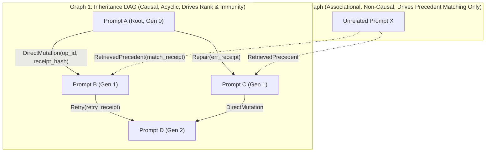

# Prompt Civ Level 01: Lineage DAG & Causal Descent: Two-Graph Separation

**AuthorityEffect:** None.  
**Level:** Level 01 (Causal Lineage & Reference Topologies)  
**Rust Genealogy Seam:** [`core_prompt_civilization::genealogy`](../../../engine/crates_rs/core_prompt_civilization/src/genealogy.rs)  
**Primary Graphs:** `InheritanceDAG` (Causal), `ReferenceGraph` (Associational)  
**Core Falsifiers:** `F-LINEAGE-01`, `F-RANK-01`

---

## 1. Schematic & Conceptual Architecture



In multi-agent and prompt-search architectures, systems frequently conflate **causal descent** (how an artifact was generated) with **retrieval association** (which existing artifacts were cited or retrieved as context). Conflating these two graphs leads to self-reinforcing popularity loops, sybil attacks, and corrupt ancestry trees.

Level 01 establishes the **Two-Graph Separation Law**:

1. **Inheritance DAG:** A strictly acyclic directed graph whose edges represent verified causal operations:
   - `DirectMutation`: Produced via a canalized mutation operator against parent prompt bytes.
   - `Repair`: Produced via an automated or supervised repair operator responding to a typed obstruction receipt.
   - `Retry`: Produced as an authorized continuation of an uncompleted or inconclusive bout.
2. **Reference Graph:** A directed multigraph whose edges represent `RetrievedPrecedent` citations chosen during execution matching.

---

## 2. Invariants & Mathematical Packaging

1. **Causal Evidence Binding:**
   An inheritance edge $(u, v)$ is admitted **only** when accompanied by a host-sealed witness receipt demonstrating physical generation of $v$ from $u$:
   $$e = (u, v, \text{rel}, \text{receipt\_sha256}) \quad \text{where } \text{rel} \in \{\text{DirectMutation}, \text{Repair}, \text{Retry}\}$$
   Matching prompt objectives, topic similarity, or shared domain annotations **never** create an inheritance edge (`F-LINEAGE-01`).
2. **Acyclicity Invariant:**
   The inheritance graph must remain strictly acyclic ($\forall v, v \notin \operatorname{Ancestors}(v)$). Any proposed edge closing a directed cycle is rejected with `INHERITANCE_CYCLE_DETECTED`. Multiple parents are permitted (representing explicit crossover or joint repairs).
3. **Firewall on Reference Edges:**
   Reference edges represent historical usage only. They are strictly excluded from:
   - Generation calculation ($\text{generation}(v)$ is derived solely from inheritance parents).
   - Lamarckian immunity propagation (antibodies propagate across inheritance edges, never reference edges).
   - Inverse PageRank transition matrices (precedent citations do not count as offspring in $P^{\leftarrow}$).

---

## 3. Rust Engine Seam

```rust
// core_prompt_civilization::genealogy
pub enum InheritanceRelationship {
    DirectMutation { operator_id: OperatorId },
    Repair { defect_hash: [u8; 32] },
    Retry { bout_id: BoutId },
}

pub struct InheritanceEdgeV1 {
    pub parent_id: PromptId,
    pub child_id: PromptId,
    pub relationship: InheritanceRelationship,
    pub witness_receipt_digest: [u8; 32],
}

pub struct ReferenceEdgeV1 {
    pub consumer_prompt_id: PromptId,
    pub precedent_prompt_id: PromptId,
    pub match_receipt_digest: [u8; 32],
    pub ledger_epoch: u64,
}
```

---

## 4. Verification Obligations & Falsifiers

- **`F-LINEAGE-01` (Causal Edge Integrity):** Generating a prompt with the same task instructions as an existing prompt, but without a causal mutation/repair receipt linking them, must not introduce an edge into `InheritanceDAG`.
- **`F-RANK-01` (Reference Invariance of Ancestral Rank):** Adding 1,000 `RetrievedPrecedent` edges to an existing prompt node must leave its ancestral rank ($r_{\text{inv}}$) computed on `InheritanceDAG` completely invariant.

---

## 5. Claim Hygiene Quadrant

1. **What this supports:**
   - Formal separation between causal ancestry and associational retrieval within prompt evolution ledgers.
   - Prevention of popularity feedback loops corrupting genealogical descent.
2. **What this does not support:**
   - Does not demonstrate that mutated child prompts outperform parent prompts on benchmark tasks.
3. **The narrowest defensible claim:**
   - Partitioning lineage into an acyclic causal DAG and an associational citation graph ensures that precedent retrieval cannot inflate structural genealogical rank.
4. **The next test needed:**
   - Property-based cycle detection test asserting that parallel multi-parent insertions fail gracefully on cycle formation.
