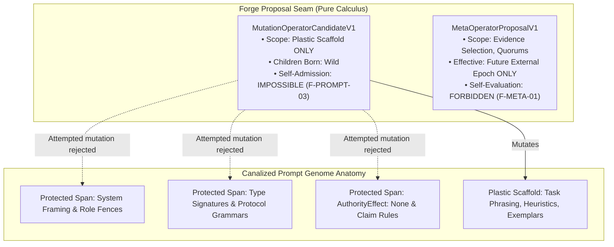

# Prompt Civ Level 02: Mutation Operators & Canalized Forge: Core vs Scaffold

**AuthorityEffect:** None.  
**Level:** Level 02 (Operator Scope & Canalized Plasticity)  
**Rust Forge Seam:** [`omega_prompt_civilization::forge`](../../../omega_engine/crates_rs/omega_prompt_civilization/src/forge.rs)  
**Primary Types:** `MutationOperatorCandidateV1`, `MetaOperatorProposalV1`, `ForgeActionV1`  
**Core Falsifiers:** `F-BIO-03`, `F-PROMPT-03`, `F-META-01`

---

## 1. Schematic & Conceptual Architecture



In uncontrolled prompt evolution setups, stochastic language models are prompted to "improve themselves" by rewriting their entire system prompt. This inevitably results in the erosion of security fences, hallucination of elevated permissions, deletion of negative constraints, and sycophantic self-certification.

Level 02 establishes the **Canalized Forge Architecture** (drawing from C.H. Waddington's biological principle of *canalization*—developmental buffering that protects critical structures while permitting plasticity in non-vital margins):

1. **Canalized Invariant Core:** Critical system parameters (protocol envelopes, role boundaries, claim hygiene gates, and typed refusal contracts) reside within immutable `protected_spans`.
2. **Plastic Scaffold:** Only the heuristic body, explanatory prose, and contextual examples outside `protected_spans` are mutable.
3. **No Self-Admission Law:** Mutation operators are pure proposal generators. A mutation operator can never evaluate, review, activate, or admit the prompts it generates.

---

## 2. Invariants & Mathematical Packaging

1. **Protected Span Fence (`F-BIO-03`):**
   Given a prompt byte sequence $B$ and derived protected spans $S = \{[a_i, b_i)\}_{i=1}^k$:
   $$\forall \Delta = (\text{offset}, \text{len}, \text{replacement}), \quad \left([\text{offset}, \text{offset} + \text{len}) \cap \bigcup_{i=1}^k [a_i, b_i) \neq \emptyset\right) \implies \text{Refuse}(\text{PROTECTED\_SPAN\_MUTATION\_REFUSED})$$
2. **Birth Custody Invariant:**
   All candidate child prompts synthesized by a `MutationOperatorCandidateV1` are instantiated with custody status:
   $$\text{birth\_custody} = \text{CustodyTier::Wild}$$
   No mutation operator carries a schema field or permission to set custody to `Candidate`, `Reviewed`, or `Admitted`.
3. **Meta-Operator Epoch Boundary (`F-META-01`):**
   Proposals that modify operational parameters (such as evidence aggregation rules, checker selection, or quorum policies) are encapsulated in [`MetaOperatorProposalV1`](../../../omega_engine/crates_rs/omega_prompt_civilization/src/forge.rs).
   - A meta-operator proposal **never** takes effect within its current evaluation epoch.
   - It cannot alter the checker, judge, or test bank evaluating its own lineage.
   - It takes effect only when ratified by an external decision in a subsequent epoch.

---

## 3. Rust Engine Seam

```rust
// omega_prompt_civilization::forge
pub struct MutationOperatorCandidateV1 {
    pub operator_id: OperatorId,
    pub target_domain: DomainId,
    pub edit_script: Vec<ByteSpanEditV1>,
    pub authority_effect: AuthorityEffect, // None
}

pub struct MetaOperatorProposalV1 {
    pub proposal_id: ProposalId,
    pub target_epoch: u64,
    pub proposed_policy_digest: [u8; 32],
    pub authority_effect: AuthorityEffect, // None
}

pub enum ForgeActionV1 {
    Continue,
    ProposeMutation(MutationOperatorCandidateV1),
    ChangeRetrieval { prompt_id: PromptId, new_status: RetrievalEligibility },
    ProposeReview { prompt_id: PromptId },
}
```

---

## 4. Verification Obligations & Falsifiers

- **`F-BIO-03` (Protected Span Integrity):** Any edit script attempting to insert, delete, or replace even a single byte within an envelope's declared `protected_spans` must fail with `PROTECTED_SPAN_MUTATION_REFUSED`.
- **`F-PROMPT-03` (Self-Admission Refusal):** Attempting to execute an admission or status promotion method directly from a `MutationOperatorCandidateV1` must be rejected at compile time (by absence of method/field) and at runtime with `SELF_ADMISSION_REFUSED`.
- **`F-META-01` (Checker Self-Modification Prevention):** A `MetaOperatorProposalV1` altering checker weights must not alter the fitness evaluation or gate disposition of the active bout that produced it.

---

## 5. Claim Hygiene Quadrant

1. **What this supports:**
   - Strict architectural compartmentalization protecting essential system invariants from evolutionary drift.
   - Elimination of self-referential authorization exploits in prompt mutation pipelines.
2. **What this does not support:**
   - Does not establish that canalized prompts generate superior natural language responses compared to unconstrained rewrites.
3. **The narrowest defensible claim:**
   - Byte-level span verification guarantees that declared system boundaries, types, and authority declarations remain invariant under all automated mutation operations.
4. **The next test needed:**
   - Adversarial fuzzing test verifying that malformed byte-offset edits cannot overflow or clip into protected boundary buffers.
