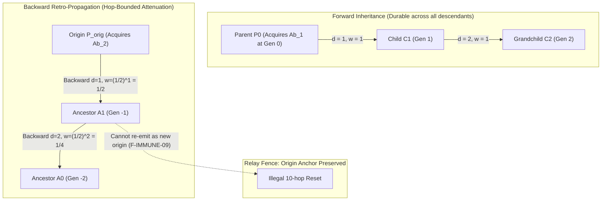

# Prompt Civ Level 03: Lamarckian Retro-Inheritance & Hop-Bounded Immunity

**AuthorityEffect:** None.  
**Level:** Level 03 (Phenotypic Trace Inheritance & Backward Attenuation)  
**Rust Immunity Seam:** [`core_prompt_civilization::immunity`](../../../engine/crates_rs/core_prompt_civilization/src/immunity.rs)  
**Primary Types:** `ImmunityAcquisitionV1`, `ImmunityPropagationV1`, `AntibodyRefV1`  
**Core Falsifiers:** `F-IMMUNE-09`, `F-IMMUNE-10`, `F-IMMUNE-11`, `F-SCOPE-01`

---

## 1. Schematic & Conceptual Architecture



Classical Darwinian genetic algorithms mutate prompt text blindly, discarding the rich diagnostic receipts generated when execution fails. Lamarckian evolution, in contrast, incorporates acquired phenotypic adaptations directly into the organism's hereditary lineage. In Prompt Civilization, when a prompt execution triggers a formal failure receipt or cochain obstruction, the Epistemic Immune System (OEEIS) generates an **antibody reference** ([`AntibodyRefV1`](../../../engine/crates_rs/core_prompt_civilization/src/immunity.rs)).

Level 03 defines how acquired immunity propagates across the inheritance topology:
1. **Durable Forward Inheritance:** All future descendants inherit the acquired antibody reference without expiration.
2. **Hop-Bounded Backward Retro-Propagation:** The antibody also retro-propagates *backward* to ancestral prompts in the lineage DAG, allowing older lineages to benefit from bugs discovered by their descendants.
3. **Strict 10-Hop Horizon:** Backward propagation attenuates exponentially with weight $(1/2)^d$ and halts completely at hop distance $d = 10$.

---

## 2. Invariants & Mathematical Packaging

1. **Shortest DAG Hop Distance (`F-IMMUNE-10`):**
   In multi-parent DAGs, distance $d$ is strictly defined as the length of the **shortest path in directed inheritance edges** from the acquisition origin node to the target node:
   $$d = \operatorname{dist}_{\text{DAG}}(u_{\text{origin}}, v_{\text{target}})$$
   Distance is never computed by simple scalar generation subtraction ($g_{\text{target}} - g_{\text{origin}}$), which would overestimate distance in converging branches.
2. **Weight Attenuation:**
   For backward retro-propagation along an ancestor path of distance $d$:
   $$w(d) = \left(\frac{1}{2}\right)^d \quad \text{for } 1 \le d \le 10$$
   For $d > 10$, propagation ceases ($w = 0$). Where multiple paths converge on an ancestor, the **maximum weight** path governs.
3. **No Horizon-Reset Relay (`F-IMMUNE-09`):**
   Inheriting an antibody does **not** count as acquiring it anew. The immutable fields:
   - `acquisition_id`
   - `origin_prompt_id`
   - `acquired_generation`
   are preserved across all propagation records. A node that receives an antibody via backward propagation cannot re-emit that antibody with itself as a new origin to bypass the 10-hop ceiling.
4. **Scope Preservation (`F-SCOPE-01`):**
   Propagated immunity arms detectors only within the target prompt's declared operational scope:
   $$\text{diagnostic\_eligible}(ref, target) \implies \text{target} \in \text{diagnostic\_scope}(ref)$$
   Propagation across a domain, carrier, or grammar boundary without an explicit transport and loss record is refused with `REFUSE_SCOPE_ESCALATION`.
5. **Armed Repertoire Derivation & Cache Invalidation (`F-IMMUNE-11`):**
   A prompt's armed repertoire is a derived view computed from the current ledger revision. If an antibody is suspended or revoked by an external decision, all armed repertoire caches are invalidated immediately without graph traversal.

---

## 3. Rust Engine Seam

```rust
// core_prompt_civilization::immunity
pub enum PropagationDirection {
    Forward,
    Backward,
}

pub struct ImmunityAcquisitionV1 {
    pub acquisition_id: AcquisitionId,
    pub origin_prompt_id: PromptId,
    pub acquired_generation: u64,
    pub antibody_id: AntibodyId,
    pub qualifying_witness_receipts: Vec<[u8; 32]>,
}

pub struct ImmunityPropagationV1 {
    pub propagation_id: PropagationId,
    pub acquisition_id: AcquisitionId,
    pub origin_prompt_id: PromptId,
    pub source_prompt_id: PromptId,
    pub target_prompt_id: PromptId,
    pub hop_distance: u32,
    pub direction: PropagationDirection,
    pub weight: num_rational::BigRational,
    pub policy_digest: [u8; 32],
}
```

---

## 4. Verification Obligations & Falsifiers

- **`F-IMMUNE-09` (No Relay Reset):** An ancestor node at hop $d=9$ that receives a propagated antibody must not be permitted to initiate a secondary backward propagation chain claiming $d=1$ to reach ancestors at hops $11 \dots 19$.
- **`F-IMMUNE-10` (Shortest Hop Parity):** In a diamond graph where Parent A has paths of length 2 and 4 to the origin, the propagation engine must assign $d=2$ and weight $1/4$, rejecting $d=4$ and weight $1/16$.
- **`F-IMMUNE-11` (Global Repertoire Disarming):** Updating an antibody's status to `Suspended` in the custody ledger must instantly remove that antibody from the `armed_repertoire` of all 10 backward-propagated ancestors and all forward descendants on subsequent ledger view evaluations.
- **`F-SCOPE-01` (Scope Escalation Refusal):** Propagating an antibody to a prompt residing in an un-admitted domain must fail with `REFUSE_SCOPE_ESCALATION`.

---

## 5. Claim Hygiene Quadrant

1. **What this supports:**
   - Rigorous mathematical attenuation and horizon-bounding of inherited diagnostic constraints across directed acyclic lineage graphs.
   - Elimination of infinite reverberation and cascading immune over-reaction across ancestral trees.
2. **What this does not support:**
   - Does not establish that the $(1/2)^d$ weight or 10-hop ceiling represents a biologically optimal or universal decay constant (these are declared repository engineering policies).
3. **The narrowest defensible claim:**
   - Shortest-path DAG traversal with anchored origin metadata guarantees that backward propagation strictly terminates within at most 10 edge hops from the original failure locus.
4. **The next test needed:**
   - Preregistered empirical ablation comparing task pass rates with and without backward retro-propagation on complex multi-turn reasoning traces.
