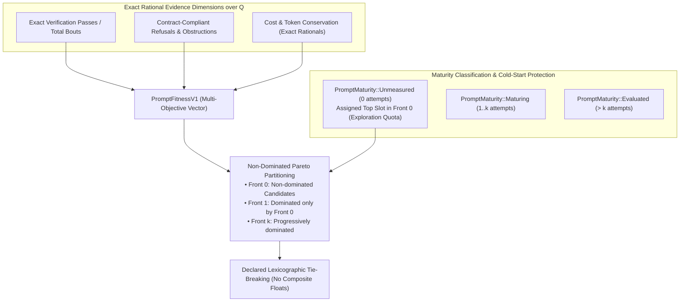

# Prompt Civ Level 04: Pareto Selection & Fitness: Multi-Objective Exact Evaluation

**AuthorityEffect:** None.  
**Level:** Level 04 (Multi-Objective Rational Frontiers & Honest Accounting)  
**Rust Fitness Seam:** [`core_prompt_civilization::fitness`](../../../engine/crates_rs/core_prompt_civilization/src/fitness.rs)  
**Primary Types:** `PromptFitnessV1`, `PromptMaturity`, `ParetoFrontier`  
**Core Falsifiers:** `F-SELECT-01`, `F-SELECT-02`, `F-SELECT-03`, `F-RES-06`

---

## 1. Schematic & Conceptual Architecture



Standard automated prompt engineering reduces prompt evaluation to a single floating-point scalar (e.g. an LLM-as-a-judge score or average accuracy). This introduces multiple critical failure modes:
1. **Scalar Collapse:** High task pass rates mask catastrophic security violations or massive token inefficiency.
2. **Honest Refusal Penalization:** A prompt that correctly identifies an unprovable proposition or malformed input and emits a contract-compliant refusal is penalized as a "failure to generate an answer."
3. **Maturity Starvation:** Newly generated candidate prompts with 0 trials are immediately dominated and discarded by entrenched prompts with hundreds of historical evaluations.

Level 04 establishes the **Exact Multi-Objective Pareto Fitness Architecture**:
- All fitness dimensions are exact rationals $\mathbb{Q}$ derived from cryptographic receipts.
- Candidates are partitioned into non-dominated Pareto fronts; composite scalar formulas are strictly forbidden.
- Honest refusals are accounted as compliance rather than failure.
- Cold-start exploration quotas protect newly generated lineages from premature starvation.

---

## 2. Invariants & Mathematical Packaging

1. **Exact Rational Field $\mathbb{Q}$:**
   All fitness dimensions are represented as pairs of arbitrary-precision integers $(n, d) \in \mathbb{Z} \times \mathbb{Z}^+$:
   $$\text{dimension} = \frac{n}{d} \in \mathbb{Q}$$
   Floating-point calculations (`f32`, `f64`) are barred from fitness evaluation. A zero denominator is undefined, never coerced to an artificial zero.
2. **Obligation Binding Invariant (`F-SELECT-03`):**
   An exact verifier receipt contributes to a prompt's fitness score if and only if the receipt's `obligation_id` matches the prompt's declared task obligation:
   $$\operatorname{match}(\text{receipt.obligation\_id}, \text{task.obligation\_id}) = \text{true}$$
   A verified receipt proving a theorem in topology cannot increase a prompt's arithmetic verification fitness.
3. **Honest Refusals and Obstruction Accounting (`F-RES-06`):**
   A prompt response that terminates in a certified refusal (`Refused`, `LiftLicenseNeeded`) or identifies an exact cochain obstruction ($\Phi_1 > 0$, $\Gamma_2 > 0$) is accounted as a **valid refusal** under contract compliance, **not** as a prompt failure.
   - Conversely, syntactic validity alone earns no correctness credit: an empty packet or trivial unconstrained output is scored explicitly as zero progress.
4. **Pareto Front Partitioning (`F-SELECT-01`):**
   Candidate vector $\mathbf{u}$ dominates $\mathbf{v}$ ($\mathbf{u} \succ \mathbf{v}$) if and only if $\forall i, u_i \ge v_i$ and $\exists j, u_j > v_j$.
   - Population is partitioned into disjoint fronts $\mathcal{F}_0, \mathcal{F}_1, \dots, \mathcal{F}_m$.
   - Within each front, candidates are ordered by a declared, versioned lexicographic tiebreak policy.
5. **Exploration Quota for Unmeasured Prompts (`F-SELECT-02`):**
   Prompts with zero recorded executions are classified as `PromptMaturity::Unmeasured`.
   - The population policy reserves a fixed exploration fraction (1/4) of slots in $\mathcal{F}_0$ specifically for unmeasured prompts, ensuring new mutations receive evaluation trials.

---

## 3. Rust Engine Seam

```rust
// core_prompt_civilization::fitness
pub struct PromptFitnessV1 {
    pub verification_pass_rate: Option<num_rational::BigRational>,
    pub contract_compliance_rate: num_rational::BigRational,
    pub cost_efficiency: num_rational::BigRational,
    pub precedent_reuse_count: u64,
    pub active_descendant_count: u64,
    pub authority_effect: AuthorityEffect, // None
}

pub enum PromptMaturity {
    Unmeasured,
    Maturing { attempts: u32 },
    Evaluated { attempts: u32 },
}

pub struct ParetoEvaluationReportV1 {
    pub prompt_id: PromptId,
    pub front_index: usize,
    pub maturity: PromptMaturity,
    pub non_dominated: bool,
}
```

---

## 4. Verification Obligations & Falsifiers

- **`F-SELECT-01` (Pareto Dominance Purity):** In any candidate set where prompt A strictly dominates prompt B across all declared dimensions, B must never be placed in a higher-priority front than A, regardless of tiebreak preferences.
- **`F-SELECT-02` (Unmeasured Prompt Retention):** In a population of 100 evaluated high-performing prompts and 10 newly minted `Unmeasured` prompts, the selection engine must allocate the declared exploration quota (at least 2 slots) to unmeasured candidates.
- **`F-SELECT-03` (Obligation Isolation):** Ingesting 50 passing receipts with `obligation_id = "group_axioms"` must leave the `verification_pass_rate` for a task declaring `obligation_id = "regge_curvature"` strictly unchanged.
- **`F-RES-06` (Empty Packet Score Firewall):** An agent emitting an empty packet `<>` that passes syntax validation must not be awarded task success credit.

---

## 5. Claim Hygiene Quadrant

1. **What this supports:**
   - Multi-objective optimization without arbitrary scalar weighting or metric collapse.
   - Objective separation between task failure and contract-compliant refusal.
2. **What this does not support:**
   - Does not guarantee that Pareto-optimal prompts generalize to unseen distributions or different LLM model providers.
3. **The narrowest defensible claim:**
   - Exact rational Pareto partitioning ensures that prompt candidates are selected on the basis of non-dominated multi-objective trade-offs rather than uncalibrated scalar aggregations.
4. **The next test needed:**
   - Benchmark audit testing whether 3-axis Pareto fronts maintain higher population diversity than scalar weighted-sum ranking over 50 consecutive generations.
