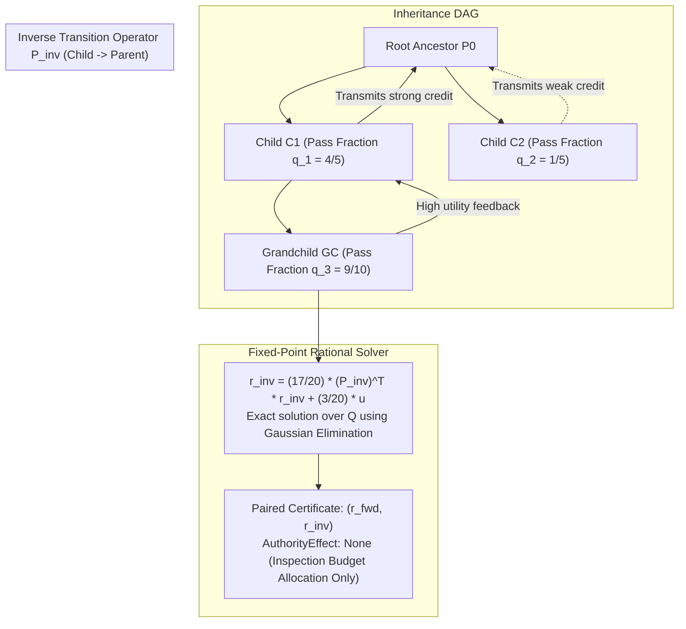

# Prompt Civ Level 05: Inverse Lineage PageRank: Certified Ancestral Utility

**AuthorityEffect:** None.  
**Level:** Level 05 (Markov Lineage Diffusion & Fixed-Point Certification)  
**Rust Rank Seam:** [`omega_prompt_civilization::rank`](../../../omega_engine/crates_rs/omega_prompt_civilization/src/rank.rs)  
**Primary Contract:** `omega.spectral.pagerank.v2`  
**Core Falsifiers:** `F-RANK-01`, `F-RANK-02`, `F-RANK-03`, `F-RES-03`, `F-RES-04`

---

## 1. Schematic & Conceptual Architecture



Traditional PageRank flows influence forward from cited documents to citing documents, or from web pages to hyperlinks. In prompt evolutionary biology, a critical question is **ancestral utility**: *Which foundational prompt templates and framing patterns repeatedly spawn high-performing, verified descendants across generations?*

Level 05 establishes **Inverse Lineage PageRank ($r_{\text{inv}}$)**:
- Lineage diffusion flows backward from children to parents along the **Inheritance DAG**.
- The transition probability is modulated by the child's exact verified pass fraction $q_c \in \mathbb{Q}$.
- The rank is certified as an exact rational fixed-point solution under the contract `omega.spectral.pagerank.v2`.
- $r_{\text{inv}}$ represents "useful genealogical precedent," allocating human inspection budget without minting operational authority.

---

## 2. Invariants & Mathematical Packaging

1. **Transport Parameter Construction ($P^{\leftarrow}$):**
   For child $c$ with eligible inheritance parents $\operatorname{Parents}(c) = \{p_1, \dots, p_k\}$:
   $$P^{\leftarrow}(c, \cdot) = q_c A(c, \cdot) + (1 - q_c) u$$
   where:
   - $A(c, p) = \frac{1}{k}$ represents the uniform distribution over the child's $k$ eligible parents.
   - $u_i = \frac{1}{N}$ represents the uniform community teleportation distribution over $N$ nodes.
   - $q_c \in [0, 1] \cap \mathbb{Q}$ is the child's exact verified pass fraction:
     $$q_c = \frac{\text{passes}}{\text{passes} + \text{failures}} \in \mathbb{Q}$$
     (defaults to $1/2$ if the child is unmeasured).
   - If a node has no parents (root), it transitions purely via $u$.
2. **Exact Fixed-Point Solver:**
   The stationary distribution $r_{\text{inv}}$ satisfies:
   $$r_{\text{inv}} = \frac{17}{20} (P^{\leftarrow})^T r_{\text{inv}} + \frac{3}{20} u \quad \text{subject to } \sum_{i=1}^N r_{\text{inv}}(i) = 1, \quad r_{\text{inv}}(i) \ge 0, \quad r_{\text{inv}}(i) \in \mathbb{Q}$$
   Solved exactly using exact-rational Gaussian elimination without floating-point approximations.
3. **Anti-Sybil Deduplication (`F-RES-04`):**
   Markov-chain rankings are vulnerable to sybil attacks where an adversary creates hundreds of trivial, identical offspring to inflate parent rank.
   - Only host-sealed descendants with distinct `(state_digest, action_digest)` tuples are counted.
   - Identical offspring are collapsed prior to transition matrix construction.
4. **Authority Separation (`F-RES-03`):**
   $r_{\text{inv}}$ is an inspection and retrieval prior. It **never** feeds:
   - Gate verdicts (admitted vs refused).
   - Custody promotions (`Candidate` $\to$ `Admitted`).
   - Pareto objective dominance vectors.

---

## 3. Rust Engine Seam

```rust
// omega_prompt_civilization::rank
pub struct AncestralRankCertificateV1 {
    pub community_id: CommunityId,
    pub node_order: Vec<PromptId>,
    pub r_fwd: Vec<num_rational::BigRational>,
    pub r_inv: Vec<num_rational::BigRational>,
    pub damping_factor: num_rational::BigRational, // 17/20
    pub teleport_factor: num_rational::BigRational, // 3/20
    pub authority_effect: AuthorityEffect, // None
}

pub fn solve_ancestral_pagerank(
    dag: &InheritanceDAG,
    pass_fractions: &HashMap<PromptId, num_rational::BigRational>,
    budget: SolverBudget,
) -> Result<AncestralRankCertificateV1, RankError>;
```

---

## 4. Verification Obligations & Falsifiers

- **`F-RANK-01` (Pass Fraction Sensitivity):** In a test setup with two parents $P_1$ and $P_2$, where $P_1$ has a child with pass fraction $q = 9/10$ and $P_2$ has a child with pass fraction $q = 1/10$, the solved rank must strictly satisfy $r_{\text{inv}}(P_1) > r_{\text{inv}}(P_2)$.
- **`F-RANK-02` (Matrix Reconstruction Verification):** A verifier must reconstruct $P^{\leftarrow}$ directly from the underlying DAG and evidence receipts. An injected rank certificate matching a forged transition matrix must be rejected.
- **`F-RANK-03` (Budget Halting):** When attempting to solve a graph exceeding $N > 1,000$ or $E > 5,000$ without an authorized solver budget extension, the engine must return a typed `BUDGET_EXHAUSTED` error rather than timing out or emitting an approximate float.
- **`F-RES-03` (Rank Invariance of Custody):** Inverting the rank order of two candidate prompts while holding their verification receipts and authority policies fixed must leave their custody verdicts completely unchanged.

---

## 5. Claim Hygiene Quadrant

1. **What this supports:**
   - Exact rational computation of backward ancestral utility across directed prompt lineages.
   - Rigorous protection against floating-point drift and sybil graph inflation.
2. **What this does not support:**
   - Does not establish that high-$r_{\text{inv}}$ prompts are universally superior across unobserved problem domains.
3. **The narrowest defensible claim:**
   - The exact stationary vector $r_{\text{inv}}$ certifies the normalized stationary probability of a random walker moving backward along verified inheritance edges with probability proportional to child pass rates.
4. **The next test needed:**
   - Preregistered empirical comparison evaluating whether retrieval guided by $r_{\text{inv}}$ yields higher cold-start solve rates than uniform or depth-first retrieval.
