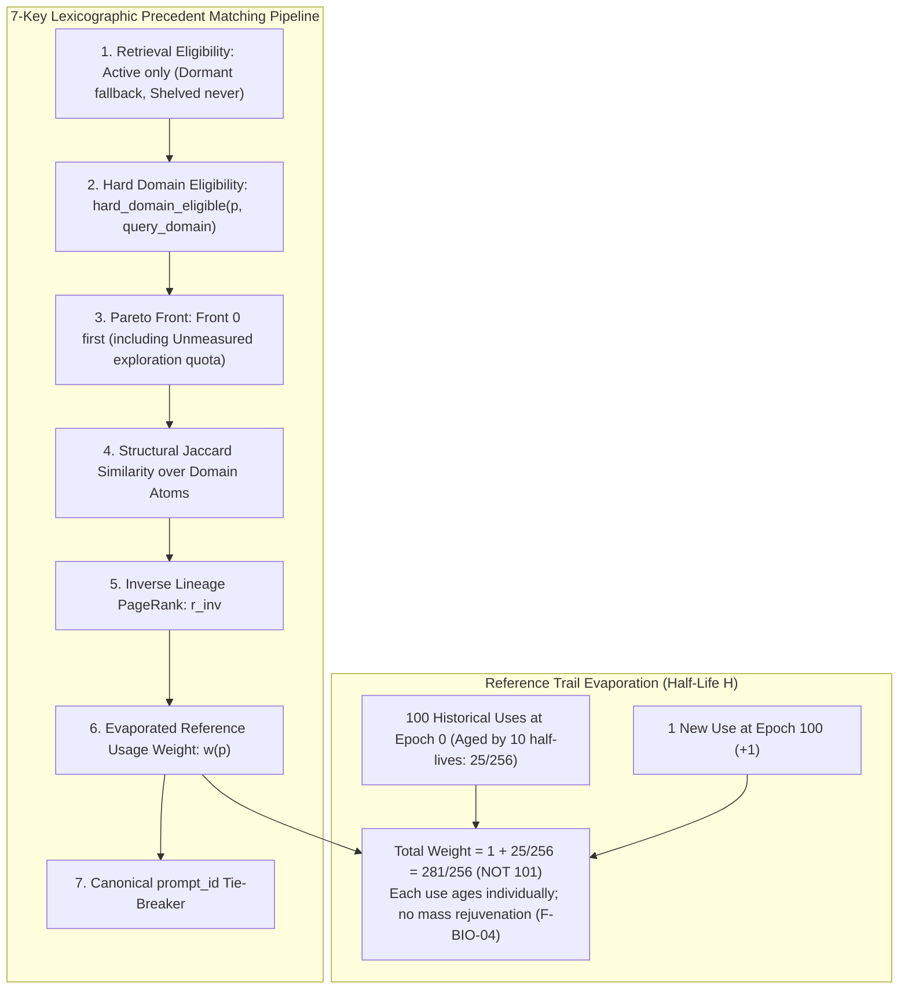

# Prompt Civ Level 06: Precedent Retrieval & Evaporation: Lexicographic Matching

**AuthorityEffect:** None.  
**Level:** Level 06 (Precedent Retrieval, Lexicographic Sorting & Usage Decay)  
**Rust Matching Seam:** [`omega_prompt_civilization::matching`](../../../omega_engine/crates_rs/omega_prompt_civilization/src/matching.rs)  
**Primary Types:** `PrecedentMatchReceiptV1`, `ReferencePolicyV1`  
**Core Falsifiers:** `F-BIO-04`, `F-DOMAIN-01`

---

## 1. Schematic & Conceptual Architecture



When an autonomous agent or execution bout begins a task, it queries the prompt civilization for relevant **precedents** (previously evaluated prompt templates and problem formulations). If retrieval is governed solely by raw citation counts or vector embedding similarity, two distinct pathologies emerge:
1. **First-Mover Lock-In:** Early prompts accumulate citations simply because they existed first, permanently dominating retrieval even when newer mutations are structurally superior.
2. **Domain Contamination:** Prompts with high general popularity are retrieved for specialized formal contexts where their axiomatic assumptions are invalid.

Level 06 establishes the **7-Key Lexicographic Matching Engine with Epoch-Based Pheromone Evaporation**:
- Precedents are filtered through strict domain eligibility before ranking.
- Sorting follows a deterministic, 7-key lexicographic hierarchy.
- Precedent usage citations decay over an epoch half-life $H$, where every historical citation ages independently, preventing incumbent rejuvenation.

---

## 2. Invariants & Mathematical Packaging

1. **Hard Domain Eligibility (`F-DOMAIN-01`):**
   A prompt is eligible for retrieval under `query_domain` if and only if:
   $$\operatorname{hard\_domain\_eligible}(p, \text{query\_domain}) \iff \exists \operatorname{DomainPlacementV1}(p) \text{ s.t. } \text{disposition} = \text{ADMITTED\_LOCAL} \land \text{read\_scope} \supseteq \text{query\_domain}$$
   Taxonomy recognition alone (`taxonomy_membership = KNOWN`) or a proposed annotation **never** satisfies domain eligibility.
2. **The 7-Key Lexicographic Order:**
   Candidate precedents are sorted by:
   1. `retrieval_eligibility`: `Active` first; `Dormant` only on fallback; `Shelved` never retrieved.
   2. `hard_domain_eligible`: Must be true; otherwise excluded.
   3. `pareto_front`: $\mathcal{F}_0$ first, then $\mathcal{F}_1$, incorporating the exploration quota.
   4. `structural_jaccard_similarity`: Jaccard index over admitted domain atoms.
   5. `r_inv`: Certified inverse lineage PageRank.
   6. `evaporated_usage_weight`: Decayed reference usage weight $w(p)$.
   7. `prompt_id`: Canonical byte-order tie-breaker ensuring deterministic repeatability.
3. **Reference Evaporation with Independent Aging (`F-BIO-04`):**
   Inspired by ant colony pheromone evaporation (Dorigo & Stützle 2004), citation priority decays over a declared half-life $H$ (measured in ledger epochs, not wall-clock time).
   - **Independent Aging Law:** Each historical usage citation $u$ ages based on its own elapsed epochs:
     $$w(p) = \sum_{u \in \operatorname{uses}(p)} \left(\frac{1}{2}\right)^{\lfloor (\text{epoch}_{\text{now}} - \text{epoch}_u)/H \rfloor} \in \mathbb{Q}$$
   - A newly added usage at $\text{epoch}_{\text{now}}$ contributes $+1$ to $w(p)$. It **never** resets the decay clock or rejuvenates older historical usages.
   - Evaporation is purely a retrieval tiebreak; it never alters custody, fitness records, or lineage edges.

---

## 3. Rust Engine Seam

```rust
// omega_prompt_civilization::matching
pub struct ReferencePolicyV1 {
    pub epoch_half_life: u64, // e.g. H = 10 epochs
    pub policy_digest: [u8; 32],
}

pub struct PrecedentMatchReceiptV1 {
    pub query_domain: DomainId,
    pub selected_precedents: Vec<PromptId>,
    pub match_scores: Vec<MatchScoreV1>,
    pub ledger_revision: u64,
    pub authority_effect: AuthorityEffect, // None
}

pub fn match_precedents(
    population: &[PromptViewV1],
    query: &MatchQueryV1,
    policy: &ReferencePolicyV1,
    current_epoch: u64,
) -> PrecedentMatchReceiptV1;
```

---

## 4. Verification Obligations & Falsifiers

- **`F-BIO-04` (No Incumbent Rejuvenation):** Given a prompt with 100 historical uses at epoch 0, evaluated at epoch 100 with $H=10$:
  - Its base weight is $100 / 2^{10} = 25/256$.
  - Adding 1 new use at epoch 100 must yield exactly $1 + 25/256 = 281/256$.
  - Any implementation yielding 101 (by updating a global `last_used` timestamp for all counts) violates this invariant.
- **`F-DOMAIN-01` (Hard Domain Gate):** A prompt whose domain annotation is merely `PROPOSED` or `SUPPORTED` without an `ADMITTED_LOCAL` placement record must be excluded from retrieval results, even if its Jaccard similarity is 1.0.

---

## 5. Claim Hygiene Quadrant

1. **What this supports:**
   - Deterministic, multi-tier precedent matching that prevents early prompt entrenchment through exact rational decay.
   - Strict domain isolation preventing cross-domain semantic contamination.
2. **What this does not support:**
   - Does not establish that pheromone evaporation guarantees optimal meta-learning convergence across all problem domains.
3. **The narrowest defensible claim:**
   - Epoch-based rational evaporation guarantees that prompt precedents with unrenewed historical citations monotonically attenuate in retrieval priority relative to actively used peers.
4. **The next test needed:**
   - Simulation testing whether reference evaporation successfully breaks monopoly lock-in when a superior mutation appears at generation 50.
