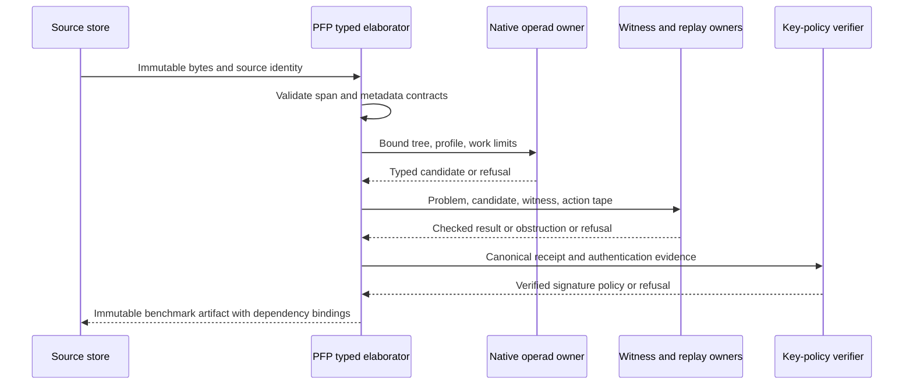

# OEPFP v1.1RC: architectural specification and engine migration monograph

**Proposal Fidelity Protocol · Integrity mode: benchmark · AuthorityEffect: None**

**Evidence baseline:** `58a6a1ef92e155b1fa3783081becb41de3e07734`, synchronized from remote `main` on 2026-10-16 UTC. **Release status:** proposed architecture with a source audit and checkable metadata contracts; not an implemented replacement engine or a certification of the complete estate.

## 1. Purpose, deliverables, and evidence discipline

OEPFP should turn a source-bound proposal into a typed, bounded verification attempt whose result can be independently replayed. An operation name, a successful model completion, a receipt-shaped object, and a verified mathematical witness are four different things. This specification keeps their identities and evidence separate.

The attached request names thirteen curriculum tracks, seventy-five coda pilot IDs, 158 Adversary test modules, and nineteen antibodies. The synchronized repository differs from those assumptions. All thirteen tracks exist, including the omitted `005_oegenong`. Only thirty-two of the requested numbered coda pilot IDs have materialized directories; forty-three are absent. A separately registered C054 layouts experiment retains identity 003. Adversary contains 308 recursive `test_*.py` files: 291 candidate modules, sixteen retained snapshots, and one retired module. Static discovery is not pytest collection or test execution.

The requested review is delivered as this monograph, exhaustive source inventories, a seventy-five-ID census, a test-module/assertion crosswalk, an antibody crosswalk, reference Pydantic contracts, a reference grammar and fixtures, and an artifact-custody checker. The detailed evidence directory accompanies this document. Its compressed JSON retains the full specialist extractions; its Markdown files provide readable source citations. The source manifest binds the actual inspected bytes.

Evidence labels used throughout are:

| Label | Meaning | What it does not establish |
|---|---|---|
| `SOURCE_INSPECTED` | The named source and line were read or parsed in this audit. | Execution, correctness, or reachability from a public entry point. |
| `RECORDED` | A stored completion, receipt, report, or historical run exists. | Fresh replay, authentic provenance beyond its checked bindings, or agreement with current code. |
| `EXECUTED_LOCAL` | A command in the accompanying execution receipt ran against the stated payload. | Coverage outside that command's scope. |
| `DECLARED` | A document, schema, manifest, or model states a contract. | An executable enforcement mechanism. |
| `PROPOSED` | A v1.1RC or v1.2 design and its proof obligations. | Current runtime support. |
| `MISSING` / `OPEN` / `REFUTED` | An artifact is absent, an obligation remains open, or a specified claim has a counterexample. | Permission to replace negative evidence with a success label. |

No provider calls, new empirical model experiments, or whole-estate test sweeps are part of this review. Historical token counts and completion results remain historical. The focused checks for the new reference contracts and audit artifacts are recorded separately from the source-only estate census.

### 1.1 Acceptance interpretation

Some requested statements require correction. DPO pushout squares alone do not imply confluence. Rational matrix entries do not make logarithmic entropy rational. Off-diagonal entries do not by themselves establish entanglement. A signed receipt is not a categorical terminal object. Strict rational descent does not imply finite arrival. These are mathematical distinctions, not implementation choices that can be removed by stronger wording.

The implementable target is a declared finite profile with explicit hypotheses, typed refusals, resource bounds, and independently checked witnesses. Broader semantic or physical interpretations are research proposals. The acceptance matrix in Section 15 records both deliveries and unresolved requirements.

## 2. Forensic scope and census

The audit uses separate identities for curriculum artifacts, coda pilot IDs, Adversary `pilot_0000000` directories, Adversary result `pilot_00000` directories, and challenge/catalog IDs such as C054. Equal numerals do not join these carriers. An identity join requires an explicit manifest, source reference, or content-binding witness.

All rows below are `SOURCE_INSPECTED`/`DECLARED`; file counts include media, notebooks and tests. No curriculum source was executed by this audit. NF counts describe contract files, not proved normalizers.

| Track · files | Mathematical primitives and identities | Transitions and normal forms | Actual owner and evidence qualification |
|---|---|---|---|
| `000_oepregen` · 17 | Opaque inscriptions; supplied observations define equivalence; answer reconstruction requires constancy on observation fibers. [fiber criterion:115](../../education/documentation/000_oepregen/03_results_and_arguments.md#L115) | Empty-rule quiescence; external separation lifts. PG1–PG8 are prose strategies; no NF contract directory. | Shared EBNF `Grammar` via [checker:38](../../education/documentation/000_oepregen/code/check_pre_genesis.py#L38). Syntax source inspected, not run; four advertised primary record files are absent. |
| `001_oegen` · 155 | Nineteen selected families: admission/regimes, witnessed relations, apartness, traces, observers, simplicial boundaries and exact weight rays. [taxonomy:41](../../education/documentation/001_oegen/levels/README.md#L41) | Supply ≠ admission; conditional passage/repair/lift rules. Fourteen draft NF contracts; teaching numbers are not forced Genesis stages. | Local Python [Regime:130](../../education/documentation/001_oegen/primitives/code/seed_and_regime.py#L130) and Lean family declarations; native owners are separately mapped. Selected educational models, not exhaustive primitive extraction or fresh proof execution. |
| `002_oesn` · 95 | Declared S(n) presentations; endpoint count ≠ admission cost; survivor update W′=(W minus D)⊔B. [ledger identity:118](../../education/documentation/002_oesn/sn.md#L118) | Policy-relative closure, issued continuation, and partial recovery on the actual section image. Eight draft NF contracts. | `sn_core`/codecs/finite toys; [old-image law:91](../../education/documentation/002_oesn/lean4/SnTheorems.lean#L91) is a local typed declaration. Section/retraction is not a general adjunction; no source replay or Lean execution here. |
| `003_oemssn` · 346 | External101-row capability atlas; chosen alphabets/free monoids, prefix-free countable encoding, finite algebra and supplied simplicial/gauge models. [atlas scope:18](../../education/documentation/003_oemssn/README.md#L18) | Grammar, boundary-packet and executable tower wires differ; lift preservation needs its own evidence. Twelve NF contract files plus schema. | [codec:391](../../education/documentation/003_oemssn/code/mssn_codec.py#L391); six top-level Lean modules plus domain examples. [formal scopes:5](../../education/documentation/003_oemssn/lean4/README.md#L5) separates actual identities from fixtures; no MSS0→100 licensed chain or blanket verification. |
| `004_oepfp` · 1277 | C=(X,Q,check,R), Pass/Fail/Unknown, exact failed-obligation reports, reachability, repair quotients, weighted Φ₁/Γ₂ and conditional Hodge models. [context:19](../../education/documentation/004_oepfp/math/02_executable_contexts_and_reachability.md#L19) | R1 repair priority; R2 needs exhaustion and explicit extension order. BQNF is model-relative; fixed-schema DPO does not imply global confluence. | `pfp`, `core_symbol_game`/runtime; [DPO scope:7](../../education/documentation/004_oepfp/docs/20_acsets_dpo_and_optional_backends.md#L7) limits ACSets to a graph schema and explicit matches. Two hundred notebooks are source/stored outputs, not fresh executions. |
| `005_oegenong` · 77 | Genesis Ongoing: pinned H3V7N5QF, assertion multiplicities, reachability, cost bounds, writing collisions and H1–H3 constructions. [pin:13](../../education/documentation/005_oegenong/README.md#L13) | Declared add/copy/remove/identify changes, separate leftovers/admission and climbing rounds. Six NF copies are outside the pinned source. | [pin checker:32](../../education/documentation/005_oegenong/README.md#L32); notebooks call pinned paper `code/xry`. Present track omitted from the request list; “primal-dual”/“confluence” filenames do not strengthen the source results. |
| `006_oewdp` · 329 | Declared cut/witness roles, raw Q¹ versus closed H¹, Φ₁/Γ₂, observer/measurement layers, semiring histories and conditional quantum interfaces. [cochain host:70](../../education/documentation/006_oewdp/levels/level_03_discrete_complex_cochains.md#L70) | CODA/Prime/DDC routes separate proposal, admission, replay, descent and halting. Twenty-seven NF contract copies plus schema across NF folders; README count is stale. | [owner map:51](../../education/documentation/006_oewdp/levels/level_23_sovereign_difference_grounding.md#L51) binds `core_wdp` to mathematical crates. Written/mechanized/executed are distinct historical labels; local S(n) toys are not those full owners. |
| `007_oelggr` · 28 | Signed evaluator defect ΔE=Eg−∏Ei; observation fibers, linear kernels/Gram maps and inverse systems. [defect:51](../../education/documentation/007_oelggr/README.md#L51) | Evaluated paths require matching interfaces; no NF contract directory. Same-Q adjoint probes cannot reveal ker Q; nonlinear probes need extra hypotheses. | [kernel check:88](../../engine/crates_rs/core_local_green_global_red_lggr/src/lggr_v.rs#L88) in package `core_epk`; source located, not run. Legacy curriculum paths name retired owners. |
| `008_oeop` · 88 | Ten declared colours; multi-input/single-output operations, units, capabilities and typed planar trees. [colours:24](../../operads/domain/operad/colours.py#L24) | Type-matched partial substitution and index-shift associativity witnesses. Four draft NF contracts; AONF YAML means Active Obstruction, not Agent Operad. | [composition:85](../../operads/domain/operad/operad.py#L85) and planar substitution sources. A full symmetric action/equivariance proof remains separate; regex lint still exists. No execution credited by this scan. |
| `009_oeeis` · 76 | Separate spec, fixtures, receipts, external decisions, registry, activation and hit carriers; independently grounded danger. [roles:34](../../education/documentation/009_oeeis/levels/README.md#L34) | Candidate→provisional review ≠ external admission. Activation needs admitted scope, match, independent danger and health. Five draft NF contracts; four declare absent verification. | [guard activation:66](../../eis/use_cases/guard_activation.py#L66) and external-admission owner sources; located, not run. Antibody-register membership is not activated protection or universal immunity. |
| `010_oepciv` · 80 | Genome versus occurrence; causal inheritance DAG, rational Pareto selection, bounded attenuated retro-inheritance, PageRank and evaporation. [carriers:61](../../education/documentation/010_oepciv/README.md#L61) | Failure-bound child mutations, parent hashes, forward taint and custody invalidation. Five draft NF contracts; provenance verification is declared absent. | [native modules:29](../../engine/crates_rs/core_prompt_civilization/src/lib.rs#L29) and scoped Lean source; located, not executed. Software lineage adaptation does not establish semantic correctness or immunity. |
| `011_oeadversary` · 54 | Typed bouts, cochain scores, DDC/DDA traces, terminal verdicts and custody bundles. [bout model:45](../../education/documentation/011_oeadversary/08_clean_architecture_runtime_and_persistence.md#L45) | Seven-act pedagogical sequence separates prefilter, quarantine, adversarial review and adjudication. No NF contract directory; narrative order differs from runtime profiles. | [bout service:1088](../../adversary/use_cases/bout_service.py#L1088) and native-bout/journal owners; source located, not run. Displayed Φ₁/Γ₂, entropy or purity fields do not prove density dynamics or a single-binary migration. |
| `012_oecogops` · 33 | Scoped 4E/personality/affective carriers, four exploit tiers, known-indicator coverage ratio. [tiers:57](../../education/documentation/012_oecogops/02_cognitive_warfare_gate_and_defense_registry.md#L57) | Manifest/prose partition, canary/catalog checks, findings and dispositions; no NF contract directory. Coverage is not a probability of immunity. | [CWGate:540](../../cognitive_operations/ooutwire/cognitive_warfare_gate.py#L540) and disposition/bout sources; located, not run. Finite affective vectors are not epistemic density operators; uncatalogued attacks remain outside scope. |

The curriculum inventory includes every file under tracks 000–012, with source hashes and definition/identity/transition/normal-form passages. It does not infer executable support from a lesson title or from a Markdown link. The detailed extraction also records unresolved links and referenced owner modules.

| Coda ID | Directory/evidence state | Recorded observation or source defect | Source / identity qualification |
|---|---|---|---|
| 001 | present / recorded; no fresh execution | The evaluator awards colour/arity/grafting/ideal/decoy indicators by regex matches only; terms can satisfy a score without a typed AST, substitution witness, or operad-law proof. | [pilot_manifest.yaml](../../atlas/coda_atlas/prompts/pilots/pilot_001/pilot_manifest.yaml#L1) |
| 002 | present / recorded; no fresh execution | Operad/antibody scores are supplied literals rather than derived from completion content. | [pilot_manifest.yaml](../../atlas/coda_atlas/prompts/pilots/pilot_002/pilot_manifest.yaml#L1) |
| 003 | present / recorded; no fresh execution | The numbered evaluator assigns unperturbed_gap=-sdp_margin and estimates generic slope/curvature without accepting a concrete G0/W/certificate or verifying their trace. Its I/dim witness would give Tr(WG)=1 for a 24-column Gram matrix with unit diagonal, so it cannot witness the claimed negative trace. | [pilot_manifest.yaml](../../atlas/coda_atlas/prompts/pilots/pilot_003/pilot_manifest.yaml#L1) C054 remains a separately named frozen alias registered003. |
| 004 | present / recorded; no fresh execution | The declared rational cusp coordinates(-3/2,±21/8) are approximate points, not exact cusps of the polynomial: direct substitution gives81/4096. True nonreal cusps have y=±3sqrt(3)/2. Point-in-box tests at approximants do not by themselves certify true cusp coverage. | [pilot_manifest.yaml](../../atlas/coda_atlas/prompts/pilots/pilot_004/pilot_manifest.yaml#L1) |
| 005 | present / recorded; no fresh execution | The fixture defines phi13 from phi12 and phi23; vanishing coboundary is built into the example. It does not validate independent overlap maps between actual MUB charts or prove their coverage. | [pilot_manifest.yaml](../../atlas/coda_atlas/prompts/pilots/pilot_005/pilot_manifest.yaml#L1) |
| 006 | present / recorded; no fresh execution | discrete_hodge_decomposition interpolates three edges to get potentials rather than solving the Poisson normal equation; the residual need not be orthogonal to im(d0). For delta=(1,0,0,0,0), its residual(0,0,1,0,1) has d0^T residual=(2,0,-1,-1). This is a source-derived counterexample, not an executed test. | [pilot_manifest.yaml](../../atlas/coda_atlas/prompts/pilots/pilot_006/pilot_manifest.yaml#L1) |
| 007 | present / recorded; no fresh execution | Greedy simulation immediately returns the input history; coupled simulation appends the all-twos and all-zero tuples. It does not enumerate legal moves or verify face-flux preservation. | [pilot_manifest.yaml](../../atlas/coda_atlas/prompts/pilots/pilot_007/pilot_manifest.yaml#L1) |
| 008 | present / recorded; no fresh execution | Recorded live metrics mark a zero-output seed arm passedtrue: empty or refused response can vacuously avoid all forbidden patterns. | [pilot_manifest.yaml](../../atlas/coda_atlas/prompts/pilots/pilot_008/pilot_manifest.yaml#L1) |
| 009 | present / recorded; no fresh execution | A small syntactic relabeling fixture and regex classifier do not certify general semantic grounding or impossibility over arbitrary observation channels; trace/interface binding must be explicit. | [pilot_manifest.yaml](../../atlas/coda_atlas/prompts/pilots/pilot_009/pilot_manifest.yaml#L1) |
| 010 | present / recorded; no fresh execution | The fixture tests only selected fixed charge-preserving operations; assertions enforce some checks only without Python optimization, and the overall PASS is a literal independent of model arithmetic. | [pilot_manifest.yaml](../../atlas/coda_atlas/prompts/pilots/pilot_010/pilot_manifest.yaml#L1) |
| 011 | present / recorded; no fresh execution | Gate accepts presence of literal1/24 and1/6 plus a suppression/jet word; it never computes the truncated polynomial or checks the alleged suppressor operation. | [pilot_manifest.yaml](../../atlas/coda_atlas/prompts/pilots/pilot_011/pilot_manifest.yaml#L1) |
| 012 | present / recorded; no fresh execution | PASS requires quench-related words and786, not a debate trajectory or measured Lyapunov drop; has_firewall is excluded and storedfalse. | [pilot_manifest.yaml](../../atlas/coda_atlas/prompts/pilots/pilot_012/pilot_manifest.yaml#L1) |
| 013 | planned / planned; no fresh execution | No numbered pilot directory, evaluator, completion or run receipt found in the requested prompts estate. A plan is not an executed pilot. | [pilots_003_030_master_plan.md](../../atlas/coda_atlas/prompts/pilots/pilots_003_030_master_plan.md#L423) |
| 014 | planned / planned; no fresh execution | No numbered pilot directory, evaluator, completion or run receipt found in the requested prompts estate. A plan is not an executed pilot. | [pilots_003_030_master_plan.md](../../atlas/coda_atlas/prompts/pilots/pilots_003_030_master_plan.md#L443) |
| 015 | planned / planned; no fresh execution | No numbered pilot directory, evaluator, completion or run receipt found in the requested prompts estate. A plan is not an executed pilot. | [pilots_003_030_master_plan.md](../../atlas/coda_atlas/prompts/pilots/pilots_003_030_master_plan.md#L463) |
| 016 | planned / planned; no fresh execution | No numbered pilot directory, evaluator, completion or run receipt found in the requested prompts estate. A plan is not an executed pilot. | [pilots_003_030_master_plan.md](../../atlas/coda_atlas/prompts/pilots/pilots_003_030_master_plan.md#L484) |
| 017 | planned / planned; no fresh execution | No numbered pilot directory, evaluator, completion or run receipt found in the requested prompts estate. A plan is not an executed pilot. | [pilots_003_030_master_plan.md](../../atlas/coda_atlas/prompts/pilots/pilots_003_030_master_plan.md#L503) |
| 018 | planned / planned; no fresh execution | No numbered pilot directory, evaluator, completion or run receipt found in the requested prompts estate. A plan is not an executed pilot. | [pilots_003_030_master_plan.md](../../atlas/coda_atlas/prompts/pilots/pilots_003_030_master_plan.md#L523) |
| 019 | planned / planned; no fresh execution | No numbered pilot directory, evaluator, completion or run receipt found in the requested prompts estate. A plan is not an executed pilot. | [pilots_003_030_master_plan.md](../../atlas/coda_atlas/prompts/pilots/pilots_003_030_master_plan.md#L543) |
| 020 | planned / planned; no fresh execution | No numbered pilot directory, evaluator, completion or run receipt found in the requested prompts estate. A plan is not an executed pilot. | [pilots_003_030_master_plan.md](../../atlas/coda_atlas/prompts/pilots/pilots_003_030_master_plan.md#L563) |
| 021 | planned / planned; no fresh execution | No numbered pilot directory, evaluator, completion or run receipt found in the requested prompts estate. A plan is not an executed pilot. | [pilots_003_030_master_plan.md](../../atlas/coda_atlas/prompts/pilots/pilots_003_030_master_plan.md#L584) |
| 022 | planned / planned; no fresh execution | No numbered pilot directory, evaluator, completion or run receipt found in the requested prompts estate. A plan is not an executed pilot. | [pilots_003_030_master_plan.md](../../atlas/coda_atlas/prompts/pilots/pilots_003_030_master_plan.md#L604) |
| 023 | planned / planned; no fresh execution | No numbered pilot directory, evaluator, completion or run receipt found in the requested prompts estate. A plan is not an executed pilot. | [pilots_003_030_master_plan.md](../../atlas/coda_atlas/prompts/pilots/pilots_003_030_master_plan.md#L624) |
| 024 | planned / planned; no fresh execution | No numbered pilot directory, evaluator, completion or run receipt found in the requested prompts estate. A plan is not an executed pilot. | [pilots_003_030_master_plan.md](../../atlas/coda_atlas/prompts/pilots/pilots_003_030_master_plan.md#L643) |
| 025 | planned / planned; no fresh execution | No numbered pilot directory, evaluator, completion or run receipt found in the requested prompts estate. A plan is not an executed pilot. | [pilots_003_030_master_plan.md](../../atlas/coda_atlas/prompts/pilots/pilots_003_030_master_plan.md#L663) |
| 026 | planned / planned; no fresh execution | No numbered pilot directory, evaluator, completion or run receipt found in the requested prompts estate. A plan is not an executed pilot. | [pilots_003_030_master_plan.md](../../atlas/coda_atlas/prompts/pilots/pilots_003_030_master_plan.md#L684) |
| 027 | planned / planned; no fresh execution | No numbered pilot directory, evaluator, completion or run receipt found in the requested prompts estate. A plan is not an executed pilot. | [pilots_003_030_master_plan.md](../../atlas/coda_atlas/prompts/pilots/pilots_003_030_master_plan.md#L703) |
| 028 | planned / planned; no fresh execution | No numbered pilot directory, evaluator, completion or run receipt found in the requested prompts estate. A plan is not an executed pilot. | [pilots_003_030_master_plan.md](../../atlas/coda_atlas/prompts/pilots/pilots_003_030_master_plan.md#L723) |
| 029 | planned / planned; no fresh execution | No numbered pilot directory, evaluator, completion or run receipt found in the requested prompts estate. A plan is not an executed pilot. | [pilots_003_030_master_plan.md](../../atlas/coda_atlas/prompts/pilots/pilots_003_030_master_plan.md#L743) |
| 030 | planned / planned; no fresh execution | No numbered pilot directory, evaluator, completion or run receipt found in the requested prompts estate. A plan is not an executed pilot. | [pilots_003_030_master_plan.md](../../atlas/coda_atlas/prompts/pilots/pilots_003_030_master_plan.md#L763) |
| 031 | present / recorded; no fresh execution | Matolcsi-Weiner Conjecture 2(b) Non-Tensor Generalization & Algebraic Refutation; detailed signatures and failures in §2.1. | [master register](../../atlas/coda_atlas/prompts/pilot_031_050_master_review_and_operad_findings.md#L78); same-number Adversary identities unlinked. |
| 032 | present / recorded; no fresh execution | Karlsson Singular Segre Slice z=0 Stengle SOS Discharge; detailed signatures and failures in §2.1. | [master register](../../atlas/coda_atlas/prompts/pilot_031_050_master_review_and_operad_findings.md#L79); same-number Adversary identities unlinked. |
| 033 | present / recorded; no fresh execution | 55-Polynomial / 50-Variable Ideal I_55 Groebner Elimination & Cylindrical Slices; detailed signatures and failures in §2.1. | [master register](../../atlas/coda_atlas/prompts/pilot_031_050_master_review_and_operad_findings.md#L80); same-number Adversary identities unlinked. |
| 034 | present / recorded; no fresh execution | Sporadic Literature CHM Classes Exhaustion (F6, S6, H6) & Subgap R6 Certification; detailed signatures and failures in §2.1. | [master register](../../atlas/coda_atlas/prompts/pilot_031_050_master_review_and_operad_findings.md#L81); same-number Adversary identities unlinked. |
| 035 | present / recorded; no fresh execution | Pilot 035: Tao $S_6$ Non-Membership Obstruction & Hadamard Cube Slices; detailed signatures and failures in §2.1. | [master register](../../atlas/coda_atlas/prompts/pilot_031_050_master_review_and_operad_findings.md#L82); same-number Adversary identities unlinked. |
| 036 | present / recorded; no fresh execution | Pilot 036: Szöllősi 618-Equation / 440-Coordinate Rectangular Quadratic Exclusion; detailed signatures and failures in §2.1. | [master register](../../atlas/coda_atlas/prompts/pilot_031_050_master_review_and_operad_findings.md#L83); same-number Adversary identities unlinked. |
| 037 | present / recorded; no fresh execution | Pilot 037: Szöllősi Column Gauge Fixing (24 Prescribed Coordinates); detailed signatures and failures in §2.1. | [master register](../../atlas/coda_atlas/prompts/pilot_031_050_master_review_and_operad_findings.md#L84); same-number Adversary identities unlinked. |
| 038 | present / recorded; no fresh execution | Pilot 038: The 666-Equation Derived Transition Balance System; detailed signatures and failures in §2.1. | [master register](../../atlas/coda_atlas/prompts/pilot_031_050_master_review_and_operad_findings.md#L85); same-number Adversary identities unlinked. |
| 039 | present / recorded; no fresh execution | Pilot 039: Depth-64 56-Cell Moduli Partition & Smale Sentry Reflection; detailed signatures and failures in §2.1. | [master register](../../atlas/coda_atlas/prompts/pilot_031_050_master_review_and_operad_findings.md#L86); same-number Adversary identities unlinked. |
| 040 | present / recorded; no fresh execution | Pilot 040: Three Deltoid Cusp Collars & Singular Lipschitz Gradients; detailed signatures and failures in §2.1. | [master register](../../atlas/coda_atlas/prompts/pilot_031_050_master_review_and_operad_findings.md#L87); same-number Adversary identities unlinked. |
| 041 | present / recorded; no fresh execution | Pilot 041: Discrete 4D Bianchi Spectral Contraction; detailed signatures and failures in §2.1. | [master register](../../atlas/coda_atlas/prompts/pilot_031_050_master_review_and_operad_findings.md#L88); same-number Adversary identities unlinked. |
| 042 | present / recorded; no fresh execution | Pilot 042: Genuine Alternating Simplicial 1-Cochains & Curvature Wall; detailed signatures and failures in §2.1. | [master register](../../atlas/coda_atlas/prompts/pilot_031_050_master_review_and_operad_findings.md#L89); same-number Adversary identities unlinked. |
| 043 | present / recorded; no fresh execution | Pilot 043: Vector Curvature Wall to Basis Non-Extension Gluing Bridge; detailed signatures and failures in §2.1. | [master register](../../atlas/coda_atlas/prompts/pilot_031_050_master_review_and_operad_findings.md#L90); same-number Adversary identities unlinked. |
| 044 | present / recorded; no fresh execution | Pilot 044: C2 Full Atlas Chart Gluing & Moduli Overlaps; detailed signatures and failures in §2.1. | [master register](../../atlas/coda_atlas/prompts/pilot_031_050_master_review_and_operad_findings.md#L91); same-number Adversary identities unlinked. |
| 045 | present / recorded; no fresh execution | Pilot 045: Simplicial Nerve Homotopy & Path B Invariant Survivor; detailed signatures and failures in §2.1. | [master register](../../atlas/coda_atlas/prompts/pilot_031_050_master_review_and_operad_findings.md#L92); same-number Adversary identities unlinked. |
| 046 | present / recorded; no fresh execution | Pilot 046: Concrete MUB Projector-Moments & 180 Quadratic Residuals; detailed signatures and failures in §2.1. | [master register](../../atlas/coda_atlas/prompts/pilot_031_050_master_review_and_operad_findings.md#L93); same-number Adversary identities unlinked. |
| 047 | present / recorded; no fresh execution | Pilot 047: Commutative Flat Moments & Real Point Extraction; detailed signatures and failures in §2.1. | [master register](../../atlas/coda_atlas/prompts/pilot_031_050_master_review_and_operad_findings.md#L94); same-number Adversary identities unlinked. |
| 048 | present / recorded; no fresh execution | Pilot 048: Concrete Route C Fourier-Triple Landing Bridge; detailed signatures and failures in §2.1. | [master register](../../atlas/coda_atlas/prompts/pilot_031_050_master_review_and_operad_findings.md#L95); same-number Adversary identities unlinked. |
| 049 | present / recorded; no fresh execution | Pilot 049: Lean 4 Kernel Reflection Scaling & Certificate Chunking; detailed signatures and failures in §2.1. | [master register](../../atlas/coda_atlas/prompts/pilot_031_050_master_review_and_operad_findings.md#L96); same-number Adversary identities unlinked. |
| 050 | present / recorded; no fresh execution | Pilot 050: Option B Master Synthesis & Moduli Exhaustion Assembly; detailed signatures and failures in §2.1. | [master register](../../atlas/coda_atlas/prompts/pilot_031_050_master_review_and_operad_findings.md#L97); same-number Adversary identities unlinked. |
| 051 | absent / absent; no fresh execution | No numbered pilot directory, evaluator, completion or run receipt found in the requested prompts estate. A plan is not an executed pilot. | No numbered source or run artifact found. |
| 052 | absent / absent; no fresh execution | No numbered pilot directory, evaluator, completion or run receipt found in the requested prompts estate. A plan is not an executed pilot. | No numbered source or run artifact found. |
| 053 | absent / absent; no fresh execution | No numbered pilot directory, evaluator, completion or run receipt found in the requested prompts estate. A plan is not an executed pilot. | No numbered source or run artifact found. |
| 054 | absent / absent; no fresh execution | No numbered pilot directory, evaluator, completion or run receipt found in the requested prompts estate. A plan is not an executed pilot. | No numbered source or run artifact found. |
| 055 | absent / absent; no fresh execution | No numbered pilot directory, evaluator, completion or run receipt found in the requested prompts estate. A plan is not an executed pilot. | No numbered source or run artifact found. |
| 056 | absent / absent; no fresh execution | No numbered pilot directory, evaluator, completion or run receipt found in the requested prompts estate. A plan is not an executed pilot. | No numbered source or run artifact found. |
| 057 | absent / absent; no fresh execution | No numbered pilot directory, evaluator, completion or run receipt found in the requested prompts estate. A plan is not an executed pilot. | No numbered source or run artifact found. |
| 058 | absent / absent; no fresh execution | No numbered pilot directory, evaluator, completion or run receipt found in the requested prompts estate. A plan is not an executed pilot. | No numbered source or run artifact found. |
| 059 | absent / absent; no fresh execution | No numbered pilot directory, evaluator, completion or run receipt found in the requested prompts estate. A plan is not an executed pilot. | No numbered source or run artifact found. |
| 060 | absent / absent; no fresh execution | No numbered pilot directory, evaluator, completion or run receipt found in the requested prompts estate. A plan is not an executed pilot. | No numbered source or run artifact found. |
| 061 | absent / absent; no fresh execution | No numbered pilot directory, evaluator, completion or run receipt found in the requested prompts estate. A plan is not an executed pilot. | No numbered source or run artifact found. |
| 062 | absent / absent; no fresh execution | No numbered pilot directory, evaluator, completion or run receipt found in the requested prompts estate. A plan is not an executed pilot. | No numbered source or run artifact found. |
| 063 | absent / absent; no fresh execution | No numbered pilot directory, evaluator, completion or run receipt found in the requested prompts estate. A plan is not an executed pilot. | No numbered source or run artifact found. |
| 064 | absent / absent; no fresh execution | No numbered pilot directory, evaluator, completion or run receipt found in the requested prompts estate. A plan is not an executed pilot. | No numbered source or run artifact found. |
| 065 | absent / absent; no fresh execution | No numbered pilot directory, evaluator, completion or run receipt found in the requested prompts estate. A plan is not an executed pilot. | No numbered source or run artifact found. |
| 066 | absent / absent; no fresh execution | No numbered pilot directory, evaluator, completion or run receipt found in the requested prompts estate. A plan is not an executed pilot. | No numbered source or run artifact found. |
| 067 | absent / absent; no fresh execution | No numbered pilot directory, evaluator, completion or run receipt found in the requested prompts estate. A plan is not an executed pilot. | No numbered source or run artifact found. |
| 068 | absent / absent; no fresh execution | No numbered pilot directory, evaluator, completion or run receipt found in the requested prompts estate. A plan is not an executed pilot. | No numbered source or run artifact found. |
| 069 | absent / absent; no fresh execution | No numbered pilot directory, evaluator, completion or run receipt found in the requested prompts estate. A plan is not an executed pilot. | No numbered source or run artifact found. |
| 070 | absent / absent; no fresh execution | No numbered pilot directory, evaluator, completion or run receipt found in the requested prompts estate. A plan is not an executed pilot. | No numbered source or run artifact found. |
| 071 | absent / absent; no fresh execution | No numbered pilot directory, evaluator, completion or run receipt found in the requested prompts estate. A plan is not an executed pilot. | No numbered source or run artifact found. |
| 072 | absent / absent; no fresh execution | No numbered pilot directory, evaluator, completion or run receipt found in the requested prompts estate. A plan is not an executed pilot. | No numbered source or run artifact found. |
| 073 | absent / absent; no fresh execution | No numbered pilot directory, evaluator, completion or run receipt found in the requested prompts estate. A plan is not an executed pilot. | No numbered source or run artifact found. |
| 074 | absent / absent; no fresh execution | No numbered pilot directory, evaluator, completion or run receipt found in the requested prompts estate. A plan is not an executed pilot. | No numbered source or run artifact found. |
| 075 | absent / absent; no fresh execution | No numbered pilot directory, evaluator, completion or run receipt found in the requested prompts estate. A plan is not an executed pilot. | No numbered source or run artifact found. |


Rows marked absent are part of the requested census, not fabricated experiments. Planned specifications for 013–030 and the unmaterialized 051–075 range do not supply completion records. The companion outer-pilot census records all fifty-five requested IDs outside 031–050 and their independent Adversary-number collisions.

### 2.1 The twenty MUB(6) operad readings

| ID; master / local declaration | Actually declared colours and operations | Declared ideals / annihilators; witness-binding gap | Stored result and static audit finding | Source citations |
|---|---|---|---|---|
| **031**; `O_2Circulant` / `O_HadCube`; no equivalence map supplied | Colours: `TransitionMatrix`, `HadamardCubeSlice`, `S6Permutation`, `LaurentMonomialSum`, `ParityWitness`, `AdjointProduct`, `Conjecture2Receipt`.<br>**Prompt-declared arrows:** `sigma_slice_filter: (TransitionMatrix) → HadamardCubeSlice`; `sigma_laurent_eval: (TransitionMatrix, S6Permutation) → LaurentMonomialSum`; `sigma_qubit_parity: (TensorTransition, S6Permutation) → ParityWitness`; `sigma_2circ_pairing: (TwoCirculantTransition, S6Permutation) → ParityWitness`; `sigma_adjoint_product: (LaurentMonomialSum, LaurentMonomialSum) → AdjointProduct`; `sigma_certify_conj2b: (AdjointProduct × 20) → Conjecture2Receipt`.<br>Referenced but undeclared colours: `TensorTransition`, `TwoCirculantTransition`. | Prose I: Annihilator of tensor factorization assumption: applying U (x) V qubit factorization to non-tensor 2-circulant B_6(theta); Annihilator of float approximations in Laurent evaluations; Annihilator of universal CHM claims without Tao S_6 non-membership exclusion.<br>Local O−: `alpha_tensor_leak`, `alpha_float`, `alpha_tao_conflation`.<br>Gap: No source-bound catalog-to-universal coverage witness; probe also omits TensorTransition and TwoCirculantTransition from its colour list. | Six stored Sonnet/Haiku task texts; no standalone completion receipt or Qwen text. Findings report seven catalog matrices (six expected passes, one negative control); finite catalog arithmetic does not establish coverage of all MUB triples. | [master:78](../../atlas/coda_atlas/prompts/pilot_031_050_master_review_and_operad_findings.md#L78); [probe:23](../../atlas/coda_atlas/prompts/pilots/pilot_031/probes/probe_hadamard_cube_operad_miner.txt#L23); [evaluator:487](../../atlas/coda_atlas/prompts/pilots/pilot_031/evaluator.py#L487); [findings:166](../../atlas/coda_atlas/prompts/pilots/pilot_031/pilot_findings.md#L166) |
| **032**; `O_SOS` / `O_SegreSOS`; no equivalence map supplied | Colours: `PolyRing`, `IdealGenerators`, `SOSSummands`, `GuardedPolynomial`, `StengleIdentity`.<br>**Prompt-declared arrows:** `op_form_quadric: () → IdealGenerators`; `op_form_sos: (IdealGenerators) → SOSSummands`; `op_form_guard: (SOSSummands, Collar) → GuardedPolynomial`; `op_stengle_compose: (IdealGenerators, SOSSummands, GuardedPolynomial) → StengleIdentity`.<br>Referenced but undeclared colours: `Collar`. | Prose I: Strict zero-float rational arithmetic over Q.; Non-negativity constraint on sums of squares: sigma_0 >= 0, sigma_1 >= 0.; All sample points must satisfy ideal generators f_k = 0 before evaluating g_sep.; alpha_variety_leak: annihilates proofs evaluating g_sep at off-variety sample points (where f_k != 0).; alpha_float: annihilates any completion containing floating-point decimal approximations.; alpha_ideal_conflation: annihilates claims that the 4-variable Segre quadric proves global I_55 exhaustion without full coordinate bisection..<br>Local O−: `alpha_variety_leak`, `alpha_float`, `alpha_ideal_conflation`.<br>Gap: No candidate-bound full-I55 embedding proof; Collar is referenced but undeclared in the probe colours. | Stored PASS: 625 grid points, degree bound 4, six variety samples and two flagged off-variety points. Named-model benchmark texts are literals embedded in run_model_benchmark; missing tested_points can pass the variety sentry. | [master:79](../../atlas/coda_atlas/prompts/pilot_031_050_master_review_and_operad_findings.md#L79); [probe:23](../../atlas/coda_atlas/prompts/pilots/pilot_032/probes/probe_segre_operad_miner.txt#L23); [receipt:1](../../atlas/coda_atlas/prompts/pilots/pilot_032/completions/pilot_032_receipt.json#L1); [model literals:235](../../atlas/coda_atlas/prompts/pilots/pilot_032/evaluator.py#L235) |
| **033**; `O_Groebner` / `O_Groebner` | Colours: `MonomialIdeal`, `MonomialOrder`, `SPolynomial`, `GroebnerBasis`, `CylindricalSlice`.<br>**Prompt-declared arrows:** `sigma_slice_project: (MonomialIdeal, CoordinateSubspace) → CylindricalSlice`; `sigma_s_poly: (Poly, Poly, MonomialOrder) → SPolynomial`; `sigma_reduce: (SPolynomial, Basis, MonomialOrder) → Poly`; `sigma_buchberger: (CylindricalSlice, MonomialOrder) → GroebnerBasis`.<br>Referenced but undeclared colours: `CoordinateSubspace`, `Poly`, `Basis`. | Prose I: global_50var_explosion: Unconstrained 50-variable global elimination.; truncated_s_pairs: Dropping unreduced S-pairs.; non_admissible_order: Non-well-founded term orderings.; floating_point_coefficients: Non-exact arithmetic..<br>Local O−: `alpha_global_groebner`, `alpha_groebner_trunc`, `alpha_float_residual`.<br>Gap: No completion-certificate binding; CoordinateSubspace, Poly and Basis are referenced but undeclared. | Stored PASS: three initial generators, four basis polynomials, six S-pairs, maximum degree 2. Actual arithmetic is a fixed four-variable slice; each completion is checked against that same slice, and the verdict digest commits only STATUS/reasons. | [master:80](../../atlas/coda_atlas/prompts/pilot_031_050_master_review_and_operad_findings.md#L80); [probe:16](../../atlas/coda_atlas/prompts/pilots/pilot_033/probes/probe_groebner_operad_miner.txt#L16); [fixed slice:330](../../atlas/coda_atlas/prompts/pilots/pilot_033/evaluator.py#L330); [receipt:1](../../atlas/coda_atlas/prompts/pilots/pilot_033/completions/pilot_033_receipt.json#L1) |
| **034**; `O_Fourier` / `O_Sporadic`; no equivalence map supplied | Colours: `SporadicOrbit`, `CyclotomicInvariant`, `UnbiasingObstruction`, `ExclusionReceipt`.<br>**Prompt-declared arrows:** `sigma_classify_orbit: (Matrix) → SporadicOrbit`; `sigma_compute_eisenstein_norm: (SporadicOrbit, Permutation) → EisensteinNorm`; `sigma_verify_uncertainty: (SporadicOrbit, Vector) → UnbiasingObstruction`; `sigma_certify_non_extension: (UnbiasingObstruction) → ExclusionReceipt`.<br>Referenced but undeclared colours: `Matrix`, `Permutation`, `EisensteinNorm`, `Vector`. | Prose I: finite_row_promotion: Promoting Fin 4 row counts to matrix proofs.; single_matrix_conflation: Ignoring monomial equivalence group action.; floating_point_tolerances: Non-exact arithmetic..<br>Local O−: `alpha_finite_matrix_leak`, `alpha_orbit_conflation`, `alpha_float_residual`.<br>Gap: No replayable Fourier/Haagerup nonextension certificate; Matrix, Permutation, EisensteinNorm and Vector are referenced but undeclared. | Stored PASS for F6/S6/H6 exclusion. Tao finite norms are computed, but Fourier and Haagerup exclusion_certified flags are literals. The Qwen text promotes a Fin4 table to MUB(6)=3 (supported AB-001 failure-class crosswalk). | [master:81](../../atlas/coda_atlas/prompts/pilot_031_050_master_review_and_operad_findings.md#L81); [probe:15](../../atlas/coda_atlas/prompts/pilots/pilot_034/probes/probe_sporadic_operad_miner.txt#L15); [literal flags:163](../../atlas/coda_atlas/prompts/pilots/pilot_034/evaluator.py#L163); [receipt:1](../../atlas/coda_atlas/prompts/pilots/pilot_034/completions/pilot_034_receipt.json#L1) |
| **035**; `O_TaoS6` / `O_TaoSlice`; no equivalence map supplied | Colours: `TaoMatrix`, `HadamardCubeSlice`, `NonMembershipWitness`, `FourierVanishingCert`.<br>**Names only; arity and output unspecified:** `evaluate_slice`, `fourier_vanish`, `isolate_obstruction`. | Prose I: conflating Tao matrix with affine seeds; unhedged ideal membership.<br>Local O−: `ab_tao_slice_non_membership`.<br>Gap: Finite Tao norm witness does not prove the separately assigned maximum-cardinality claim. | Stored PASS: 20 partitions with norm squared 9. Finite Tao Hadamard/norm computation exists, while defect 0, maximum MUB cardinality 3 and Fourier exclusion are constants; the receipt has no per-model verdict rows. | [master:82](../../atlas/coda_atlas/prompts/pilot_031_050_master_review_and_operad_findings.md#L82); [manifest:11](../../atlas/coda_atlas/prompts/pilots/pilot_035/pilot_manifest.yaml#L11); [receipt:1](../../atlas/coda_atlas/prompts/pilots/pilot_035/completions/pilot_035_receipt.json#L1); [native:189](../../engine/crates_rs/core_mub/src/core_native/mub6_tao_obstruction_solver.rs#L189) |
| **036**; `O_RectExcl` / `O_RectExcl` | Colours: `RationalBox440`, `IntervalJacobian`, `MidpointSecant`, `ContractionStep`, `ExclusionReceipt`.<br>**Names only; arity and output unspecified:** `midpoint_taylor`, `jacobian_contract`, `bisect_box`. | Prose I: inverting singular non-square Jacobians; discarding unresolved leaf intervals; 2^440 combinatorial explosion.<br>Local O−: `ab_bisection_explosion`.<br>Gap: No candidate system, 32-box partition or interval image is bound to the success receipt. | Stored PASS: 618 equations, 440 coordinates, 32 boxes, zero_contained=false. Python returns that literal dictionary; Rust assigns all_excluded=true and residual floor 1/64 without evaluating a supplied system/box cover. | [master:83](../../atlas/coda_atlas/prompts/pilot_031_050_master_review_and_operad_findings.md#L83); [manifest:12](../../atlas/coda_atlas/prompts/pilots/pilot_036/pilot_manifest.yaml#L12); [evaluator:14](../../atlas/coda_atlas/prompts/pilots/pilot_036/evaluator.py#L14); [receipt:1](../../atlas/coda_atlas/prompts/pilots/pilot_036/completions/pilot_036_receipt.json#L1); [native:83](../../engine/crates_rs/core_mub/src/core_native/mub6_rectangular_exclusion_solver.rs#L83) |
| **037**; `O_GaugeFix` / `O_GaugeFix` | Colours: `RawQuartetSystem`, `ColumnPhaseAction`, `PrescribedCoordinates`, `GaugeFixedSystem`.<br>**Names only; arity and output unspecified:** `conjugate_first_row`, `bind_wire_ids`, `verify_invariance`. | Prose I: modifying constructed family phase parameters; breaking MU Gram norms; unverified gauge loss.<br>Local O−: `ab_gauge_loss_fallacy`.<br>Gap: No input basis, phase transformation or Gram-invariance witness is bound. | Stored PASS: 24 prescribed coordinates and preserved MU invariance. Rust constructs wire-binding metadata but sets mu_invariance_preserved=true; no supplied quartet/phase action is checked. | [master:84](../../atlas/coda_atlas/prompts/pilot_031_050_master_review_and_operad_findings.md#L84); [manifest:11](../../atlas/coda_atlas/prompts/pilots/pilot_037/pilot_manifest.yaml#L11); [evaluator:14](../../atlas/coda_atlas/prompts/pilots/pilot_037/evaluator.py#L14); [receipt:1](../../atlas/coda_atlas/prompts/pilots/pilot_037/completions/pilot_037_receipt.json#L1); [native:35](../../engine/crates_rs/core_mub/src/core_native/mub6_column_gauge_verifier.rs#L35) |
| **038**; `O_Balance` / `O_Balance` | Colours: `System618`, `BalanceEquations48`, `System666`, `SeparationWitness`.<br>**Names only; arity and output unspecified:** `derive_balance`, `augment_system`, `test_separation`. | Prose I: treating candidate separation as full parameter fiber exclusion; unverified balance weights.<br>Local O−: `ab_premature_fiber_exclusion`.<br>Gap: No input balance rows, candidate fibre or uniform separation witness is bound. | Stored PASS: 618+48=666 equations. Both entry points report fixed counts; Rust sets balance_separation_witnessed=true and margin 1/128 without supplied balance coefficients or interval evidence. | [master:85](../../atlas/coda_atlas/prompts/pilot_031_050_master_review_and_operad_findings.md#L85); [manifest:11](../../atlas/coda_atlas/prompts/pilots/pilot_038/pilot_manifest.yaml#L11); [evaluator:14](../../atlas/coda_atlas/prompts/pilots/pilot_038/evaluator.py#L14); [receipt:1](../../atlas/coda_atlas/prompts/pilots/pilot_038/completions/pilot_038_receipt.json#L1); [native:22](../../engine/crates_rs/core_mub/src/core_native/mub6_balance_system_solver.rs#L22) |
| **039**; `O_SmaleSentry` / `O_SmaleSentry` | Colours: `ModuliCell56`, `Depth64Subdivision`, `KrawczykOperator`, `ExclusionReceipt`.<br>**Names only; arity and output unspecified:** `subdivide_depth64`, `krawczyk_contract`, `reflect_lean`. | Prose I: unverified floating-point Krawczyk images; missing cell leaves; unbounded second derivative.<br>Local O−: `ab_krawczyk_float_leak`.<br>Gap: No input partition, leaf inventory or interval operator witness is bound. | Stored PASS: 56 cells, depth 64, zero uncertified leaves. These are constants in both summary entry points; no cell list, Krawczyk image or coverage witness is replayed. | [master:86](../../atlas/coda_atlas/prompts/pilot_031_050_master_review_and_operad_findings.md#L86); [manifest:11](../../atlas/coda_atlas/prompts/pilots/pilot_039/pilot_manifest.yaml#L11); [evaluator:14](../../atlas/coda_atlas/prompts/pilots/pilot_039/evaluator.py#L14); [receipt:1](../../atlas/coda_atlas/prompts/pilots/pilot_039/completions/pilot_039_receipt.json#L1); [native:29](../../engine/crates_rs/core_mub/src/core_native/mub6_smale_sentry_inspector.rs#L29) |
| **040**; `O_CuspCollar` / `O_CuspCollar` | Colours: `DeltoidBoundary`, `CuspNeighborhood`, `LipschitzCollar`, `CollarReceipt`.<br>**Names only; arity and output unspecified:** `isolate_cusp_3`, `compute_transverse_gradient`, `seal_collar`. | Prose I: smooth Taylor approximation across cusp; uncovered collar volume; gradient blow-up.<br>Local O−: `ab_cusp_smoothness_fallacy`.<br>Gap: No input boundary collar, Lipschitz constant or coverage witness is bound. | Stored PASS/SEALED: three cusps and radius 1/256. The summary contains no supplied collar cover, derivative bound or exclusion witness; it cannot establish boundary coverage. | [master:87](../../atlas/coda_atlas/prompts/pilot_031_050_master_review_and_operad_findings.md#L87); [manifest:11](../../atlas/coda_atlas/prompts/pilots/pilot_040/pilot_manifest.yaml#L11); [evaluator:14](../../atlas/coda_atlas/prompts/pilots/pilot_040/evaluator.py#L14); [receipt:1](../../atlas/coda_atlas/prompts/pilots/pilot_040/completions/pilot_040_receipt.json#L1); [native:29](../../engine/crates_rs/core_mub/src/core_native/mub6_deltoid_cusp_collar_solver.rs#L29) |
| **041**; `O_Bianchi` / `O_Bianchi` | Colours: `C2Complex`, `C3Complex`, `C4Complex`, `SpectralFloor`, `ClosureRatioReceipt`.<br>**Names only; arity and output unspecified:** `d2_differential`, `d3_differential`, `contract_spectrum`. | Prose I: d3 circ d2 non-zero; spectral floor non-positive; unverified Stokes bridge.<br>Local O−: `ab_discrete_bianchi_violation`.<br>Gap: No input cochain differentials, spectral matrix or dual witness is bound. | Stored PASS: sigma_floor=31/800 and closure ratio 0. Native closure/nilpotence flags are constants. Stored Sonnet PASS contradicts the current forbidden-word predicate because its completion contains guarantees. | [master:88](../../atlas/coda_atlas/prompts/pilot_031_050_master_review_and_operad_findings.md#L88); [manifest:11](../../atlas/coda_atlas/prompts/pilots/pilot_041/pilot_manifest.yaml#L11); [evaluator:14](../../atlas/coda_atlas/prompts/pilots/pilot_041/evaluator.py#L14); [receipt:1](../../atlas/coda_atlas/prompts/pilots/pilot_041/completions/pilot_041_receipt.json#L1); [native:20](../../engine/crates_rs/core_mub/src/core_native/mub6_bianchi_contraction_solver.rs#L20); [full Sonnet text:1](../../atlas/coda_atlas/prompts/pilots/pilot_041/completions/claude_3_5_sonnet_completion.txt#L1); [filter:25](../../atlas/coda_atlas/prompts/pilots/pilot_041/evaluator.py#L25) |
| **042**; `O_SimpCurv` / `O_SimpCurv` | Colours: `SimplicialNerve`, `AlternatingCochain`, `CurvatureWall`, `WallReceipt`.<br>**Names only; arity and output unspecified:** `build_nerve`, `compute_circulation`, `certify_wall`. | Prose I: symmetric non-alternating cochains; circulation floor violation; sign flips on 1-cells.<br>Local O−: `ab_alternating_cochain_parity`.<br>Gap: No input alternating cochain, oriented cycle or circulation witness is bound. | Stored PASS: circulation floor 12133/5000 and valid orientation. Native alternating/orientation flags and the floor are constants, with no supplied boundary matrices or cochain. | [master:89](../../atlas/coda_atlas/prompts/pilot_031_050_master_review_and_operad_findings.md#L89); [manifest:11](../../atlas/coda_atlas/prompts/pilots/pilot_042/pilot_manifest.yaml#L11); [evaluator:14](../../atlas/coda_atlas/prompts/pilots/pilot_042/evaluator.py#L14); [receipt:1](../../atlas/coda_atlas/prompts/pilots/pilot_042/completions/pilot_042_receipt.json#L1); [native:20](../../engine/crates_rs/core_mub/src/core_native/mub6_curvature_wall_solver.rs#L20) |
| **043**; `O_PsiBridge` / `O_PsiBridge` | Colours: `VectorCurvature`, `MUContract`, `FourthBasisCandidate`, `NonExtensionProof`.<br>**Names only; arity and output unspecified:** `lift_vector_to_basis`, `aggregate_curvature`, `prove_non_extension`. | Prose I: assuming basis completeness without orthogonality; unsupported single-vector promotion.<br>Local O−: `ab_vector_basis_gap`.<br>Gap: No input fourth basis, aggregation certificate or checked Lean proof is bound. | Stored PASS: kernel_proof_valid=true, custom_axioms_count=0. Native receipt asserts fourth_basis_excluded=true from fixed metadata; it does not compile or inspect the claimed Lean gluing proof. | [master:90](../../atlas/coda_atlas/prompts/pilot_031_050_master_review_and_operad_findings.md#L90); [manifest:11](../../atlas/coda_atlas/prompts/pilots/pilot_043/pilot_manifest.yaml#L11); [evaluator:14](../../atlas/coda_atlas/prompts/pilots/pilot_043/evaluator.py#L14); [receipt:1](../../atlas/coda_atlas/prompts/pilots/pilot_043/completions/pilot_043_receipt.json#L1); [native:22](../../engine/crates_rs/core_mub/src/core_native/mub6_gluing_bridge_verifier.rs#L22) |
| **044**; `O_AtlasC2` / `O_AtlasC2` | Colours: `ChartC2`, `ChartKarlsson`, `ChartSzollosi`, `GluingCocycle`, `GluedAtlas`.<br>**Names only; arity and output unspecified:** `intersect_charts`, `compute_overlap_cocycle`, `glue_atlas`. | Prose I: non-transitive transition cocycle; unmatched boundary gauge; smooth manifold tearing.<br>Local O−: `ab_atlas_overlap_gauge_trap`.<br>Gap: No input chart transitions, cocycle or atlas-cover witness is bound. | Stored PASS: three charts and consistent triple intersection. Native cocycle/boundary booleans are constants; no overlap maps or atlas-coverage witnesses are supplied. | [master:91](../../atlas/coda_atlas/prompts/pilot_031_050_master_review_and_operad_findings.md#L91); [manifest:11](../../atlas/coda_atlas/prompts/pilots/pilot_044/pilot_manifest.yaml#L11); [evaluator:14](../../atlas/coda_atlas/prompts/pilots/pilot_044/evaluator.py#L14); [receipt:1](../../atlas/coda_atlas/prompts/pilots/pilot_044/completions/pilot_044_receipt.json#L1); [native:19](../../engine/crates_rs/core_mub/src/core_native/mub6_atlas_gluing_verifier.rs#L19) |
| **045**; `O_NerveHomotopy` / `O_NerveHomotopy` | Colours: `Catalog13`, `SimplicialNerve`, `HomotopyRetraction`, `TopologicalSurvivor`.<br>**Names only; arity and output unspecified:** `nerve_projection`, `homotopy_deform`, `certify_survivor`. | Prose I: deforming across singular boundary walls; unverified contractibility; betti_1 vanishing.<br>Local O−: `ab_contractibility_hallucination`.<br>Gap: No input nerve complex, boundary reduction or deformation witness is bound. | Stored PASS: Betti1=1 and noncontractibility. No input nerve or boundary reduction supports those literals. Stored Sonnet PASS contradicts its current filter because the full text contains proves. | [master:92](../../atlas/coda_atlas/prompts/pilot_031_050_master_review_and_operad_findings.md#L92); [manifest:11](../../atlas/coda_atlas/prompts/pilots/pilot_045/pilot_manifest.yaml#L11); [evaluator:14](../../atlas/coda_atlas/prompts/pilots/pilot_045/evaluator.py#L14); [receipt:1](../../atlas/coda_atlas/prompts/pilots/pilot_045/completions/pilot_045_receipt.json#L1); [native:20](../../engine/crates_rs/core_mub/src/core_native/mub6_nerve_homotopy_solver.rs#L20); [full Sonnet text:1](../../atlas/coda_atlas/prompts/pilots/pilot_045/completions/claude_3_5_sonnet_completion.txt#L1); [filter:25](../../atlas/coda_atlas/prompts/pilots/pilot_045/evaluator.py#L25) |
| **046**; `O_Moments180` / `O_Moments180` | Colours: `Real72Coordinates`, `Residuals180`, `MomentMatrixDegree2`, `FlatnessWitness`.<br>**Names only; arity and output unspecified:** `build_residuals`, `compute_moment_gram`, `verify_flatness`. | Prose I: unsupported realification; admitting zero-action projector assignments; rank blowup.<br>Local O−: `ab_realification_fallacy`.<br>Gap: No input coordinates, moment matrix or rank/positivity witness is bound. | Stored PASS: 180 residuals and equal ranks 6/6. Native code adds 108+72 and compares literal ranks; it does not assemble a supplied projector moment matrix or verify positivity. | [master:93](../../atlas/coda_atlas/prompts/pilot_031_050_master_review_and_operad_findings.md#L93); [manifest:12](../../atlas/coda_atlas/prompts/pilots/pilot_046/pilot_manifest.yaml#L12); [evaluator:14](../../atlas/coda_atlas/prompts/pilots/pilot_046/evaluator.py#L14); [receipt:1](../../atlas/coda_atlas/prompts/pilots/pilot_046/completions/pilot_046_receipt.json#L1); [native:23](../../engine/crates_rs/core_mub/src/core_native/mub6_moment_flatness_verifier.rs#L23) |
| **047**; `O_FlatExt` / `O_FlatExt` | Colours: `FlatRealMoments`, `CommutingMultiplicationOps`, `ExtractedPoint`, `EquivalenceProof`.<br>**Names only; arity and output unspecified:** `build_ops`, `extract_common_zero`, `prove_equivalence`. | Prose I: inferring flatness from positivity alone; products of degree > 4; unbounded degree blowup.<br>Local O−: `ab_moment_degree_blowup`.<br>Gap: No input moments, commuting operators or common-zero witness is bound. | Stored PASS: common zero extracted, degree at most 4, candidate equivalence proved. Native receipt assigns these booleans without moment data, multiplication operators or extracted coordinates. | [master:94](../../atlas/coda_atlas/prompts/pilot_031_050_master_review_and_operad_findings.md#L94); [manifest:11](../../atlas/coda_atlas/prompts/pilots/pilot_047/pilot_manifest.yaml#L11); [evaluator:14](../../atlas/coda_atlas/prompts/pilots/pilot_047/evaluator.py#L14); [receipt:1](../../atlas/coda_atlas/prompts/pilots/pilot_047/completions/pilot_047_receipt.json#L1); [native:20](../../engine/crates_rs/core_mub/src/core_native/mub6_flat_moment_extractor.rs#L20) |
| **048**; `O_LandingBridge` / `O_LandingBridge` | Colours: `CompleteMUBFamily`, `FourierEquivalence`, `UnitaryGaugeOrbit`, `LandingCertificate`.<br>**Names only; arity and output unspecified:** `evaluate_gauge`, `compute_cross_ratio`, `bind_landing`. | Prose I: fourth root entry confabulation; unverified family counts; phase-dependent trace ambiguity.<br>Local O−: `ab_fourth_root_fourier_confabulation`.<br>Gap: No input unitary family, cross-ratio table or orbit-equivalence witness is bound. | Stored PASS: invariant cross-ratio and gauge invariance. Native receipt uses cross_ratio=1 and fixed true flags; no candidate family or equivalence witness is evaluated. | [master:95](../../atlas/coda_atlas/prompts/pilot_031_050_master_review_and_operad_findings.md#L95); [manifest:11](../../atlas/coda_atlas/prompts/pilots/pilot_048/pilot_manifest.yaml#L11); [evaluator:14](../../atlas/coda_atlas/prompts/pilots/pilot_048/evaluator.py#L14); [receipt:1](../../atlas/coda_atlas/prompts/pilots/pilot_048/completions/pilot_048_receipt.json#L1); [native:21](../../engine/crates_rs/core_mub/src/core_native/mub6_fourier_landing_verifier.rs#L21) |
| **049**; `O_ChunkReflect` / `O_ChunkReflect` | Colours: `LargeCertificate`, `ChunkedTree`, `SubTreeReceipt`, `RootKernelProof`.<br>**Names only; arity and output unspecified:** `chunk_certificate`, `verify_leaves`, `stitch_root`. | Prose I: monolithic kernel term explosion; unverified digest stitching; stack overflow on rfl.<br>Local O−: `ab_monolithic_kernel_overflow`.<br>Gap: No input certificate chunks, kernel proofs or checked root stitching is bound. | Stored PASS: chunk size 1024, total_chunks=64 and no overflow; native metadata reports 1,048,576 terms/1024 subtrees. Neither summary processes a certificate or invokes the Lean kernel. | [master:96](../../atlas/coda_atlas/prompts/pilot_031_050_master_review_and_operad_findings.md#L96); [manifest:11](../../atlas/coda_atlas/prompts/pilots/pilot_049/pilot_manifest.yaml#L11); [evaluator:14](../../atlas/coda_atlas/prompts/pilots/pilot_049/evaluator.py#L14); [receipt:1](../../atlas/coda_atlas/prompts/pilots/pilot_049/completions/pilot_049_receipt.json#L1); [native:22](../../engine/crates_rs/core_mub/src/core_native/mub6_chunked_reflection_engine.rs#L22) |
| **050**; `O_OptionBMaster` / `O_OptionBMaster` | Colours: `Frontier1Landing`, `Frontier2Exclusion`, `Frontier3Flatness`, `OptionBReceipt`.<br>**Names only; arity and output unspecified:** `assemble_frontiers`, `audit_axioms`, `certify_option_b`. | Prose I: unhedged universal proof claims; undischarged premises; custom axiom injection.<br>Local O−: `ab_premature_triumph_promotion`.<br>Gap: No input discharged-frontier receipts, axiom audit or 52-gate evidence is bound. | Stored PASS: 52 gates and zero custom axioms. Native f1/f2/f3 are set true rather than checked. Stored Sonnet PASS contradicts its filter because the hedged full completion contains universal. | [master:97](../../atlas/coda_atlas/prompts/pilot_031_050_master_review_and_operad_findings.md#L97); [manifest:11](../../atlas/coda_atlas/prompts/pilots/pilot_050/pilot_manifest.yaml#L11); [evaluator:14](../../atlas/coda_atlas/prompts/pilots/pilot_050/evaluator.py#L14); [receipt:1](../../atlas/coda_atlas/prompts/pilots/pilot_050/completions/pilot_050_receipt.json#L1); [native:27](../../engine/crates_rs/core_mub/src/core_native/mub6_option_b_master_assembly.rs#L27); [full Sonnet text:1](../../atlas/coda_atlas/prompts/pilots/pilot_050/completions/claude_3_5_sonnet_completion.txt#L1); [filter:25](../../atlas/coda_atlas/prompts/pilots/pilot_050/evaluator.py#L25) |

Only 031–034 provide explicit operation arrows in their inspected probes, and those arrows still mention undeclared colours. For 035–050, lists of generator names and colours do not determine arity, symmetric action, relations, or semantics. A proposed completion of those signatures must therefore be identified as a new design.

The master register and local probes disagree on several names, including 031, 032, 034, and 035. Both names are retained. The 036–050 Python evaluator entry points emit literal success metrics; the associated input-free Rust summary functions are not candidate-bound certificate verifiers. Stored success labels in 041, 045, and 050 also disagree with their current literal filters. These findings do not resolve any MUB(6) existence frontier.

### 2.2 Adversary gate and replay extraction

The exhaustive module inventory includes test names, fixture definitions, fixture-argument candidates, assertion locations and expressions, expected-exception contexts, imported owner references, requirement mappings, and environment/skip controls. There are 2,771 statically named test functions and 10,131 `assert` statements, plus unittest-style assertion calls. Parametrized functions are not counted as independently executed cases. The root configuration statically selects only part of this inventory; collection was not inferred for the remaining modules.

The table covers all **308 physical `test_*.py` modules**. **Tests executed for this audit: 0.** Counts are static test functions / `assert` statements, including helper assertions; parametrization does not represent executed case counts. R1 records forensic inclusion. R2–R5 entries are citation-bearing topic associations from the inventory, not proof that a complete formal requirement is satisfied. The companion evidence contains every test name, assertion expression, fixture and source hash, with contextual review of the principal gate/replay modules.

| Module | Static tests / assertions | R1–R5 associations | Provenance class |
|---|---:|---|---|
| [tests/domain/test_oew_qa_evidence_falsification.py](../../adversary/tests/domain/test_oew_qa_evidence_falsification.py) | 13 / 19 | R1, R4 | `source_test_candidate` |
| [tests/geometry/test_checkpoint_hooks.py](../../adversary/tests/geometry/test_checkpoint_hooks.py) | 4 / 12 | R1, R4 | `source_test_candidate` |
| [tests/geometry/test_forge_pfp.py](../../adversary/tests/geometry/test_forge_pfp.py) | 12 / 38 | R1, R3, R4, R5 | `source_test_candidate` |
| [tests/geometry/test_graph_captures.py](../../adversary/tests/geometry/test_graph_captures.py) | 4 / 28 | R1, R3, R4 | `source_test_candidate` |
| [tests/geometry/test_graph_reporting.py](../../adversary/tests/geometry/test_graph_reporting.py) | 4 / 23 | R1 | `source_test_candidate` |
| [tests/geometry/test_native_reporting_outcome.py](../../adversary/tests/geometry/test_native_reporting_outcome.py) | 2 / 7 | R1, R3, R4 | `source_test_candidate` |
| [tests/geometry/test_observer_configuration.py](../../adversary/tests/geometry/test_observer_configuration.py) | 3 / 7 | R1, R3, R4 | `source_test_candidate` |
| [tests/geometry/test_openrouter_captures.py](../../adversary/tests/geometry/test_openrouter_captures.py) | 3 / 14 | R1, R3, R4 | `source_test_candidate` |
| [tests/geometry/test_pilot035_continuation_replay.py](../../adversary/tests/geometry/test_pilot035_continuation_replay.py) | 3 / 8 | R1, R4 | `source_test_candidate` |
| [tests/geometry/test_pilot035_retained_json.py](../../adversary/tests/geometry/test_pilot035_retained_json.py) | 4 / 2 | R1 | `source_test_candidate` |
| [tests/intelligence_mining/test_intelligence_miner.py](../../adversary/tests/intelligence_mining/test_intelligence_miner.py) | 14 / 39 | R1, R2, R4, R5 | `source_test_candidate` |
| [tests/intergates/test_intergate_input_contract.py](../../adversary/tests/intergates/test_intergate_input_contract.py) | 13 / 18 | R1, R2, R4, R5 | `source_test_candidate` |
| [tests/intergates/test_intergates_evaluator.py](../../adversary/tests/intergates/test_intergates_evaluator.py) | 12 / 46 | R1, R4 | `source_test_candidate` |
| [tests/intergates/test_source_contract_profile.py](../../adversary/tests/intergates/test_source_contract_profile.py) | 10 / 20 | R1, R4, R5 | `source_test_candidate` |
| [tests/pilots/acset_cochain_rewriting/tests/test_acset_cochain_rewriting.py](../../adversary/tests/pilots/acset_cochain_rewriting/tests/test_acset_cochain_rewriting.py) | 25 / 27 | R1, R4, R5 | `source_test_candidate` |
| [tests/pilots/acset_prompt_rewriting/tests/test_acset_prompt_rewriting.py](../../adversary/tests/pilots/acset_prompt_rewriting/tests/test_acset_prompt_rewriting.py) | 25 / 24 | R1, R3, R4, R5 | `source_test_candidate` |
| [tests/pilots/c051_exact_lp_solver_with_duals/tests/test_c051_refusal_and_input_crash.py](../../adversary/tests/pilots/c051_exact_lp_solver_with_duals/tests/test_c051_refusal_and_input_crash.py) | 7 / 15 | R1 | `source_test_candidate` |
| [tests/pilots/c053_bareiss_fraction_free_matrix_inversion/tests/test_c053_canonical_rationals_and_det_pin.py](../../adversary/tests/pilots/c053_bareiss_fraction_free_matrix_inversion/tests/test_c053_canonical_rationals_and_det_pin.py) | 9 / 18 | R1 | `source_test_candidate` |
| [tests/pilots/c054_exact_linear_systems/tests/test_c054_typed_rejections.py](../../adversary/tests/pilots/c054_exact_linear_systems/tests/test_c054_typed_rejections.py) | 7 / 11 | R1, R2 | `source_test_candidate` |
| [tests/pilots/c055_assignment_with_potentials/tests/test_c055_typed_certificates.py](../../adversary/tests/pilots/c055_assignment_with_potentials/tests/test_c055_typed_certificates.py) | 8 / 11 | R1, R2, R4 | `source_test_candidate` |
| [tests/pilots/evidence/…/c005_dev_typed_witness_v3/…/test_c005_bakeoff.py](../../adversary/tests/pilots/evidence/demo004_pfp_learning/live/c005_dev_typed_witness_v3/source_snapshot/education/pilots/demo_004/a_mechanism/c005_hosted_decode_controls/test_c005_bakeoff.py) | 17 / 81 | R1, R3, R4, R5 | `retained_source_snapshot` |
| [tests/pilots/evidence/…/c005_dev_typed_witness_v4/…/test_c005_bakeoff.py](../../adversary/tests/pilots/evidence/demo004_pfp_learning/live/c005_dev_typed_witness_v4/source_snapshot/education/pilots/demo_004/a_mechanism/c005_hosted_decode_controls/test_c005_bakeoff.py) | 17 / 81 | R1, R3, R4, R5 | `retained_source_snapshot` |
| [tests/pilots/evidence/…/c005_dev_typed_witness_v5/…/test_c005_bakeoff.py](../../adversary/tests/pilots/evidence/demo004_pfp_learning/live/c005_dev_typed_witness_v5/source_snapshot/education/pilots/demo_004/a_mechanism/c005_hosted_decode_controls/test_c005_bakeoff.py) | 17 / 81 | R1, R3, R4, R5 | `retained_source_snapshot` |
| [tests/pilots/evidence/…/c011_dev_baseline_v2/…/test_checker_mutations.py](../../adversary/tests/pilots/evidence/demo004_pfp_learning/live/c011_dev_baseline_v2/source_snapshot/education/pilots/demo_004/b_cohomology/c011_cycle_rank_ladder_coboundary_repair/judge_packet/mutation_suite/test_checker_mutations.py) | 2 / 4 | R1, R4 | `retained_source_snapshot` |
| [tests/pilots/evidence/…/c011_dev_typed_witness_v2/…/test_checker_mutations.py](../../adversary/tests/pilots/evidence/demo004_pfp_learning/live/c011_dev_typed_witness_v2/source_snapshot/education/pilots/demo_004/b_cohomology/c011_cycle_rank_ladder_coboundary_repair/judge_packet/mutation_suite/test_checker_mutations.py) | 2 / 4 | R1, R4 | `retained_source_snapshot` |
| [tests/pilots/evidence/…/c011_development_baseline_deepseek/…/test_checker_mutations.py](../../adversary/tests/pilots/evidence/demo004_pfp_learning/live/c011_development_baseline_deepseek/source_snapshot/education/pilots/demo_004/b_cohomology/c011_cycle_rank_ladder_coboundary_repair/judge_packet/mutation_suite/test_checker_mutations.py) | 2 / 4 | R1, R4 | `retained_source_snapshot` |
| [tests/pilots/evidence/…/c011_development_typed_v2/…/test_checker_mutations.py](../../adversary/tests/pilots/evidence/demo004_pfp_learning/live/c011_development_typed_v2/source_snapshot/education/pilots/demo_004/b_cohomology/c011_cycle_rank_ladder_coboundary_repair/judge_packet/mutation_suite/test_checker_mutations.py) | 2 / 4 | R1, R4 | `retained_source_snapshot` |
| [tests/pilots/evidence/…/c011_held_out_transfer_v2/…/test_checker_mutations.py](../../adversary/tests/pilots/evidence/demo004_pfp_learning/live/c011_held_out_transfer_v2/source_snapshot/education/pilots/demo_004/b_cohomology/c011_cycle_rank_ladder_coboundary_repair/judge_packet/mutation_suite/test_checker_mutations.py) | 2 / 4 | R1, R4 | `retained_source_snapshot` |
| [tests/pilots/evidence/…/c021_dev_baseline_v2/…/test_checker_mutations.py](../../adversary/tests/pilots/evidence/demo004_pfp_learning/live/c021_dev_baseline_v2/source_snapshot/education/pilots/demo_004/c_quantum/c021_q40_r/judge_packet/mutation_suite/test_checker_mutations.py) | 2 / 7 | R1, R4 | `retained_source_snapshot` |
| [tests/pilots/evidence/…/c021_dev_baseline_v3/…/test_checker_mutations.py](../../adversary/tests/pilots/evidence/demo004_pfp_learning/live/c021_dev_baseline_v3/source_snapshot/education/pilots/demo_004/c_quantum/c021_q40_r/judge_packet/mutation_suite/test_checker_mutations.py) | 2 / 7 | R1, R4 | `retained_source_snapshot` |
| [tests/pilots/evidence/…/c021_dev_typed_witness_v2/…/test_checker_mutations.py](../../adversary/tests/pilots/evidence/demo004_pfp_learning/live/c021_dev_typed_witness_v2/source_snapshot/education/pilots/demo_004/c_quantum/c021_q40_r/judge_packet/mutation_suite/test_checker_mutations.py) | 2 / 7 | R1, R4 | `retained_source_snapshot` |
| [tests/pilots/evidence/…/c039_dev_baseline_v2/…/test_checker_mutations.py](../../adversary/tests/pilots/evidence/demo004_pfp_learning/live/c039_dev_baseline_v2/source_snapshot/education/pilots/demo_004/d_physics_mtheory/c039_lattice_z2_gauge_theory_gauss_law/judge_packet/mutation_suite/test_checker_mutations.py) | 4 / 0 | R1, R4 | `retained_source_snapshot` |
| [tests/pilots/evidence/…/c039_dev_typed_witness_v2/…/test_checker_mutations.py](../../adversary/tests/pilots/evidence/demo004_pfp_learning/live/c039_dev_typed_witness_v2/source_snapshot/education/pilots/demo_004/d_physics_mtheory/c039_lattice_z2_gauge_theory_gauss_law/judge_packet/mutation_suite/test_checker_mutations.py) | 4 / 0 | R1, R4 | `retained_source_snapshot` |
| [tests/pilots/evidence/…/c039_dev_typed_witness_v3/…/test_checker_mutations.py](../../adversary/tests/pilots/evidence/demo004_pfp_learning/live/c039_dev_typed_witness_v3/source_snapshot/education/pilots/demo_004/d_physics_mtheory/c039_lattice_z2_gauge_theory_gauss_law/judge_packet/mutation_suite/test_checker_mutations.py) | 4 / 0 | R1, R4 | `retained_source_snapshot` |
| [tests/pilots/evidence/pfp_ownership_migration_20261012/frozen_sources/education/pfp/infrastructure/po035/test_fixtures.py](../../adversary/tests/pilots/evidence/pfp_ownership_migration_20261012/frozen_sources/education/pfp/infrastructure/po035/test_fixtures.py) | 0 / 2 | R1 | `retained_source_snapshot` |
| [tests/pilots/evidence/pfp_ownership_migration_20261012/frozen_sources/education/pfp/tests/test_pilot_runner.py](../../adversary/tests/pilots/evidence/pfp_ownership_migration_20261012/frozen_sources/education/pfp/tests/test_pilot_runner.py) | 9 / 48 | R1, R2, R4, R5 | `retained_source_snapshot` |
| [tests/pilots/optional_rewrite_backends/dspy/test_demo.py](../../adversary/tests/pilots/optional_rewrite_backends/dspy/test_demo.py) | 11 / 23 | R1, R2, R3, R4, R5 | `source_test_candidate` |
| [tests/pilots/pilot_0000026/tests/test_cycle.py](../../adversary/tests/pilots/pilot_0000026/tests/test_cycle.py) | 18 / 68 | R1, R2, R4, R5 | `source_test_candidate` |
| [tests/pilots/pilot_0000027/tests/test_lp_certificates.py](../../adversary/tests/pilots/pilot_0000027/tests/test_lp_certificates.py) | 25 / 96 | R1, R4, R5 | `source_test_candidate` |
| [tests/pilots/pilot_0000028/tests/test_packet_profiles.py](../../adversary/tests/pilots/pilot_0000028/tests/test_packet_profiles.py) | 13 / 71 | R1, R4, R5 | `source_test_candidate` |
| [tests/pilots/pilot_0000029/tests/test_integer_obstructions.py](../../adversary/tests/pilots/pilot_0000029/tests/test_integer_obstructions.py) | 18 / 72 | R1, R4, R5 | `source_test_candidate` |
| [tests/pilots/pilot_0000030/tests/test_rewrite_information.py](../../adversary/tests/pilots/pilot_0000030/tests/test_rewrite_information.py) | 19 / 66 | R1, R4, R5 | `source_test_candidate` |
| [tests/pilots/pilot_0000031/tests/test_exact_interference.py](../../adversary/tests/pilots/pilot_0000031/tests/test_exact_interference.py) | 16 / 69 | R1, R3, R4, R5 | `source_test_candidate` |
| [tests/pilots/pilot_0000032/tests/test_three_sector_normalization.py](../../adversary/tests/pilots/pilot_0000032/tests/test_three_sector_normalization.py) | 17 / 60 | R1, R4, R5 | `source_test_candidate` |
| [tests/pilots/pilot_0000033/tests/test_sn09_budget_dependency.py](../../adversary/tests/pilots/pilot_0000033/tests/test_sn09_budget_dependency.py) | 7 / 16 | R1, R4, R5 | `source_test_candidate` |
| [tests/pilots/pilot_0000033/tests/test_sn09_packets_and_loop.py](../../adversary/tests/pilots/pilot_0000033/tests/test_sn09_packets_and_loop.py) | 23 / 70 | R1, R4, R5 | `source_test_candidate` |
| [tests/pilots/pilot_0000034/tests/test_trace_replay.py](../../adversary/tests/pilots/pilot_0000034/tests/test_trace_replay.py) | 33 / 85 | R1, R2, R4, R5 | `source_test_candidate` |
| [tests/pilots/pilot_0000035/tests/test_role_comparison.py](../../adversary/tests/pilots/pilot_0000035/tests/test_role_comparison.py) | 29 / 90 | R1, R4 | `source_test_candidate` |
| [tests/pilots/pilot_0000036/tests/provenance/test_quiz01_provenance.py](../../adversary/tests/pilots/pilot_0000036/tests/provenance/test_quiz01_provenance.py) | 27 / 83 | R1, R4 | `source_test_candidate` |
| [tests/pilots/pilot_0000037/tests/quotients/test_quiz02_quotients.py](../../adversary/tests/pilots/pilot_0000037/tests/quotients/test_quiz02_quotients.py) | 27 / 113 | R1, R2, R4 | `source_test_candidate` |
| [tests/pilots/pilot_0000038/tests/singular_integrals/test_quiz04_integrals.py](../../adversary/tests/pilots/pilot_0000038/tests/singular_integrals/test_quiz04_integrals.py) | 27 / 127 | R1, R2, R4, R5 | `source_test_candidate` |
| [tests/pilots/pilot_0000039/tests/intrinsic_geometry/test_quiz05_geometry.py](../../adversary/tests/pilots/pilot_0000039/tests/intrinsic_geometry/test_quiz05_geometry.py) | 27 / 117 | R1, R4 | `source_test_candidate` |
| [tests/pilots/pilot_0000040/tests/cochains/test_quiz06_cochains.py](../../adversary/tests/pilots/pilot_0000040/tests/cochains/test_quiz06_cochains.py) | 25 / 128 | R1, R3, R4 | `source_test_candidate` |
| [tests/pilots/pilot_0000041/tests/face_activation/test_quiz08_face_activation.py](../../adversary/tests/pilots/pilot_0000041/tests/face_activation/test_quiz08_face_activation.py) | 21 / 97 | R1, R4, R5 | `source_test_candidate` |
| [tests/pilots/pilot_0000042/tests/hodge/test_quiz11_hodge.py](../../adversary/tests/pilots/pilot_0000042/tests/hodge/test_quiz11_hodge.py) | 32 / 110 | R1, R2, R4 | `source_test_candidate` |
| [tests/pilots/pilot_0000043/tests/checkerboard/test_quiz12_checkerboard.py](../../adversary/tests/pilots/pilot_0000043/tests/checkerboard/test_quiz12_checkerboard.py) | 26 / 85 | R1, R2, R4 | `source_test_candidate` |
| [tests/pilots/pilot_0000044/tests/clique/test_quiz13_clique.py](../../adversary/tests/pilots/pilot_0000044/tests/clique/test_quiz13_clique.py) | 21 / 89 | R1, R4, R5 | `source_test_candidate` |
| [tests/pilots/pilot_0000045/tests/fan_pairing/test_quiz14_fan_pairing.py](../../adversary/tests/pilots/pilot_0000045/tests/fan_pairing/test_quiz14_fan_pairing.py) | 21 / 79 | R1, R4 | `source_test_candidate` |
| [tests/pilots/pilot_0000046/tests/hodge_companion/test_pilot_0000046_hodge_companion.py](../../adversary/tests/pilots/pilot_0000046/tests/hodge_companion/test_pilot_0000046_hodge_companion.py) | 19 / 69 | R1, R4, R5 | `source_test_candidate` |
| [tests/pilots/pilot_0000047/tests/typed_engine/test_new001_typed_engine.py](../../adversary/tests/pilots/pilot_0000047/tests/typed_engine/test_new001_typed_engine.py) | 22 / 61 | R1, R2, R4, R5 | `source_test_candidate` |
| [tests/pilots/pilot_0000048/tests/glyph_packet/test_new002_glyph_packet.py](../../adversary/tests/pilots/pilot_0000048/tests/glyph_packet/test_new002_glyph_packet.py) | 18 / 58 | R1, R4, R5 | `source_test_candidate` |
| [tests/pilots/pilot_0000048/tests/glyph_packet/test_pilot23_check.py](../../adversary/tests/pilots/pilot_0000048/tests/glyph_packet/test_pilot23_check.py) | 4 / 9 | R1, R4 | `source_test_candidate` |
| [tests/pilots/pilot_0000049/tests/repair/test_pilot24_bounded_repair.py](../../adversary/tests/pilots/pilot_0000049/tests/repair/test_pilot24_bounded_repair.py) | 13 / 30 | R1, R4 | `source_test_candidate` |
| [tests/pilots/pilot_0000049/tests/repair/test_pilot24_check.py](../../adversary/tests/pilots/pilot_0000049/tests/repair/test_pilot24_check.py) | 5 / 12 | R1, R4 | `source_test_candidate` |
| [tests/pilots/pilot_0000050/tests/templates/test_pilot25_check.py](../../adversary/tests/pilots/pilot_0000050/tests/templates/test_pilot25_check.py) | 5 / 12 | R1, R4 | `source_test_candidate` |
| [tests/pilots/pilot_0000050/tests/templates/test_pilot25_templates.py](../../adversary/tests/pilots/pilot_0000050/tests/templates/test_pilot25_templates.py) | 7 / 16 | R1, R4 | `source_test_candidate` |
| [tests/pilots/pilot_0000188/misc/retired_dossier_trials_runner_v1/test_campaign.py](../../adversary/tests/pilots/pilot_0000188/misc/retired_dossier_trials_runner_v1/test_campaign.py) | 11 / 27 | R1, R2, R4, R5 | `retired_source` |
| [tests/pilots/pilot_0000192/tests/test_c005_predicates.py](../../adversary/tests/pilots/pilot_0000192/tests/test_c005_predicates.py) | 5 / 5 | R1, R4 | `source_test_candidate` |
| [tests/pilots/pilot_0000192/tests/test_pilot.py](../../adversary/tests/pilots/pilot_0000192/tests/test_pilot.py) | 2 / 2 | R1, R4 | `source_test_candidate` |
| [tests/pilots/pilot_0000193/tests/test_pilot.py](../../adversary/tests/pilots/pilot_0000193/tests/test_pilot.py) | 2 / 2 | R1, R4 | `source_test_candidate` |
| [tests/pilots/pilot_0000194/tests/test_native_q40.py](../../adversary/tests/pilots/pilot_0000194/tests/test_native_q40.py) | 2 / 4 | R1, R3, R5 | `source_test_candidate` |
| [tests/pilots/pilot_0000194/tests/test_pilot.py](../../adversary/tests/pilots/pilot_0000194/tests/test_pilot.py) | 2 / 2 | R1, R4 | `source_test_candidate` |
| [tests/pilots/pilot_0000195/tests/test_pilot.py](../../adversary/tests/pilots/pilot_0000195/tests/test_pilot.py) | 2 / 2 | R1, R4 | `source_test_candidate` |
| [tests/pilots/pilot_0000196/tests/test_pilot.py](../../adversary/tests/pilots/pilot_0000196/tests/test_pilot.py) | 2 / 2 | R1, R4 | `source_test_candidate` |
| [tests/pilots/pilot_0000197/tests/test_pilot.py](../../adversary/tests/pilots/pilot_0000197/tests/test_pilot.py) | 2 / 2 | R1, R4 | `source_test_candidate` |
| [tests/pilots/pilot_0000198/tests/test_pilot.py](../../adversary/tests/pilots/pilot_0000198/tests/test_pilot.py) | 1 / 0 | R1 | `source_test_candidate` |
| [tests/pilots/pilot_0000199/tests/test_pilot.py](../../adversary/tests/pilots/pilot_0000199/tests/test_pilot.py) | 1 / 0 | R1 | `source_test_candidate` |
| [tests/pilots/pilot_0000200/tests/test_pilot.py](../../adversary/tests/pilots/pilot_0000200/tests/test_pilot.py) | 1 / 0 | R1 | `source_test_candidate` |
| [tests/pilots/pilot_0000201/tests/test_pilot.py](../../adversary/tests/pilots/pilot_0000201/tests/test_pilot.py) | 1 / 0 | R1 | `source_test_candidate` |
| [tests/pilots/pilot_0000202/tests/test_pilot.py](../../adversary/tests/pilots/pilot_0000202/tests/test_pilot.py) | 1 / 0 | R1 | `source_test_candidate` |
| [tests/pilots/pilot_0000203/tests/test_pilot.py](../../adversary/tests/pilots/pilot_0000203/tests/test_pilot.py) | 1 / 0 | R1 | `source_test_candidate` |
| [tests/pilots/replay_runners/dossier_capsules/test_campaign.py](../../adversary/tests/pilots/replay_runners/dossier_capsules/test_campaign.py) | 17 / 51 | R1, R2, R4, R5 | `source_test_candidate` |
| [tests/pilots/test_c051_dual_adversary_pfp.py](../../adversary/tests/pilots/test_c051_dual_adversary_pfp.py) | 3 / 28 | R1, R4, R5 | `source_test_candidate` |
| [tests/pilots/test_c052_dual_adversary_pfp.py](../../adversary/tests/pilots/test_c052_dual_adversary_pfp.py) | 3 / 27 | R1, R4, R5 | `source_test_candidate` |
| [tests/pilots/test_c053_dual_adversary_pfp.py](../../adversary/tests/pilots/test_c053_dual_adversary_pfp.py) | 3 / 27 | R1, R4, R5 | `source_test_candidate` |
| [tests/pilots/test_c054_dual_adversary_pfp.py](../../adversary/tests/pilots/test_c054_dual_adversary_pfp.py) | 3 / 27 | R1, R4, R5 | `source_test_candidate` |
| [tests/pilots/test_c055_dual_adversary_pfp.py](../../adversary/tests/pilots/test_c055_dual_adversary_pfp.py) | 3 / 27 | R1, R4, R5 | `source_test_candidate` |
| [tests/pilots/test_c059_dual_adversary_pfp.py](../../adversary/tests/pilots/test_c059_dual_adversary_pfp.py) | 3 / 28 | R1, R4, R5 | `source_test_candidate` |
| [tests/probes/test_multi_agent_bout_crash_recovery.py](../../adversary/tests/probes/test_multi_agent_bout_crash_recovery.py) | 7 / 39 | R1, R2, R4 | `source_test_candidate` |
| [tests/providers/test_backend_pfp_boundary.py](../../adversary/tests/providers/test_backend_pfp_boundary.py) | 10 / 35 | R1, R4, R5 | `source_test_candidate` |
| [tests/providers/test_budget.py](../../adversary/tests/providers/test_budget.py) | 9 / 19 | R1, R5 | `source_test_candidate` |
| [tests/providers/test_completion_contracts.py](../../adversary/tests/providers/test_completion_contracts.py) | 33 / 59 | R1, R4, R5 | `source_test_candidate` |
| [tests/providers/test_completion_failure_bytes.py](../../adversary/tests/providers/test_completion_failure_bytes.py) | 4 / 16 | R1, R4 | `source_test_candidate` |
| [tests/providers/test_contract_test_selection.py](../../adversary/tests/providers/test_contract_test_selection.py) | 3 / 3 | R1, R4 | `source_test_candidate` |
| [tests/providers/test_credential_source.py](../../adversary/tests/providers/test_credential_source.py) | 22 / 45 | R1, R2, R5 | `source_test_candidate` |
| [tests/providers/test_http_error_custody.py](../../adversary/tests/providers/test_http_error_custody.py) | 4 / 19 | R1, R4 | `source_test_candidate` |
| [tests/providers/test_llm_gateway_pfp.py](../../adversary/tests/providers/test_llm_gateway_pfp.py) | 8 / 26 | R1, R4 | `source_test_candidate` |
| [tests/providers/test_llm_proposer.py](../../adversary/tests/providers/test_llm_proposer.py) | 8 / 13 | R1, R2, R4, R5 | `source_test_candidate` |
| [tests/providers/test_model_backends.py](../../adversary/tests/providers/test_model_backends.py) | 12 / 29 | R1, R4, R5 | `source_test_candidate` |
| [tests/providers/test_model_registry.py](../../adversary/tests/providers/test_model_registry.py) | 10 / 13 | R1, R5 | `source_test_candidate` |
| [tests/providers/test_native_functional.py](../../adversary/tests/providers/test_native_functional.py) | 7 / 13 | R1, R5 | `source_test_candidate` |
| [tests/providers/test_openai_compat_body.py](../../adversary/tests/providers/test_openai_compat_body.py) | 9 / 40 | R1, R4, R5 | `source_test_candidate` |
| [tests/providers/test_openrouter_experiment_deadline.py](../../adversary/tests/providers/test_openrouter_experiment_deadline.py) | 9 / 15 | R1 | `source_test_candidate` |
| [tests/providers/test_openrouter_transport.py](../../adversary/tests/providers/test_openrouter_transport.py) | 6 / 12 | R1, R2, R4, R5 | `source_test_candidate` |
| [tests/providers/test_pricing_observations.py](../../adversary/tests/providers/test_pricing_observations.py) | 4 / 10 | R1, R4 | `source_test_candidate` |
| [tests/providers/test_sakana_adapter.py](../../adversary/tests/providers/test_sakana_adapter.py) | 10 / 23 | R1, R5 | `source_test_candidate` |
| [tests/research/test_code_panel_gateway_boundary.py](../../adversary/tests/research/test_code_panel_gateway_boundary.py) | 7 / 43 | R1, R4, R5 | `source_test_candidate` |
| [tests/research/test_domain_research_ddd_modules.py](../../adversary/tests/research/test_domain_research_ddd_modules.py) | 7 / 0 | R1 | `source_test_candidate` |
| [tests/research/test_domain_research_disk_io_ast.py](../../adversary/tests/research/test_domain_research_disk_io_ast.py) | 4 / 0 | R1, R4 | `source_test_candidate` |
| [tests/research/test_http_ingress_limits.py](../../adversary/tests/research/test_http_ingress_limits.py) | 7 / 24 | R1, R2, R4, R5 | `source_test_candidate` |
| [tests/research/test_http_pfp_boundary.py](../../adversary/tests/research/test_http_pfp_boundary.py) | 8 / 47 | R1, R4, R5 | `source_test_candidate` |
| [tests/research/test_increment_pad.py](../../adversary/tests/research/test_increment_pad.py) | 6 / 18 | R1, R2, R4 | `source_test_candidate` |
| [tests/research/test_live_residual_input_boundary.py](../../adversary/tests/research/test_live_residual_input_boundary.py) | 20 / 54 | R1, R4 | `source_test_candidate` |
| [tests/research/test_module_identity.py](../../adversary/tests/research/test_module_identity.py) | 6 / 9 | R1, R5 | `source_test_candidate` |
| [tests/research/test_oears_host_s1.py](../../adversary/tests/research/test_oears_host_s1.py) | 8 / 17 | R1, R4 | `source_test_candidate` |
| [tests/research/test_oears_host_s2_providers.py](../../adversary/tests/research/test_oears_host_s2_providers.py) | 17 / 43 | R1, R4, R5 | `source_test_candidate` |
| [tests/research/test_oears_host_s3_api.py](../../adversary/tests/research/test_oears_host_s3_api.py) | 7 / 27 | R1, R5 | `source_test_candidate` |
| [tests/research/test_oears_host_s4_skeleton.py](../../adversary/tests/research/test_oears_host_s4_skeleton.py) | 8 / 37 | R1, R4, R5 | `source_test_candidate` |
| [tests/research/test_oears_host_s5_digest_literature.py](../../adversary/tests/research/test_oears_host_s5_digest_literature.py) | 17 / 75 | R1, R4, R5 | `source_test_candidate` |
| [tests/research/test_oears_host_s6_stage_zip.py](../../adversary/tests/research/test_oears_host_s6_stage_zip.py) | 8 / 87 | R1, R4, R5 | `source_test_candidate` |
| [tests/research/test_oears_host_s7_dashboard.py](../../adversary/tests/research/test_oears_host_s7_dashboard.py) | 6 / 63 | R1, R4, R5 | `source_test_candidate` |
| [tests/research/test_oears_host_s8_strict_estate.py](../../adversary/tests/research/test_oears_host_s8_strict_estate.py) | 12 / 48 | R1, R4, R5 | `source_test_candidate` |
| [tests/research/test_oears_host_scale_001_s1_openrouter.py](../../adversary/tests/research/test_oears_host_scale_001_s1_openrouter.py) | 11 / 21 | R1, R5 | `source_test_candidate` |
| [tests/research/test_oears_host_scale_001_s2_stage_routes.py](../../adversary/tests/research/test_oears_host_scale_001_s2_stage_routes.py) | 8 / 30 | R1, R2, R5 | `source_test_candidate` |
| [tests/research/test_oears_host_scale_001_s3_ollama_local.py](../../adversary/tests/research/test_oears_host_scale_001_s3_ollama_local.py) | 16 / 33 | R1, R5 | `source_test_candidate` |
| [tests/research/test_oears_host_scale_001_s4_strict_estate.py](../../adversary/tests/research/test_oears_host_scale_001_s4_strict_estate.py) | 14 / 22 | R1, R4, R5 | `source_test_candidate` |
| [tests/research/test_oears_host_scale_002_s1_skill_panel.py](../../adversary/tests/research/test_oears_host_scale_002_s1_skill_panel.py) | 7 / 19 | R1, R4, R5 | `source_test_candidate` |
| [tests/research/test_oears_host_scale_002_s2_claim_queue.py](../../adversary/tests/research/test_oears_host_scale_002_s2_claim_queue.py) | 9 / 28 | R1, R4 | `source_test_candidate` |
| [tests/research/test_oears_host_scale_002_s3_live_residual.py](../../adversary/tests/research/test_oears_host_scale_002_s3_live_residual.py) | 8 / 25 | R1, R4 | `source_test_candidate` |
| [tests/research/test_oears_host_scale_002_s4_stage5_on_demand.py](../../adversary/tests/research/test_oears_host_scale_002_s4_stage5_on_demand.py) | 11 / 22 | R1, R4 | `source_test_candidate` |
| [tests/research/test_oears_host_scale_002_s5_strict_estate.py](../../adversary/tests/research/test_oears_host_scale_002_s5_strict_estate.py) | 14 / 16 | R1, R4 | `source_test_candidate` |
| [tests/research/test_oears_host_scale_003_s3_gemini_provider.py](../../adversary/tests/research/test_oears_host_scale_003_s3_gemini_provider.py) | 9 / 25 | R1, R5 | `source_test_candidate` |
| [tests/research/test_oears_host_scale_005_s1_warm_cache.py](../../adversary/tests/research/test_oears_host_scale_005_s1_warm_cache.py) | 4 / 12 | R1, R4 | `source_test_candidate` |
| [tests/research/test_oears_host_scale_005_s2_cloud_kill_dispatch.py](../../adversary/tests/research/test_oears_host_scale_005_s2_cloud_kill_dispatch.py) | 7 / 11 | R1, R4 | `source_test_candidate` |
| [tests/research/test_oears_host_scale_005_s3_multi_job_isolation.py](../../adversary/tests/research/test_oears_host_scale_005_s3_multi_job_isolation.py) | 5 / 7 | R1 | `source_test_candidate` |
| [tests/research/test_oears_host_scale_005_s4_strict_estate.py](../../adversary/tests/research/test_oears_host_scale_005_s4_strict_estate.py) | 7 / 9 | R1, R4 | `source_test_candidate` |
| [tests/research/test_oears_host_scale_006_s1_code_pipeline.py](../../adversary/tests/research/test_oears_host_scale_006_s1_code_pipeline.py) | 10 / 37 | R1, R2, R4, R5 | `source_test_candidate` |
| [tests/research/test_oears_host_scale_006_s2_code_panel.py](../../adversary/tests/research/test_oears_host_scale_006_s2_code_panel.py) | 3 / 12 | R1, R4, R5 | `source_test_candidate` |
| [tests/research/test_oears_host_scale_006_s3_code_routes.py](../../adversary/tests/research/test_oears_host_scale_006_s3_code_routes.py) | 5 / 14 | R1, R2, R5 | `source_test_candidate` |
| [tests/research/test_oears_host_scale_006_s4_strict_estate.py](../../adversary/tests/research/test_oears_host_scale_006_s4_strict_estate.py) | 4 / 7 | R1, R2 | `source_test_candidate` |
| [tests/research/test_oears_host_scale_007_s1_strict_cheap_routes.py](../../adversary/tests/research/test_oears_host_scale_007_s1_strict_cheap_routes.py) | 4 / 9 | R1, R5 | `source_test_candidate` |
| [tests/research/test_oears_host_scale_007_s2_multi_host_parity.py](../../adversary/tests/research/test_oears_host_scale_007_s2_multi_host_parity.py) | 3 / 6 | R1, R2, R4 | `source_test_candidate` |
| [tests/research/test_oears_host_scale_007_s3_cloud_kill_strict.py](../../adversary/tests/research/test_oears_host_scale_007_s3_cloud_kill_strict.py) | 3 / 1 | R1 | `source_test_candidate` |
| [tests/research/test_oears_host_scale_007_s4_true_i3_ceremony.py](../../adversary/tests/research/test_oears_host_scale_007_s4_true_i3_ceremony.py) | 6 / 10 | R1, R4 | `source_test_candidate` |
| [tests/research/test_oears_host_scale_007_s5_saga_honesty.py](../../adversary/tests/research/test_oears_host_scale_007_s5_saga_honesty.py) | 2 / 5 | R1, R4 | `source_test_candidate` |
| [tests/research/test_oears_host_scale_nvidia_provider.py](../../adversary/tests/research/test_oears_host_scale_nvidia_provider.py) | 4 / 9 | R1, R5 | `source_test_candidate` |
| [tests/research/test_oears_host_true_i3_board.py](../../adversary/tests/research/test_oears_host_true_i3_board.py) | 4 / 12 | R1, R4 | `source_test_candidate` |
| [tests/research/test_paper_run_graph_s0.py](../../adversary/tests/research/test_paper_run_graph_s0.py) | 10 / 34 | R1, R2, R4 | `source_test_candidate` |
| [tests/research/test_pfp_model_routes.py](../../adversary/tests/research/test_pfp_model_routes.py) | 17 / 100 | R1, R4, R5 | `source_test_candidate` |
| [tests/research/test_program_and_merge_apply.py](../../adversary/tests/research/test_program_and_merge_apply.py) | 7 / 15 | R1, R2, R4 | `source_test_candidate` |
| [tests/research/test_program_map_and_estate_gate.py](../../adversary/tests/research/test_program_map_and_estate_gate.py) | 6 / 19 | R1, R3 | `source_test_candidate` |
| [tests/research/test_provider_ingress.py](../../adversary/tests/research/test_provider_ingress.py) | 17 / 18 | R1, R2, R4 | `source_test_candidate` |
| [tests/research/test_provider_json_ingress.py](../../adversary/tests/research/test_provider_json_ingress.py) | 7 / 28 | R1 | `source_test_candidate` |
| [tests/research/test_stage_receipt_custody.py](../../adversary/tests/research/test_stage_receipt_custody.py) | 7 / 21 | R1, R4 | `source_test_candidate` |
| [tests/research/test_stage_route_binding.py](../../adversary/tests/research/test_stage_route_binding.py) | 12 / 56 | R1, R2, R4, R5 | `source_test_candidate` |
| [tests/research/test_stage_transition_gates.py](../../adversary/tests/research/test_stage_transition_gates.py) | 4 / 3 | R1 | `source_test_candidate` |
| [tests/research_swarm/test_research_swarm.py](../../adversary/tests/research_swarm/test_research_swarm.py) | 7 / 45 | R1, R3, R4, R5 | `source_test_candidate` |
| [tests/researcher/test_executor_policy.py](../../adversary/tests/researcher/test_executor_policy.py) | 1 / 3 | R1, R5 | `source_test_candidate` |
| [tests/researcher/test_researcher_loop.py](../../adversary/tests/researcher/test_researcher_loop.py) | 12 / 36 | R1, R3, R4, R5 | `source_test_candidate` |
| [tests/residual_algebra/test_residual_algebra_core.py](../../adversary/tests/residual_algebra/test_residual_algebra_core.py) | 10 / 64 | R1, R2, R4, R5 | `source_test_candidate` |
| [tests/residual_algebra/test_scene_engine_refactor.py](../../adversary/tests/residual_algebra/test_scene_engine_refactor.py) | 11 / 45 | R1, R4, R5 | `source_test_candidate` |
| [tests/residual_algebra/test_adversary_bout_runtime.py](../../adversary/tests/residual_algebra/test_adversary_bout_runtime.py) | 5 / 20 | R1, R2, R4, R5 | `source_test_candidate` |
| [tests/spine/test_connection_matrix.py](../../adversary/tests/spine/test_connection_matrix.py) | 19 / 65 | R1, R2, R4, R5 | `source_test_candidate` |
| [tests/spine/test_cross_engine_disconnected_contract.py](../../adversary/tests/spine/test_cross_engine_disconnected_contract.py) | 10 / 37 | R1, R2, R4, R5 | `source_test_candidate` |
| [tests/spine/test_cross_engine_task_binding.py](../../adversary/tests/spine/test_cross_engine_task_binding.py) | 8 / 24 | R1, R2, R4, R5 | `source_test_candidate` |
| [tests/spine/test_llm_mediation.py](../../adversary/tests/spine/test_llm_mediation.py) | 10 / 14 | R1, R5 | `source_test_candidate` |
| [tests/spine/test_native_anti_skill_ingress.py](../../adversary/tests/spine/test_native_anti_skill_ingress.py) | 9 / 22 | R1, R4, R5 | `source_test_candidate` |
| [tests/spine/test_native_cross_engine_pipeline.py](../../adversary/tests/spine/test_native_cross_engine_pipeline.py) | 3 / 31 | R1, R2, R4, R5 | `source_test_candidate` |
| [tests/spine/test_native_immune_screen.py](../../adversary/tests/spine/test_native_immune_screen.py) | 2 / 4 | R1, R2, R5 | `source_test_candidate` |
| [tests/spine/test_no_retired_module_paths.py](../../adversary/tests/spine/test_no_retired_module_paths.py) | 2 / 2 | R1, R5 | `source_test_candidate` |
| [tests/spine/test_oeeis_candidate_custody.py](../../adversary/tests/spine/test_oeeis_candidate_custody.py) | 12 / 58 | R1, R2, R4 | `source_test_candidate` |
| [tests/spine/test_op_term_binding.py](../../adversary/tests/spine/test_op_term_binding.py) | 10 / 13 | R1, R2, R4, R5 | `source_test_candidate` |
| [tests/spine/test_skill_reference_resolution.py](../../adversary/tests/spine/test_skill_reference_resolution.py) | 2 / 5 | R1, R4, R5 | `source_test_candidate` |
| [tests/spine/test_specialization_contract.py](../../adversary/tests/spine/test_specialization_contract.py) | 10 / 30 | R1, R2, R4, R5 | `source_test_candidate` |
| [tests/spine/test_swarm_specialization_gate.py](../../adversary/tests/spine/test_swarm_specialization_gate.py) | 7 / 9 | R1, R4 | `source_test_candidate` |
| [tests/test_add_two_integers_acceptance_demo.py](../../adversary/tests/test_add_two_integers_acceptance_demo.py) | 1 / 6 | R1, R2, R5 | `source_test_candidate` |
| [tests/test_adversarial_m1_1_challenger.py](../../adversary/tests/test_adversarial_m1_1_challenger.py) | 9 / 31 | R1, R4 | `source_test_candidate` |
| [tests/test_adversarial_m1_challenger.py](../../adversary/tests/test_adversarial_m1_challenger.py) | 15 / 72 | R1, R4, R5 | `source_test_candidate` |
| [tests/test_adversarial_m1_it2_1_challenger.py](../../adversary/tests/test_adversarial_m1_it2_1_challenger.py) | 16 / 59 | R1, R2, R4 | `source_test_candidate` |
| [tests/test_adversarial_m1_it2_challenger2.py](../../adversary/tests/test_adversarial_m1_it2_challenger2.py) | 5 / 42 | R1, R4, R5 | `source_test_candidate` |
| [tests/test_algorithm_receipt_custody.py](../../adversary/tests/test_algorithm_receipt_custody.py) | 7 / 12 | R1, R4 | `source_test_candidate` |
| [tests/test_architecture_fitness.py](../../adversary/tests/test_architecture_fitness.py) | 8 / 21 | R1, R2, R4 | `source_test_candidate` |
| [tests/test_ast_lint.py](../../adversary/tests/test_ast_lint.py) | 4 / 7 | R1 | `source_test_candidate` |
| [tests/test_blocking_challenge_selection.py](../../adversary/tests/test_blocking_challenge_selection.py) | 6 / 37 | R1, R4 | `source_test_candidate` |
| [tests/test_bout_execution.py](../../adversary/tests/test_bout_execution.py) | 8 / 69 | R1, R4 | `source_test_candidate` |
| [tests/test_bout_journal.py](../../adversary/tests/test_bout_journal.py) | 18 / 56 | R1, R2, R3, R4 | `source_test_candidate` |
| [tests/test_bout_refusal_coverage.py](../../adversary/tests/test_bout_refusal_coverage.py) | 14 / 34 | R1, R2, R4 | `source_test_candidate` |
| [tests/test_bout_service_units.py](../../adversary/tests/test_bout_service_units.py) | 18 / 75 | R1, R2, R4 | `source_test_candidate` |
| [tests/test_bqnf_runtime_interventions.py](../../adversary/tests/test_bqnf_runtime_interventions.py) | 3 / 10 | R1, R4, R5 | `source_test_candidate` |
| [tests/test_challenge_campaign_cli.py](../../adversary/tests/test_challenge_campaign_cli.py) | 3 / 14 | R1 | `source_test_candidate` |
| [tests/test_checked_ddc_reuse.py](../../adversary/tests/test_checked_ddc_reuse.py) | 17 / 54 | R1, R3, R4, R5 | `source_test_candidate` |
| [tests/test_circuit_algorithm_evidence.py](../../adversary/tests/test_circuit_algorithm_evidence.py) | 7 / 31 | R1, R2, R4 | `source_test_candidate` |
| [tests/test_cli.py](../../adversary/tests/test_cli.py) | 38 / 98 | R1, R2, R3, R4, R5 | `source_test_candidate` |
| [tests/test_coda_hypothesis_fuzzing.py](../../adversary/tests/test_coda_hypothesis_fuzzing.py) | 4 / 20 | R1, R3, R4, R5 | `source_test_candidate` |
| [tests/test_coda_native_subprocess.py](../../adversary/tests/test_coda_native_subprocess.py) | 15 / 50 | R1, R3, R4, R5 | `source_test_candidate` |
| [tests/test_compositional_open_games.py](../../adversary/tests/test_compositional_open_games.py) | 4 / 22 | R1, R2, R4, R5 | `source_test_candidate` |
| [tests/test_critique_loop_replay.py](../../adversary/tests/test_critique_loop_replay.py) | 1 / 40 | R1, R4 | `source_test_candidate` |
| [tests/test_critique_pfp_boundary.py](../../adversary/tests/test_critique_pfp_boundary.py) | 7 / 38 | R1, R4, R5 | `source_test_candidate` |
| [tests/test_ddc_operad_bout_ingress.py](../../adversary/tests/test_ddc_operad_bout_ingress.py) | 2 / 6 | R1, R3, R4 | `source_test_candidate` |
| [tests/test_ddc_program_reuse.py](../../adversary/tests/test_ddc_program_reuse.py) | 7 / 17 | R1, R3, R4, R5 | `source_test_candidate` |
| [tests/test_diff_oracle.py](../../adversary/tests/test_diff_oracle.py) | 3 / 20 | R1, R4 | `source_test_candidate` |
| [tests/test_digestion_extraction.py](../../adversary/tests/test_digestion_extraction.py) | 26 / 61 | R1, R3, R4, R5 | `source_test_candidate` |
| [tests/test_end_to_end_multiturn_bout_derivation_target.py](../../adversary/tests/test_end_to_end_multiturn_bout_derivation_target.py) | 8 / 62 | R1, R2, R4, R5 | `source_test_candidate` |
| [tests/test_evidence_gate_review_findings.py](../../adversary/tests/test_evidence_gate_review_findings.py) | 24 / 58 | R1, R3, R4 | `source_test_candidate` |
| [tests/test_fable_long_horizon_critique.py](../../adversary/tests/test_fable_long_horizon_critique.py) | 5 / 24 | R1, R4 | `source_test_candidate` |
| [tests/test_fugu_autophagous_cemetery.py](../../adversary/tests/test_fugu_autophagous_cemetery.py) | 3 / 19 | R1, R2, R4 | `source_test_candidate` |
| [tests/test_governance_dispatch.py](../../adversary/tests/test_governance_dispatch.py) | 11 / 50 | R1, R2, R3, R4, R5 | `source_test_candidate` |
| [tests/test_governing_councils_bout_use_case.py](../../adversary/tests/test_governing_councils_bout_use_case.py) | 7 / 59 | R1, R4, R5 | `source_test_candidate` |
| [tests/test_governing_councils_input_binding.py](../../adversary/tests/test_governing_councils_input_binding.py) | 5 / 28 | R1, R4 | `source_test_candidate` |
| [tests/test_graph_boundaries.py](../../adversary/tests/test_graph_boundaries.py) | 11 / 35 | R1, R4, R5 | `source_test_candidate` |
| [tests/test_graph_ingress_cli.py](../../adversary/tests/test_graph_ingress_cli.py) | 2 / 15 | R1, R4, R5 | `source_test_candidate` |
| [tests/test_graph_instruction_ingress.py](../../adversary/tests/test_graph_instruction_ingress.py) | 11 / 38 | R1, R4 | `source_test_candidate` |
| [tests/test_graph_pfp_boundary.py](../../adversary/tests/test_graph_pfp_boundary.py) | 11 / 47 | R1, R4 | `source_test_candidate` |
| [tests/test_graph_replay.py](../../adversary/tests/test_graph_replay.py) | 11 / 27 | R1, R4, R5 | `source_test_candidate` |
| [tests/test_graph_tasks.py](../../adversary/tests/test_graph_tasks.py) | 13 / 44 | R1, R2, R4, R5 | `source_test_candidate` |
| [tests/test_grobner_variety_contraction_bout.py](../../adversary/tests/test_grobner_variety_contraction_bout.py) | 3 / 43 | R1, R2, R4, R5 | `source_test_candidate` |
| [tests/test_honest_gate_falsifiers.py](../../adversary/tests/test_honest_gate_falsifiers.py) | 43 / 115 | R1, R2, R3, R4, R5 | `source_test_candidate` |
| [tests/test_human_projection_adapter.py](../../adversary/tests/test_human_projection_adapter.py) | 17 / 56 | R1, R3, R4, R5 | `source_test_candidate` |
| [tests/test_ingress_ordering.py](../../adversary/tests/test_ingress_ordering.py) | 25 / 59 | R1, R2, R4, R5 | `source_test_candidate` |
| [tests/test_defect_hunter_live_flaw_critique_cemetery.py](../../adversary/tests/test_defect_hunter_live_flaw_critique_cemetery.py) | 5 / 48 | R1, R2, R4, R5 | `source_test_candidate` |
| [tests/test_lake_candidate_binding.py](../../adversary/tests/test_lake_candidate_binding.py) | 7 / 43 | R1, R4, R5 | `source_test_candidate` |
| [tests/test_lean4_dual_witness_cross_verification.py](../../adversary/tests/test_lean4_dual_witness_cross_verification.py) | 2 / 19 | R1, R2, R3, R4 | `source_test_candidate` |
| [tests/test_learning_completion.py](../../adversary/tests/test_learning_completion.py) | 4 / 18 | R1, R4 | `source_test_candidate` |
| [tests/test_legacy_rip_manifest_absence_gate.py](../../adversary/tests/test_legacy_rip_manifest_absence_gate.py) | 6 / 16 | R1, R4, R5 | `source_test_candidate` |
| [tests/test_level_engine_checker.py](../../adversary/tests/test_level_engine_checker.py) | 11 / 43 | R1, R2, R4, R5 | `source_test_candidate` |
| [tests/test_live_configuration_cli.py](../../adversary/tests/test_live_configuration_cli.py) | 13 / 77 | R1, R2, R4, R5 | `source_test_candidate` |
| [tests/test_matrix_transport_adapter.py](../../adversary/tests/test_matrix_transport_adapter.py) | 11 / 90 | R1, R4, R5 | `source_test_candidate` |
| [tests/test_mechanism_cli.py](../../adversary/tests/test_mechanism_cli.py) | 12 / 50 | R1, R4, R5 | `source_test_candidate` |
| [tests/test_model_backend_budget_reservation.py](../../adversary/tests/test_model_backend_budget_reservation.py) | 3 / 6 | R1 | `source_test_candidate` |
| [tests/test_mub6_review_refusals.py](../../adversary/tests/test_mub6_review_refusals.py) | 4 / 7 | R1, R4 | `source_test_candidate` |
| [tests/test_multi_round_repair_bout.py](../../adversary/tests/test_multi_round_repair_bout.py) | 2 / 29 | R1, R3, R4 | `source_test_candidate` |
| [tests/test_multivariate_singular_boundary_bout.py](../../adversary/tests/test_multivariate_singular_boundary_bout.py) | 3 / 46 | R1, R2, R4, R5 | `source_test_candidate` |
| [tests/test_native_c011_composition.py](../../adversary/tests/test_native_c011_composition.py) | 3 / 16 | R1, R2, R4, R5 | `source_test_candidate` |
| [tests/test_native_live_retirement.py](../../adversary/tests/test_native_live_retirement.py) | 5 / 20 | R1, R4, R5 | `source_test_candidate` |
| [tests/test_native_runtime.py](../../adversary/tests/test_native_runtime.py) | 5 / 28 | R1, R4, R5 | `source_test_candidate` |
| [tests/test_nomos_contract_compliance.py](../../adversary/tests/test_nomos_contract_compliance.py) | 4 / 22 | R1, R2, R4, R5 | `source_test_candidate` |
| [tests/test_oewas_signed_ingress.py](../../adversary/tests/test_oewas_signed_ingress.py) | 9 / 46 | R1, R2, R4, R5 | `source_test_candidate` |
| [tests/test_omc_dag_intake.py](../../adversary/tests/test_omc_dag_intake.py) | 7 / 42 | R1, R4, R5 | `source_test_candidate` |
| [tests/test_operad_pre_miner_harness.py](../../adversary/tests/test_operad_pre_miner_harness.py) | 2 / 18 | R1, R2 | `source_test_candidate` |
| [tests/test_package_imports.py](../../adversary/tests/test_package_imports.py) | 2 / 1 | R1 | `source_test_candidate` |
| [tests/test_pfp_teamwork_integration.py](../../adversary/tests/test_pfp_teamwork_integration.py) | 9 / 40 | R1, R2, R4, R5 | `source_test_candidate` |
| [tests/test_pilot035_play.py](../../adversary/tests/test_pilot035_play.py) | 7 / 16 | R1, R2, R4, R5 | `source_test_candidate` |
| [tests/test_pilot_owner_migration.py](../../adversary/tests/test_pilot_owner_migration.py) | 1 / 28 | R1, R4, R5 | `source_test_candidate` |
| [tests/test_prime_descent_adapter.py](../../adversary/tests/test_prime_descent_adapter.py) | 9 / 36 | R1, R4, R5 | `source_test_candidate` |
| [tests/test_prior_art_native_transition_composition.py](../../adversary/tests/test_prior_art_native_transition_composition.py) | 12 / 79 | R1, R3, R4, R5 | `source_test_candidate` |
| [tests/test_product_mgmt_bout_use_case.py](../../adversary/tests/test_product_mgmt_bout_use_case.py) | 7 / 58 | R1, R4, R5 | `source_test_candidate` |
| [tests/test_prompt_family.py](../../adversary/tests/test_prompt_family.py) | 13 / 41 | R1, R2, R4, R5 | `source_test_candidate` |
| [tests/test_prompt_family_binder.py](../../adversary/tests/test_prompt_family_binder.py) | 10 / 10 | R1, R2, R4, R5 | `source_test_candidate` |
| [tests/test_rebased_swarm_spoe_aliases.py](../../adversary/tests/test_rebased_swarm_spoe_aliases.py) | 4 / 26 | R1, R3, R4, R5 | `source_test_candidate` |
| [tests/test_report_learning.py](../../adversary/tests/test_report_learning.py) | 9 / 28 | R1, R2, R4 | `source_test_candidate` |
| [tests/test_report_operation.py](../../adversary/tests/test_report_operation.py) | 9 / 38 | R1, R3, R4, R5 | `source_test_candidate` |
| [tests/test_panel_22_cast_totality.py](../../adversary/tests/test_panel_22_cast_totality.py) | 4 / 17 | R1, R2, R4 | `source_test_candidate` |
| [tests/test_retired_facade_removed.py](../../adversary/tests/test_retired_facade_removed.py) | 3 / 6 | R1, R5 | `source_test_candidate` |
| [tests/test_rust_cochain_adapter_parity.py](../../adversary/tests/test_rust_cochain_adapter_parity.py) | 17 / 127 | R1, R2, R4, R5 | `source_test_candidate` |
| [tests/test_seat_routing.py](../../adversary/tests/test_seat_routing.py) | 14 / 35 | R1, R4, R5 | `source_test_candidate` |
| [tests/test_skill_learning_notice.py](../../adversary/tests/test_skill_learning_notice.py) | 2 / 15 | R1 | `source_test_candidate` |
| [tests/test_skill_run_ic_routing.py](../../adversary/tests/test_skill_run_ic_routing.py) | 2 / 4 | R1, R4 | `source_test_candidate` |
| [tests/test_skill_work_status.py](../../adversary/tests/test_skill_work_status.py) | 8 / 31 | R1, R4 | `source_test_candidate` |
| [tests/test_software_dev_bout_use_case.py](../../adversary/tests/test_software_dev_bout_use_case.py) | 7 / 50 | R1, R4 | `source_test_candidate` |
| [tests/test_strict_gate_cli.py](../../adversary/tests/test_strict_gate_cli.py) | 2 / 7 | R1 | `source_test_candidate` |
| [tests/test_spec_001_exact_admission.py](../../adversary/tests/test_spec_001_exact_admission.py) | 4 / 22 | R1, R4, R5 | `source_test_candidate` |
| [tests/test_sprint2_7act_bout.py](../../adversary/tests/test_sprint2_7act_bout.py) | 2 / 22 | R1, R4 | `source_test_candidate` |
| [tests/test_structurebench_quad_persistence.py](../../adversary/tests/test_structurebench_quad_persistence.py) | 3 / 19 | R1, R4 | `source_test_candidate` |
| [tests/test_teamwork.py](../../adversary/tests/test_teamwork.py) | 13 / 58 | R1, R4, R5 | `source_test_candidate` |
| [tests/test_teamwork_checked_query.py](../../adversary/tests/test_teamwork_checked_query.py) | 5 / 25 | R1, R4 | `source_test_candidate` |
| [tests/test_teamwork_checked_reuse.py](../../adversary/tests/test_teamwork_checked_reuse.py) | 3 / 8 | R1 | `source_test_candidate` |
| [tests/test_teamwork_checked_reuse_cli.py](../../adversary/tests/test_teamwork_checked_reuse_cli.py) | 6 / 20 | R1, R4 | `source_test_candidate` |
| [tests/test_teamwork_cleanup.py](../../adversary/tests/test_teamwork_cleanup.py) | 16 / 47 | R1, R4, R5 | `source_test_candidate` |
| [tests/test_teamwork_cli.py](../../adversary/tests/test_teamwork_cli.py) | 11 / 59 | R1, R4, R5 | `source_test_candidate` |
| [tests/test_teamwork_compact_profile.py](../../adversary/tests/test_teamwork_compact_profile.py) | 8 / 21 | R1, R4, R5 | `source_test_candidate` |
| [tests/test_teamwork_compact_v2.py](../../adversary/tests/test_teamwork_compact_v2.py) | 6 / 84 | R1, R2, R4, R5 | `source_test_candidate` |
| [tests/test_teamwork_continuation.py](../../adversary/tests/test_teamwork_continuation.py) | 13 / 57 | R1, R4, R5 | `source_test_candidate` |
| [tests/test_teamwork_ddc_host.py](../../adversary/tests/test_teamwork_ddc_host.py) | 12 / 38 | R1, R2, R3, R4, R5 | `source_test_candidate` |
| [tests/test_teamwork_digestion.py](../../adversary/tests/test_teamwork_digestion.py) | 21 / 94 | R1, R4, R5 | `source_test_candidate` |
| [tests/test_teamwork_factory.py](../../adversary/tests/test_teamwork_factory.py) | 8 / 16 | R1, R4, R5 | `source_test_candidate` |
| [tests/test_teamwork_ide_gate.py](../../adversary/tests/test_teamwork_ide_gate.py) | 7 / 41 | R1, R4, R5 | `source_test_candidate` |
| [tests/test_teamwork_installed.py](../../adversary/tests/test_teamwork_installed.py) | 1 / 7 | R1, R4 | `source_test_candidate` |
| [tests/test_teamwork_kernel_learning_privacy.py](../../adversary/tests/test_teamwork_kernel_learning_privacy.py) | 1 / 6 | R1, R4, R5 | `source_test_candidate` |
| [tests/test_teamwork_kernel_observation.py](../../adversary/tests/test_teamwork_kernel_observation.py) | 11 / 40 | R1, R4, R5 | `source_test_candidate` |
| [tests/test_teamwork_learning_context.py](../../adversary/tests/test_teamwork_learning_context.py) | 2 / 13 | R1, R4 | `source_test_candidate` |
| [tests/test_teamwork_learning_readback.py](../../adversary/tests/test_teamwork_learning_readback.py) | 1 / 5 | R1, R4, R5 | `source_test_candidate` |
| [tests/test_teamwork_native_gates.py](../../adversary/tests/test_teamwork_native_gates.py) | 9 / 53 | R1, R4, R5 | `source_test_candidate` |
| [tests/test_teamwork_native_host_facts.py](../../adversary/tests/test_teamwork_native_host_facts.py) | 6 / 25 | R1, R4, R5 | `source_test_candidate` |
| [tests/test_teamwork_openrouter.py](../../adversary/tests/test_teamwork_openrouter.py) | 18 / 62 | R1, R4, R5 | `source_test_candidate` |
| [tests/test_teamwork_pfp.py](../../adversary/tests/test_teamwork_pfp.py) | 6 / 40 | R1, R4, R5 | `source_test_candidate` |
| [tests/test_teamwork_plain_digestion.py](../../adversary/tests/test_teamwork_plain_digestion.py) | 5 / 32 | R1, R4, R5 | `source_test_candidate` |
| [tests/test_teamwork_process_observation.py](../../adversary/tests/test_teamwork_process_observation.py) | 11 / 39 | R1, R2, R4, R5 | `source_test_candidate` |
| [tests/test_teamwork_reporting.py](../../adversary/tests/test_teamwork_reporting.py) | 5 / 29 | R1, R3, R4, R5 | `source_test_candidate` |
| [tests/test_teamwork_reports.py](../../adversary/tests/test_teamwork_reports.py) | 5 / 23 | R1, R4 | `source_test_candidate` |
| [tests/test_teamwork_resource_observation.py](../../adversary/tests/test_teamwork_resource_observation.py) | 6 / 22 | R1, R4, R5 | `source_test_candidate` |
| [tests/test_teamwork_panel_adversarial.py](../../adversary/tests/test_teamwork_panel_adversarial.py) | 21 / 42 | R1, R4, R5 | `source_test_candidate` |
| [tests/test_teamwork_routing.py](../../adversary/tests/test_teamwork_routing.py) | 11 / 42 | R1, R2, R4, R5 | `source_test_candidate` |
| [tests/test_teamwork_semantic_review.py](../../adversary/tests/test_teamwork_semantic_review.py) | 2 / 27 | R1, R4, R5 | `source_test_candidate` |
| [tests/test_teamwork_source_profile.py](../../adversary/tests/test_teamwork_source_profile.py) | 4 / 9 | R1, R4, R5 | `source_test_candidate` |
| [tests/test_teamwork_v3.py](../../adversary/tests/test_teamwork_v3.py) | 10 / 59 | R1, R4, R5 | `source_test_candidate` |
| [tests/test_thanatos_bout_use_case.py](../../adversary/tests/test_thanatos_bout_use_case.py) | 7 / 57 | R1, R4, R5 | `source_test_candidate` |
| [tests/test_manuscript_truth_live_routed_bout.py](../../adversary/tests/test_manuscript_truth_live_routed_bout.py) | 4 / 37 | R1, R4, R5 | `source_test_candidate` |
| [tests/test_manuscript_truth_seed_prover_bout.py](../../adversary/tests/test_manuscript_truth_seed_prover_bout.py) | 7 / 51 | R1, R4 | `source_test_candidate` |
| [tests/test_truthful_turn_content.py](../../adversary/tests/test_truthful_turn_content.py) | 9 / 67 | R1, R4, R5 | `source_test_candidate` |
| [tests/test_turn_and_terminal_truth.py](../../adversary/tests/test_turn_and_terminal_truth.py) | 7 / 24 | R1, R2, R4 | `source_test_candidate` |
| [tests/test_versioned_symbol_game_connector.py](../../adversary/tests/test_versioned_symbol_game_connector.py) | 6 / 18 | R1, R2, R4, R5 | `source_test_candidate` |
| [tests/test_adversary_council_loader.py](../../adversary/tests/test_adversary_council_loader.py) | 2 / 14 | R1 | `source_test_candidate` |
| [tests/test_adversary_syntax_prefilter_defect_hunter_debate.py](../../adversary/tests/test_adversary_syntax_prefilter_defect_hunter_debate.py) | 9 / 32 | R1, R4 | `source_test_candidate` |
| [tests/test_adversary_phi_qualification.py](../../adversary/tests/test_adversary_phi_qualification.py) | 6 / 21 | R1, R4 | `source_test_candidate` |
| [tests/test_adversary_profile.py](../../adversary/tests/test_adversary_profile.py) | 6 / 22 | R1, R2, R4 | `source_test_candidate` |
| [tests/test_adversary_scene_locations.py](../../adversary/tests/test_adversary_scene_locations.py) | 12 / 23 | R1, R4, R5 | `source_test_candidate` |
| [tests/test_adversary_swarm.py](../../adversary/tests/test_adversary_swarm.py) | 9 / 53 | R1, R2, R4 | `source_test_candidate` |
| [tests/test_adversary_thymus_gate_integration.py](../../adversary/tests/test_adversary_thymus_gate_integration.py) | 14 / 39 | R1, R2, R4, R5 | `source_test_candidate` |

The following obligations remain separate even when a test mentions all of them: source/input digest binding; legal action replay; owner-specific witness verification; gate evaluation; bout lifecycle validity; receipt custody; and authentication under a trusted key policy. A fixture that instantiates a true Boolean flag is not an independent check of the vector equation described by that flag.

The Adversary rewrite-information fixture explicitly rejects a general confluence claim for its original system. The inspected Lean cross-verification carrier checks conjunctions of supplied Boolean flags rather than deriving all primal-dual equations from vector data. Float-valued open-game examples are numerical fixtures, not evidence of an exact-rational verification core. No inspected Adversary fixture establishes a Wilsonian cognition flow, a calibrated epistemic bundle, or a Lindblad semantic theorem.

## 3. Current ownership and the migration boundary

| Concern | Inspected owner | Retained responsibility / migration boundary |
|---|---|---|
| Metadata/YAML and CLI/API assembly | pfp domain/types,contracts; infrastructure/model_loading; controllers/entrypoints | Python strict immutable value models and orchestration Unify strict canonical loader and versioned catalogue compiler; reject duplicate keys before model construction. |
| Exact coefficients/algebra | core_number_theory; linear_algebra::exact_field | BigRational/Q(i)/algebraic numbers and checked matrix budgets Never copy elimination, PSD, eigenvalue/root or exact-number algorithms into the operad compiler. |
| Cochains/quotients/defect | core_homology; core_holonomy; core_functional; core_solvers | Boundary laws, exact cohomology/holonomy, independently verified primal-dual residuals Compile declared carrier/profile to existing owner IDs; require submitted witnesses rather than assertion booleans. |
| Operad syntax/normalization | core_operad_theory::kernel; foundation; core_workflows_agents_skills::operad_runtime | PortSpec/OperationSpec, OperationTerm, normalize_term and bounded runtime inventory Extend registered typed executor bindings and strict carrier admission, remove structural fallback from acceptance routes; lawful symmetric action needs explicit equivariance checks. |
| DPO finite graphs | pfp/domain/rewriting/finite_dpo.py | Existing bounded fixed-schema semantics and hostile cases First port one fixed attributed graph profile into an orthogonal core_category_theory module, then add a schema interpreter only with explicit finite functor/equation/naturality admission. No native ACSet DPO owner found in audited crates. |
| Native executable gates | core_adversary::{primary_gates,intergates}; core_symbol_game dispatch | 22 primary+3 empirical+10 transition predicates, source-spec binding and measured process/kernel observations Route PFP stage/checker ports to this owner, preserving AttestedPass as a different result from executed check. |
| Density/channel/entropy | core_quantum_physics::{density_matrix,exact_channel,entropy,quantum_relative_entropy,trace_norm_certificate}; core_finite_probability::log_form; core_kernel::interval | Exact Q(i) admission, CPTP, tensor/partial trace, rational-log forms and certified intervals Add only typed execution adapters; finite bundle interpretation and RG/GKSL semantic models need new explicit profile and empirical bridge. |
| Digest/authentication | core_operad_theory::kernel::canonical; core_symbol_game_runtime canonical profiles; core_epistemic_immune_system::authenticated | Named serialization domains; Ed25519 trust policy, scope/purpose/expiry/revocation; no signing keys in metadata Carry zero-authority receipt separately from optional authenticated envelope; do not conflate SHA256 or metadata seal with signature verification. |
| Lean reflection/replay | Lean4 proof kernel; core_symbol_game_runtime::lean_verify; core_adversary kernel observation | Pinned source/build/harness/axiom observations Typed compiler/reflection theorem plus host-observed sandboxed process evidence; source scanner and supplied booleans alone cannot validate a theorem. |

Owner and line citations: [full PFP interface audit](oepfp_v1_1_rc_evidence/pfp_architecture.md).


The YAML estate is already structured: 303 files, including 259 YAML files, schemas, stages, wire profiles, gates, fixtures, and taxonomy. It is not an untyped blank slate. PFP already has strict contract models, byte-span carriers, a polarized operad aggregate, and a bounded fixed-schema DPO implementation. Other generic models permit extra fields or coercion. These boundary differences must be addressed explicitly.

Source inspection found a duplicate `authority_effect` key in `pfp_data_types.yaml`; an ordinary YAML loader keeps the last value. The audit records this defect without silently editing the baseline. The existing default Python tribunal route is an attestation path covering a subset of gates, while native primary and intergate predicates have a different owner and scope. A default controller that does not inject a required host verifier cannot be described as an end-to-end native verification route.

Existing exact quantum owners provide Gaussian-rational carriers, density checks, partial traces and channels, and symbolic or enclosed entropy calculations. Existing operad owners provide bounded term normalization. Existing immune-system code provides explicit key-policy authentication. New Python code in this delivery validates specification metadata; it does not duplicate those mathematical kernels.

## 4. The coloured symmetric operad contract

### 4.1 Signature and laws

A profile declares a set of colours \(\mathcal C\). Its operations are sets

\[
\mathcal O(c_1,\ldots,c_n;c),\qquad n\geq0.
\]

Every generator names its ordered input colours, output colour, mathematical owner, effect class, input bindings, work budget, applicable relations, and verifier obligations. At minimum the vocabulary distinguishes `RawSpan`, `Equation`, `Hamiltonian`, `DensityMatrix`, `Cochain`, `Candidate`, `Witness`, `Receipt`, and `Refusal`. Refinements such as a coefficient field, dimension, degree, basis, problem digest, and source interval belong to the type contract; a shared nominal word is insufficient to make two values composable.

For each colour there is a unary unit \(1_c\in\mathcal O(c;c)\). If the output of \(g\) matches input slot \(i\) of \(f\), partial composition has profile

\[
f\circ_i g\in\mathcal O(c_1,\ldots,c_{i-1},d_1,\ldots,d_m,c_{i+1},\ldots,c_n;c).
\]

Unit, nested associativity, and disjoint-slot interchange are required. For \(\sigma\in S_n\), reindexing sends \(f\) to an operation with input profile \((c_{\sigma(1)},\ldots,c_{\sigma(n)})\). Its interpretation is

\[
(\sigma^*f)(x_1,\ldots,x_n)=f(x_{\sigma^{-1}(1)},\ldots,x_{\sigma^{-1}(n)}).
\]

The permutation is an actual bijection, not a promise that arbitrary inputs commute. Permuting ordered matrix multiplication changes its argument assignment; it does not turn multiplication into a commutative operation. Equivariance requires grafting and reindexing diagrams to agree under this convention. With \((\sigma\tau)(i)=\sigma(\tau(i))\), reindexing obeys \((\sigma\tau)^*=\tau^*\sigma^*\). Existing structural symmetric-operad representations and the bounded executable owner are distinct surfaces: verified symmetric execution requires the stated interpretation laws, not only a permutation data type.

An operad algebra assigns a carrier \(X_c\) to each colour and an interpretation
\(\alpha(f):\prod_i X_{c_i}\to X_c\), preserving units, substitution, and reindexing. Pure native mathematical operations can implement this law. Provider calls, clocks, signing, and external writes carry effects; their order and capabilities must be represented in a separate typed execution context. A symmetry of syntax does not authorize reordering effectful calls. Only independently verified commuting effects may be exchanged.

### 4.2 Leaves, intervals, and inbound typing

For a fixed immutable UTF-8 byte source \(s\), let \(\mathbf{Int}(s)\) have half-open byte intervals \([i,j)\) as objects and interval inclusions as arrows. The half-open convention is intentional: it gives empty spans and unambiguous concatenation. A carrier records the source digest, byte length, interval, encoding, and grammar/profile identity. A verifier recomputes the source and slice bindings and checks UTF-8 boundaries where text interpretation is requested.

Leaves are generating operands, not categorical initial objects. A span-to-colour assignment is not automatically a functor. An inbound functor into a category of typed span carriers requires a declared restriction/embedding map for each inclusion and proofs of identity and composition compatibility. Overlapping equation fragments need not admit such a map. The safe default is a partial typed elaborator returning either a candidate AST or a typed refusal, with source evidence attached.

Parsing may use a declared grammar, lexer, and byte decoder. The architectural prohibition concerns lexical success heuristics masquerading as semantic verification. Eliminating every character comparison from a text-processing system is neither necessary nor a meaningful acceptance test. No substring such as “verified” may discharge a mathematical obligation.

### 4.3 Ideals, zeros, and annihilators

A congruence consists of equivalence relations on operations of the same profile, stable under substitution and symmetric action. An equation between different profiles is ill-typed. Quotienting requires a contextual soundness argument for each declared relation and a semantic interpretation that respects it.

If the profile is pointed, it may contain a separate absorbing zero for each input/output profile. A single untyped `NullTree` cannot inhabit every colour without an explicit typed-zero construction. Float leakage, missing inputs, division by zero, and failed authentication are execution refusals; they must not be converted into the legitimate numeric value zero or a valid witness. Non-gauge-equivalent moves may be rejected, but cannot be declared gauge-equivalent by adding an unchecked relation.

An antibody is a bounded detector with a declared candidate/evidence input and a typed decision output. Its contract includes a malicious or near-miss control, a benign control, a problem binding, a detector version, and the evidence supporting its scope. An annihilator can quarantine or reject a candidate under that contract. Its name and its appearance in a register do not establish detection coverage.

### 4.4 Typed generator table for the target profile

| Generator | Input profile | Output | Required obligation |
|---|---|---|---|
| `bind_source` | bytes, source policy | bound source / refusal | Recompute digest and length. |
| `elaborate` | `RawSpan`, grammar, context | candidate AST / refusal | Span binding and grammar derivation; no claim of truth. |
| `graft` | typed tree, slot, typed tree | typed tree / refusal | Matching refinements, arity, no unintended sharing, permutation law. |
| `rewrite` | ACSet, rule, monic match | ACSet and rewrite witness / refusal | Both pushout squares, gluing and application conditions, invariant preservation. |
| `verify_exact` | problem, candidate, witness | checked witness / obstruction / refusal | Native recomputation of the actual equations and inequalities. |
| `observe_density` | bound data, declared encoding | density report / refusal | Encoding identity and density validity; semantic calibration remains separate. |
| `coarse_grain` | density, factorization, retained factors | coarse density / refusal | Tensor/basis binding and native partial trace. |
| `verify_replay` | initial state, action tape, claimed result | replay witness / refusal | Legal steps and final state, all input-bound. |
| `seal` | checked run, key policy | signed receipt / unsigned benchmark artifact / refusal | Canonical bytes, trusted purpose/scope, signature and dependency closure. |

The table is a proposed total vocabulary of execution outcomes. It is not a claim that every current entry point implements these generators. Repeated source observations require an explicit diagonal/copy operation when sharing is intended; an operadic tree itself has distinct input occurrences.

## 5. ACSet state and DPO rewriting

### 5.1 The category and application conditions

A finite C-set is a functor from a declared finite presentation of a category \(\mathbf C\) to finite sets. The presentation names object sorts, generating arrows, and path equations. An attributed version additionally fixes data carriers and attribute maps. Morphisms commute with incidence and preserve the declared attributes.

Use a stated adhesive or suitable M-adhesive category of fixed-schema attributed structures with specified monomorphisms. Arbitrary attribute mutation, application constraints, or semantic predicates do not inherit every adhesive theorem without proof. The current PFP owner implements one bounded attributed directed-graph schema, with explicit injective matches and identity-key interface inclusions; it is not a general ACSet interpreter.

A linear rule is \(L\xleftarrow{l}K\xrightarrow{r}R\) with the declared monic legs. For a monic match \(m:L\to G\), application constructs the diagram

```text
L  <---  K  --->  R
|        |        |
m        |        |
v        v        v
G  <---  D  --->  H
```

The left square is the pushout-complement construction and the right square is a pushout. Existence requires the gluing conditions, including absence of dangling references to deleted items and the appropriate identification condition. Negative application conditions and attribute constraints must be checked separately. The witness records all maps, retained/deleted/created parts, input and rule digests, and output digest.

Source-boundary preservation is an invariant about a chosen boundary subobject and its maps through the rewrite. It does not follow from the word “DPO.” Semantic preservation additionally needs an interpretation and a checked equation between the interpretations before and after the rule.

### 5.2 Why DPO existence does not give confluence

Take an isolated node labelled `a` and two rules replacing it by `b` or by `c`, with empty interfaces. Both DPO constructions exist. If `b` and `c` are irreducible and distinct, the two outcomes have no common reduct. This is a finite counterexample to confluence inferred from pushout existence alone.

A confluence certificate must state its domain: a particular graph and depth, a finite reachable carrier, a checked critical-pair set under the relevant hypotheses, or a proved rule-system theorem. Termination plus local confluence implies confluence under the usual rewriting assumptions; neither premise is supplied by a bare span diagram. A bounded search that exhausts its declared finite carrier must not be promoted to all graphs.

### 5.3 A complete restricted phase profile

The following proposed profile gives a small confluence target with explicit hypotheses. There are anchor parts \(A\), phase parts \(P\), an owner map \(P\to A\), immutable source bindings on anchors, and a phase attribute in \(\{0,1,2,3\}\). Each anchor has exactly one phase part. External references to phase parts are forbidden. Native evidence for a phase is immutable and bound to that anchor and input. Each guard and result depends only on that anchor’s immutable source/evidence and its own current phase, and is stable under other-anchor rewrites. It reads no shared mutable state, global phase, or global fuel predicate. Results are compared modulo anchor-fixing graph isomorphism; the independent attempt budget belongs to execution, not these local guards.

For each \(i\in\{0,1,2\}\), rule \(r_i\) has:

| Component | Parts and incidence |
|---|---|
| \(L_i\) | One anchor \(a\), one owned phase part \(p\) of phase \(i\). |
| \(K_i\) | The anchor \(a\), with its source attributes unchanged. |
| \(R_i\) | The same anchor and one new owned phase part of phase \(i+1\). |
| Guard | A successful, deterministic native check for this bound phase; otherwise a refusal leaves the graph unchanged. |

Legs are inclusions of the anchor. The no-external-reference condition makes deletion of the old phase part satisfy the dangling condition. Anchor bindings survive through the common interface. Each successful step lowers
\(\mu=\sum_{a\in A}(3-\operatorname{phase}(a))\)
by exactly one; hence there are at most \(3|A|\) successful steps. Two enabled rewrites on different anchors commute up to the declared graph isomorphism. At one anchor, only its current phase rule is enabled and its deterministic checked result is unique. Thus local peaks join, and termination gives confluence for this restricted profile.

This argument is conditional on the stated guards, schema invariants, and deterministic evidence. It is not a theorem for the existing complete PFP rule estate. External replies that change the evidence are different inputs. Refused attempts still need a separate finite attempt budget. The native generalization and Lean proof of this profile are roadmap items.

## 6. Epistemic bundles and coherence

### 6.1 Finite base and local carriers

The deployable base \(B\) is a finite observation/incidence complex with immutable source and receipt bindings. Calling it a smooth manifold requires an atlas, topology, differentiability, and compatible data that the estate does not currently supply. A profile declares a cover \(U_i\), local finite-dimensional spaces \(H_i\), bases, restriction/transport maps, and overlap data.

For a constant-rank unitary bundle, transition maps obey
\(g_{ii}=I\), \(g_{ij}=g_{ji}^{-1}\), and
\(g_{ij}g_{jk}=g_{ik}\) on triple overlaps, with the stated orientation. Density matrices transport by \(\rho_i=g_{ij}\rho_jg_{ij}^{\dagger}\). Every equation is basis- and overlap-bound.

A transition cocycle defines a bundle. A nontrivial class can obstruct a global frame; it does not imply that every global section is absent, since a vector bundle has its zero section. Nonabelian unitary Čech \(H^1\) is generally a pointed set. Additive sheaf-cohomology groups require a declared abelian coefficient sheaf.

For an additive correction problem, use cochains \(C^0\xrightarrow{d^0}C^1\xrightarrow{d^1}C^2\) with \(d^1d^0=0\). A closed discrepancy \(\omega\) has a global correction precisely when its class vanishes in the declared quotient \(\ker d^1/\operatorname{im}d^0\). This is a conditional finite algebraic gluing statement. It does not identify every difference between agents as a topological obstruction.

### 6.2 Density operators and semantic limits

A state is a matrix \(\rho\) on an explicitly declared finite Hilbert space satisfying \(\rho=\rho^{\dagger}\), \(\rho\succeq0\), and \(\operatorname{Tr}\rho=1\). Exact \(\mathbb Q(i)\) entries are a useful native carrier. Shape validation, a caller-supplied “PSD” flag, and a valid source digest are each insufficient to establish these equations.

Off-diagonal coefficients are basis-dependent coherence. Entanglement additionally requires a tensor-product decomposition and a nonseparability criterion. Mutual information requires declared subsystems and entropy calculations; it is not an entry of the matrix. An encoding of prompt bytes into a density matrix is a reproducible observation profile, not a measured distribution of agent beliefs without calibration and external validation.

Define
\[
S(\rho)=-\sum_j\lambda_j\log\lambda_j,\qquad
D(\rho\|\sigma)=\operatorname{Tr}\rho(\log\rho-\log\sigma).
\]

Use \(0\log0=0\). Relative entropy is infinite when \(\operatorname{supp}\rho\nsubseteq\operatorname{supp}\sigma\). Rational matrices can have algebraic eigenvalues and nonrational logarithmic entropy. Allowed outputs are exact symbolic forms where supported, certified rational enclosures, or labelled numerical diagnostics. A threshold decision from an enclosure is `UNKNOWN` if its interval overlaps the threshold. A numerical report cannot silently become an exact witness.

## 7. Coarse-graining, scale, and dissipation

### 7.1 The executable finite map

Given a declared factorization \(H_{\rm fine}=H_{\rm keep}\otimes H_{\rm fast}\), basis order, and dimensions, the partial trace is
\[
(\operatorname{Tr}_{\rm fast}\rho)_{ab}=\sum_\mu\rho_{(a,\mu),(b,\mu)}.
\]

This is a linear completely positive trace-preserving map. Exact input coefficients give exact output coefficients for the finite sum. The trace norm contracts for differences of states: by the dual characterization of the Hermitian trace norm, the adjoint of a CPTP map is positive and unital and sends the order interval \([-I,I]\) into itself. Taking the supremum therefore gives
\(\|\mathcal R(\rho)-\mathcal R(\sigma)\|_1\leq\|\rho-\sigma\|_1\).
This is non-strict contraction, not a positive progress margin.

Erasing “fast token fluctuations” requires a concrete tensor-factor encoding. Tokens are not automatically independent Hilbert factors. The channel, its factorization, retained indices, source/profile hashes, and output basis are part of the witness. Different factorizations cannot be compared as if they were the same operation.

### 7.2 What an RG interpretation additionally needs

A Wilsonian model needs a scale parameter, a microscopic model, a fast/slow split, a family of effective descriptions and couplings, and a rule for projecting the coarse description back into that family. Without these, partial trace is coarse-graining but does not establish a Wilsonian semantic flow. For discrete levels, record \(g_a^{(n+1)}-g_a^{(n)}\); a continuous beta function \(\beta_a=\partial g_a/\partial\ell\) requires a justified continuous scale and differentiable parametrization.

Partial trace changes dimension, so a fixed-point equation needs an identification or a lifting map. A declared reference fast state gives an endomorphism
\(E(\rho)=\operatorname{Tr}_{\rm fast}(\rho)\otimes\tau_{\rm fast}\).
It is CPTP and idempotent, but has an entire family of fixed points \(\sigma\otimes\tau_{\rm fast}\). There is no unique syntactic normal form from this fact. Entropy need not monotonically decrease under a dimension-changing partial trace: a pure entangled input can acquire mixed reduced states.

An ENF/BQNF identification requires a separately defined normalization map, invariant preservation, an idempotence proof, a choice of representative, and a commuting relation between interpretation and coarse-graining. This is an open bridge obligation, not an established equivalence of current normal forms.

### 7.3 Lindblad and Tsirelson obligations

For finite-dimensional Hermitian \(H\) and declared \(L_k\), the proposed generator is
\[
\mathcal L(\rho)=-i[H,\rho]+\sum_k\left(L_k\rho L_k^{\dagger}-\tfrac12\{L_k^{\dagger}L_k,\rho\}\right).
\]

Under the finite GKSL hypotheses, its semigroup is CPTP. Exact coefficients of the generator do not make arbitrary-time matrix exponentials rational. No decay rate or strict convergence follows without invariant-subspace and spectral assumptions. An approximation needs an explicit error enclosure and time/discretization profile.

AB-004 requires retaining mixed terms when expanding sums of Hamiltonian/jump contributions. AB-005 forbids assuming that an optimal polar witness lies in the normal subspace. AB-017 separates the one-local normal projector from irreducible higher-order correlation projectors. These are distinct algebraic obligations; a single “quantum safe” flag cannot discharge them.

A Tsirelson statement needs a CHSH expression, normalized positive state, dichotomic Hermitian observables, and the specified tensor or cross-party commutation relations. Then the bound is \(2\sqrt2\), with an algebraic squared bound available for an exact checker. Trace-norm descent alone supplies none of those observable relations, and does not establish that a semantic debate has CHSH structure.

## 8. Cochains, exact witnesses, and finite arrival

The native profile declares coefficient field, bases, dimensions, boundary/coboundary operators, and verifies \(d^{k+1}d^k=0\). For a fixed rational matrix \(D=d^{p-1}\) and rational vector \(\omega\), with unconstrained rational/real optimization variables, the unweighted linear-programming primal-dual pair is
\[
\min_\alpha\|\omega-D\alpha\|_1
=\max_{D^Ty=0,\ \|y\|_\infty\leq1}\langle y,\omega\rangle.
\]

A certificate checks primal binding and shape, exact residual, dual annihilation, dual capacity, and equality of objectives. This formula is not the integer-lattice or GF(2)/Hamming repair problem: with integer \(\alpha\), \(D=[2]\), and \(\omega=[1]\), the primal minimum is one while the displayed real dual is zero. Those profiles need their own certificate contracts. For positive rational weights \(w_i\), the dual box is \(|y_i|\leq w_i\); the unweighted bound cannot be copied unchanged into a weighted claim. Zero objective equality alone does not establish feasibility. A higher-degree claim binds degree, simplex complex, orientation, and the actual coboundary matrices (AB-019).

The repair potential may be \(\Phi_1=\|\omega-D\alpha\|_1\), or a stated lexicographic tuple including curvature and defect counts. The symbol \(\Gamma_2\) must name a particular operator and witness; it is not automatically nonnegative or a Lyapunov function in every profile.

For finite arrival, suppose accepted steps satisfy \(\Phi_{t+1}\leq\Phi_t-\delta\) for a fixed \(\delta>0\), and \(\Phi_t\geq0\). Then at most \(\lfloor\Phi_0/\delta\rfloor\) such steps can occur. A finite grid with a proved minimum decrement is one way to establish the premise. The rational sequence \(2^{-t}\) strictly decreases forever while remaining positive, so exact arithmetic and strict decrease alone are insufficient (AB-013). Failed or stalled attempts consume separate bounded fuel and may terminate with an open obstruction or timeout rather than a repair claim.

## 9. The nineteen-antibody crosswalk

| Antibody | Source-attributed counterexample / scope | Proposed v1.1RC obligation | Inspected coverage limit |
|---|---|---|---|
| [AB-001](../../_ic/antibodies/antibodies_log.md#L14) | Bounded minor establishes division-free algebraic equations for quartets; all-instance nonextension remains open conjecture. | Quantify exactly the family, corner/minor assumptions and parameters in the finite reduction. Do not infer ∀H nonextension from existence/equivalence of bounded polynomial constraints or one excluded slice. | Related live detector JSON self-declares admitted; this is independently named ab_finite_matrix_leak, not a demonstrated AB-001 guard-equivalence theorem. Regex scope cannot prove universal nonextension. |
| [AB-002](../../_ic/antibodies/antibodies_log.md#L15) | At $T \le 2h$, coordinate caps $\min(c_i, h)$ plus signed total uniquely recover every integer count; injection forces raw equality ($29,771$ classes, zero compression). | Define legal future removal probes and signed-count carrier. Prove capped coordinates plus signed total injective for T≤2h; keep operational equivalence distinct from raw equality. | Finite replay test source states 29,771 cases; not executed here and not universal beyond legal-probe/horizon premises. |
| [AB-003](../../_ic/antibodies/antibodies_log.md#L16) | Linear intersection theorem proves simultaneous minimum is $\dim K - \dim(K \cap B) + \dim(R \cap K \cap B) \le \dim(K/K \cap R) + \dim(K/K \cap B)$. | Compute K∩B and R∩K∩B on the same ambient vector space. Verify joint minimum dim K−dim(K∩B)+dim(R∩K∩B); provide actual realizing measurement rows. | Native exact completion/checker owner located; no run receipt or AB-id detector/admission binding validated. |
| [AB-004](../../_ic/antibodies/antibodies_log.md#L17) | Counterexample Lemma 4.3f: for $H = Z \otimes I$, $K = S \otimes I$, $\\|\rho''(0)\\|_1 = 10 > 4(1^2 + 1^2) = 8$. Cross term $8gG$ is strictly positive and necessary. | Expand the full generator square, retaining mixed H/K commutators. Any acceleration bound must include mixed 2gG contribution; replay the stated 10>8 counterexample on its exact operators/state. | Related numeric open-system implementation retains (g+G)^2. Exact stated H/K/state acceleration-10 fixture was not located in this bounded search; register counterexample remains a cited prose claim here. |
| [AB-005](../../_ic/antibodies/antibodies_log.md#L18) | Counterexample Theorem 4.4: SVD polar factor of normal residual $Q(Z)$ can have non-zero projection onto algebraic product tangent space $\operatorname{im}(P)$. | Verify polar dual feasibility and norm pairing separately from tangent annihilation. Never impose P(W)=0 without proof for the actual W and tangent projector. | Concrete NumPy/tolerance counterexample source pairs polar witness with tangent giving −2/3. This is numerical regression coverage, not an exact universal theorem or activated detector. |
| [AB-006](../../_ic/antibodies/antibodies_log.md#L19) | In the presence of state disturbance / post-measurement collapse, static minimal observation can destroy state coherence required for future actions, increasing overall dynamic cost. | Bind measurements to state transitions and admissible future actions, not only current reports. Optimize dynamic post-measurement cost/enablement over actual transition paths. | Only register claim traced for this AB. No exact dynamic measurement disturbance fixture or automatically enforced guard was established in this audit. |
| [AB-007](../../_ic/antibodies/antibodies_log.md#L20) | Lean source was 100% correct, verified by compiling cleanly from a shorter root path with zero errors. | Bind path-limit claim to OS, compiler/toolchain, checkout-root and output paths. Check final compiler output path length or supply a short-root build witness; source correctness alone does not establish successful build. | Related path-length antibody JSON declares candidate, not admitted. Its 250-character check and register short-root≤50 rule are different specifications. |
| [AB-008](../../_ic/antibodies/antibodies_log.md#L21) | Files were clean at HEAD; `SHA256SUMS` merely held pre-commit hashes. | Hash exact bytes of every covered member and compare with the manifest. Regenerate manifest atomically with member changes and independently verify the final tree/archive. | Deposit verifier and related manifest antibody source located; no manifest/integrity execution performed. |
| [AB-009](../../_ic/antibodies/antibodies_log.md#L22) | Rebuilding via `scripts/build_release_zip.py --output dist/` after purging debris restores 100% passing verified deposit. | Build archives from a declared inventory excluding generated debris. Verify deterministic archive members/bytes; a clean working tree alone does not certify an archive. | Related packaging candidate metadata only for the canonical AB pathology; no cleanup/archive execution performed. |
| [AB-010](../../_ic/antibodies/antibodies_log.md#L23) | Adding module bindings inside sealed paper directories triggers fail-closed contract errors in `verify_deposit.py`. | Preserve sealed package member hashes and declared written_only/not_executable counts. Place supplemental harnesses outside sealed deposits and retain explicit claim-to-harness scope. | A regression source checks the sealed written_only count. Supplemental path in register (_intelligence/fuzzing) is historical; live retained source is tests/fuzzing. |
| [AB-011](../../_ic/antibodies/antibodies_log.md#L24) | Commit `67779a7062` replaced unseeded loops with deterministic `random.Random(seed)` parametrized tests and stripped placeholder parent hashes. | Pin RNG seeds, legal action guards, canonical run/task/parent bindings and distinct event identities. Verify canonical custody payload hashes; deterministic fixture replay does not imply all adversarial behaviors are covered. | Seeded edit regression and custody audit sources exist, but the latter references absent _ic/adversary/runs directories. A source assertion is not a current PASS receipt. |
| [AB-012](../../_ic/antibodies/antibodies_log.md#L25) | Node cubic $H(x)=(x-1/16)(x-1/36)(x-1/64)$ has $H(0)=-1/36864 \ne 0$ while vanishing on all 3 nodes; `gid=15` has negative atoms $-1$ ($q=3$) and $-1/21743271936$ ($q=193/192$). | Keep arithmetic interval error, sampling/scaling remainder and positivity as separate typed obligations. Test positivity atomwise on unreduced support; zero orbit sums do not imply nonnegative atoms. | Exact Fraction counterexample regression source exists for both node remainder and signed atoms; no generic positivity/admission mechanism inferred. |
| [AB-013](../../_ic/antibodies/antibodies_log.md#L26) | Dyadic run $h_n=2^{-n}$ has $\Phi_1=\Gamma_2=2^{-n}>0, R_{\mathrm{cl}}=1$ for all $n$; omitting $\tau''(u)b_0(u)$ in Lemma 3.9/3.10 yields $31/100 \ne 1/100$ and $-248/75 \ne -24/25$. | Finite arrival needs a discrete grid/lower positive decrement or another well-founded rank, not mere strict rational descent. Chart derivative transport must include the full second jet D²τ term. | Exact dyadic and chart-jet regressions present. Applying to a new finite-arrival claim requires a separately checked uniform-drop/grid witness. |
| [AB-014](../../_ic/antibodies/antibodies_log.md#L27) | Marginal interval enclosure admits $(0,0)$ for both answers ($0$ and $1$) and $(0,1)$ for answer $0$, making product optima `None` while true joint optima equal $2$. | Require an explicit type-preserving carrier adapter before comparing cross-carrier numerals. Optimize on correlated joint support, not Cartesian products of marginal enclosures. | Exact fixture and joint-support native owner found; same numeral in unrelated types still needs explicit adapter/source binding. |
| [AB-015](../../_ic/antibodies/antibodies_log.md#L28) | On `parity_alt_osc`, parity winning set `{hi, lo}` has size $2 \notin \{0,3,5,7\}$; on $d=2$ mandatory $R_1$, no-fallback arena has `(solutions, strategies, restored) = (1, 0, 6)`. | Verify an actual infinite-play parity winning strategy/region, rather than finite attractor-count proxies. Require nonempty accepted-strategy coverage separately from soundness; the empty accepted set is vacuously sound. | Finite fixtures expose parity-proxy and coverage gaps; they do not prove arbitrary games solved or all strategies covered. |
| [AB-016](../../_ic/antibodies/antibodies_log.md#L29) | Constant profile has $\kappa_4=-1/32 \ne 0$, alternating profile has $\kappa_n=0$ on all $16$ supported histories, and 4-site grid sampling aliases $\cos(8\pi\xi)$ onto $(1,1,1,1)$ while $\cos(\pi)=-1$. | A Gaussian or continuum limit requires joint scaling/tightness and higher-cumulant control. Distinguish fixed-grid sampled profiles and aliasing from continuum kernel reconstruction. | Finite exact cumulant and aliasing regression sources found. They refute specific extrapolations; they do not construct a continuum limit. |
| [AB-017](../../_ic/antibodies/antibodies_log.md#L30) | On $k=4$ qubits, 2-body and 3-body Pauli-$X$ commutators have $\\|Q(L)\\|_1 = 2$ while $R_4(L) = 0$; on $c_0 \oplus \mathbb{R}$, $F(x)_n = x_n/n + x_n^3$ has $C^\infty$ image retraction $\Pi(x,t)=(x,0)$ while $\\|h^{(n)}\\|_\infty / \\|f(h^{(n)})\\| = n^2/(n+1) = 25/6$ at $n=5$. | Separate product-normal Q=I−P from irreducible k-body R_k=∏(I−E_j) for k≥3. A smooth image retraction does not supply a lower derivative bound; require an explicit linear inverse modulus/closed-range premise. | Projector hierarchy fixture uses NumPy tolerance; c0 infinite-dimensional countermodel has a sampled n=5 arithmetic check. Neither is a generic Banach-modulus verification gate. |
| [AB-018](../../_ic/antibodies/antibodies_log.md#L31) | $\det M(1,1,1) = -3$ while $(-1)^3 \det M(1,1,1) = +3 = 16 A^2$; on $\Delta^4 \subset \mathbb{Q}^4$, the 30 edge-sharing hinge pairs have $\mathrm{Pf}(B_h + B_{h'}) = 0$, whereas all $5 \times 3 = 15$ vertex-only opposite-hinge pairs have $\|\mathrm{Pf}(B_h + B_{h'})\| = 1 \neq 0$. | Use signed Cayley–Menger convention (−1)^(k+1)det M and bind k. Check Pfaffian/cross-simplicity only for the specified incidence relation and boundary simplex. | Rust exact derivation-control tests located for determinant sign and hinge incidence; not executed here. |
| [AB-019](../../_ic/antibodies/antibodies_log.md#L32) | Forged dual multipliers ($\|y_i\| > 1$) or mismatched residual witnesses on hollow simplices $\partial\Delta^k$ ($k \in \{3,4,5\}$) fail `QuotientDistanceCertificate.verify()` and `ExactDegreeKPhiReceipt.verify()`. | Verify exact residual ω−dα and objective value, dual annihilation dᵀy=0, dual feasibility and zero gap. For weighted l1, the dual bound is \|y_i\|≤w_i unless weights were absorbed into a declared normalized carrier. Bind degree, complex, pricing declaration, orientation and matrix dimensions; reject forged/mismatched witnesses. | Actual Python exact certificate verify predicates and forged-dual tests found; degree-k owner remains under paper tests/support and uses declared exact rational LP carrier. Generic weighted objective needs declared normalization because base verifier uses \|y\|≤1. |


The canonical register is a prose register. The audit found an explicit repository note explaining that the nineteen entries lack the detector/prompt/benign-control combination required for admission to the executable antibody catalog. Existing paper harnesses and selected native owners can support particular equations or counterexamples, but that does not establish an equivalent AB-ID detector on every PFP route. The crosswalk records both kinds of evidence and their limits.

For each detector to be admitted in v1.1RC, require: a source-bound malicious case; a benign control; a near-miss; a typed detector and native owner; exact replay instructions; a refusal mode; a scope statement; and independent evidence of the desired discrimination. New pathology classes must not be forced into an unrelated existing AB identifier.

## 10. End-to-end binding and receipts



The sequence is a target route. It does not assert that every current controller follows it. Source text, AST, tree, graph, mathematical problem, witness, action tape, gate configuration, code/tool identities, and receipt all receive distinct digests under named encodings. Hash equality is meaningful only within the same encoding and carrier. Dependencies form a bound directed acyclic graph; substituting an artifact under an unchanged filename must invalidate replay.

Native process refusal, timeout, mathematical obstruction, malformed input, and failed authentication are distinct outcomes. A missing verifier never activates a Python solver or a caller-supplied success flag. `UNSIGNED_BENCHMARK` is an honest artifact class; it is not authenticated evidence. Signing uses the existing trusted-key policy with purpose, scope, revocation/expiry, and exact input bindings. No key provisioning, signature fabrication, or external publication is performed by this specification.

`Receipt` is a terminal protocol colour. Operadic units \(1_c\) are unary identity operations. A categorical terminal object has one arrow from every object; a collection of different signed receipts does not satisfy that property just because an execution ends. Forgetting receipts to a singleton erases their evidence. The notation \(\mathbf1\), if retained for a terminal run tag, must not be confused with either an operadic unit or a proof of uniqueness.

## 11. Complete reference metadata contracts and grammar

The following contracts are delivered as executable Pydantic v2 source. They check metadata and finite type/shape relationships. They do not verify an Ed25519 signature, positive semidefiniteness, a pushout universal property, semantic equivalence, or a mathematical witness. Those obligations remain with the named native owners. The generated JSON Schema and valid JSON/YAML fixtures accompany the source.

Canonical source: [specification.py](../domain/operad/specification.py). This reference permits nonempty operand spans; the interval category itself may also have empty intervals.

```python
"""Checkable architecture metadata; this module executes no mathematical solver.

Source-byte commitments, nominal typing, finite tree shape and declaration
bindings are validated. Success never verifies a theorem, a signature, density
positivity, channel laws, DPO confluence, or native runtime acceptance.
AuthorityEffect: None.
"""

from __future__ import annotations

import hashlib
import json
from fractions import Fraction
from typing import Annotated, Literal, Self

from pydantic import (
    AfterValidator,
    BaseModel,
    ConfigDict,
    Field,
    StrictInt,
    StrictStr,
    model_validator,
)

Identifier = Annotated[
    StrictStr, Field(min_length=1, max_length=128, pattern=r"^[A-Za-z][A-Za-z0-9_.:-]*$")
]
Digest = Annotated[StrictStr, Field(pattern=r"^[0-9a-f]{64}$")]
Natural = Annotated[StrictInt, Field(ge=0, le=1_048_576)]
Positive = Annotated[StrictInt, Field(ge=1, le=1_048_576)]


def _canonical_rational(value: str) -> str:
    try:
        parsed = Fraction(value)
    except (ValueError, ZeroDivisionError) as error:
        raise ValueError("expected a canonical exact rational string") from error
    if str(parsed) != value:
        raise ValueError("noncanonical rational alias")
    return value


RationalToken = Annotated[
    StrictStr, Field(min_length=1, max_length=4096), AfterValidator(_canonical_rational)
]


class SpecificationMetadata(BaseModel):
    """Frozen metadata carriers with no implicit coercion or unknown fields."""

    model_config = ConfigDict(extra="forbid", strict=True, frozen=True, allow_inf_nan=False)


class ArtifactRef(SpecificationMetadata):
    artifact_id: Identifier
    path: Annotated[StrictStr, Field(min_length=1, max_length=4096)]
    sha256: Digest
    byte_length: Natural
    media_type: Annotated[StrictStr, Field(min_length=1, max_length=128)]


class SourceDocument(SpecificationMetadata):
    source_id: Identifier
    artifact_id: Identifier
    content_utf8: Annotated[StrictStr, Field(max_length=65_536)]
    coordinate_profile: Literal["utf8-bytes-half-open-v1"] = "utf8-bytes-half-open-v1"


class SourceByteSpan(SpecificationMetadata):
    span_id: Identifier
    source_id: Identifier
    source_sha256: Digest
    start_byte: Natural
    end_byte: Natural
    span_sha256: Digest
    colour: Identifier

    @model_validator(mode="after")
    def nonempty_interval(self) -> Self:
        if self.start_byte >= self.end_byte:
            raise ValueError("source span must be a nonempty half-open byte interval")
        return self


class NominalColour(SpecificationMetadata):
    colour_id: Identifier
    payload_schema_artifact_id: Identifier
    interpretation_artifact_id: Identifier


class BoundObligation(SpecificationMetadata):
    obligation_id: Identifier
    kind: Identifier
    subject_artifact_ids: Annotated[tuple[Identifier, ...], Field(min_length=1, max_length=32)]
    evidence_artifact_id: Identifier
    verification_status: Literal["declared_unverified"] = "declared_unverified"


class CongruenceIdeal(SpecificationMetadata):
    ideal_id: Identifier
    relation_artifact_id: Identifier
    substitution_closure: BoundObligation
    action: Literal["quotient_declaration", "typed_null_tree"]
    enforcement_status: Literal["not_executed"] = "not_executed"

    @model_validator(mode="after")
    def relation_binding(self) -> Self:
        if self.relation_artifact_id not in self.substitution_closure.subject_artifact_ids:
            raise ValueError("ideal obligation must bind the declared relation")
        return self


class OperatorSignature(SpecificationMetadata):
    operator_id: Identifier
    input_colours: Annotated[tuple[Identifier, ...], Field(max_length=32)]
    output_colour: Identifier
    polarity: Literal["constructive", "annihilator", "interrogative", "verifier"]
    effect_class: Literal["pure", "provider", "clock", "signing", "external_write"]
    work_limit: Positive
    semantics_artifact_id: Identifier
    ideal_ids: Annotated[tuple[Identifier, ...], Field(max_length=32)] = ()
    equivariance: BoundObligation

    @model_validator(mode="after")
    def semantic_binding(self) -> Self:
        if self.semantics_artifact_id not in self.equivariance.subject_artifact_ids:
            raise ValueError("equivariance obligation must bind this operation")
        return self


class LeafNode(SpecificationMetadata):
    kind: Literal["leaf"]
    node_id: Identifier
    span_id: Identifier
    colour: Identifier


class GraftNode(SpecificationMetadata):
    """input_permutation[slot] indexes children for that operator input slot."""

    kind: Literal["graft"]
    node_id: Identifier
    operator_id: Identifier
    children: Annotated[tuple[Identifier, ...], Field(max_length=32)]
    input_permutation: Annotated[tuple[Natural, ...], Field(max_length=32)]


class NullTreeNode(SpecificationMetadata):
    """A typed failed term; it is never a zero matrix or a density operator."""

    kind: Literal["null_tree"]
    node_id: Identifier
    colour: Identifier
    refusal_code: Identifier
    evidence_artifact_id: Identifier


TreeNode = Annotated[LeafNode | GraftNode | NullTreeNode, Field(discriminator="kind")]


class GraftTree(SpecificationMetadata):
    tree_id: Identifier
    nodes: Annotated[tuple[TreeNode, ...], Field(min_length=1, max_length=256)]
    root: Identifier
    expected_output_colour: Identifier


DPO_OWNER = "pfp.domain.rewriting.finite_dpo.apply_registered_rule"
DENSITY_OWNER = "core_quantum_physics::density_matrix::ExactDensityMatrix"
DPO_OBLIGATIONS = frozenset(
    {
        "monic_interfaces",
        "injective_match",
        "dangling",
        "identification",
        "attribute_compatibility",
        "pushout_complement",
        "pushout",
        "critical_pair_coverage",
        "critical_pair_joinability",
        "well_founded_termination",
    }
)


class DPODeclaration(SpecificationMetadata):
    declaration_id: Identifier
    owner: Literal["pfp.domain.rewriting.finite_dpo.apply_registered_rule"] = DPO_OWNER
    owner_source_artifact_id: Identifier
    supported_schema: Literal["finite-attributed-directed-graph-identity-key-monic-v1"]
    rule_artifact_id: Identifier
    schema_artifact_id: Identifier
    left_artifact_id: Identifier
    interface_artifact_id: Identifier
    right_artifact_id: Identifier
    host_artifact_id: Identifier
    match_artifact_id: Identifier
    obligations: Annotated[tuple[BoundObligation, ...], Field(min_length=10, max_length=32)]
    verification_status: Literal["declaration_only_no_rewrite_or_confluence_verified"] = (
        "declaration_only_no_rewrite_or_confluence_verified"
    )

    @model_validator(mode="after")
    def complete_artifact_obligations(self) -> Self:
        _unique(self.obligations, "obligation_id")
        kinds = [obligation.kind for obligation in self.obligations]
        if len(kinds) != len(set(kinds)) or not DPO_OBLIGATIONS <= set(kinds):
            raise ValueError(
                "DPO obligations must uniquely cover the declared structural and confluence duties"
            )
        required = {
            self.rule_artifact_id,
            self.schema_artifact_id,
            self.left_artifact_id,
            self.interface_artifact_id,
            self.right_artifact_id,
            self.host_artifact_id,
            self.match_artifact_id,
        }
        for obligation in self.obligations:
            if not required <= set(obligation.subject_artifact_ids):
                raise ValueError(
                    "each DPO obligation must bind the entire declared rewrite context"
                )
        return self


class TensorFactor(SpecificationMetadata):
    factor_id: Identifier
    dimension: Positive


class FiniteFiber(SpecificationMetadata):
    fiber_id: Identifier
    base_observation_artifact_id: Identifier
    dimension: Positive
    tensor_factors: Annotated[tuple[TensorFactor, ...], Field(max_length=16)]
    interpretation_artifact_id: Identifier
    semantic_status: Literal["finite_model_declaration_only"] = "finite_model_declaration_only"

    @model_validator(mode="after")
    def declared_dimension_product(self) -> Self:
        _unique(self.tensor_factors, "factor_id")
        product = 1
        for factor in self.tensor_factors:
            product *= factor.dimension
            if product > 1_048_576:
                raise ValueError("declared tensor dimension exceeds metadata bound")
        if product != self.dimension:
            raise ValueError("fiber dimension must equal its declared factor-dimension product")
        return self


class EpistemicBundleDeclaration(SpecificationMetadata):
    """Finite vector-bundle/sheaf metadata; no gluing or cocycle solver runs."""

    bundle_id: Identifier
    base_artifact_id: Identifier
    cover_artifact_id: Identifier
    transition_artifact_id: Identifier
    sheaf_artifact_id: Identifier
    fiber_ids: Annotated[tuple[Identifier, ...], Field(min_length=1, max_length=64)]
    rank: Positive
    cocycle_obligations: Annotated[tuple[BoundObligation, ...], Field(min_length=3, max_length=32)]
    verification_status: Literal["declared_unverified_no_bundle_sheaf_or_gluing_theorem"] = (
        "declared_unverified_no_bundle_sheaf_or_gluing_theorem"
    )

    @model_validator(mode="after")
    def declared_cocycle_duties(self) -> Self:
        if len(set(self.fiber_ids)) != len(self.fiber_ids):
            raise ValueError("bundle fiber identities must be unique")
        _unique(self.cocycle_obligations, "obligation_id")
        kinds = [obligation.kind for obligation in self.cocycle_obligations]
        if len(kinds) != len(set(kinds)) or not {"identity", "inverse", "triple_overlap"} <= set(
            kinds
        ):
            raise ValueError("bundle needs distinct identity, inverse and triple-overlap duties")
        required = {
            self.base_artifact_id,
            self.cover_artifact_id,
            self.transition_artifact_id,
            self.sheaf_artifact_id,
        }
        if any(
            not required <= set(obligation.subject_artifact_ids)
            for obligation in self.cocycle_obligations
        ):
            raise ValueError(
                "cocycle obligations must bind base, cover, transition and sheaf artifacts"
            )
        return self


class DensityDeclaration(SpecificationMetadata):
    density_id: Identifier
    fiber_id: Identifier
    dimension: Positive
    coefficient_domain: Literal["Q(i)"] = "Q(i)"
    matrix_artifact_id: Identifier
    owner: Literal["core_quantum_physics::density_matrix::ExactDensityMatrix"] = DENSITY_OWNER
    owner_source_artifact_id: Identifier
    obligations: Annotated[tuple[BoundObligation, ...], Field(min_length=3, max_length=16)]
    verification_status: Literal["matrix_not_loaded_hermiticity_trace_psd_not_verified"] = (
        "matrix_not_loaded_hermiticity_trace_psd_not_verified"
    )

    @model_validator(mode="after")
    def declared_density_duties(self) -> Self:
        _unique(self.obligations, "obligation_id")
        kinds = [obligation.kind for obligation in self.obligations]
        if len(kinds) != len(set(kinds)) or not {
            "hermiticity",
            "trace_one",
            "positive_semidefinite",
        } <= set(kinds):
            raise ValueError(
                "density declaration needs distinct hermiticity, trace-one and PSD obligations"
            )
        if any(
            self.matrix_artifact_id not in obligation.subject_artifact_ids
            for obligation in self.obligations
        ):
            raise ValueError("density obligations must bind their matrix artifact")
        return self


class PartialTraceRGStep(SpecificationMetadata):
    step_id: Identifier
    fine_density_id: Identifier
    coarse_density_id: Identifier
    trace_factor_id: Identifier
    operation: Literal["partial_trace_first", "partial_trace_second"]
    owner: Literal["core_quantum_physics::density_matrix::ExactDensityMatrix"] = DENSITY_OWNER
    owner_source_artifact_id: Identifier
    channel_artifact_id: Identifier
    scale_parameter: RationalToken
    channel_laws: BoundObligation
    wilsonian_interpretation_artifact_id: Identifier | None = None
    verification_status: Literal[
        "finite_partial_trace_declared_no_rg_or_channel_theorem_verified"
    ] = "finite_partial_trace_declared_no_rg_or_channel_theorem_verified"


class ReceiptCommon(SpecificationMetadata):
    receipt_id: Identifier
    task_artifact_id: Identifier
    candidate_artifact_id: Identifier
    witness_artifact_id: Identifier
    outcome_artifact_id: Identifier
    authority_effect: Literal["None"] = "None"
    acceptance_status: Literal["metadata_only_not_native_acceptance"] = (
        "metadata_only_not_native_acceptance"
    )


class UnsignedBenchmarkReceiptMetadata(ReceiptCommon):
    kind: Literal["unsigned_benchmark"]
    signature_status: Literal["not_supplied"] = "not_supplied"


class SignedReceiptMetadata(ReceiptCommon):
    kind: Literal["signed_metadata"]
    algorithm: Literal["Ed25519"]
    public_key_hex: Annotated[StrictStr, Field(pattern=r"^[0-9a-f]{64}$")]
    signature_hex: Annotated[StrictStr, Field(pattern=r"^[0-9a-f]{128}$")]
    signed_payload_artifact_id: Identifier
    trust_policy_artifact_id: Identifier
    verifier_source_artifact_id: Identifier
    signature_status: Literal["supplied_not_cryptographically_verified"] = (
        "supplied_not_cryptographically_verified"
    )


ReceiptMetadata = Annotated[
    UnsignedBenchmarkReceiptMetadata | SignedReceiptMetadata, Field(discriminator="kind")
]


def _unique(values: tuple, key: str) -> dict:
    indexed = {getattr(value, key): value for value in values}
    if len(indexed) != len(values):
        raise ValueError(f"duplicate {key}")
    return indexed


def _artifact_references(value: object):
    if isinstance(value, BaseModel):
        for name in type(value).model_fields:
            child = getattr(value, name)
            if name == "artifact_id" or name.endswith("_artifact_id"):
                if child is not None:
                    yield child
            elif name.endswith("_artifact_ids"):
                yield from child
            else:
                yield from _artifact_references(child)
    elif isinstance(value, tuple):
        for child in value:
            yield from _artifact_references(child)


class ArchitectureSpec(SpecificationMetadata):
    schema_version: Literal["oepfp.operad-architecture.metadata.v1"]
    spec_id: Identifier
    authority_effect: Literal["None"] = "None"
    validation_effect: Literal[
        "source_bindings_and_metadata_only_no_theorem_signature_psd_confluence_or_runtime_acceptance"
    ] = "source_bindings_and_metadata_only_no_theorem_signature_psd_confluence_or_runtime_acceptance"
    artifacts: Annotated[tuple[ArtifactRef, ...], Field(min_length=1, max_length=512)]
    sources: Annotated[tuple[SourceDocument, ...], Field(min_length=1, max_length=64)]
    spans: Annotated[tuple[SourceByteSpan, ...], Field(min_length=1, max_length=256)]
    colours: Annotated[tuple[NominalColour, ...], Field(min_length=1, max_length=64)]
    ideals: Annotated[tuple[CongruenceIdeal, ...], Field(max_length=64)]
    operators: Annotated[tuple[OperatorSignature, ...], Field(min_length=1, max_length=128)]
    trees: Annotated[tuple[GraftTree, ...], Field(min_length=1, max_length=64)]
    dpo_declarations: Annotated[tuple[DPODeclaration, ...], Field(max_length=32)]
    fibers: Annotated[tuple[FiniteFiber, ...], Field(max_length=64)]
    bundles: Annotated[tuple[EpistemicBundleDeclaration, ...], Field(max_length=64)]
    densities: Annotated[tuple[DensityDeclaration, ...], Field(max_length=64)]
    rg_steps: Annotated[tuple[PartialTraceRGStep, ...], Field(max_length=64)]
    receipts: Annotated[tuple[ReceiptMetadata, ...], Field(min_length=1, max_length=64)]

    @model_validator(mode="after")
    def check_finite_declaration_bindings(self) -> Self:
        artifacts = _unique(self.artifacts, "artifact_id")
        missing = set(_artifact_references(self)) - artifacts.keys()
        if missing:
            raise ValueError(f"unknown artifact references: {sorted(missing)}")
        sources = _unique(self.sources, "source_id")
        spans = _unique(self.spans, "span_id")
        colours = _unique(self.colours, "colour_id")
        ideals = _unique(self.ideals, "ideal_id")
        operators = _unique(self.operators, "operator_id")
        _unique(self.trees, "tree_id")
        _unique(self.dpo_declarations, "declaration_id")
        _unique(self.rg_steps, "step_id")
        _unique(self.receipts, "receipt_id")
        for source in sources.values():
            encoded = source.content_utf8.encode("utf-8")
            artifact = artifacts[source.artifact_id]
            if (
                len(encoded) > 65_536
                or len(encoded) != artifact.byte_length
                or hashlib.sha256(encoded).hexdigest() != artifact.sha256
            ):
                raise ValueError("source byte length/hash does not match its artifact")
        for span in spans.values():
            if span.source_id not in sources or span.colour not in colours:
                raise ValueError("span references unknown source or nominal colour")
            source = sources[span.source_id]
            encoded = source.content_utf8.encode("utf-8")
            if span.source_sha256 != artifacts[source.artifact_id].sha256 or span.end_byte > len(
                encoded
            ):
                raise ValueError("span source binding or bounds mismatch")
            segment = encoded[span.start_byte : span.end_byte]
            segment.decode("utf-8")  # Refuse intervals cutting through a code point.
            if hashlib.sha256(segment).hexdigest() != span.span_sha256:
                raise ValueError("source span bytes do not match span hash")
        for operator in operators.values():
            if not set(operator.input_colours + (operator.output_colour,)) <= colours.keys():
                raise ValueError("operator uses an undeclared nominal colour")
            if not set(operator.ideal_ids) <= ideals.keys():
                raise ValueError("operator uses an undeclared congruence ideal")
        for tree in self.trees:
            _check_tree(tree, spans, colours, operators)
        fibers = _unique(self.fibers, "fiber_id")
        _unique(self.bundles, "bundle_id")
        for bundle in self.bundles:
            if any(fiber_id not in fibers for fiber_id in bundle.fiber_ids):
                raise ValueError("bundle references an unknown fiber")
            if any(fibers[fiber_id].dimension != bundle.rank for fiber_id in bundle.fiber_ids):
                raise ValueError("bundle fiber dimension does not match its declared rank")
        densities = _unique(self.densities, "density_id")
        for declaration in self.dpo_declarations:
            _require_owner_source(
                artifacts,
                declaration.owner_source_artifact_id,
                "pfp/domain/rewriting/finite_dpo.py",
            )
        for receipt in self.receipts:
            if isinstance(receipt, SignedReceiptMetadata):
                _require_owner_source(
                    artifacts,
                    receipt.verifier_source_artifact_id,
                    "engine/crates_rs/core_epistemic_immune_system/src/authenticated.rs",
                )
        for density in densities.values():
            _require_owner_source(
                artifacts,
                density.owner_source_artifact_id,
                "engine/crates_rs/core_quantum_physics/src/density_matrix.rs",
            )
            if (
                density.fiber_id not in fibers
                or density.dimension != fibers[density.fiber_id].dimension
            ):
                raise ValueError("density/fiber identity or dimension mismatch")
        for step in self.rg_steps:
            _require_owner_source(
                artifacts,
                step.owner_source_artifact_id,
                "engine/crates_rs/core_quantum_physics/src/density_matrix.rs",
            )
            if step.fine_density_id not in densities or step.coarse_density_id not in densities:
                raise ValueError("RG step references an unknown density declaration")
            fine = densities[step.fine_density_id]
            coarse = densities[step.coarse_density_id]
            fine_factors = fibers[fine.fiber_id].tensor_factors
            coarse_factors = fibers[coarse.fiber_id].tensor_factors
            index = 0 if step.operation == "partial_trace_first" else 1
            if len(fine_factors) != 2 or fine_factors[index].factor_id != step.trace_factor_id:
                raise ValueError(
                    "existing owner requires an explicit matching two-factor partial trace"
                )
            if coarse_factors != (fine_factors[1 - index],):
                raise ValueError("coarse fiber must retain exactly the untraced factor")
            required = {
                fine.matrix_artifact_id,
                coarse.matrix_artifact_id,
                step.channel_artifact_id,
            }
            if not required <= set(step.channel_laws.subject_artifact_ids):
                raise ValueError(
                    "channel-law declaration must bind fine, coarse and channel artifacts"
                )
        return self


def _require_owner_source(artifacts: dict, artifact_id: str, path: str) -> None:
    if artifacts[artifact_id].path != path:
        raise ValueError("owner source artifact does not name the existing declared owner")


def _check_tree(tree: GraftTree, spans: dict, colours: dict, operators: dict) -> None:
    seen: dict[str, str] = {}
    consumed: set[str] = set()
    for node in tree.nodes:
        if node.node_id in seen:
            raise ValueError("duplicate tree node")
        if isinstance(node, LeafNode):
            if node.span_id not in spans or node.colour != spans[node.span_id].colour:
                raise ValueError("leaf span/colour binding mismatch")
            colour = node.colour
        elif isinstance(node, NullTreeNode):
            if len(tree.nodes) != 1:
                raise ValueError("typed NullTree is a standalone failed term")
            colour = node.colour
        else:
            operator = operators.get(node.operator_id)
            if operator is None or len(node.children) != len(operator.input_colours):
                raise ValueError("unknown operator or graft arity mismatch")
            if sorted(node.input_permutation) != list(range(len(node.children))):
                raise ValueError("input permutation must be a bijection on all slots")
            if len(set(node.children)) != len(node.children) or any(
                child in consumed for child in node.children
            ):
                raise ValueError("tree nodes cannot be reused")
            if any(child not in seen for child in node.children):
                raise ValueError("children must precede their parent in topological order")
            if any(
                seen[node.children[node.input_permutation[slot]]] != expected
                for slot, expected in enumerate(operator.input_colours)
            ):
                raise ValueError("graft nominal input colour mismatch")
            consumed.update(node.children)
            colour = operator.output_colour
        if colour not in colours:
            raise ValueError("tree uses an undeclared nominal colour")
        seen[node.node_id] = colour
    if tree.root != tree.nodes[-1].node_id or consumed != set(seen) - {tree.root}:
        raise ValueError("tree must have one connected final root and no unused nodes")
    if seen[tree.root] != tree.expected_output_colour:
        raise ValueError("tree output colour mismatch")


def _unique_json_object(pairs: list[tuple[str, object]]) -> dict:
    result = {}
    for key, value in pairs:
        if key in result:
            raise ValueError(f"duplicate JSON key: {key}")
        result[key] = value
    return result


def parse_architecture_json(raw: str | bytes) -> ArchitectureSpec:
    """Parse UTF-8 JSON without duplicate-key loss, then validate metadata only."""
    text = raw.decode("utf-8") if isinstance(raw, bytes) else raw
    value = json.loads(text, object_pairs_hook=_unique_json_object)
    return ArchitectureSpec.model_validate_json(
        json.dumps(value, ensure_ascii=False, allow_nan=False)
    )
```

The normative YAML grammar is the JSON-compatible mapping/sequence/scalar subset constrained by `ArchitectureSpec.model_json_schema()` in [architecture_spec.schema.json](../fixtures/operad_specification/architecture_spec.schema.json). Reject duplicate keys, nonfinite scalars, arbitrary object tags, and cyclic aliases before model construction. The following complete reference instance names all required sections and keeps every theorem obligation explicitly unverified.

```yaml
schema_version: oepfp.operad-architecture.metadata.v1
spec_id: oepfp_v1_1rc_reference
authority_effect: None
validation_effect: source_bindings_and_metadata_only_no_theorem_signature_psd_confluence_or_runtime_acceptance
artifacts:
- artifact_id: source
  path: pfp/fixtures/operad_specification/source.txt
  sha256: 32d25cb1b3cee4c807ca5652068c3a24d9ce33c2bc486e106a7cfa1fc37a4e50
  byte_length: 5
  media_type: text/plain
- artifact_id: declarations
  path: pfp/fixtures/operad_specification/declaration_evidence.txt
  sha256: 2df6db1cc17dfd28443888bea2b2dca1774eaca26cc2932e709d542e867bd2cb
  byte_length: 150
  media_type: text/plain
- artifact_id: fine_matrix
  path: pfp/fixtures/operad_specification/density_fine.json
  sha256: 30f544d0ec54f8fe2e80ef899bc5ad1f24655971ddd50b33928ff8a37103f334
  byte_length: 770
  media_type: application/json
- artifact_id: coarse_matrix
  path: pfp/fixtures/operad_specification/density_coarse.json
  sha256: 00b2e8b9be3173358c499428d2b9c5516e1a6227b9410e3f06e9e3db506cb6d9
  byte_length: 242
  media_type: application/json
- artifact_id: dpo_owner
  path: pfp/domain/rewriting/finite_dpo.py
  sha256: f5a32aac1c82376030d3fd7bfa68a7e906f5945008d3869dc8e4ac6d1089ba5a
  byte_length: 10917
  media_type: text/plain
- artifact_id: density_owner
  path: engine/crates_rs/core_quantum_physics/src/density_matrix.rs
  sha256: a3b3314a9a5fa098f3351587e38d7e8759cccf770caa79ed6f82124a531a960a
  byte_length: 45213
  media_type: text/plain
- artifact_id: signature_owner
  path: engine/crates_rs/core_epistemic_immune_system/src/authenticated.rs
  sha256: 4df14061991d31681a0b835e96111ad66370bb224825746714a5a03c30b2d8e1
  byte_length: 16522
  media_type: text/plain
sources:
- source_id: observed_text
  artifact_id: source
  content_utf8: 'αβ

    '
  coordinate_profile: utf8-bytes-half-open-v1
spans:
- span_id: alpha
  source_id: observed_text
  source_sha256: 32d25cb1b3cee4c807ca5652068c3a24d9ce33c2bc486e106a7cfa1fc37a4e50
  start_byte: 0
  end_byte: 2
  span_sha256: 3e32da9648c78feedcc821d56e483c126dcd270e9fe49973c528e3a88912d557
  colour: raw_span
- span_id: beta
  source_id: observed_text
  source_sha256: 32d25cb1b3cee4c807ca5652068c3a24d9ce33c2bc486e106a7cfa1fc37a4e50
  start_byte: 2
  end_byte: 4
  span_sha256: 2245c1c8daf7694bc2b2fe9f156c39f4bac6c788dc32e42bccb74554af2b5d86
  colour: raw_span
colours:
- colour_id: raw_span
  payload_schema_artifact_id: declarations
  interpretation_artifact_id: declarations
- colour_id: equation
  payload_schema_artifact_id: declarations
  interpretation_artifact_id: declarations
ideals:
- ideal_id: known_decoy_relation
  relation_artifact_id: declarations
  substitution_closure:
    obligation_id: ideal_closure
    kind: substitution_closure
    subject_artifact_ids:
    - declarations
    evidence_artifact_id: declarations
    verification_status: declared_unverified
  action: typed_null_tree
  enforcement_status: not_executed
operators:
- operator_id: join_spans
  input_colours:
  - raw_span
  - raw_span
  output_colour: equation
  polarity: constructive
  effect_class: pure
  work_limit: 64
  semantics_artifact_id: declarations
  ideal_ids:
  - known_decoy_relation
  equivariance:
    obligation_id: join_equivariance
    kind: symmetric_equivariance
    subject_artifact_ids:
    - declarations
    evidence_artifact_id: declarations
    verification_status: declared_unverified
trees:
- tree_id: source_tree
  nodes:
  - kind: leaf
    node_id: a
    span_id: alpha
    colour: raw_span
  - kind: leaf
    node_id: b
    span_id: beta
    colour: raw_span
  - kind: graft
    node_id: root
    operator_id: join_spans
    children:
    - a
    - b
    input_permutation:
    - 1
    - 0
  root: root
  expected_output_colour: equation
dpo_declarations:
- declaration_id: bounded_dpo_declaration
  owner: pfp.domain.rewriting.finite_dpo.apply_registered_rule
  owner_source_artifact_id: dpo_owner
  supported_schema: finite-attributed-directed-graph-identity-key-monic-v1
  rule_artifact_id: declarations
  schema_artifact_id: declarations
  left_artifact_id: declarations
  interface_artifact_id: declarations
  right_artifact_id: declarations
  host_artifact_id: declarations
  match_artifact_id: declarations
  obligations:
  - obligation_id: dpo_attribute_compatibility
    kind: attribute_compatibility
    subject_artifact_ids:
    - declarations
    evidence_artifact_id: declarations
    verification_status: declared_unverified
  - obligation_id: dpo_critical_pair_coverage
    kind: critical_pair_coverage
    subject_artifact_ids:
    - declarations
    evidence_artifact_id: declarations
    verification_status: declared_unverified
  - obligation_id: dpo_critical_pair_joinability
    kind: critical_pair_joinability
    subject_artifact_ids:
    - declarations
    evidence_artifact_id: declarations
    verification_status: declared_unverified
  - obligation_id: dpo_dangling
    kind: dangling
    subject_artifact_ids:
    - declarations
    evidence_artifact_id: declarations
    verification_status: declared_unverified
  - obligation_id: dpo_identification
    kind: identification
    subject_artifact_ids:
    - declarations
    evidence_artifact_id: declarations
    verification_status: declared_unverified
  - obligation_id: dpo_injective_match
    kind: injective_match
    subject_artifact_ids:
    - declarations
    evidence_artifact_id: declarations
    verification_status: declared_unverified
  - obligation_id: dpo_monic_interfaces
    kind: monic_interfaces
    subject_artifact_ids:
    - declarations
    evidence_artifact_id: declarations
    verification_status: declared_unverified
  - obligation_id: dpo_pushout
    kind: pushout
    subject_artifact_ids:
    - declarations
    evidence_artifact_id: declarations
    verification_status: declared_unverified
  - obligation_id: dpo_pushout_complement
    kind: pushout_complement
    subject_artifact_ids:
    - declarations
    evidence_artifact_id: declarations
    verification_status: declared_unverified
  - obligation_id: dpo_well_founded_termination
    kind: well_founded_termination
    subject_artifact_ids:
    - declarations
    evidence_artifact_id: declarations
    verification_status: declared_unverified
  verification_status: declaration_only_no_rewrite_or_confluence_verified
fibers:
- fiber_id: fine_fiber
  base_observation_artifact_id: source
  dimension: 4
  tensor_factors:
  - factor_id: slow
    dimension: 2
  - factor_id: fast
    dimension: 2
  interpretation_artifact_id: declarations
  semantic_status: finite_model_declaration_only
- fiber_id: coarse_fiber
  base_observation_artifact_id: source
  dimension: 2
  tensor_factors:
  - factor_id: slow
    dimension: 2
  interpretation_artifact_id: declarations
  semantic_status: finite_model_declaration_only
bundles:
- bundle_id: fine_bundle
  base_artifact_id: source
  cover_artifact_id: declarations
  transition_artifact_id: declarations
  sheaf_artifact_id: declarations
  fiber_ids:
  - fine_fiber
  rank: 4
  cocycle_obligations:
  - obligation_id: fine_bundle_identity
    kind: identity
    subject_artifact_ids:
    - source
    - declarations
    evidence_artifact_id: declarations
    verification_status: declared_unverified
  - obligation_id: fine_bundle_inverse
    kind: inverse
    subject_artifact_ids:
    - source
    - declarations
    evidence_artifact_id: declarations
    verification_status: declared_unverified
  - obligation_id: fine_bundle_triple_overlap
    kind: triple_overlap
    subject_artifact_ids:
    - source
    - declarations
    evidence_artifact_id: declarations
    verification_status: declared_unverified
  verification_status: declared_unverified_no_bundle_sheaf_or_gluing_theorem
- bundle_id: coarse_bundle
  base_artifact_id: source
  cover_artifact_id: declarations
  transition_artifact_id: declarations
  sheaf_artifact_id: declarations
  fiber_ids:
  - coarse_fiber
  rank: 2
  cocycle_obligations:
  - obligation_id: coarse_bundle_identity
    kind: identity
    subject_artifact_ids:
    - source
    - declarations
    evidence_artifact_id: declarations
    verification_status: declared_unverified
  - obligation_id: coarse_bundle_inverse
    kind: inverse
    subject_artifact_ids:
    - source
    - declarations
    evidence_artifact_id: declarations
    verification_status: declared_unverified
  - obligation_id: coarse_bundle_triple_overlap
    kind: triple_overlap
    subject_artifact_ids:
    - source
    - declarations
    evidence_artifact_id: declarations
    verification_status: declared_unverified
  verification_status: declared_unverified_no_bundle_sheaf_or_gluing_theorem
densities:
- density_id: fine_density
  fiber_id: fine_fiber
  dimension: 4
  coefficient_domain: Q(i)
  matrix_artifact_id: fine_matrix
  owner: core_quantum_physics::density_matrix::ExactDensityMatrix
  owner_source_artifact_id: density_owner
  obligations:
  - obligation_id: fine_density_hermiticity
    kind: hermiticity
    subject_artifact_ids:
    - fine_matrix
    evidence_artifact_id: declarations
    verification_status: declared_unverified
  - obligation_id: fine_density_trace_one
    kind: trace_one
    subject_artifact_ids:
    - fine_matrix
    evidence_artifact_id: declarations
    verification_status: declared_unverified
  - obligation_id: fine_density_positive_semidefinite
    kind: positive_semidefinite
    subject_artifact_ids:
    - fine_matrix
    evidence_artifact_id: declarations
    verification_status: declared_unverified
  verification_status: matrix_not_loaded_hermiticity_trace_psd_not_verified
- density_id: coarse_density
  fiber_id: coarse_fiber
  dimension: 2
  coefficient_domain: Q(i)
  matrix_artifact_id: coarse_matrix
  owner: core_quantum_physics::density_matrix::ExactDensityMatrix
  owner_source_artifact_id: density_owner
  obligations:
  - obligation_id: coarse_density_hermiticity
    kind: hermiticity
    subject_artifact_ids:
    - coarse_matrix
    evidence_artifact_id: declarations
    verification_status: declared_unverified
  - obligation_id: coarse_density_trace_one
    kind: trace_one
    subject_artifact_ids:
    - coarse_matrix
    evidence_artifact_id: declarations
    verification_status: declared_unverified
  - obligation_id: coarse_density_positive_semidefinite
    kind: positive_semidefinite
    subject_artifact_ids:
    - coarse_matrix
    evidence_artifact_id: declarations
    verification_status: declared_unverified
  verification_status: matrix_not_loaded_hermiticity_trace_psd_not_verified
rg_steps:
- step_id: trace_fast
  fine_density_id: fine_density
  coarse_density_id: coarse_density
  trace_factor_id: fast
  operation: partial_trace_second
  owner: core_quantum_physics::density_matrix::ExactDensityMatrix
  owner_source_artifact_id: density_owner
  channel_artifact_id: declarations
  scale_parameter: 1/2
  channel_laws:
    obligation_id: partial_trace_laws
    kind: channel_laws
    subject_artifact_ids:
    - fine_matrix
    - coarse_matrix
    - declarations
    evidence_artifact_id: declarations
    verification_status: declared_unverified
  wilsonian_interpretation_artifact_id: null
  verification_status: finite_partial_trace_declared_no_rg_or_channel_theorem_verified
receipts:
- receipt_id: unsigned_reference
  task_artifact_id: source
  candidate_artifact_id: declarations
  witness_artifact_id: declarations
  outcome_artifact_id: declarations
  authority_effect: None
  acceptance_status: metadata_only_not_native_acceptance
  kind: unsigned_benchmark
  signature_status: not_supplied
```

The reference fixture is a proposed bounded profile, not a replacement for the current global schema register. A parser must reject duplicate YAML keys before validating its decoded data. Serialization uses canonical exact scalar strings; booleans and floats are not integer/rational aliases. Unknown fields refuse. A frozen model with mutable nested collections is not enough for immutable receipt semantics; the reference uses immutable field carriers and content bindings.

## 12. Rust interface boundary

The following complete trait surface is a proposed integration contract. It is self-contained and compile-checked as a reference interface; no implementation is claimed. Production implementations must adapt the current owner types and canonical process seam rather than introduce parallel mathematical engines. Opaque checks carry bindings to their inputs and verifier profile; constructing a reference struct is not an authenticated proof.

```rust
#![forbid(unsafe_code)]
//! Proposed interfaces only: implementations must use existing native owners.

#[derive(Clone, Debug, PartialEq, Eq)]
pub struct Digest(pub [u8; 32]);
#[derive(Clone, Debug, PartialEq, Eq)]
pub struct Colour(pub String);
#[derive(Clone, Debug, PartialEq, Eq)]
pub struct Artifact {
    pub digest: Digest,
    pub encoding_profile: Digest,
    pub media_type: String,
    pub byte_length: u64,
}
#[derive(Clone, Debug, PartialEq, Eq)]
pub struct Span {
    pub source: Artifact,
    pub start_byte: u64,
    pub end_byte: u64,
    pub slice_digest: Digest,
}
#[derive(Clone, Debug, PartialEq, Eq)]
pub enum Effect {
    Pure,
    Provider,
    Clock,
    Signing,
    ExternalWrite,
}
#[derive(Clone, Debug, PartialEq, Eq)]
pub struct Signature {
    pub operation: String,
    pub inputs: Vec<Colour>,
    pub output: Colour,
    pub semantics: Artifact,
    pub relations: Vec<Artifact>,
    pub effect: Effect,
    pub scalar_operation_limit: u64,
}
#[derive(Clone, Debug, PartialEq, Eq)]
pub enum Term {
    Leaf {
        span: Span,
        colour: Colour,
    },
    Graft {
        signature: Signature,
        children: Vec<Term>,
        permutation: Vec<usize>,
    },
    Failed {
        output: Colour,
        refusal: Refusal,
    },
}
#[derive(Clone, Debug, PartialEq, Eq)]
pub enum Refusal {
    MissingInput,
    BindingMismatch,
    IllTyped,
    InvalidWitness,
    UnsupportedProfile,
    NotExecutable,
    FuelExhausted,
    Timeout,
    UntrustedKey,
    SignatureInvalid,
    ProofUnavailable,
}
#[derive(Clone, Debug)]
pub struct WorkBudget {
    pub remaining_steps: u64,
    pub remaining_scalar_operations: u64,
    pub maximum_bytes: u64,
    pub maximum_parts: u64,
}
/// Opaque result: its implementing verifier owns checked construction.
pub trait VerifiedBinding {
    fn input_bindings(&self) -> &[Digest];
    fn verifier_profile(&self) -> &Digest;
    fn evidence(&self) -> &Artifact;
}
pub enum MathematicalOutcome<V: VerifiedBinding> {
    Verified(V),
    Obstruction(V),
    Refused(Refusal),
}
pub trait OperadEngine {
    type TypedTerm;
    type LawWitness;
    type CheckedLaw: VerifiedBinding;
    fn elaborate(
        &self,
        term: &Term,
        profile: &Artifact,
        budget: &mut WorkBudget,
    ) -> Result<Self::TypedTerm, Refusal>;
    fn normalize(
        &self,
        term: &Self::TypedTerm,
        budget: &mut WorkBudget,
    ) -> Result<Self::TypedTerm, Refusal>;
    fn graft(
        &self,
        outer: &Self::TypedTerm,
        slot: usize,
        inner: &Self::TypedTerm,
        budget: &mut WorkBudget,
    ) -> Result<Self::TypedTerm, Refusal>;
    fn reindex(
        &self,
        term: &Self::TypedTerm,
        permutation: &[usize],
        budget: &mut WorkBudget,
    ) -> Result<Self::TypedTerm, Refusal>;
    fn verify_law(
        &self,
        inputs: &[Self::TypedTerm],
        law: &Artifact,
        witness: &Self::LawWitness,
        budget: &mut WorkBudget,
    ) -> Result<Self::CheckedLaw, Refusal>;
}
pub struct RewriteResult<G, W> {
    pub graph: G,
    pub witness: W,
}
pub trait DpoEngine {
    type Graph;
    type Rule;
    type MonicMatch;
    type RewriteWitness;
    type CheckedRewrite: VerifiedBinding;
    fn apply(
        &self,
        graph: &Self::Graph,
        rule: &Self::Rule,
        matched: &Self::MonicMatch,
        budget: &mut WorkBudget,
    ) -> Result<RewriteResult<Self::Graph, Self::RewriteWitness>, Refusal>;
    fn verify(
        &self,
        input: &Self::Graph,
        rule: &Self::Rule,
        matched: &Self::MonicMatch,
        result: &RewriteResult<Self::Graph, Self::RewriteWitness>,
        budget: &mut WorkBudget,
    ) -> Result<Self::CheckedRewrite, Refusal>;
}
pub struct TensorFactors {
    pub basis_profile: Digest,
    pub dimensions: Vec<usize>,
    pub keep: Vec<usize>,
}
pub enum EntropyReport {
    Symbolic {
        expression: Artifact,
    },
    CertifiedInterval {
        lower_rational: String,
        upper_rational: String,
        certificate: Artifact,
    },
    NumericalDiagnostic {
        profile: Artifact,
        data: Artifact,
    },
    Infinite {
        support_certificate: Artifact,
    },
}
pub trait QuantumEngine {
    type Matrix;
    type DensityWitness;
    type CheckedDensity: VerifiedBinding;
    fn verify_density(
        &self,
        matrix: &Self::Matrix,
        witness: &Self::DensityWitness,
        budget: &mut WorkBudget,
    ) -> Result<Self::CheckedDensity, Refusal>;
    fn partial_trace(
        &self,
        density: &Self::CheckedDensity,
        factors: &TensorFactors,
        budget: &mut WorkBudget,
    ) -> Result<Self::Matrix, Refusal>;
    fn entropy(
        &self,
        density: &Self::CheckedDensity,
        output_profile: &Artifact,
        budget: &mut WorkBudget,
    ) -> Result<EntropyReport, Refusal>;
}
pub trait ExactWitnessVerifier {
    type Problem;
    type Candidate;
    type Witness;
    type Checked: VerifiedBinding;
    fn verify(
        &self,
        problem: &Self::Problem,
        candidate: &Self::Candidate,
        witness: &Self::Witness,
        budget: &mut WorkBudget,
    ) -> MathematicalOutcome<Self::Checked>;
}
pub trait ReplayVerifier {
    type Initial;
    type ActionTape;
    type Final;
    type Checked: VerifiedBinding;
    fn verify_replay(
        &self,
        initial: &Self::Initial,
        actions: &Self::ActionTape,
        claimed: &Self::Final,
        budget: &mut WorkBudget,
    ) -> Result<Self::Checked, Refusal>;
}
pub trait LeanReflection {
    type CheckedTheorem: VerifiedBinding;
    fn check(
        &self,
        expected_statement: &Artifact,
        inputs: &[Artifact],
        certificate: &Artifact,
        budget: &mut WorkBudget,
    ) -> Result<Self::CheckedTheorem, Refusal>;
}
pub struct Receipt {
    pub run_identity: Digest,
    pub profile: Artifact,
    pub inputs: Vec<Artifact>,
    pub candidate: Artifact,
    pub witness: Artifact,
    pub checked_outcome: Artifact,
    pub replay: Artifact,
    pub authority_effect: NoAuthority,
}
pub struct NoAuthority;
pub struct SignedReceipt {
    pub canonical_payload: Artifact,
    pub receipt: Receipt,
    pub public_key: [u8; 32],
    pub signature: [u8; 64],
}
pub enum ReceiptEnvelope {
    UnsignedBenchmark(Receipt),
    Signed(SignedReceipt),
}
pub trait ReceiptAuthenticator {
    type TrustPolicy;
    type Authenticated: VerifiedBinding;
    fn verify(
        &self,
        receipt: &SignedReceipt,
        policy: &Self::TrustPolicy,
        now_utc: i64,
    ) -> Result<Self::Authenticated, Refusal>;
}
```

The adapter responsibilities are: `core_symbol_game` decodes bounded wire contracts and dispatches; `core_symbol_game_runtime` owns execution/custody protocol data; the operad owner validates and normalizes typed terms; exact quantum/cochain owners compute and independently verify their domain results. The current fixed-schema DPO owner is Python; native DPO realization is a roadmap item, not a claimed current crate. Infrastructure supplies source bytes, provider transport, clocks, and signing capabilities through ports. Domain code must not import those concrete outer layers.

## 13. Lean 4 reflection and independent replay

The reflection boundary needs inductive syntax for colours, typed ASTs, permutations, graph presentations, finite maps, and certificate data. Parsing untrusted JSON into these types is not the theorem. A checker must return a decidable Boolean/result, and a kernel theorem must connect acceptance to the actual predicate on the decoded inputs.

For an exact quotient witness, the soundness theorem must mention the bound matrices and vectors and derive feasibility, annihilation, capacity, and objective equality. A theorem about supplied Boolean flags is weaker. For DPO, the certificate must establish the specified finite maps and pushout/gluing predicates. For operads, prove typing, substitution/unit/equivariance, and the named relation soundness under the selected realization.

Replay binds source encodings, toolchain/library versions, checker definitions, imported axioms, the Lean declaration name and type, and the checked artifact. No `sorry`, `admit`, or newly invented axiom may be hidden behind a success receipt. Existing source packages and historical Lean reports must be audited at their actual theorem type; this monograph does not upgrade them by renaming an adapter.

## 14. Migration roadmap and v1.2 preview

| Stage | Deliverable | Exit criterion | Failure retained |
|---|---|---|---|
| M0: custody | This census, source manifest, identity crosswalk, contract examples. | All requested IDs represented; hashes and source links checked; missing data explicit. | Absent pilots and stale historical counts. |
| M1: witness binding | Replace input-free success summaries and attestation-only admission with problem-bound native verifiers. | Forged/mismatched witnesses fail; benign controls still pass; no fallback path. | Open mathematical claims and unavailable verifiers. |
| M2: typed execution | Adapt native operad terms, explicit permutations, strict wire models and budgets. | Unit/substitution/equivariance laws and resource refusals checked on a declared profile. | External operation returns `NOT_EXECUTABLE` until implemented. |
| M3: DPO realization | Fixed-schema rules with explicit matches, gluing, boundary and semantic witnesses. | Replay and near-miss controls; a scoped confluence certificate, including the phase profile if chosen. | General confluence remains open. |
| M4: exact geometry | Declared encoding, tensor factors, native density/channel checks, symbolic/enclosed entropy. | Invalid densities/factorizations refuse; numerical reports cannot discharge exact gates. | Uncalibrated semantic interpretation. |
| M5: reflection and authentication | Input-bound Lean checkers and existing trusted-key policy. | Independent theorem/replay/signature verification with negative controls. | Unsigned, expired, wrong-purpose, or unbound artifacts. |
| M6: retirement | Move actual callers, remove demonstrated duplicate kernels/lexical success paths, update schemas and custody. | Per-route reachability and regression evidence; legacy references inventoried before deletion. | Unmigrated routes stay visibly legacy. |

No stage is complete because its filename or manifest says “native.” Exit criteria are executable and scoped. The current delivery completes the reference specification and audit artifacts, not M1–M6 across the estate. Each later implementation should be small enough to review with its own source-bound malicious and benign controls.

### 14.1 Bidirectional lenses and open games

For a well-behaved lens, `get: S -> V` and `put: S x V -> S` obey GetPut, PutGet, and PutPut:
\[
\operatorname{put}(s,\operatorname{get}(s))=s,\quad
\operatorname{get}(\operatorname{put}(s,v))=v,\quad
\operatorname{put}(\operatorname{put}(s,v_1),v_2)=\operatorname{put}(s,v_2).
\]

Partial edits need an admissible view domain and typed refusals. For an open game with forward boundary \(X\to Y\) and backward boundary \(R\to S\), declare strategy set \(\Sigma\), play \(P:\Sigma\times X\to Y\), coplay \(C:\Sigma\times X\times R\to S\), and equilibrium correspondence \(E:X\times(Y\to R)\to\mathcal P(\Sigma)\). Composition binds both forward data and continuation information. A formatted debate transcript is not an equilibrium certificate. Determinism, finite strategy coverage, and nonempty accepted strategies require separate evidence.

### 14.2 Degree-three-and-higher cochains

v1.2 extends the existing finite certificate interfaces to explicit degrees \(k\geq3\), preserving exact orientations, basis/dimension bindings, weighted dual boxes where applicable, and independent primal-dual verification. AB-017's projector distinction and AB-019's feasibility/gap checks remain separate. A fixed-dimensional fixture does not establish an unbounded-degree theorem. Higher coherence of composed certificates is a new obligation rather than a consequence of adding another integer field.

### 14.3 Bounded autopoiesis

Generated skills are untrusted candidate artifacts. A Nomos-style admission contract must bind the generating inputs, proposed signature, owner, dependency inventory, negative and benign controls, independent checker, resource/spend capability, and rollback/custody policy. A generator cannot attest its own candidate into trusted status. No generated rule may widen authority or silently import an external effect. Versioned admission receipts and revocation preserve the distinction between proposal, checked capability, and authorized deployment.

## 15. Acceptance and verification record

| Criterion | Delivery and current status | Remaining condition |
|---|---|---|
| AC01: thirteen curriculum tracks | **DELIVERED: source census**, including005;2,655 files. | No curriculum capability inferred from a heading; historical record absences retained. |
| AC02: seventy-five pilots and twenty operads | **DELIVERED: full ID census and twenty detailed source readings.** |43 coda IDs lack directories;035–050 do not declare complete arities; empirical validation cannot be invented. |
| AC03: Adversary gate/test crosswalk | **DELIVERED:308 source modules**, fixtures/assertions/requirements indexed. | No full-suite execution or current collection claim. |
| AC04: nineteen antibodies | **DELIVERED: nineteen-row counterexample/obligation crosswalk.** | Per-AB runtime guard equivalence and broad prevention remain unestablished. |
| AC05: entire runtime as typed morphisms, no lexical semantic gates | **PROPOSED**, with concrete generator/effect boundaries. | Current lexical/attestation paths and input-free summaries must be migrated route by route. |
| AC06: operator colours/arities/ideals | **DELIVERED: strict reference contracts and fixture.** | Full existing catalogue elaboration and algebra laws are not implemented by metadata validation. |
| AC07: DPO spans and confluence | **DEFINED: complete restricted phase profile and conditional proof argument.** | General confluence is unsupported; restricted native/Lean implementation remains open. |
| AC08: bundle/cocycle/sheaf formulation | **DEFINED: finite-base model, transition laws, and additive obstruction problem.** | No empirical semantic calibration or smooth-manifold premise established. |
| AC09: density/entropy/relative entropy | **DEFINED: equations, domains, exact/symbolic/interval output policy, reference metadata.** | Native execution and certified thresholds must be bound to a declared profile. |
| AC10: Wilsonian RG and normal-form fixed points | **DEFINED: finite partial trace and a lifted projection.** | Wilsonian scale/coupling model and ENF/BQNF equivalence remain research obligations. |
| AC11: AB004/005/017 quantum obligations | **EXPLICIT: mixed terms, polar tangent, and projector distinctions.** | A source specification is not a newly admitted detector or a quantum semantic theorem. |
| AC12: self-contained Markdown monograph | **DELIVERED**, with complete matrices, mathematical definitions, interfaces and companion exhaustive evidence. | Source changes require custody regeneration and a new validation receipt. |
| AC13: Pydanticv2, Rust interfaces, YAML grammar | **DELIVERED: executable metadata contracts, generated schema, JSON/YAML fixture, compile-checked trait surface.** | Metadata validation and interface compilation are not engine or theorem verification. |
| AC14: v1.2 lenses/open games/Lean preview | **DELIVERED: typed definitions, laws and staged exit criteria.** | Implementation and independent law/certificate proofs remain future work. |
| AC15: inbound/outbound and signed receipts | **DEFINED: partial elaboration, independent native checking, explicit authentication boundary.** | No signatures or trusted keys provisioned; benchmark example is unsigned. |

The specification delivery is complete. The requested claim of an already migrated, globally confluent, semantically calibrated and fully inoculated engine is **not established**. Those statuses must not be flattened into a single mathematical PASS.


The companion execution receipt gives the exact commands, tool versions, exit statuses, and tested scopes for this delivery. Compressed source inventories are static evidence. Focused tests of the new contract and custody code do not execute the 308 Adversary modules, replay all historical model runs, prove general confluence, or instantiate the proposed quantum semantic geometry.

Focused validation covers the two new files `tests/test_operad_specification.py` and `tests/test_v1_1_rc_specification_integrity.py`:44 metadata cases and34 custody/coverage cases. The Rust interface block is compiled as a standalone reference with rustc; it supplies traits, not implementations. The custody command checks all7,176 inspected source hashes and the final delivered artifacts. Exact commands, tool versions, outputs and scopes are bound in [execution_receipt.json](oepfp_v1_1_rc_evidence/execution_receipt.json).

Reproduce the principal checks from the repository root with Python3.12 and the installed Pydanticv2/pytest/PyYAML/jsonschema dependencies:

```sh
PYTEST_DISABLE_PLUGIN_AUTOLOAD=1 python -m pytest -p no:cacheprovider -o addopts= --basetemp=/tmp/oepfp-meta-check pfp/tests/test_operad_specification.py
PYTEST_DISABLE_PLUGIN_AUTOLOAD=1 python -m pytest -p no:cacheprovider -o addopts= --basetemp=/tmp/oepfp-custody-check pfp/tests/test_v1_1_rc_specification_integrity.py
python pfp/scripts/verify_v1_1_rc_specification.py --pinned-sources
python pfp/scripts/check_v1_1_rc_references.py
```

The `--pinned-sources` mode reads audited source blobs from the manifest’s immutable Git revision; the generated specification, contracts, fixtures and output artifacts still bind to their current delivered bytes. The required Git history must be available locally: missing revisions or source blobs refuse without falling back to working-tree files. Omitting this flag deliberately checks the working-tree source bytes instead and detects source drift. Historical source citations refer to the recorded baseline; use `git show BASE_COMMIT:PATH` to inspect those exact lines when a local file has advanced. Pinned verification does not assert equivalence of the current source tree to the audit baseline.

These are separate small batches. The final receipt also records reference-fixture/schema parity, relative link and embedded-source checks, Rust reference compilation, scoped lint/format checks, and relevant repository governance checks. The baseline183 unrelated changed files remain byte-identical and outside this delivery.

The two repository-wide clean-architecture commands failed on baseline code: fourteen domain-to-outer-layer edges in three EIS files, and four operations use-case dependency edges in three files. All six files were compared byte-for-byte with the synchronized HEAD and are unchanged by this delivery. These failures are retained in the execution receipt; they are not attributed to the new metadata contracts, and the estate is not declared architecture-clean. Remediating those edges requires its own ownership-aware change.


## 16. Artifact index

| Artifact | Role |
|---|---|
| [census.json](oepfp_v1_1_rc_evidence/census.json) | Exact13/75/308/19 coverage and honest source/record/execution statuses. |
| [source_manifest.json](oepfp_v1_1_rc_evidence/source_manifest.json) | Ordinal UTF-8 source/artifact path list and SHA256 commitments; excludes itself and execution receipt. |
| [execution_receipt.json](oepfp_v1_1_rc_evidence/execution_receipt.json) | Local command/version/exit/scope record bound to the manifest. |
| [Curriculum000–006](oepfp_v1_1_rc_evidence/curriculum_000_006.md), [007–012](oepfp_v1_1_rc_evidence/curriculum_007_012.md) | Definition/identity/transition/NF evidence and complete file inventories. |
| [Outer pilots](oepfp_v1_1_rc_evidence/pilots_outer.md), [MUB twenty](oepfp_v1_1_rc_evidence/pilots_mub20.md) | Completion/evaluator receipt audit and separate identity crosswalks. |
| [Adversary tests](oepfp_v1_1_rc_evidence/adversary_tests.md) | All module/test/fixture/assertion associations and their execution limits. |
| [Antibodies](oepfp_v1_1_rc_evidence/antibodies.md), [PFP ownership](oepfp_v1_1_rc_evidence/pfp_architecture.md) | Nineteen counterexample obligations, current owners, seams and migration boundaries. |
| [Metadata models](../domain/operad/specification.py) | Canonical source for the embedded Pydantic block. |
| [Reference fixtures and schema](../fixtures/operad_specification/README.md) | Strict JSON/YAML instance, referenced data, and generated JSON Schema. |
| [Reference checker](../scripts/check_v1_1_rc_references.py) | Fixture/schema/hash/link parity and standalone Rust interface compilation. |
| [Custody checker](../scripts/verify_v1_1_rc_specification.py) | Missing/tampered/ambiguous artifact and census refusal checks. |

Each of the seven readable audit appendices has a matching `.json.gz` full extraction with schema/version/base-commit metadata. These are retained static evidence, not newly executed historical results.


The original attachment is the task specification, not empirical evidence. Its requested counts and mathematical implications have been audited rather than treated as premises. The narrow supported result is a source-bound architectural specification and migration plan with executable reference metadata/custody checks; the open implementation and research obligations above remain visible.
