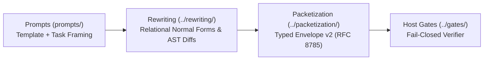

# Prompts: Untrusted Stimulus & Template Inventory

**AuthorityEffect:** `None`  
**Governing Standard:** Containment Law, Template Integrity, External Verification Gateway  
**Architectural Synthesis:** [`06_prompt_packet_stage_synthesis.md`](../../../../education/documentation/004_oepfp/docs/06_prompt_packet_stage_synthesis.md)  
**Authoritative Monograph:** [`21_prompt_template_contracts_and_single_prompt_standard.md`](../../../../education/documentation/004_oepfp/docs/21_prompt_template_contracts_and_single_prompt_standard.md)  

This directory defines the unversioned prompt templates, schemas, and representation forms for the Proposal Fidelity Protocol (PFP) and the Symbol Game educational estate. All filenames observe the standardized format `template_<slug>.yaml` with `len(slug) <= 20`. Historical versions are retained in Git history rather than on-disk version directories.

The finite-QM derivation profile consists of
[`prompt_template.yaml`](finite_qm/prompt_template.yaml),
[`workflow.yaml`](finite_qm/workflow.yaml) and [`mode.yaml`](finite_qm/mode.yaml).
The [`operad catalog`](finite_qm_operad_catalog.json) stays a separate lookup
asset and is never appended to the system prompt. These profile files have
explicit schema IDs and are separate from the generic `templates/` naming catalog. See the
[workflow guide](../../../../education/documentation/004_oepfp/docs/22_unified_pfp_v4_operad_workflow_and_hacks.md)
for stage instructions, repair prompting, technique attachment points and CLI usage.

---

## 1. What a Prompt Is (and Is Not)

- **A Prompt is:** An untrusted external stimulus ($A_{\text{stimulus}}$) presented to a stochastic generative model (LLM) or human participant to elicit candidate proposals.
- **A Prompt is NOT:** A machine packet. Natural language prose does not satisfy the RFC 8785 canonical hash envelope contract and cannot be parsed as a deterministic AST without compilation.
- **Authority:** Strictly `AuthorityEffect: None`. Generating text is not evaluating it; evaluating text is not admitting it. No model output from a prompt has the authority to mutate repository state or certify mathematical closure.

---

## 2. Partitioned Directory Structure & Inventory

The prompt estate is partitioned into three modular subdirectories of authoritative YAML contracts:

### 2.1 `templates/` (Runtime Execution Prompt Templates)

All runtime prompt templates adhere to the naming format `template_<slug>.yaml` (`len(slug) <= 20`):

| File | Slug (Length) | Purpose & Scope |
|---|---|---|
| [`templates/template_operad_compressed.yaml`](templates/template_operad_compressed.yaml) | `operad_compressed` (17) | 3-Layer compact operad prompt template (Environment, TreeSkeleton, SpanTable). |
| [`templates/template_operad_categorical.yaml`](templates/template_operad_categorical.yaml) | `operad_categorical` (18) | Category-theoretic multicategory operad prompt template (colours, operators, operands, grafting, ideals, annihilators). |
| [`templates/template_p_star_family.yaml`](templates/template_p_star_family.yaml) | `p_star_family` (13) | Compiled $P^*$ root prompt family template envelope (`mutation_kind: root_seed`). |
| [`templates/template_p_subprompt_family.yaml`](templates/template_p_subprompt_family.yaml) | `p_subprompt_family` (18) | Compiled $p_i^*$ child subprompt family template envelope (`mutation_kind: decompose`). |
| [`templates/template_single_slot.yaml`](templates/template_single_slot.yaml) | `single_slot` (11) | Runtime single-slot template with one `[USER PROMPT]` slot and response schema. |
| [`templates/template_typed_contract.yaml`](templates/template_typed_contract.yaml) | `typed_contract` (14) | Typed contract carrying containment, slot metadata, and lineage. |
| [`templates/template_standard_base.yaml`](templates/template_standard_base.yaml) | `standard_base` (13) | Base interface template defining `SPK-001` manifest and MSS-0 rules. |
| [`templates/template_pfp_t0001.yaml`](templates/template_pfp_t0001.yaml) | `pfp_t0001` (9) | Stage 1 Single-Shot prompt role template (`PFP-T0001`). |
| [`templates/template_pfp_t0002.yaml`](templates/template_pfp_t0002.yaml) | `pfp_t0002` (9) | Stage 2 Public Workpad prompt role template (`PFP-T0002`). |
| [`templates/template_pfp_t0003.yaml`](templates/template_pfp_t0003.yaml) | `pfp_t0003` (9) | Stage 3 Final-From-Workpad prompt role template (`PFP-T0003`). |
| [`templates/template_pfp_r0001.yaml`](templates/template_pfp_r0001.yaml) | `pfp_r0001` (9) | Recipe configuration template (`PFP-R0001`). |
| [`templates/template_role_registry.yaml`](templates/template_role_registry.yaml) | `role_registry` (13) | Canonical role registry mapping prompt roles, recipes, and cryptographic bindings. |

### 2.2 `schemas/` (Formal Schemas & Type Contracts)

| File | Slug (Length) | Purpose & Scope |
|---|---|---|
| [`schemas/template_schema_prompt.yaml`](schemas/template_schema_prompt.yaml) | `schema_prompt` (13) | Raw prompt text schema and SHA-256 fingerprint envelope. |
| [`schemas/template_schema_containment.yaml`](schemas/template_schema_containment.yaml) | `schema_containment` (18) | Typed contract for prompt containment law and expansion limits. |
| [`schemas/template_schema_models.yaml`](schemas/template_schema_models.yaml) | `schema_models` (13) | Formal schema specifications for prompt templates and expansion nodes. |
| [`schemas/template_schema_types.yaml`](schemas/template_schema_types.yaml) | `schema_types` (12) | Shared type primitives for prompt roles, splitters, and mutation kinds. |

### 2.3 `reprs/` (Prompt Representation Forms)

| File | Slug (Length) | Purpose & Scope |
|---|---|---|
| [`reprs/template_repr_raw.yaml`](reprs/template_repr_raw.yaml) | `repr_raw` (8) | Raw verbatim prompt representation format. |
| [`reprs/template_repr_structured.yaml`](reprs/template_repr_structured.yaml) | `repr_structured` (15) | Structured prompt representation format. |
| [`reprs/template_repr_relational.yaml`](reprs/template_repr_relational.yaml) | `repr_relational` (15) | Relational prompt representation format. |
| [`reprs/template_repr_symbolic.yaml`](reprs/template_repr_symbolic.yaml) | `repr_symbolic` (13) | Symbolic prompt representation format. |
| [`reprs/template_repr_operadic.yaml`](reprs/template_repr_operadic.yaml) | `repr_operadic` (13) | 3-Layer compact operad prompt representation. |
| [`reprs/template_repr_egraph.yaml`](reprs/template_repr_egraph.yaml) | `repr_egraph` (11) | Equational saturation e-graph normal form representation. |
| [`reprs/template_repr_diagram.yaml`](reprs/template_repr_diagram.yaml) | `repr_diagram` (12) | Monoidal category planar string diagram representation. |
| [`reprs/template_repr_cochain.yaml`](reprs/template_repr_cochain.yaml) | `repr_cochain` (12) | Simplicial complex and exterior calculus boundary representation. |

### 2.4 Canonical Documentation & Architectural Monograph

The formal mathematical specifications, containment law derivation, and Single Prompt Standard have been consolidated into canonical education documentation:
- [`21_prompt_template_contracts_and_single_prompt_standard.md`](../../../../education/documentation/004_oepfp/docs/21_prompt_template_contracts_and_single_prompt_standard.md): Authoritative specification for $P \mapsto P^* \to \{p_i\}$, containment law, SPK-001 policy manifest, and v2 template contracts.
- [`06_prompt_packet_stage_synthesis.md`](../../../../education/documentation/004_oepfp/docs/06_prompt_packet_stage_synthesis.md): Architectural semiotics and 4-axis separation (Prompt, Packet, Stage, Mode).

---

## 3. The Containment Law & Expansion Tree

For any successfully validated prompt expansion tree $T$:

$$\text{cardinality}(n) = 1 + \sum_{c \in \text{children}(n)} \text{cardinality}(c)$$

- **Leaf Invariant:** $|T| = 1$ when the root has empty declared `decomposition.subprompts`. A refusal is a valid single leaf.
- **Node Budget:** Tree expansion is bounded by `max_depth = 5` and strict node ceilings to prevent unbounded prompt explosion.
- **Adoption Port:** Computing an `ExpansionReceipt` does not execute prompts. Adopting child prompts into active runtime sets requires external verification against the host agreement port.

---

## 4. Pipeline Boundary: Prompt $\to$ Rewriting $\to$ Packetization

1. **Prompts (`prompts/`):** Supply the linguistic instruction framing and structured containment slots.
2. **Rewriting (`../rewriting/`):** Compiles and optimizes prompts into relational normal forms, applying syntactic firewalls and bounding repair loops.
3. **Packetization (`../packetization/`):** Encapsulates candidate proposals into cryptographic, content-addressed host envelopes for deterministic evaluation.

---

## 5. Adversary Prompt Anti-Patterns

1. **Self-Certifying Prompts:** Instructions asking the LLM to output `"verified": true` or `"all tests passed"`. Such assertions are ignored; only host verifier receipts determine status.
2. **Prompt-Level Opcodes:** Attempting to inject host-internal instruction codes into public prompts. Prompts operate strictly on public grammar starts and declared modes.
3. **Unbounded Decomposition:** Expanding subprompts without declaring explicit slot IDs, contiguous ordinals, and parent hash bindings.

---

## 6. Typed Contracts

- [`schemas/template_schema_prompt.yaml`](schemas/template_schema_prompt.yaml): raw prompt text schema and SHA-256 fingerprint envelope.
- [`schemas/template_schema_containment.yaml`](schemas/template_schema_containment.yaml): containment law, `max_depth = 5`, mutation kinds, and pipeline order.
