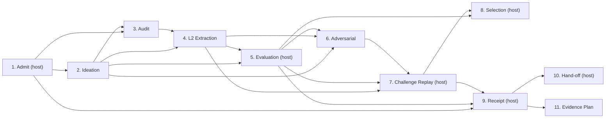

# Pipeline Stages: The 11-Stage PFP Public Protocol

**AuthorityEffect:** `None`  
**Governing Laws:** Two Boxed Laws of $S(n)$, Fail-Closed Sequential Verification  
**Architectural Synthesis:** [`../docs/06_prompt_packet_stage_synthesis.md`](../docs/06_prompt_packet_stage_synthesis.md)  
**Sequential Controller:** [`controller.yaml`](controller.yaml) (`pfp-staged.0.3`)  
**Stage Models & Types:** [`stage_models.yaml`](stage_models.yaml), [`stage_types.yaml`](stage_types.yaml)  
**Terminal Routing:** [`terminal_routing.json`](terminal_routing.json)  

This directory defines the 11 public pipeline stages, the controller, and the data contracts for the Proposal Fidelity Protocol. Five stages are model turns; six are host stages that the model cannot write.

---

## 1. Pipeline Stages Overview

Stages run in number order. Each stage's `requires` list in [`controller.yaml`](controller.yaml) and in its stage file names the earlier stages it reads; the two lists must agree. A failure at any stage stops the run with a typed refusal.

| Stage | Requires | Executor | Seat |
|---|---|---|---|
| 1 | none | host | none |
| 2 | 1 | model | `seat_gauge_breaker` |
| 3 | 1, 2 | model | `seat_defect_hunter` |
| 4 | 2, 3 | model | `seat_gauge_breaker` |
| 5 | 2, 4 | host | `seat_adversary` |
| 6 | 2, 4, 5 | model | `seat_primal_dual` |
| 7 | 4, 5, 6 | host | none |
| 8 | 5, 7 | host | `seat_manuscript_truth` |
| 9 | 1, 5, 7 | host | none |
| 10 | 9 | host | none |
| 11 | 9 | model | none |

`domain/stages/stages.py` checks each list: sorted, distinct, earlier stages only, and containing the stages the code reads (`MINIMUM_STAGE_INPUTS`). A run is either stages 1 through N, or a subset passed as `stages=` to `ExecuteStagePipelineUseCase.run_pipeline` that starts at stage 1 and contains everything its members require. Both the Python runner and the native staged runner accept any such subset. No later stage requires stages 8, 10 or 11, so each may be left out. A model stage's prompt still shows every earlier stage that ran.

The seat of a stage names the core-panel seat whose turn it is; it does not change what the stage checks. Stage 1 admits the seed declaration on the host; a seed without a declaration gets one model repair turn, and the receipt then carries `DECLARATION_FROM_MODEL_REPAIR`. Stage 7 replays every stage 6 witness on the host; an obstruction found there does not stop the run, so selection rejects the candidate and the receipt names `OPEN_OBSTRUCTION`. Stage 9 derives the terminal from host facts only, using the `obligation_rules` in [`stage_9_receipt.yaml`](stage_9_receipt.yaml). Stage 10 maps that terminal to a routing terminal through [`terminal_routing.json`](terminal_routing.json) and records `authorized_by: null`. Stage 11 runs only when the receipt is not `VERIFIED`; otherwise it is recorded as skipped.

| Stage | Contract File | Focus | Outcome |
|---|---|---|---|
| **Stage 1** | [`stage_1_admit.yaml`](stage_1_admit.yaml) | **Admission** | Host check of the declared grammar, equality test and coefficient profile. |
| **Stage 2** | [`stage_2_ideation.yaml`](stage_2_ideation.yaml) | **Proposal Ideation** | Candidates with distinct ids. |
| **Stage 3** | [`stage_3_audit.yaml`](stage_3_audit.yaml) | **Audit** | Flaws in the candidates, with quotes. |
| **Stage 4** | [`stage_4_l2_extraction.yaml`](stage_4_l2_extraction.yaml) | **L2 Extraction** | One candidate, bound to a stage 2 id. |
| **Stage 5** | [`stage_5_evaluation.yaml`](stage_5_evaluation.yaml) | **Host Evaluation** | Host verdict and surviving candidates. |
| **Stage 6** | [`stage_6_adversarial.yaml`](stage_6_adversarial.yaml) | **Adversarial Challenges** | Witnesses for the host to replay. |
| **Stage 7** | [`stage_7_challenge_replay.yaml`](stage_7_challenge_replay.yaml) | **Challenge Replay** | Each witness classed as control, discarded or obstruction. |
| **Stage 8** | [`stage_8_selection.yaml`](stage_8_selection.yaml) | **Selection** | SELECT or REJECT from the surviving candidates. |
| **Stage 9** | [`stage_9_receipt.yaml`](stage_9_receipt.yaml) | **Receipt** | Terminal and remaining obligations from host facts. |
| **Stage 10** | [`stage_10_hand_off.yaml`](stage_10_hand_off.yaml) | **Hand-off** | Routing terminal; authorization stays outside the pipeline. |
| **Stage 11** | [`stage_11_evidence_plan.yaml`](stage_11_evidence_plan.yaml) | **Evidence Plan** | Diagnostic plan for the remaining obligations. |

---

## 2. Epistemic Relationship to $S(n)$ Postnikov Tower

These 11 operational pipeline stages must not be conflated with the 5 epistemic levels $S(0)$ through $S(4)$ of the Postnikov tower:
- The **11 pipeline stages** are sequential verification steps executed by the host on a single proposal packet.
- The **Postnikov levels $S(n)$** represent the active mathematical obstruction state $(s_n, H_n)$ of the underlying problem carrier:
  - $S(0)$: Unformed ground.
  - $S(1)$: 1-difference witnessed ($s_1 > 0$).
  - $S(2)$: Simplicial 2-cycle formed ($s_2 > 0$).
  - $S(3)$: Higher holonomy / Bianchi defect audited ($s_3 > 0$).
  - $S(4)$: Quiescent normal form ($s_4 = 0, |H_4| = 5$).
- A proposal that successfully traverses the pipeline stages emits a receipt that may be used as an admissible witness to extinguish an obstruction in $S(n)$ and advance the tower level.

---

## 3. Schemas & Models

- [`controller.yaml`](controller.yaml): Master finite state automaton declaring permitted stage transitions, retry limits (max 3), and fail-closed terminal halts.
- [`stage_models.yaml`](stage_models.yaml): Pydantic-compatible JSON schemas for stage request and response envelopes.
- [`stage_types.yaml`](stage_types.yaml): Primitive enum definitions for stage IDs, statuses, and terminal error codes.

## Typed Contracts

[`stage_types.yaml`](stage_types.yaml) is the source of the stage type rules and [`stage_models.yaml`](stage_models.yaml) is the JSON Schema form of them. The generator named in the `stage_models.yaml` header is no longer in the repository, so change both files together. The Pydantic models are in `pfp/domain/stages/stages.py`. `pfp/tests/types/test_stages_types.py` checks the eleven stage files and `controller.yaml` against `stage_types.yaml`, and `pfp/tests/test_stage_dependency_graph.py` checks the graph and subset runs.
