# Workflow DAG: WF1–WF49

**WF1–WF5 are the implemented runners. WF6–WF49 are proposals, not runners.** WF6–WF23 were read off the retained pilot experiments, and WF24–WF49 off the certified-challenge findings notes and the papers: what the pilots
did, which check decided, and which earlier workflow they reuse. No new model
call was made to build this graph, and most of the source pilots from 52 to
187 are planned capsules that were never dispatched.

An arrow `A → B` means B reuses A's procedure or acceptance rule, so learn
and run A first.

```mermaid
flowchart TD
  WF1["WF1 Typed answer<br/><small>base</small>"]
  WF2["WF2 Full slots<br/><small>procedure extension</small>"]
  WF3["WF3 Mine, then solve<br/><small>procedure extension</small>"]
  WF4["WF4 Five agents + LGGR<br/><small>procedure extension</small>"]
  WF5["WF5 Checked rewrite<br/><small>procedure extension</small>"]
  WF6("WF6 Dialect sweep<br/><small>experiment design</small>")
  WF7("WF7 Typed refusal<br/><small>procedure extension</small>")
  WF8("WF8 Staged sealed packets<br/><small>procedure extension</small>")
  WF9("WF9 Bounded check-and-repair<br/><small>procedure extension</small>")
  WF10("WF10 Local-to-global obstruction certificate<br/><small>task preset</small>")
  WF11("WF11 Dual-certificate synthesis<br/><small>task preset</small>")
  WF12("WF12 Mechanism-control arms<br/><small>experiment design</small>")
  WF13("WF13 Exact-domain capsule battery<br/><small>task preset</small>")
  WF14("WF14 Immune failure classification<br/><small>meta workflow</small>")
  WF15("WF15 Adversary tribunal<br/><small>procedure extension</small>")
  WF16("WF16 Substrate crosswalk<br/><small>task preset</small>")
  WF17("WF17 Witnessed-difference programme<br/><small>task preset</small>")
  WF18("WF18 Dossier replay campaign<br/><small>harness gate</small>")
  WF19("WF19 Failure-derived rule transfer<br/><small>experiment design</small>")
  WF20("WF20 Derivation loop with lift grants<br/><small>procedure extension</small>")
  WF21("WF21 Structural prompt rewriting<br/><small>procedure extension</small>")
  WF22("WF22 Certified cost ladder<br/><small>experiment design</small>")
  WF23("WF23 Judge-packet custody audit<br/><small>harness gate</small>")
  WF24("WF24 Pinned-token operational scratchpad<br/><small>procedure extension</small>")
  WF25("WF25 Hierarchical decimation<br/><small>procedure extension</small>")
  WF26("WF26 Multi-round antibody dialogue<br/><small>procedure extension</small>")
  WF27("WF27 Hinted retraction with a stationary-loop detector<br/><small>procedure extension</small>")
  WF28("WF28 Eight-role audit dialogue<br/><small>procedure extension</small>")
  WF29("WF29 Checker synthesis scored by mutation kill rate<br/><small>task preset</small>")
  WF30("WF30 Constraint-forcing anti-recitation<br/><small>procedure extension</small>")
  WF31("WF31 Multi-agent tournament with held-out cross-validation<br/><small>experiment design</small>")
  WF32("WF32 Claim-scoped receipt<br/><small>procedure extension</small>")
  WF33("WF33 Recursive re-entry with shared fuel<br/><small>procedure extension</small>")
  WF34("WF34 Future-faithful compression and bounded context<br/><small>procedure extension</small>")
  WF35("WF35 Proposal-channel comparison<br/><small>experiment design</small>")
  WF36("WF36 Guarded staged slot materialisation<br/><small>procedure extension</small>")
  WF37("WF37 Evidence-bound harness evolution<br/><small>meta workflow</small>")
  WF38("WF38 Diagnostic-trace proposal selection<br/><small>procedure extension</small>")
  WF39("WF39 Authority firewall gate<br/><small>harness gate</small>")
  WF40("WF40 Restart boundary after exhausted repair<br/><small>procedure extension</small>")
  WF41("WF41 Detector adequacy and two-signal admission<br/><small>meta workflow</small>")
  WF42("WF42 Reasoning-trace validation<br/><small>procedure extension</small>")
  WF43("WF43 Gate-honesty and answer-free leak audit<br/><small>harness gate</small>")
  WF44("WF44 Exact certificate presets<br/><small>task preset</small>")
  WF45("WF45 Finite terminal selector and plenitude test<br/><small>procedure extension</small>")
  WF46("WF46 Boundary sufficiency and gluing diagnostic<br/><small>procedure extension</small>")
  WF47("WF47 Resumable bounded frontier search<br/><small>procedure extension</small>")
  WF48("WF48 Commit-reveal with a hostile mutation gate<br/><small>harness gate</small>")
  WF49("WF49 Query-preservation stage and mode campaign<br/><small>experiment design</small>")
  WF1 --> WF2
  WF1 --> WF3
  WF3 --> WF4
  WF4 --> WF5
  WF5 --> WF6
  WF1 --> WF7
  WF2 --> WF8
  WF5 --> WF8
  WF2 --> WF9
  WF4 --> WF10
  WF9 --> WF10
  WF3 --> WF11
  WF9 --> WF11
  WF6 --> WF12
  WF3 --> WF12
  WF1 --> WF13
  WF7 --> WF13
  WF7 --> WF14
  WF12 --> WF14
  WF4 --> WF15
  WF14 --> WF15
  WF5 --> WF16
  WF10 --> WF16
  WF10 --> WF17
  WF11 --> WF17
  WF6 --> WF18
  WF12 --> WF18
  WF12 --> WF19
  WF14 --> WF19
  WF9 --> WF20
  WF10 --> WF20
  WF19 --> WF20
  WF5 --> WF21
  WF6 --> WF22
  WF8 --> WF22
  WF18 --> WF22
  WF11 --> WF23
  WF2 --> WF24
  WF24 --> WF25
  WF9 --> WF26
  WF14 --> WF26
  WF9 --> WF27
  WF15 --> WF28
  WF11 --> WF29
  WF1 --> WF30
  WF1 --> WF31
  WF1 --> WF32
  WF2 --> WF32
  WF9 --> WF33
  WF20 --> WF33
  WF8 --> WF34
  WF22 --> WF34
  WF6 --> WF35
  WF12 --> WF35
  WF8 --> WF36
  WF19 --> WF37
  WF22 --> WF37
  WF9 --> WF38
  WF1 --> WF39
  WF23 --> WF39
  WF9 --> WF40
  WF20 --> WF40
  WF14 --> WF41
  WF10 --> WF42
  WF21 --> WF42
  WF23 --> WF43
  WF11 --> WF44
  WF10 --> WF44
  WF7 --> WF45
  WF4 --> WF46
  WF9 --> WF47
  WF11 --> WF48
  WF23 --> WF48
  WF8 --> WF49
  WF22 --> WF49
  classDef implemented fill:#dbeafe,stroke:#1d4ed8,color:#0f172a
  classDef gate fill:#e5e7eb,stroke:#4b5563,color:#0f172a
  classDef derived fill:#fef3c7,stroke:#b45309,color:#0f172a
  class WF1,WF2,WF3,WF4,WF5 implemented
  class WF6,WF7,WF8,WF9,WF10,WF11,WF12,WF13,WF14,WF15,WF16,WF17,WF19,WF20,WF21,WF22,WF24,WF25,WF26,WF27,WF28,WF29,WF30,WF31,WF32,WF33,WF34,WF35,WF36,WF37,WF38,WF40,WF41,WF42,WF44,WF45,WF46,WF47,WF49 derived
  class WF18,WF23,WF39,WF43,WF48 gate
```

Files: [JSON](https://github.com/dbccpage/proposal_fidelity_protocol_pfp/blob/main/workflows/dag/workflow_dag.json) · [Mermaid](https://github.com/dbccpage/proposal_fidelity_protocol_pfp/blob/main/workflows/dag/workflow_dag.mmd) ·
[SVG](https://github.com/dbccpage/proposal_fidelity_protocol_pfp/blob/main/workflows/dag/workflow_dag.svg) · [orchestration guide](https://github.com/dbccpage/proposal_fidelity_protocol_pfp/blob/main/workflows/dag/ORCHESTRATION.md).
The process and mathematics are written up in Paper 021
(`papers/pfp/021_pfp_workflow_dag_process_and_mathematics/`).

## Reading the source citations

The `Pnnn` citations below (for example `P026 §3-4`) use the paper numbers in
force when the nodes were written, before the papers were split and renumbered
on 2026-11-06. Several old numbers named two papers, which is why some
citations carry a hint such as `P027(firewall)` or `P004(role)`.
[`papers/RENUMBERING.md`](https://github.com/dbccpage/proposal_fidelity_protocol_pfp/blob/main/papers/RENUMBERING.md)
translates each one. The unambiguous ones: P000-P010 are PFP 000-010;
P011 is PFP 012; P021 is PFP 011; P022 is PFP 020; P023-P025 are PFP 013-015;
P034 is PFP 021; P013, P018, P019, P030 and P033 are non-PFP 005, 007, 008,
011 and 009. P001-P005 and P026-P029 need the hint or the topic: for example
P027(firewall) is non-PFP 010, P028(finite authority) is non-PFP 014,
P004(role) is non-PFP 012, P004(DSL) is non-PFP 003 and P003(rep) is non-PFP 015.

## Structure

One base workflow (WF1); procedure extensions that add one step (WF2–WF5, refusal, staged packets, repair loop, tribunal); task presets that only change the task and checker; experiment designs that wrap any workflow; meta-workflows over prompts and detectors; and harness gates required on every run. Settings such as model, dialect, rung and stage count vary a run without making a new workflow. Details are in the [committee report](https://github.com/dbccpage/proposal_fidelity_protocol_pfp/blob/main/docs/research/2026-11-05_committee_report.md).

## How a team runs a family

Every family has a **goal** (decided only by its host check), a **team**
(roles with model tiers), a **teamwork pattern** and a bounded **boost**.

- **Sonnet** does most of the work: code, encoders, runs, custody.
- **Opus** does deep research: derivations, checker and certificate design,
  analysis, and usually the boost step.
- **Fable** does adversarial research: countermodels, leak tests,
  premise-removing variants, prosecution.
- The **host check** is deterministic code and is the only thing that accepts.

A **boost** is one escalation after a failed check: a stronger tier receives
the typed residual (never the expected answer), its calls are charged, and
the limit is per run. A boost changes who proposes next, not what counts as
success.

## WF1: Typed answer

**Folder:** [`workflows/wf01_typed_answer/`](https://github.com/dbccpage/proposal_fidelity_protocol_pfp/tree/main/workflows/wf01_typed_answer)

**Status:** implemented runner. **Kind:** base. **Builds on:** nothing. **Model calls on the normal path:** 1.

**Goal:** One schema-valid answer that the host check accepts, or a typed refusal.

**Process:**

1. Freeze the task and response schema
2. One solver reply
3. Parse the typed envelope
4. Independent exact check

**Mathematics:**

- `accept(r) iff parse(r) = v and v = f(x) for the host-computed f`

**Host check:** typed_envelope_and_independent_exact_sum.

**Team (`solo`):** coder ×1 (sonnet); host_checker ×1 (none).

**Boost:** when host check rejects: none on the base path; WF9 adds bounded repair. Limit 0.

## WF2: Full slots

**Folder:** [`workflows/wf02_full_slots/`](https://github.com/dbccpage/proposal_fidelity_protocol_pfp/tree/main/workflows/wf02_full_slots)

**Status:** implemented runner. **Kind:** procedure extension. **Builds on:** WF1. **Model calls on the normal path:** 1.

**Goal:** A complete slot record plus an accepted answer.

**Process:**

1. Freeze the slot catalogue
2. One reply filling operations, missing information and repair moves
3. Check slots and exact answer

**Mathematics:**

- `slot coverage: every declared slot s has a typed value or an explicit absence`

**Host check:** typed_envelope_and_independent_exact_sum.

**Team (`solo`):** coder ×1 (sonnet); host_checker ×1 (none).

**Boost:** when missing slot: none on the base path. Limit 0.

## WF3: Mine, then solve

**Folder:** [`workflows/wf03_mine_then_solve/`](https://github.com/dbccpage/proposal_fidelity_protocol_pfp/tree/main/workflows/wf03_mine_then_solve)

**Status:** implemented runner. **Kind:** procedure extension. **Builds on:** WF1. **Model calls on the normal path:** 2.

**Goal:** Useful frozen guidance, then an accepted answer.

**Process:**

1. Mining call proposes operation guidance
2. Screen and freeze guidance
3. Solver call uses frozen guidance
4. Independent check

**Mathematics:**

- `guidance g is frozen before the solve: hash(g) recorded, never edited after the solver starts`

**Host check:** typed_envelope_and_independent_exact_sum.

**Team (`relay`):** miner ×1 (opus); coder ×1 (sonnet); host_checker ×1 (none).

**Boost:** when guidance screen rejects: none on the base path. Limit 0.

## WF4: Five agents + LGGR

**Folder:** [`workflows/wf04_five_agents_lggr/`](https://github.com/dbccpage/proposal_fidelity_protocol_pfp/tree/main/workflows/wf04_five_agents_lggr)

**Status:** implemented runner. **Kind:** procedure extension. **Builds on:** WF3. **Model calls on the normal path:** 6.

**Goal:** Five isolated answers whose local checks pass and which agree globally.

**Process:**

1. One shared mining call
2. Five isolated solvers
3. Local checks per agent
4. One global compatibility check (local green, global red)

**Mathematics:**

- `global accept iff every local check passes and the local answers glue: a_1 = ... = a_5 = f(x)`

**Host check:** typed_envelope_and_independent_exact_sum.

**Team (`parallel_isolated_then_global`):** miner ×1 (opus); coder ×5 (sonnet); host_checker ×1 (none).

**Boost:** when global disagreement: none on the base path. Limit 0.

## WF5: Checked rewrite

**Folder:** [`workflows/wf05_checked_rewrite/`](https://github.com/dbccpage/proposal_fidelity_protocol_pfp/tree/main/workflows/wf05_checked_rewrite)

**Status:** implemented runner. **Kind:** procedure extension. **Builds on:** WF4. **Model calls on the normal path:** 6.

**Goal:** A rewrite that preserves the protected query, then a WF4 pass.

**Process:**

1. Label every source span
2. Rewrite the whole seed into one grammar
3. Parse, decode and check preservation
4. Run WF4 against the original public input

**Mathematics:**

- `preservation: decode(rewrite(s)) = query(s) on the declared finite language`

**Host check:** typed_envelope_and_independent_exact_sum.

**Team (`parallel_isolated_then_global`):** coder ×1 (sonnet); miner ×1 (opus); coder ×5 (sonnet); host_checker ×1 (none).

**Boost:** when preservation check fails: stop; never solve an unpreserved task. Limit 0.

## WF6: Dialect sweep

**Folder:** [`workflows/wf06_dialect_sweep/`](https://github.com/dbccpage/proposal_fidelity_protocol_pfp/tree/main/workflows/wf06_dialect_sweep)

**Status:** proposal (no runner, no run). **Kind:** experiment design, expected to fold into Sweep. **Builds on:** WF5. **Model calls on the normal path:** 2 + 2k per seed.

**Goal:** Measure, item by item, which presentation of the same task the host accepts more often, without changing the task.

**Sources:** 0000000-0000019. Pilots 0-10 retain 53-83 test capsules each (seed, P*, ten seed rewrites, ten P* rewrites); a few capsules hold manual live replies, most are offline controls.

**Process:**

1. Freeze one seed and its host answer
2. Compile P* and k checked rewrites (dialects) of seed and P*
3. Dispatch each capsule once under the same model and parameters
4. Grade every reply with the same host checker
5. Report acceptance per dialect, item by item

**Mathematics:**

- `dialect family {rho_k}: decode(rho_k(s)) = q(s) for every k (preservation precondition)`
- `acceptance A_k = (1/N) sum_i 1[check(r_ik)] compared pairwise on the same items`
- `exact rational structure delta: Net = Delta_created - Delta_removed`

**Host check:** family checker (e.g. exact linear algebra, graph facts, graph repair, typed refusal).

**Team (`sweep_with_shared_judge`):** coder ×1 (sonnet); coder ×1 (sonnet); deep_researcher ×1 (opus); host_checker ×1 (none).

**Boost:** when a dialect fails preservation: opus proposes a corrected rewrite from the preservation residual; recheck before any dispatch. Limit 1.

## WF7: Typed refusal

**Folder:** [`workflows/wf07_typed_refusal/`](https://github.com/dbccpage/proposal_fidelity_protocol_pfp/tree/main/workflows/wf07_typed_refusal)

**Status:** proposal (no runner, no run). **Kind:** procedure extension. **Builds on:** WF1. **Model calls on the normal path:** 1.

**Goal:** Return the correct refusal code whenever the premises do not determine an answer.

**Sources:** 0000003, 0000007, 0000011, 0000015, 0000019, 0000034, 0000175. Refusal rungs 1-5 with checkers PFP-04 and PFP-14 typed refusal; pilot 34 refuses stationary traces; pilot 175 is a planned capsule.

**Process:**

1. Declare the answerability predicate and the refusal codes
2. Pose an underdetermined or undefined task
3. Accept only the correct typed refusal or a checked answer
4. Count bluffs: a confident answer to an unanswerable task

**Mathematics:**

- `answerable(A x = b) iff rank(A) = rank([A|b]) = n; otherwise the right outcome is UNRESOLVED <code>`
- `bluff rate = #(answered and unanswerable) / #unanswerable`

**Host check:** typed refusal checker.

**Team (`red_team_pair`):** coder ×1 (sonnet); adversary ×1 (fable); host_checker ×1 (none).

**Boost:** when bluff detected: fable adds the variant to the negative-control bank; no retry on the same item. Limit 0.

## WF8: Staged sealed packets

**Folder:** [`workflows/wf08_staged_sealed_packets/`](https://github.com/dbccpage/proposal_fidelity_protocol_pfp/tree/main/workflows/wf08_staged_sealed_packets)

**Status:** proposal (no runner, no run). **Kind:** procedure extension. **Builds on:** WF2, WF5. **Model calls on the normal path:** k.

**Goal:** Each stage produces a sealed, typed output; the final answer checks.

**Sources:** 0000001-0000025, 0000033. Mode trials mode_01..mode_20 and wire encodings (EBNF wire, S(n) wire, boundary packets, glyph alphabets); pilot 20 runs two local stages with zero provider calls; pilot 33 documents a two-pass loop the old runner did not implement.

**Process:**

1. Choose a mode contract and wire encoding
2. Split the task into k declared stages
3. Seal each stage output (hash chain) before the next stage reads it
4. Check every stage receipt and the final answer

**Mathematics:**

- `composition F = f_k o ... o f_1 with typed interfaces between stages`
- `seal chain h_0 = H(seed), h_i = H(h_{i-1} || payload_i); any edit breaks every later h_j`

**Host check:** per-stage receipts plus the family checker.

**Team (`relay`):** coder ×k (sonnet); deep_researcher ×1 (opus); host_checker ×1 (none).

**Boost:** when a stage receipt fails: rerun that stage once with opus and the receipt residual; earlier seals are reused. Limit 1.

## WF9: Bounded check-and-repair

**Folder:** [`workflows/wf09_bounded_check_and_repair/`](https://github.com/dbccpage/proposal_fidelity_protocol_pfp/tree/main/workflows/wf09_bounded_check_and_repair)

**Status:** proposal (no runner, no run). **Kind:** procedure extension. **Builds on:** WF2. **Model calls on the normal path:** 1..L.

**Goal:** An accepted reply within L attempts, or a recorded stop at the limit.

**Sources:** 0000002, 0000006, 0000010, 0000026, 0000049, 0000055, 0000062, 0000096. Pilot 49 is a deterministic mock (41 then 42, two mock calls, zero provider cost); pilot 26 retains all three least-cost repairs of an odd XOR cycle; graph-repair rungs use PFP-03.

**Process:**

1. Check the reply
2. On rejection return only the typed residual (never the expected answer)
3. Allow at most L repair attempts
4. Stop at the first accepted reply or at the limit

**Mathematics:**

- `XOR cycle: a consistent assignment exists iff the cycle sum of edge labels is 0 mod 2`
- `minimal repair: argmin |Delta| subject to c + Delta in im(delta_0) for the edge cochain c`
- `termination: attempts <= L, and each attempt is charged`

**Host check:** repair checker (coboundary or parity).

**Team (`proposer_with_residual_feedback`):** coder ×1 (sonnet); host_checker ×1 (none).

**Boost:** when two rejections in a row: final attempt goes to opus with the full residual history. Limit 1.

## WF10: Local-to-global obstruction certificate

**Folder:** [`workflows/wf10_local_to_global_obstruction_certificate/`](https://github.com/dbccpage/proposal_fidelity_protocol_pfp/tree/main/workflows/wf10_local_to_global_obstruction_certificate)

**Status:** proposal (no runner, no run). **Kind:** task preset, expected to fold into WF4. **Builds on:** WF4, WF9. **Model calls on the normal path:** 1 + n_patches.

**Goal:** A checked gluing witness or a checked obstruction class for the declared cover.

**Sources:** 0000029, 0000039-0000045, 0000051, 0000056-0000064, 0000083. Pilot 51 records live runs on the three-patch observer-visibility obstruction; 39-45 are offline exact checkers (angle defects, Hodge, clique homology, triangle fans); 56-64 are planned capsules.

**Process:**

1. Declare the cover, cochains and restriction maps
2. Agents certify local sections on each patch
3. Host computes the global obstruction class
4. Accept a gluing witness or an obstruction certificate, never a prose claim

**Mathematics:**

- `H^1 = ker(delta_1) / im(delta_0); a class [c] != 0 means local green, global red`
- `three-patch observer visibility: each observer sees zero on its edges, yet sum_alpha J^alpha(s) > 0 for the glued section`
- `Hodge: c = delta alpha + delta^* beta + h with h harmonic (exact rational arithmetic)`
- `integer lift: an obstruction in H^1(X; Z) can survive the map to rational coefficients only if it is non-torsion`

**Host check:** exact cochain / homology checker.

**Team (`parallel_isolated_then_global`):** coder ×n_patches (sonnet); deep_researcher ×1 (opus); adversary ×1 (fable); host_checker ×1 (none).

**Boost:** when local checks pass but the global check fails: opus receives the coboundary residual and proposes either a repair (WF9) or an obstruction certificate. Limit 1.

## WF11: Dual-certificate synthesis

**Folder:** [`workflows/wf11_dual_certificate_synthesis/`](https://github.com/dbccpage/proposal_fidelity_protocol_pfp/tree/main/workflows/wf11_dual_certificate_synthesis)

**Status:** proposal (no runner, no run). **Kind:** task preset, expected to fold into WF1. **Builds on:** WF3, WF9. **Model calls on the normal path:** planned, budget-capped.

**Goal:** A frozen solver whose every output carries a certificate the judge accepts on hidden cases.

**Sources:** 0000027, 0000053, 0000054, 0000095, 0000115-0000124, 0000171, 0000180, c051, c052, c053, c054, c055, c059. Challenge folders c051-c055 and c059 hold participant packets, judge packets, reference solvers and commit-reveal scripts; dossier LP pilots are planned capsules.

**Process:**

1. Publish the participant packet; keep the judge packet sealed
2. Team writes a solver that emits certificates, not just answers
3. Commit H(salt || solver) before hidden cases are revealed
4. Judge checks each certificate with exact dot products

**Mathematics:**

- `LP optimality: x >= 0, A x <= b, y >= 0, A^T y >= c, c.x = b.y (weak duality closes the gap)`
- `infeasibility (Farkas): y >= 0, A^T y >= 0, b.y < 0`
- `max-flow value = min-cut capacity; assignment potentials u_i + v_j <= c_ij with equality on the matching`
- `Bareiss fraction-free elimination keeps every intermediate an exact integer`

**Host check:** exact certificate checker plus an independent second checker.

**Team (`research_cell`):** coder ×2 (sonnet); deep_researcher ×1 (opus); adversary ×1 (fable); host_checker ×1 (none).

**Boost:** when a certificate is rejected on public cases: opus reads the rejected certificate and the checker message, proposes one patch; sonnet applies it. Limit 2.

## WF12: Mechanism-control arms

**Folder:** [`workflows/wf12_mechanism_control_arms/`](https://github.com/dbccpage/proposal_fidelity_protocol_pfp/tree/main/workflows/wf12_mechanism_control_arms)

**Status:** proposal (no runner, no run). **Kind:** experiment design, expected to fold into Sweep. **Builds on:** WF6, WF3. **Model calls on the normal path:** arms x items.

**Goal:** An arm comparison on a fixed carrier whose only difference is the mechanism note.

**Sources:** 0000052. Ten planned capsules (c001-c010) on one integer rank-difference carrier with three distractor spans; no model was called and the checker id is not registered.

**Process:**

1. Hold the carrier fixed; vary only the mechanism note
2. Run baseline, typed-witness and mechanism arms on the same items
3. Grade with one registered checker
4. Compare arms item by item

**Mathematics:**

- `rank difference: r_i - r_j recovered from a gauge-fixed assignment; gauge freedom r -> r + c leaves differences unchanged`
- `paired effect: d_i = 1[check(arm_B, i)] - 1[check(arm_A, i)]`

**Host check:** integer rank-difference certificate (to be registered).

**Team (`sweep_with_shared_judge`):** coder ×1 (sonnet); deep_researcher ×1 (opus); adversary ×1 (fable); host_checker ×1 (none).

**Boost:** when leak found: rebuild the carrier; discard affected runs. Limit 0.

## WF13: Exact-domain capsule battery

**Folder:** [`workflows/wf13_exact_domain_capsule_battery/`](https://github.com/dbccpage/proposal_fidelity_protocol_pfp/tree/main/workflows/wf13_exact_domain_capsule_battery)

**Status:** proposal (no runner, no run). **Kind:** task preset, expected to fold into WF1. **Builds on:** WF1, WF7. **Model calls on the normal path:** 1 per capsule.

**Goal:** One checked answer or refusal per domain capsule.

**Sources:** 0000065-0000114, 0000177, 0000176, 0000178, 0000187. Fifty planned single-capsule pilots, one per catalog challenge, each naming a domain checker id; none was dispatched.

**Process:**

1. One catalog challenge becomes one capsule
2. A domain checker is registered before dispatch
3. One reply or typed refusal per capsule
4. Results stay per domain; no cross-domain average is claimed

**Mathematics:**

- `stabilizer codes: generators commute iff their symplectic product is 0 mod 2`
- `U(1) anomaly freedom: sum_i q_i = 0 and sum_i q_i^3 = 0 over the declared charges`
- `Regge deficit: epsilon = 2 pi - sum of dihedral angles at a hinge`
- `commutator [g, h] = g^-1 h^-1 g h, checked in the declared finite group`

**Host check:** per-domain registered checker.

**Team (`solo`):** coder ×1 (sonnet); deep_researcher ×1 (opus); host_checker ×1 (none).

**Boost:** when checker rejects: one opus attempt with the checker message. Limit 1.

## WF14: Immune failure classification

**Folder:** [`workflows/wf14_immune_failure_classification/`](https://github.com/dbccpage/proposal_fidelity_protocol_pfp/tree/main/workflows/wf14_immune_failure_classification)

**Status:** proposal (no runner, no run). **Kind:** meta workflow. **Builds on:** WF7, WF12. **Model calls on the normal path:** per candidate.

**Goal:** Detectors that catch the recorded failures and never fire on the sealed self panel.

**Sources:** 0000125-0000134. Ten planned capsules (C081-C090), e.g. negative selection against a sealed self panel; none dispatched.

**Process:**

1. Seal a self panel of known-good outputs
2. Propose candidate detectors (antibodies) from observed failures
3. Reject any detector that fires on the self panel
4. Admit a detector only with two signals: a failure match and a host check

**Mathematics:**

- `negative selection: keep d iff for all s in Self, match(d, s) < theta`
- `two-signal gate: admit iff signal_1 (pattern) and signal_2 (host evidence)`
- `self-tolerance = 1 - false positives on Self / |Self|`

**Host check:** detector admission check over the sealed panel.

**Team (`red_team_pair`):** coder ×1 (sonnet); adversary ×1 (fable); host_checker ×1 (none).

**Boost:** when a detector fires on Self: discard it; opus may propose one narrower detector. Limit 1.

## WF15: Adversary tribunal

**Folder:** [`workflows/wf15_adversary_tribunal/`](https://github.com/dbccpage/proposal_fidelity_protocol_pfp/tree/main/workflows/wf15_adversary_tribunal)

**Status:** proposal (no runner, no run). **Kind:** procedure extension. **Builds on:** WF4, WF14. **Model calls on the normal path:** 2 per claim.

**Goal:** A verdict that the finite check supports, with both sides frozen first.

**Sources:** 0000035, 0000135-0000144. Pilot 35 freezes role submissions and checks them separately (118 tests, 17 mutations); 135-144 are planned tribunal capsules (e.g. modal model checking).

**Process:**

1. Prosecutor and defender submit independently; submissions are frozen
2. Neither sees the other before freezing
3. The host checks each claim on the finite model
4. Verdict comes only from the check; rhetoric is not evidence

**Mathematics:**

- `Kripke model M = (W, R, V); M, w |= box phi iff phi holds at every R-successor of w`
- `argument acceptance: grounded extension of the attack graph, computed by the host`
- `finite predicate example: sum(left) <= sum(right) on 1..16 bounded integers`

**Host check:** finite model checker.

**Team (`tribunal`):** prosecutor ×1 (fable); defender ×1 (opus); coder ×1 (sonnet); host_checker ×1 (none).

**Boost:** when both submissions fail the check: one fresh opus round per side with the checker output. Limit 1.

## WF16: Substrate crosswalk

**Folder:** [`workflows/wf16_substrate_crosswalk/`](https://github.com/dbccpage/proposal_fidelity_protocol_pfp/tree/main/workflows/wf16_substrate_crosswalk)

**Status:** proposal (no runner, no run). **Kind:** task preset, expected to fold into WF5. **Builds on:** WF5, WF10. **Model calls on the normal path:** 1 per capsule.

**Goal:** A translation that preserves every declared relation, with alternatives recorded.

**Sources:** 0000145-0000169. Twenty-five planned capsules (G01-G25), e.g. reading non-uniqueness in Lean; none dispatched.

**Process:**

1. Declare source and target substrates (e.g. prose, Lean, finite tables)
2. Translate generators and relations
3. Check that relations are preserved on the target
4. Record every non-unique choice

**Mathematics:**

- `a crosswalk F: C -> D is accepted iff F(r) holds in D for every relation r of C`
- `non-uniqueness: F and F' both preserve relations yet differ on a generator; both are recorded`

**Host check:** relation-preservation checker (Lean or finite tables).

**Team (`research_cell`):** coder ×1 (sonnet); deep_researcher ×1 (opus); adversary ×1 (fable); host_checker ×1 (none).

**Boost:** when Lean or table check fails: opus repairs the encoding from the error. Limit 2.

## WF17: Witnessed-difference programme

**Folder:** [`workflows/wf17_witnessed_difference_programme/`](https://github.com/dbccpage/proposal_fidelity_protocol_pfp/tree/main/workflows/wf17_witnessed_difference_programme)

**Status:** proposal (no runner, no run). **Kind:** task preset, expected to fold into WF10. **Builds on:** WF10, WF11. **Model calls on the normal path:** research budget, capped.

**Goal:** Each claimed difference has a checked witness and each equivalence a checked certificate.

**Sources:** 0000170-0000187. Eighteen planned capsules (W01-W18): behavioral equivalence, cochain quotients, Cech gluing, Fenchel-Rockafellar duality, LGGR I-VI, countermodels CE1-CE5; none dispatched.

**Process:**

1. State two artifacts and the claimed difference or equivalence
2. Require a witness for a difference and a certificate for an equivalence
3. Pair every theorem with countermodels
4. Host checks witnesses on finite instances

**Mathematics:**

- `behavioral equivalence: a bisimulation relation B with (p, q) in B and matching transitions`
- `Fenchel-Rockafellar: inf_x f(x) + g(Ax) = sup_y -f^*(A^T y) - g^*(-y) under the stated qualification`
- `Cech gluing obstruction lives in the first Cech cohomology of the cover`

**Host check:** witness / countermodel checker.

**Team (`research_cell`):** deep_researcher ×2 (opus); adversary ×1 (fable); coder ×2 (sonnet); host_checker ×1 (none).

**Boost:** when countermodel found: claim is narrowed or withdrawn; opus restates it once. Limit 1.

## WF18: Dossier replay campaign

**Folder:** [`workflows/wf18_dossier_replay_campaign/`](https://github.com/dbccpage/proposal_fidelity_protocol_pfp/tree/main/workflows/wf18_dossier_replay_campaign)

**Status:** proposal (no runner, no run). **Kind:** harness gate. **Builds on:** WF6, WF12. **Model calls on the normal path:** 30 per pilot.

**Goal:** A replayable 5 x 5 + 5 campaign whose every grade reproduces from stored bytes.

**Sources:** 0000188-0000191. Each pilot crosses five finite carriers with five wrapped representations plus five matched guidance trials (30 capsules each); replay and learning runners exist in the source estate.

**Process:**

1. Fix five carriers and five representations (including emoji and glyph carrier encodings with an explicit legend)
2. Run the 5 x 5 baseline
3. Run five matched guidance trials
4. Replay from stored bytes and extract learning

**Mathematics:**

- `frustrated spin triangle: no s in {+1,-1}^3 satisfies s_i s_j = -1 on all three edges (odd cycle)`
- `weighted cycle duality: a feasible potential exists iff no negative cycle exists`
- `design: 25 baseline cells + 5 matched cells, compared per carrier`

**Host check:** family checker; replay must reproduce every grade.

**Team (`sweep_with_shared_judge`):** coder ×2 (sonnet); deep_researcher ×1 (opus); host_checker ×1 (none).

**Boost:** when replay grade differs: stop the campaign; investigate custody before any new call. Limit 0.

## WF19: Failure-derived rule transfer

**Folder:** [`workflows/wf19_failure_derived_rule_transfer/`](https://github.com/dbccpage/proposal_fidelity_protocol_pfp/tree/main/workflows/wf19_failure_derived_rule_transfer)

**Status:** proposal (no runner, no run). **Kind:** experiment design. **Builds on:** WF12, WF14. **Model calls on the normal path:** arms x held-out items.

**Goal:** A rule that improves held-out acceptance without new false positives.

**Sources:** 0000192-0000198. Seven partially executed learning pilots over challenge families A-F plus harness tests; reference solver outputs are controls, never model responses.

**Process:**

1. Compare baseline, typed-witness and failure-derived rule prompts
2. Use disjoint held-out cases
3. Allow at most two stages; checker disagreement stops the run
4. A rule stays a candidate until transfer and self-tolerance are measured

**Mathematics:**

- `transfer gain = acc(rule, held-out) - acc(baseline, held-out) on disjoint items`
- `a rule is admitted only if gain > 0 and self-tolerance holds (WF14)`

**Host check:** original domain judges; disagreement halts.

**Team (`research_cell`):** deep_researcher ×1 (opus); adversary ×1 (fable); coder ×1 (sonnet); host_checker ×1 (none).

**Boost:** when rule shows no gain: one revised rule from opus; otherwise the rule is retired. Limit 1.

## WF20: Derivation loop with lift grants

**Folder:** [`workflows/wf20_derivation_loop_with_lift_grants/`](https://github.com/dbccpage/proposal_fidelity_protocol_pfp/tree/main/workflows/wf20_derivation_loop_with_lift_grants)

**Status:** proposal (no runner, no run). **Kind:** procedure extension, expected to fold into WF9. **Builds on:** WF9, WF10, WF19. **Model calls on the normal path:** 5 per pilot.

**Goal:** Discharge the named obligations or stop with a typed record at the loop limit.

**Sources:** 0000199-0000203. Each pilot ran five loops: five provider trials and twenty host stages, capped at USD 0.05, 120,000 tokens and 180 s; analytical status stays unverified until independent proof review.

**Process:**

1. Proposal against named obligations
2. Lift grant: the host licenses which higher structure may be used
3. Witness check on the exact finite control
4. Negative control
5. Learning refinement for the next loop; stop at the loop limit

**Mathematics:**

- `loop state (P_t, G_t, W_t); P_{t+1} = refine(P_t, residual_t) with t <= 5`
- `metric/cochain bridge: additive curvature and metric Regge holonomy are checked separately`
- `terminal policy: halt on certificate, on budget, or on the loop limit, whichever comes first`

**Host check:** finite witness controls; proofs need independent review.

**Team (`research_cell`):** deep_researcher ×1 (opus); adversary ×1 (fable); coder ×1 (sonnet); host_checker ×1 (none).

**Boost:** when witness check fails twice: next loop starts from the adversary's counterexample. Limit 1.

## WF21: Structural prompt rewriting

**Folder:** [`workflows/wf21_structural_prompt_rewriting/`](https://github.com/dbccpage/proposal_fidelity_protocol_pfp/tree/main/workflows/wf21_structural_prompt_rewriting)

**Status:** proposal (no runner, no run). **Kind:** procedure extension, expected to fold into WF5. **Builds on:** WF5. **Model calls on the normal path:** 0 (deterministic) or 1 per proposed rule.

**Goal:** Rewrites that attach hints or encodings without touching protected bytes.

**Sources:** 0000028, 0000030, 0000050, acset_prompt_rewriting, acset_cochain_rewriting. Offline pilots: grammar selection preserving bytes (28), a normal form that loses the question (30), no substitution inside substituted data (50), and finite ACSet/DPO rewriting with an exact judge.

**Process:**

1. Represent the prompt as an attributed graph with protected task, constraint and output nodes
2. Apply a rule only through an explicit injective match
3. Check protected bytes are unchanged
4. Refuse a rewrite whose normal form drops the question

**Mathematics:**

- `double-pushout rewrite: L <- K -> R with injective match m: L -> G; the pushout complement must exist (gluing condition)`
- `protected invariant: bytes(protected(G')) = bytes(protected(G))`

**Host check:** byte-preservation and exact judge.

**Team (`red_team_pair`):** coder ×1 (sonnet); adversary ×1 (fable); host_checker ×1 (none).

**Boost:** when meaning-loss case found: add it as a refusal test. Limit 0.

## WF22: Certified cost ladder

**Folder:** [`workflows/wf22_certified_cost_ladder/`](https://github.com/dbccpage/proposal_fidelity_protocol_pfp/tree/main/workflows/wf22_certified_cost_ladder)

**Status:** proposal (no runner, no run). **Kind:** experiment design, expected to fold into Sweep. **Builds on:** WF6, WF8, WF18. **Model calls on the normal path:** items x arms.

**Goal:** Decide each pre-registered hypothesis on this bank, at this rung, with this gate.

**Sources:** certified_ladder. Pre-registered design with fourteen falsifiable hypotheses (H0-H13) and pinned baseline models; arms vary stage count 1-8, rewrites, model tier and antibodies.

**Process:**

1. Pre-register items, arms and hypotheses
2. Every arm ends with one canonical ANSWER line or ANSWER: UNRESOLVED <code>
3. Run every item under every arm
4. Evaluate hypotheses item by item with refutation criteria

**Mathematics:**

- `cost to certified correct: C_arm = total spend / #accepted`
- `paired test on discordant items (McNemar-style): b = #(A ok, B fail), c = #(A fail, B ok)`
- `bluff rate per arm, as in WF7`

**Host check:** family certificate checkers; hypothesis evaluator.

**Team (`sweep_with_shared_judge`):** coder ×2 (sonnet); deep_researcher ×1 (opus); adversary ×1 (fable); host_checker ×1 (none).

**Boost:** when none: a ladder run never escalates mid-campaign: boosted arms are separate pre-registered arms. Limit 0.

## WF23: Judge-packet custody audit

**Folder:** [`workflows/wf23_judge_packet_custody_audit/`](https://github.com/dbccpage/proposal_fidelity_protocol_pfp/tree/main/workflows/wf23_judge_packet_custody_audit)

**Status:** proposal (no runner, no run). **Kind:** harness gate. **Builds on:** WF11. **Model calls on the normal path:** 0.

**Goal:** Show that every challenge packet is sealed and leak-free before any team runs it.

**Sources:** judge_packet_audit. Audit modules for canonical form, custody, execution, layout and leakage of challenge packets.

**Process:**

1. Canonicalise participant and judge packets
2. Hash every file
3. Test that no expected answer is derivable from participant bytes
4. Verify the judge executes the sealed checker version

**Mathematics:**

- `leakage test: the expected answer does not appear in, and is not a declared function of, participant bytes`
- `custody: recorded SHA-256 equals the hash of the executed bytes`

**Host check:** audit report.

**Team (`red_team_pair`):** coder ×1 (sonnet); adversary ×1 (fable); host_checker ×1 (none).

**Boost:** when leak found: block the challenge until it is resealed. Limit 0.

## WF24: Pinned-token operational scratchpad

**Folder:** [`workflows/wf24_pinned_token_operational_scratchpad/`](https://github.com/dbccpage/proposal_fidelity_protocol_pfp/tree/main/workflows/wf24_pinned_token_operational_scratchpad)

**Status:** proposal (no runner, no run). **Kind:** procedure extension. **Builds on:** WF2. **Model calls on the normal path:** see process.

**Goal:** An accepted answer whose scratchpad follows the pinned grammar.

**Sources:** F symbol_game_challenge_and_demos_findings §3.4, F challenges_findings_and_updates §8.2 (C017). Live, 5 cases: 0/5 became 3/5 on a 70B model and on a reasoning model. Historical; the findings carry errata.

**Process:**

1. Pin canonical coordinate tokens in the reply grammar
2. Require an operational scratchpad of the exact computation (e.g. path products)
3. Check the final answer with dual independent checkers

**Mathematics:**

- `holonomy along a loop: g_acc <- g_acc * U(e) for each edge e, compared with the identity`

**Host check:** dual holonomy checkers that must agree.

**Team (`solo`):** coder ×1 (sonnet); deep_researcher ×1 (opus); host_checker ×1 (none).

**Boost:** when checker rejects: opus repairs the scratchpad from the residual. Limit 1.

## WF25: Hierarchical decimation

**Folder:** [`workflows/wf25_hierarchical_decimation/`](https://github.com/dbccpage/proposal_fidelity_protocol_pfp/tree/main/workflows/wf25_hierarchical_decimation)

**Status:** proposal (no runner, no run). **Kind:** procedure extension. **Builds on:** WF24. **Model calls on the normal path:** see process.

**Goal:** Fit large lattices inside the token limit without losing exactness.

**Sources:** F symbol_game_challenge_and_demos_findings §3.6, §15, F challenges_findings_and_updates §12. Live on one torus case: tokens fell from over 8,000 to 2,810 and overall 4/5 passed. Two-pass quad-tree aggregation is proposed, not run.

**Process:**

1. Certify trivially flat sub-blocks at zero tokens
2. Evaluate only the non-contractible loops
3. Check that the remaining holonomies commute
4. Optional second pass aggregates macro-blocks

**Mathematics:**

- `flat blocks contribute the identity; global flatness reduces to the cycle holonomies of the quotient`

**Host check:** dual checkers.

**Team (`solo`):** coder ×1 (sonnet); deep_researcher ×1 (opus); host_checker ×1 (none).

**Boost:** when token ceiling reached: split into macro-blocks and rerun once. Limit 1.

## WF26: Multi-round antibody dialogue

**Folder:** [`workflows/wf26_multi_round_antibody_dialogue/`](https://github.com/dbccpage/proposal_fidelity_protocol_pfp/tree/main/workflows/wf26_multi_round_antibody_dialogue)

**Status:** proposal (no runner, no run). **Kind:** procedure extension. **Builds on:** WF9, WF14. **Model calls on the normal path:** see process.

**Goal:** Converge to an accepted answer as antibodies accumulate, without leaking the answer.

**Sources:** F symbol_game_challenge_and_demos_findings §2. Live: 5 models, 22 calls, $0.015; two models reached 4/4 by round 2-3. The prompts leaked the answer (erratum), so this is plumbing evidence only.

**Process:**

1. Run up to R dialogue rounds on one task
2. Turn each recorded hallucination into a typed negative-constraint antibody
3. Carry accumulated antibodies into the next round
4. Accept only on the exact oracle

**Mathematics:**

- `antibody set A_{t+1} = A_t ∪ {typed constraint from failure_t}; stop when check passes or t = R`

**Host check:** exact oracle.

**Team (`proposer_with_residual_feedback`):** coder ×1 (sonnet); adversary ×1 (fable); host_checker ×1 (none).

**Boost:** when two rounds without progress: opus rewrites the antibody set once. Limit 1.

## WF27: Hinted retraction with a stationary-loop detector

**Folder:** [`workflows/wf27_hinted_retraction_with_a_stationary_loop_detector/`](https://github.com/dbccpage/proposal_fidelity_protocol_pfp/tree/main/workflows/wf27_hinted_retraction_with_a_stationary_loop_detector)

**Status:** proposal (no runner, no run). **Kind:** procedure extension, expected to fold into WF9. **Builds on:** WF9. **Model calls on the normal path:** see process.

**Goal:** Repair to zero residual within the turn cap, with unassisted and assisted arms kept separate.

**Sources:** F challenges_findings_and_updates §4, §10.1, P008 §10, P027 §5.9. Live, 28 trials on 7-8B models: baseline 0%, hinted 100% (the hint was the full repair, so only copying is shown).

**Process:**

1. Inject the residual vector and the non-zero cell ids each turn
2. Detect a stationary loop after 3 repeats
3. Force a structural lift or reframe
4. Stop at the turn cap

**Mathematics:**

- `residual r_t = d c_t; stationary if r_t = r_{t-3}; path-integrated retry uses B_T^{-1}, not edge-local B_T`

**Host check:** host residual gate (Phi1 = 0).

**Team (`proposer_with_residual_feedback`):** coder ×1 (sonnet); host_checker ×1 (none).

**Boost:** when stationary loop: forced lift or reframe. Limit 1.

## WF28: Eight-role audit dialogue

**Folder:** [`workflows/wf28_eight_role_audit_dialogue/`](https://github.com/dbccpage/proposal_fidelity_protocol_pfp/tree/main/workflows/wf28_eight_role_audit_dialogue)

**Status:** proposal (no runner, no run). **Kind:** procedure extension. **Builds on:** WF15. **Model calls on the normal path:** see process.

**Goal:** A role sequence whose final packet the host accepts or refuses with a typed reason.

**Sources:** F challenges_findings_and_updates §2. 6 run folders; verdict counts are reference self-scores.

**Process:**

1. Proposer, adversary, solver, overconfidence probe, stabilizer, schema auditor, truth repair, terminal arbiter in sequence
2. Each role sees only frozen earlier outputs
3. Host check decides; the arbiter cannot accept

**Mathematics:**

- `strict descent of the l1 defect across the role sequence`

**Host check:** strict l1 descent in the host.

**Team (`tribunal`):** coder ×1 (sonnet); adversary ×1 (fable); defender ×1 (opus); host_checker ×1 (none).

**Boost:** when arbiter and host disagree: host wins; record the disagreement. Limit 0.

## WF29: Checker synthesis scored by mutation kill rate

**Folder:** [`workflows/wf29_checker_synthesis_scored_by_mutation_kill_rate/`](https://github.com/dbccpage/proposal_fidelity_protocol_pfp/tree/main/workflows/wf29_checker_synthesis_scored_by_mutation_kill_rate)

**Status:** proposal (no runner, no run). **Kind:** task preset, expected to fold into WF11. **Builds on:** WF11. **Model calls on the normal path:** see process.

**Goal:** A checker that kills every mutant and accepts every valid case.

**Sources:** F challenges_findings_and_updates §11 (C060). Live: reasoning model 10/10, 70B 5/10, 8B 0/10.

**Process:**

1. The model writes a checker for a declared certificate
2. Run it against valid cases and a hostile mutation suite
3. Score by kills and by false rejections

**Mathematics:**

- `kill rate = killed / mutants; soundness requires zero false rejections on valid cases`

**Host check:** mutation suite plus valid-case panel.

**Team (`red_team_pair`):** coder ×1 (sonnet); adversary ×1 (fable); host_checker ×1 (none).

**Boost:** when a mutant survives: opus patches the checker once. Limit 1.

## WF30: Constraint-forcing anti-recitation

**Folder:** [`workflows/wf30_constraint_forcing_anti_recitation/`](https://github.com/dbccpage/proposal_fidelity_protocol_pfp/tree/main/workflows/wf30_constraint_forcing_anti_recitation)

**Status:** proposal (no runner, no run). **Kind:** procedure extension. **Builds on:** WF1. **Model calls on the normal path:** see process.

**Goal:** Separate solving from recall.

**Sources:** F c057_*_sorting_network_findings. Live: 70B and 8B recited the textbook network and failed every constrained case.

**Process:**

1. Add task constraints that break memorised textbook answers (forced prefix, forbidden step)
2. Check with the exact property (e.g. the 0-1 principle)

**Mathematics:**

- `a comparator network sorts all inputs iff it sorts all 2^n binary inputs`

**Host check:** exact property checker.

**Team (`solo`):** coder ×1 (sonnet); adversary ×1 (fable); host_checker ×1 (none).

**Boost:** when none: recitation is a finding, not a retry. Limit 0.

## WF31: Multi-agent tournament with held-out cross-validation

**Folder:** [`workflows/wf31_multi_agent_tournament_with_held_out_cross_validation/`](https://github.com/dbccpage/proposal_fidelity_protocol_pfp/tree/main/workflows/wf31_multi_agent_tournament_with_held_out_cross_validation)

**Status:** proposal (no runner, no run). **Kind:** experiment design. **Builds on:** WF1. **Model calls on the normal path:** see process.

**Goal:** A ranking that holds on held-out parts of each instance.

**Sources:** P022 §3-4. Offline deterministic strategies and live-capable; the earlier rates were withdrawn. Held-out split: random baseline 0/16, others 16/16 (offline).

**Process:**

1. Several proposers answer the same packet each round
2. Include a random-baseline negative control
3. Proposers see a training share of the instance; the host scores the held-out share
4. Rank per budget

**Mathematics:**

- `exact referee: SO(4N), det = +1, defect <= tolerance; held-out score on the 30% the proposer never saw`

**Host check:** exact rational referee.

**Team (`sweep_with_shared_judge`):** coder ×1 (sonnet); deep_researcher ×1 (opus); adversary ×1 (fable); host_checker ×1 (none).

**Boost:** when none: tournaments do not escalate mid-round. Limit 0.

## WF32: Claim-scoped receipt

**Folder:** [`workflows/wf32_claim_scoped_receipt/`](https://github.com/dbccpage/proposal_fidelity_protocol_pfp/tree/main/workflows/wf32_claim_scoped_receipt)

**Status:** proposal (no runner, no run). **Kind:** procedure extension. **Builds on:** WF1, WF2. **Model calls on the normal path:** see process.

**Goal:** A receipt that says exactly which claims were checked.

**Sources:** P023 §1-4. Proof and finite replay; no model runs.

**Process:**

1. Record the exact set of admitted claims J_checked
2. Check each claim with its own checker
3. A correct witness admits nothing around it (prose, universals, quotes)
4. Quotes need source bytes and a span

**Mathematics:**

- `admitted(J) = {j : C_j(witness_j) = accept}; everything else stays unadmitted`

**Host check:** per-claim independent checkers.

**Team (`solo`):** coder ×1 (sonnet); host_checker ×1 (none).

**Boost:** when unchecked claim found: drop it from the receipt. Limit 0.

## WF33: Recursive re-entry with shared fuel

**Folder:** [`workflows/wf33_recursive_re_entry_with_shared_fuel/`](https://github.com/dbccpage/proposal_fidelity_protocol_pfp/tree/main/workflows/wf33_recursive_re_entry_with_shared_fuel)

**Status:** proposal (no runner, no run). **Kind:** procedure extension. **Builds on:** WF9, WF20. **Model calls on the normal path:** see process.

**Goal:** Chains of re-entry that never reset their budget or lose their parent.

**Sources:** P024 §1-5. Replay only.

**Process:**

1. An output becomes the next proposal
2. Check a backward solution map and a forward coverage map per edge
3. Bind the parent receipt
4. Charge every prefix against one original budget

**Mathematics:**

- `at most floor(B / delta) operations under budget B; stale parent, changed task or fuel reset is refused`

**Host check:** per-edge maps plus parent binding.

**Team (`relay`):** coder ×1 (sonnet); deep_researcher ×1 (opus); host_checker ×1 (none).

**Boost:** when stale parent: refuse. Limit 0.

## WF34: Future-faithful compression and bounded context

**Folder:** [`workflows/wf34_future_faithful_compression_and_bounded_context/`](https://github.com/dbccpage/proposal_fidelity_protocol_pfp/tree/main/workflows/wf34_future_faithful_compression_and_bounded_context)

**Status:** proposal (no runner, no run). **Kind:** procedure extension. **Builds on:** WF8, WF22. **Model calls on the normal path:** see process.

**Goal:** Smaller context with no lost future operation.

**Sources:** P026 §1-6, §8, P029 §4. Proof and replay; the bounded-context harness arm is implemented and NOT_RUN.

**Process:**

1. Compress state only if enablement, cost, successors and terminal labels all survive
2. Stage boundaries require equal states, not equal diagnostics
3. Bounded context keeps root, champion, two recent attempts and evidence references
4. Compare with a full-history arm at the same ceiling

**Mathematics:**

- `coarsest stable refinement; states equal under every finite continuation`

**Host check:** endpoint-state equality and reference retention.

**Team (`relay`):** coder ×1 (sonnet); deep_researcher ×1 (opus); host_checker ×1 (none).

**Boost:** when dropped reference: refuse. Limit 0.

## WF35: Proposal-channel comparison

**Folder:** [`workflows/wf35_proposal_channel_comparison/`](https://github.com/dbccpage/proposal_fidelity_protocol_pfp/tree/main/workflows/wf35_proposal_channel_comparison)

**Status:** proposal (no runner, no run). **Kind:** experiment design. **Builds on:** WF6, WF12. **Model calls on the normal path:** see process.

**Goal:** Find which channel changes acceptance on the same items.

**Sources:** P027 §1-3, §5.1-5.2. Offline receipts; attention, activation and steering channels were not exercised on live models. Qwen-0.5B: 0/8 exact on every channel; the null channel matched free decoding token for token.

**Process:**

1. Fix the host check
2. Vary only the channel: prompt, glyph code, logit mask, grammar mask, typed tree, attention or activation bias
3. Compare per item

**Mathematics:**

- `channel invariance: the accept set depends on the reply, never on the channel that produced it`

**Host check:** fixed exact oracle.

**Team (`sweep_with_shared_judge`):** coder ×1 (sonnet); deep_researcher ×1 (opus); host_checker ×1 (none).

**Boost:** when none: channels are arms, not boosts. Limit 0.

## WF36: Guarded staged slot materialisation

**Folder:** [`workflows/wf36_guarded_staged_slot_materialisation/`](https://github.com/dbccpage/proposal_fidelity_protocol_pfp/tree/main/workflows/wf36_guarded_staged_slot_materialisation)

**Status:** proposal (no runner, no run). **Kind:** procedure extension, expected to fold into WF8. **Builds on:** WF8. **Model calls on the normal path:** see process.

**Goal:** Admit only complete stage-1 packets; abstain otherwise.

**Sources:** P027 §5.3, §5.6-5.8. Live on a local 0.5B model, gpt-4o-mini and a 7B model; 40-case ladder: 7B unstaged 9/40 exact, guarded 2/40 admitted and both optimal.

**Process:**

1. Stage 1 emits typed slots
2. A complete guard with one retry gates stage 2 or abstains
3. Two-stage tree-then-chord for higher cycle rank
4. A dichotomic guard removes the lazy false-refusal attractor

**Mathematics:**

- `syndrome r* = S c shared across verdict, repair and audit; a partial guard leaves a false-green kernel`

**Host check:** exact cochain check.

**Team (`relay`):** coder ×1 (sonnet); deep_researcher ×1 (opus); host_checker ×1 (none).

**Boost:** when guard fails: one retry, then abstain. Limit 1.

## WF37: Evidence-bound harness evolution

**Folder:** [`workflows/wf37_evidence_bound_harness_evolution/`](https://github.com/dbccpage/proposal_fidelity_protocol_pfp/tree/main/workflows/wf37_evidence_bound_harness_evolution)

**Status:** proposal (no runner, no run). **Kind:** meta workflow. **Builds on:** WF19, WF22. **Model calls on the normal path:** see process.

**Goal:** A harness change that wins on fresh confirmation and transfers.

**Sources:** P029 §2-8, P004-P006 extensions. Implemented offline; NOT_RUN live ($40 plan).

**Process:**

1. An outer model rewrites a small harness (prompt, workflow, search and context policy)
2. UCB1 plus softmax search over strategies; scoped failure memory
3. Public and private grading split
4. Fresh confirmation before replacing the incumbent
5. Untouched transfer and ablation panels

**Mathematics:**

- `paired bootstrap, exact sign test, Holm correction over transfer and ablation contrasts`

**Host check:** frozen checkers, isolation, reserved budget.

**Team (`research_cell`):** coder ×1 (sonnet); deep_researcher ×1 (opus); adversary ×1 (fable); host_checker ×1 (none).

**Boost:** when no confirmed gain: retain incumbent. Limit 0.

## WF38: Diagnostic-trace proposal selection

**Folder:** [`workflows/wf38_diagnostic_trace_proposal_selection/`](https://github.com/dbccpage/proposal_fidelity_protocol_pfp/tree/main/workflows/wf38_diagnostic_trace_proposal_selection)

**Status:** proposal (no runner, no run). **Kind:** procedure extension, expected to fold into WF9. **Builds on:** WF9. **Model calls on the normal path:** see process.

**Goal:** Select repairs only by host-recomputed diagnostics.

**Sources:** P026 §2-4, P018 §2-4, P019 §2-5. Host checks have code and tests; no model runs.

**Process:**

1. The model proposes candidates; it never reports its own score
2. The host recomputes Phi, Gamma and other channels
3. Filter by strict lexicographic decrease and a ratio ceiling
4. Rank with fixed weights; ties by name; every observer must pass in the multi-observer form

**Mathematics:**

- `primal-dual witness: B^T phi = 0, ||phi||_inf <= 1, phi . c = ||h||_1; Gamma <= ||D|| Phi`

**Host check:** exact rational diagnostics.

**Team (`proposer_with_residual_feedback`):** coder ×1 (sonnet); deep_researcher ×1 (opus); host_checker ×1 (none).

**Boost:** when no candidate passes: typed refusal. Limit 0.

## WF39: Authority firewall gate

**Folder:** [`workflows/wf39_authority_firewall_gate/`](https://github.com/dbccpage/proposal_fidelity_protocol_pfp/tree/main/workflows/wf39_authority_firewall_gate)

**Status:** proposal (no runner, no run). **Kind:** harness gate. **Builds on:** WF1, WF23. **Model calls on the normal path:** see process.

**Goal:** No path from a fluent wrong answer to authority.

**Sources:** P027(firewall) §2.4, §3.8, P028(finite authority) §6, §12-14, P030 §4, P004(role) §3-8. Code, tests and Lean; no model runs.

**Process:**

1. A rejected or obstructed reply can only become residual evidence, never an accept
2. Accept requires every guard: replay hash, replay match, terminaliser, exhaustion, zero defect, descent witness, freshness
3. Packet gates C1-C8 keep tool halt separate from authority
4. Witness must be bound to a registered verifier and the exact payload hash

**Mathematics:**

- `accept iff AllGuardsPass; a non-zero obstruction class cannot satisfy a truthful zero-defect guard`

**Host check:** guard vector over the reply.

**Team (`solo`):** coder ×1 (sonnet); adversary ×1 (fable); host_checker ×1 (none).

**Boost:** when none: gates never escalate. Limit 0.

## WF40: Restart boundary after exhausted repair

**Folder:** [`workflows/wf40_restart_boundary_after_exhausted_repair/`](https://github.com/dbccpage/proposal_fidelity_protocol_pfp/tree/main/workflows/wf40_restart_boundary_after_exhausted_repair)

**Status:** proposal (no runner, no run). **Kind:** procedure extension. **Builds on:** WF9, WF20. **Model calls on the normal path:** see process.

**Goal:** End every exhausted repair with a lawful typed outcome.

**Sources:** P029(boundary) §2.4, §6, P004 §6, P005 §2-5. Code and tests; offline scripted demos only.

**Process:**

1. When bounded repair ends with a positive residual, choose exactly one of: typed refusal, lift request, restart seed carrying the residual
2. A lift needs a preservation witness
3. A changed claim set is a new problem, not a repair

**Mathematics:**

- `cochain trichotomy: exact / unclosed / closed non-exact; lift authorised only with Delta > 0`

**Host check:** trichotomy and lift-witness check.

**Team (`proposer_with_residual_feedback`):** coder ×1 (sonnet); deep_researcher ×1 (opus); host_checker ×1 (none).

**Boost:** when none: terminal by design. Limit 0.

## WF41: Detector adequacy and two-signal admission

**Folder:** [`workflows/wf41_detector_adequacy_and_two_signal_admission/`](https://github.com/dbccpage/proposal_fidelity_protocol_pfp/tree/main/workflows/wf41_detector_adequacy_and_two_signal_admission)

**Status:** proposal (no runner, no run). **Kind:** meta workflow, expected to fold into WF14. **Builds on:** WF14. **Model calls on the normal path:** see process.

**Goal:** Detectors whose adequacy is shown, not assumed.

**Sources:** P030 §2, P003 §3, App A, P006 §7. Lemmas checked exhaustively offline; no detector admitted; the six-arm effectiveness experiment is proposed (~299 opportunities needed for a <1% bound).

**Process:**

1. Admit a detector only with positive, negative, collision and metamorphic cases plus one representative per class
2. Two signals: pattern match and structural defect; pattern alone is diagnostic only
3. Bind a human decision to the receipt digest
4. Report effective diversity of the self panel

**Mathematics:**

- `finite calibration completeness: D = A iff D = A on a class-representative set R (sharp)`

**Host check:** calibration record and two-signal table.

**Team (`red_team_pair`):** coder ×1 (sonnet); adversary ×1 (fable); host_checker ×1 (none).

**Boost:** when a class is missing: DetectorInadequate. Limit 0.

## WF42: Reasoning-trace validation

**Folder:** [`workflows/wf42_reasoning_trace_validation/`](https://github.com/dbccpage/proposal_fidelity_protocol_pfp/tree/main/workflows/wf42_reasoning_trace_validation)

**Status:** proposal (no runner, no run). **Kind:** procedure extension. **Builds on:** WF10, WF21. **Model calls on the normal path:** see process.

**Goal:** Validate the structure of a reasoning trace, not its fluency.

**Sources:** P033 §2-8. Code and tests; the extractor adequacy battery is specified, not certified.

**Process:**

1. A fixed extractor turns the model's text into a claim, citation or tool graph
2. The host computes the obstruction and a dual witness
3. Emit a typed status
4. Run an adversarial battery against the extractor

**Mathematics:**

- `Exact only describes the extractor's image; a three-claim cycle with Phi = 1 and phi = (1,1,1) is the worked obstruction`

**Host check:** rational LP primal-dual check.

**Team (`red_team_pair`):** coder ×1 (sonnet); adversary ×1 (fable); deep_researcher ×1 (opus); host_checker ×1 (none).

**Boost:** when extractor collapses: CarrierFailure. Limit 0.

## WF43: Gate-honesty and answer-free leak audit

**Folder:** [`workflows/wf43_gate_honesty_and_answer_free_leak_audit/`](https://github.com/dbccpage/proposal_fidelity_protocol_pfp/tree/main/workflows/wf43_gate_honesty_and_answer_free_leak_audit)

**Status:** proposal (no runner, no run). **Kind:** harness gate. **Builds on:** WF23. **Model calls on the normal path:** see process.

**Goal:** Show no answer-free reply can pass.

**Sources:** P009 §4, App A, P010 §4.1-4.2. Executed offline: a bare refusal passed 10/10 on two challenges before identifiers were neutralised.

**Process:**

1. Ask which operation produced each verdict
2. Probe with input replacement, keyword adjudication, phantom evidence and templated receipts
3. Replay constant refusals, empty objects and constant verdicts against both checkers

**Mathematics:**

- `a gate is honest only if no answer-free reply passes and every verdict traces to a check`

**Host check:** replay against the audited checkers.

**Team (`red_team_pair`):** coder ×1 (sonnet); adversary ×1 (fable); host_checker ×1 (none).

**Boost:** when leak found: block until resealed. Limit 0.

## WF44: Exact certificate presets

**Folder:** [`workflows/wf44_exact_certificate_presets/`](https://github.com/dbccpage/proposal_fidelity_protocol_pfp/tree/main/workflows/wf44_exact_certificate_presets)

**Status:** proposal (no runner, no run). **Kind:** task preset, expected to fold into WF11. **Builds on:** WF11, WF10. **Model calls on the normal path:** see process.

**Goal:** Verify-easy, solve-hard tasks for every other workflow to use.

**Sources:** P002(l1) §4-5, P003(l1) Thm 4.2, P001(covering) §3-4, P004(DSL), P002(signed) §5-6. Host checks have code and tests; no model runs.

**Process:**

1. The model emits a certificate: l1 potential, residual and dual circulation; a sparse representative; an equal-weight pairing involution; or a typed DSL program
2. The host checks it exactly; ill-typed programs are refused before evaluation

**Mathematics:**

- `r = w + B f, B^T z = 0, |z_e| <= w_e, w . z = ||r||_1 (weak duality)`

**Host check:** exact certificate check.

**Team (`solo`):** coder ×1 (sonnet); deep_researcher ×1 (opus); host_checker ×1 (none).

**Boost:** when certificate rejected: one opus attempt. Limit 1.

## WF45: Finite terminal selector and plenitude test

**Folder:** [`workflows/wf45_finite_terminal_selector_and_plenitude_test/`](https://github.com/dbccpage/proposal_fidelity_protocol_pfp/tree/main/workflows/wf45_finite_terminal_selector_and_plenitude_test)

**Status:** proposal (no runner, no run). **Kind:** procedure extension. **Builds on:** WF7. **Model calls on the normal path:** see process.

**Goal:** Never report a unique answer the evidence cannot separate.

**Sources:** P003(representation) §2-5. Code and tests; stress test with 100 candidates.

**Process:**

1. Check every candidate against evidence with tolerances
2. Return Accepted, Underdetermined, Refuted or Refused for the family
3. Add indistinguishable candidates and check the survivor count rises
4. Deleting competitors is not evidence

**Mathematics:**

- `unique acceptance is only relative to the declared family`

**Host check:** deterministic verifier and survivor set.

**Team (`solo`):** coder ×1 (sonnet); adversary ×1 (fable); host_checker ×1 (none).

**Boost:** when none: typed verdict. Limit 0.

## WF46: Boundary sufficiency and gluing diagnostic

**Folder:** [`workflows/wf46_boundary_sufficiency_and_gluing_diagnostic/`](https://github.com/dbccpage/proposal_fidelity_protocol_pfp/tree/main/workflows/wf46_boundary_sufficiency_and_gluing_diagnostic)

**Status:** proposal (no runner, no run). **Kind:** procedure extension. **Builds on:** WF4. **Model calls on the normal path:** see process.

**Goal:** Measure how often local passes hide a global failure.

**Sources:** P028(finite authority) §11, P005(authority gap) §3. Theory plus finite Lean split; NGD code not yet run on WF4 data.

**Process:**

1. Check that the handoff object between isolated agents keeps everything the global evaluator needs
2. Report NGD over runs; undefined when no run is locally accepted
3. Report completed share and backlog

**Mathematics:**

- `NGD = Pr(global fail | all locals pass)`

**Host check:** global evaluator on the glued trace.

**Team (`parallel_isolated_then_global`):** coder ×1 (sonnet); deep_researcher ×1 (opus); host_checker ×1 (none).

**Boost:** when none: diagnostic only. Limit 0.

## WF47: Resumable bounded frontier search

**Folder:** [`workflows/wf47_resumable_bounded_frontier_search/`](https://github.com/dbccpage/proposal_fidelity_protocol_pfp/tree/main/workflows/wf47_resumable_bounded_frontier_search)

**Status:** proposal (no runner, no run). **Kind:** procedure extension. **Builds on:** WF9. **Model calls on the normal path:** see process.

**Goal:** Search that can stop and resume without changing the question.

**Sources:** P002(signed) §4. Offline worked trace; no benchmark.

**Process:**

1. Deterministic lexicographic batches
2. Statuses: verified, unknown with suffix, restricted obstruction
3. Continuing requires replaying the contiguous chain from index 0

**Mathematics:**

- `the presentation key includes basis and representation, so a resumed search cannot silently change problem`

**Host check:** exact sign-gauge verifier.

**Team (`relay`):** coder ×1 (sonnet); host_checker ×1 (none).

**Boost:** when none: unknown is a lawful result. Limit 0.

## WF48: Commit-reveal with a hostile mutation gate

**Folder:** [`workflows/wf48_commit_reveal_with_a_hostile_mutation_gate/`](https://github.com/dbccpage/proposal_fidelity_protocol_pfp/tree/main/workflows/wf48_commit_reveal_with_a_hostile_mutation_gate)

**Status:** proposal (no runner, no run). **Kind:** harness gate, expected to fold into WF23. **Builds on:** WF11, WF23. **Model calls on the normal path:** see process.

**Goal:** Scores that could not have been tuned to the hidden cases.

**Sources:** F symbol_game_challenge_and_demos_findings §7-14, F challenges_findings_and_updates §9.3-9.5, F c043-c059 template. All C043-C060 reference solvers passed 64/64 and killed 48/48 mutants; these are reference self-scores, not model results.

**Process:**

1. Commit the judge manifest
2. Freeze the solver and commit its hash
3. Reveal hidden cases (base, relabel/gauge controls, poison bait) and score
4. Kill a hostile certificate-mutation suite with both checkers

**Mathematics:**

- `commit H(salt || artifact) before reveal; both checkers must reject every mutant`

**Host check:** dual checkers plus mutation suite.

**Team (`red_team_pair`):** coder ×1 (sonnet); adversary ×1 (fable); host_checker ×1 (none).

**Boost:** when mutant survives: block the checker. Limit 0.

## WF49: Query-preservation stage and mode campaign

**Folder:** [`workflows/wf49_query_preservation_stage_and_mode_campaign/`](https://github.com/dbccpage/proposal_fidelity_protocol_pfp/tree/main/workflows/wf49_query_preservation_stage_and_mode_campaign)

**Status:** proposal (no runner, no run). **Kind:** experiment design. **Builds on:** WF8, WF22. **Model calls on the normal path:** see process.

**Goal:** Measure which stages and modes preserve the query at scale.

**Sources:** P011 §3-5. Proposed: zero campaign cases executed; 17 live records from earlier rounds.

**Process:**

1. Run declared stages and mode contracts over task families
2. Independent oracle per family
3. Stop a lane on any safety regression

**Mathematics:**

- `a stage passes only if the decoded query is unchanged`

**Host check:** per-family oracles.

**Team (`sweep_with_shared_judge`):** coder ×1 (sonnet); deep_researcher ×1 (opus); host_checker ×1 (none).

**Boost:** when safety regression: stop the lane. Limit 0.

## Perturbations of existing workflows

Each row varies one setting or step of an existing workflow, so it is recorded under that workflow rather than as a new node. Status: live (model replies exist), offline, code (checker with tests), theory, planning, proposed or not run. Rows from the findings notes are historical and carry errata (withdrawn figures, leaked answers, reference self-scores).

| Target | Setting varied | Values | Outcome | Status | Source |
| --- | --- | --- | --- | --- | --- |
| WF1 | arithmetic | float vs exact rational | floats give spurious holonomy ~1e-16 | offline | F challenges §6.2 |
| WF1 | case identifiers | descriptive vs neutral ids | descriptive ids leaked verdicts; a bare refusal passed | offline | P010 §4.2 |
| WF1 | completion ceiling | 2048 / 4096 / 8000 tokens | reasoning model returned empty replies at the cap; budget confounds reasoning vs dense | live | F c045, c046 |
| WF1 | decode controls | attention bias, grammar mask, activation patching, KV surgery, steering, repeated sampling N=1..16 | attention bias raised mass, not correctness; the rest not run | proposed | F challenges §8.1 |
| WF1 | gate subset | C1-C8 subsets; replay on/off; leakage audit on/off | — | code | P028 §6 |
| WF1 | model size ladder | 8B, 70B, a reasoning model across C043-C060 | task-dependent, not monotonic; reruns changed 5/10 outcomes | live | F c043-c059; P010 §4.1 |
| WF1 | schema examples | with vs without example values | 8B copied placeholder keys | live | F c043-c059 |
| WF1 | scratchpad | JSON verdict-first vs numeric scratchpad vs glyph runes vs runes+scratchpad+canary (405B, 50 cases) | 50% vs 74% (McNemar p=0.035) vs 48% vs 8% | live | F §4; P008 §9.3 |
| WF1 | self-report | self-critique or self-verified flag included vs stripped | never read by the host | code | P028 §7; P030 |
| WF2 | arm | unstaged vs staged vs no-model oracle | oracle 100% | live | P027 |
| WF3 | antibodies | prompt antibodies alone vs antibodies plus pinned tokens | alone: 0% on non-abelian; with pinned tokens helped | live | F synthesis |
| WF3 | priming | gauge-fixing algorithm primed first vs not | primed: 0% (pure-gauge bias) | live | F §3.4 |
| WF4 | consensus | majority vote vs component-level descent | — | code | P030 |
| WF4 | handoff object | full trace vs summary vs answer only | — | theory | P028 §11 |
| WF4 | trials for a zero-failure bound | n = 8 vs n = 299 | upper bound ~31% vs <1% | planning | P003 §7 |
| WF5 | representation | raw edge list, distractor-masked, 8-letter glyphs, full hybrid | glyphs compressed prompts 56-74% | live | F §2.3 |
| WF6 | channel | free, null, carrier filter, grammar mask | 0/8 for all on a 0.5B model | live | P027 T1 |
| WF6 | gauge and relabel twins | 8-16 invariance controls per challenge | — | offline | F c011, c051 |
| WF7 | critic channel | keyword match vs typed JSON block | keyword mode gave false blocks and passes | offline | P009 App A.2 |
| WF7 | poison-bait notes | false optimum, false max flow, false unsolvability claims | over-refusal on C049; bluffing on UNSAT Ramsey | live | F c043-c059 |
| WF7 | terminal taxonomy | ResolvedExact / ClosedResidual / OpenResidual / CoherentUpTo(N) / BudgetUnknown | — | code | P004(role) |
| WF8 | stage count and slots | 1-turn vs 2-turn; 3 vs 4 slots; guard retry 2 | gpt-4o-mini: 5/8, 3/8, 5/8; guarded 5 admitted, 3 abstained | live | P027 T2 |
| WF8 | stage interface | diagnostic-equal vs endpoint-state-equal | — | code | P026 §5, §8 |
| WF9 | accept policy | lexicographic (Phi, Gamma, X) vs Phi only; ratio ceiling; tolerance | — | code | P026 §3-4; P018 |
| WF9 | cut mode | strict descent vs non-increase | strict descent alone does not terminate over Q | offline | P001 §5; P005 §4 |
| WF9 | fuel | 1 vs 2 attempts | UNKNOWN vs CHECKED | offline | P000 §8 |
| WF9 | negative control | deletion edit that makes the ratio test pass vacuously | passes: a known gap | code | P018 CE 3.1 |
| WF9 | prompt condition | baseline, partially masked, scratchpad, hinted | baseline and masked failed; hinted passed by copying | live | P008 §10.1; F §4.1 |
| WF9 | retry kind | blind retry vs packet-changing retry | blind retry saturates as (1-p)^n p | theory | P028 §10.3 |
| WF9 | turn cap and loop trigger | 12 turns; loop after 3 repeats; 5 dialogue rounds | — | live | F §4.1, §2.3 |
| WF10 | cover and complex | add/drop 2-cells; filled vs unfilled triangle; theta graph; hexagon | — | code | P004(DSL); P018; P003(rep) |
| WF10 | extractor carrier | claim, citation, tool-trace, proof-obligation or reasoning-step graph | — | code | P033 |
| WF10 | local tolerance | tau 1/10 vs 1/5 on a hexagon | holonomy 3/5 vs bound 6/5 | code | P003(rep) Cor 3.3 |
| WF11 | mutation suites | C011, C012, C022, C031 | 150-188 mutants, all rejected by both checkers | offline | F §9.1; P021 |
| WF11 | norm family | p=1 simplex, p=2 Hodge, p=inf Chebyshev, interior p, Schatten-1 | only p in {1, 2, inf} certified exactly | code | P002(l1); P003(l1) |
| WF12 | C017 prompt arms | arms 1, 2, 5, 6 | 0/5, 0/5, 3/5, 3/5 (4/5 with decimation) | live | P010 §3 |
| WF12 | validity gate | baseline, null-hook gate, distractor mask, string delete (0.5B) | null hook matched baseline tokens 100% | live | F §8.1 |
| WF14 | calibration set | 4 cases vs one per class; omit a class | omitting a class breaks adequacy (sharp) | code | P030 §2.4 |
| WF14 | self-panel diversity | 1000 rows, 40 distinct | effective n = 40 | offline | P003; P006 |
| WF14 | toxicity threshold and decay | 1/5 threshold; decay tau = 5 | policy arithmetic, not a rate | offline | P006 §8 |
| WF15 | role omitted | each of six roles in turn | named failure label per omission | code | P004(role) §3 |
| WF22 | arrival vs completion rate | cohort vs window counting | — | code | P005(gap) §3.3 |
| WF22 | context policy | compressed vs full history at the same ceiling | — | not run | P026; P029 |
| WF22 | cross-architecture transfer | 70B vs a reasoning model on C017 | same pass rate and failure modes | live | F §3.5 |
| WF23 | witness integrity | fabricated verifier id, unbound witness, tampered hash | all refused | code | P030 §4.2 |
| WF31 | difficulty and noise | N=2 vs N=4 modes; noise budget 1/100 vs 1/50; four targets | random 0/16, others 16/16 | offline | P022 §4.2 |
