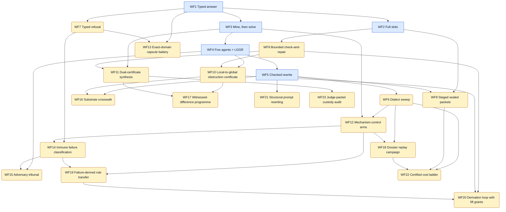

# Workflow DAG: WF1–WF23

**WF1–WF5 are the implemented runners. WF6–WF23 are derived designs.** Each
derived family was read off the retained pilot experiments: what the pilots
did, which check decided, and which earlier workflow they reuse. No new model
call was made to build this graph, and most of the source pilots from 52 to
187 are planned capsules that were never dispatched.

An arrow `A → B` means B reuses A's procedure or acceptance rule, so learn
and run A first.

Files: [JSON](https://github.com/dbccpage/proposal_fidelity_protocol_pfp/blob/main/workflows/dag/workflow_dag.json) · [Mermaid](https://github.com/dbccpage/proposal_fidelity_protocol_pfp/blob/main/workflows/dag/workflow_dag.mmd) ·
[SVG](https://github.com/dbccpage/proposal_fidelity_protocol_pfp/blob/main/workflows/dag/workflow_dag.svg) · [orchestration guide](https://github.com/dbccpage/proposal_fidelity_protocol_pfp/blob/main/workflows/dag/ORCHESTRATION.md).
The process and mathematics are written up in Paper 034
(`papers/034_pfp_workflow_dag_process_and_mathematics/`).

## How a team runs a family

Every family has a **goal** (decided only by its host check), a **team**
(roles with model tiers), a **teamwork pattern** and a bounded **boost**.

- **Sonnet** does most of the work: code, encoders, runs, custody.
- **Opus** does deep research: derivations, checker and certificate design,
  analysis, and usually the boost step.
- **Fable** does adversarial research: countermodels, leak tests,
  premise-removing variants, prosecution.
- The **host check** is deterministic code and is the only thing that accepts.

A **boost** is one escalation after a failed check: a stronger tier receives
the typed residual (never the expected answer), its calls are charged, and
the limit is per run. A boost changes who proposes next, not what counts as
success.

## WF1: Typed answer

**Status:** implemented runner. **Builds on:** nothing. **Model calls on the normal path:** 1.

**Goal:** One schema-valid answer that the host check accepts, or a typed refusal.

**Process:**

1. Freeze the task and response schema
2. One solver reply
3. Parse the typed envelope
4. Independent exact check

**Mathematics:**

- `accept(r) iff parse(r) = v and v = f(x) for the host-computed f`

**Host check:** typed_envelope_and_independent_exact_sum.

**Team (`solo`):** coder ×1 (sonnet); host_checker ×1 (none).

**Boost:** when host check rejects: none on the base path; WF9 adds bounded repair. Limit 0.

## WF2: Full slots

**Status:** implemented runner. **Builds on:** WF1. **Model calls on the normal path:** 1.

**Goal:** A complete slot record plus an accepted answer.

**Process:**

1. Freeze the slot catalogue
2. One reply filling operations, missing information and repair moves
3. Check slots and exact answer

**Mathematics:**

- `slot coverage: every declared slot s has a typed value or an explicit absence`

**Host check:** typed_envelope_and_independent_exact_sum.

**Team (`solo`):** coder ×1 (sonnet); host_checker ×1 (none).

**Boost:** when missing slot: none on the base path. Limit 0.

## WF3: Mine, then solve

**Status:** implemented runner. **Builds on:** WF1. **Model calls on the normal path:** 2.

**Goal:** Useful frozen guidance, then an accepted answer.

**Process:**

1. Mining call proposes operation guidance
2. Screen and freeze guidance
3. Solver call uses frozen guidance
4. Independent check

**Mathematics:**

- `guidance g is frozen before the solve: hash(g) recorded, never edited after the solver starts`

**Host check:** typed_envelope_and_independent_exact_sum.

**Team (`relay`):** miner ×1 (opus); coder ×1 (sonnet); host_checker ×1 (none).

**Boost:** when guidance screen rejects: none on the base path. Limit 0.

## WF4: Five agents + LGGR

**Status:** implemented runner. **Builds on:** WF3. **Model calls on the normal path:** 6.

**Goal:** Five isolated answers whose local checks pass and which agree globally.

**Process:**

1. One shared mining call
2. Five isolated solvers
3. Local checks per agent
4. One global compatibility check (local green, global red)

**Mathematics:**

- `global accept iff every local check passes and the local answers glue: a_1 = ... = a_5 = f(x)`

**Host check:** typed_envelope_and_independent_exact_sum.

**Team (`parallel_isolated_then_global`):** miner ×1 (opus); coder ×5 (sonnet); host_checker ×1 (none).

**Boost:** when global disagreement: none on the base path. Limit 0.

## WF5: Checked rewrite

**Status:** implemented runner. **Builds on:** WF4. **Model calls on the normal path:** 6.

**Goal:** A rewrite that preserves the protected query, then a WF4 pass.

**Process:**

1. Label every source span
2. Rewrite the whole seed into one grammar
3. Parse, decode and check preservation
4. Run WF4 against the original public input

**Mathematics:**

- `preservation: decode(rewrite(s)) = query(s) on the declared finite language`

**Host check:** typed_envelope_and_independent_exact_sum.

**Team (`parallel_isolated_then_global`):** coder ×1 (sonnet); miner ×1 (opus); coder ×5 (sonnet); host_checker ×1 (none).

**Boost:** when preservation check fails: stop; never solve an unpreserved task. Limit 0.

## WF6: Dialect sweep

**Status:** derived design. **Builds on:** WF5. **Model calls on the normal path:** 2 + 2k per seed.

**Goal:** Measure, item by item, which presentation of the same task the host accepts more often, without changing the task.

**Source pilots:** 0000000-0000019. Pilots 0-10 retain 53-83 test capsules each (seed, P*, ten seed rewrites, ten P* rewrites); a few capsules hold manual live replies, most are offline controls.

**Process:**

1. Freeze one seed and its host answer
2. Compile P* and k checked rewrites (dialects) of seed and P*
3. Dispatch each capsule once under the same model and parameters
4. Grade every reply with the same host checker
5. Report acceptance per dialect, item by item

**Mathematics:**

- `dialect family {rho_k}: decode(rho_k(s)) = q(s) for every k (preservation precondition)`
- `acceptance A_k = (1/N) sum_i 1[check(r_ik)] compared pairwise on the same items`
- `exact rational structure delta: Net = Delta_created - Delta_removed`

**Host check:** family checker (e.g. exact linear algebra, graph facts, graph repair, typed refusal).

**Team (`sweep_with_shared_judge`):** coder ×1 (sonnet); coder ×1 (sonnet); deep_researcher ×1 (opus); host_checker ×1 (none).

**Boost:** when a dialect fails preservation: opus proposes a corrected rewrite from the preservation residual; recheck before any dispatch. Limit 1.

## WF7: Typed refusal

**Status:** derived design. **Builds on:** WF1. **Model calls on the normal path:** 1.

**Goal:** Return the correct refusal code whenever the premises do not determine an answer.

**Source pilots:** 0000003, 0000007, 0000011, 0000015, 0000019, 0000034, 0000175. Refusal rungs 1-5 with checkers PFP-04 and PFP-14 typed refusal; pilot 34 refuses stationary traces; pilot 175 is a planned capsule.

**Process:**

1. Declare the answerability predicate and the refusal codes
2. Pose an underdetermined or undefined task
3. Accept only the correct typed refusal or a checked answer
4. Count bluffs: a confident answer to an unanswerable task

**Mathematics:**

- `answerable(A x = b) iff rank(A) = rank([A|b]) = n; otherwise the right outcome is UNRESOLVED <code>`
- `bluff rate = #(answered and unanswerable) / #unanswerable`

**Host check:** typed refusal checker.

**Team (`red_team_pair`):** coder ×1 (sonnet); adversary ×1 (fable); host_checker ×1 (none).

**Boost:** when bluff detected: fable adds the variant to the negative-control bank; no retry on the same item. Limit 0.

## WF8: Staged sealed packets

**Status:** derived design. **Builds on:** WF2, WF5. **Model calls on the normal path:** k.

**Goal:** Each stage produces a sealed, typed output; the final answer checks.

**Source pilots:** 0000001-0000025, 0000033. Mode trials mode_01..mode_20 and wire encodings (EBNF wire, S(n) wire, boundary packets, glyph alphabets); pilot 20 runs two local stages with zero provider calls; pilot 33 documents a two-pass loop the old runner did not implement.

**Process:**

1. Choose a mode contract and wire encoding
2. Split the task into k declared stages
3. Seal each stage output (hash chain) before the next stage reads it
4. Check every stage receipt and the final answer

**Mathematics:**

- `composition F = f_k o ... o f_1 with typed interfaces between stages`
- `seal chain h_0 = H(seed), h_i = H(h_{i-1} || payload_i); any edit breaks every later h_j`

**Host check:** per-stage receipts plus the family checker.

**Team (`relay`):** coder ×k (sonnet); deep_researcher ×1 (opus); host_checker ×1 (none).

**Boost:** when a stage receipt fails: rerun that stage once with opus and the receipt residual; earlier seals are reused. Limit 1.

## WF9: Bounded check-and-repair

**Status:** derived design. **Builds on:** WF2. **Model calls on the normal path:** 1..L.

**Goal:** An accepted reply within L attempts, or a recorded stop at the limit.

**Source pilots:** 0000002, 0000006, 0000010, 0000026, 0000049, 0000055, 0000062, 0000096. Pilot 49 is a deterministic mock (41 then 42, two mock calls, zero provider cost); pilot 26 retains all three least-cost repairs of an odd XOR cycle; graph-repair rungs use PFP-03.

**Process:**

1. Check the reply
2. On rejection return only the typed residual (never the expected answer)
3. Allow at most L repair attempts
4. Stop at the first accepted reply or at the limit

**Mathematics:**

- `XOR cycle: a consistent assignment exists iff the cycle sum of edge labels is 0 mod 2`
- `minimal repair: argmin |Delta| subject to c + Delta in im(delta_0) for the edge cochain c`
- `termination: attempts <= L, and each attempt is charged`

**Host check:** repair checker (coboundary or parity).

**Team (`proposer_with_residual_feedback`):** coder ×1 (sonnet); host_checker ×1 (none).

**Boost:** when two rejections in a row: final attempt goes to opus with the full residual history. Limit 1.

## WF10: Local-to-global obstruction certificate

**Status:** derived design. **Builds on:** WF4, WF9. **Model calls on the normal path:** 1 + n_patches.

**Goal:** A checked gluing witness or a checked obstruction class for the declared cover.

**Source pilots:** 0000029, 0000039-0000045, 0000051, 0000056-0000064, 0000083. Pilot 51 records live runs on the three-patch observer-visibility obstruction; 39-45 are offline exact checkers (angle defects, Hodge, clique homology, triangle fans); 56-64 are planned capsules.

**Process:**

1. Declare the cover, cochains and restriction maps
2. Agents certify local sections on each patch
3. Host computes the global obstruction class
4. Accept a gluing witness or an obstruction certificate, never a prose claim

**Mathematics:**

- `H^1 = ker(delta_1) / im(delta_0); a class [c] != 0 means local green, global red`
- `three-patch observer visibility: each observer sees zero on its edges, yet sum_alpha J^alpha(s) > 0 for the glued section`
- `Hodge: c = delta alpha + delta^* beta + h with h harmonic (exact rational arithmetic)`
- `integer lift: an obstruction in H^1(X; Z) can survive the map to rational coefficients only if it is non-torsion`

**Host check:** exact cochain / homology checker.

**Team (`parallel_isolated_then_global`):** coder ×n_patches (sonnet); deep_researcher ×1 (opus); adversary ×1 (fable); host_checker ×1 (none).

**Boost:** when local checks pass but the global check fails: opus receives the coboundary residual and proposes either a repair (WF9) or an obstruction certificate. Limit 1.

## WF11: Dual-certificate synthesis

**Status:** derived design. **Builds on:** WF3, WF9. **Model calls on the normal path:** planned, budget-capped.

**Goal:** A frozen solver whose every output carries a certificate the judge accepts on hidden cases.

**Source pilots:** 0000027, 0000053, 0000054, 0000095, 0000115-0000124, 0000171, 0000180, c051, c052, c053, c054, c055, c059. Challenge folders c051-c055 and c059 hold participant packets, judge packets, reference solvers and commit-reveal scripts; dossier LP pilots are planned capsules.

**Process:**

1. Publish the participant packet; keep the judge packet sealed
2. Team writes a solver that emits certificates, not just answers
3. Commit H(salt || solver) before hidden cases are revealed
4. Judge checks each certificate with exact dot products

**Mathematics:**

- `LP optimality: x >= 0, A x <= b, y >= 0, A^T y >= c, c.x = b.y (weak duality closes the gap)`
- `infeasibility (Farkas): y >= 0, A^T y >= 0, b.y < 0`
- `max-flow value = min-cut capacity; assignment potentials u_i + v_j <= c_ij with equality on the matching`
- `Bareiss fraction-free elimination keeps every intermediate an exact integer`

**Host check:** exact certificate checker plus an independent second checker.

**Team (`research_cell`):** coder ×2 (sonnet); deep_researcher ×1 (opus); adversary ×1 (fable); host_checker ×1 (none).

**Boost:** when a certificate is rejected on public cases: opus reads the rejected certificate and the checker message, proposes one patch; sonnet applies it. Limit 2.

## WF12: Mechanism-control arms

**Status:** derived design. **Builds on:** WF6, WF3. **Model calls on the normal path:** arms x items.

**Goal:** An arm comparison on a fixed carrier whose only difference is the mechanism note.

**Source pilots:** 0000052. Ten planned capsules (c001-c010) on one integer rank-difference carrier with three distractor spans; no model was called and the checker id is not registered.

**Process:**

1. Hold the carrier fixed; vary only the mechanism note
2. Run baseline, typed-witness and mechanism arms on the same items
3. Grade with one registered checker
4. Compare arms item by item

**Mathematics:**

- `rank difference: r_i - r_j recovered from a gauge-fixed assignment; gauge freedom r -> r + c leaves differences unchanged`
- `paired effect: d_i = 1[check(arm_B, i)] - 1[check(arm_A, i)]`

**Host check:** integer rank-difference certificate (to be registered).

**Team (`sweep_with_shared_judge`):** coder ×1 (sonnet); deep_researcher ×1 (opus); adversary ×1 (fable); host_checker ×1 (none).

**Boost:** when leak found: rebuild the carrier; discard affected runs. Limit 0.

## WF13: Exact-domain capsule battery

**Status:** derived design. **Builds on:** WF1, WF7. **Model calls on the normal path:** 1 per capsule.

**Goal:** One checked answer or refusal per domain capsule.

**Source pilots:** 0000065-0000114, 0000177, 0000176, 0000178, 0000187. Fifty planned single-capsule pilots, one per catalog challenge, each naming a domain checker id; none was dispatched.

**Process:**

1. One catalog challenge becomes one capsule
2. A domain checker is registered before dispatch
3. One reply or typed refusal per capsule
4. Results stay per domain; no cross-domain average is claimed

**Mathematics:**

- `stabilizer codes: generators commute iff their symplectic product is 0 mod 2`
- `U(1) anomaly freedom: sum_i q_i = 0 and sum_i q_i^3 = 0 over the declared charges`
- `Regge deficit: epsilon = 2 pi - sum of dihedral angles at a hinge`
- `commutator [g, h] = g^-1 h^-1 g h, checked in the declared finite group`

**Host check:** per-domain registered checker.

**Team (`solo`):** coder ×1 (sonnet); deep_researcher ×1 (opus); host_checker ×1 (none).

**Boost:** when checker rejects: one opus attempt with the checker message. Limit 1.

## WF14: Immune failure classification

**Status:** derived design. **Builds on:** WF7, WF12. **Model calls on the normal path:** per candidate.

**Goal:** Detectors that catch the recorded failures and never fire on the sealed self panel.

**Source pilots:** 0000125-0000134. Ten planned capsules (C081-C090), e.g. negative selection against a sealed self panel; none dispatched.

**Process:**

1. Seal a self panel of known-good outputs
2. Propose candidate detectors (antibodies) from observed failures
3. Reject any detector that fires on the self panel
4. Admit a detector only with two signals: a failure match and a host check

**Mathematics:**

- `negative selection: keep d iff for all s in Self, match(d, s) < theta`
- `two-signal gate: admit iff signal_1 (pattern) and signal_2 (host evidence)`
- `self-tolerance = 1 - false positives on Self / |Self|`

**Host check:** detector admission check over the sealed panel.

**Team (`red_team_pair`):** coder ×1 (sonnet); adversary ×1 (fable); host_checker ×1 (none).

**Boost:** when a detector fires on Self: discard it; opus may propose one narrower detector. Limit 1.

## WF15: Adversary tribunal

**Status:** derived design. **Builds on:** WF4, WF14. **Model calls on the normal path:** 2 per claim.

**Goal:** A verdict that the finite check supports, with both sides frozen first.

**Source pilots:** 0000035, 0000135-0000144. Pilot 35 freezes role submissions and checks them separately (118 tests, 17 mutations); 135-144 are planned tribunal capsules (e.g. modal model checking).

**Process:**

1. Prosecutor and defender submit independently; submissions are frozen
2. Neither sees the other before freezing
3. The host checks each claim on the finite model
4. Verdict comes only from the check; rhetoric is not evidence

**Mathematics:**

- `Kripke model M = (W, R, V); M, w |= box phi iff phi holds at every R-successor of w`
- `argument acceptance: grounded extension of the attack graph, computed by the host`
- `finite predicate example: sum(left) <= sum(right) on 1..16 bounded integers`

**Host check:** finite model checker.

**Team (`tribunal`):** prosecutor ×1 (fable); defender ×1 (opus); coder ×1 (sonnet); host_checker ×1 (none).

**Boost:** when both submissions fail the check: one fresh opus round per side with the checker output. Limit 1.

## WF16: Substrate crosswalk

**Status:** derived design. **Builds on:** WF5, WF10. **Model calls on the normal path:** 1 per capsule.

**Goal:** A translation that preserves every declared relation, with alternatives recorded.

**Source pilots:** 0000145-0000169. Twenty-five planned capsules (G01-G25), e.g. reading non-uniqueness in Lean; none dispatched.

**Process:**

1. Declare source and target substrates (e.g. prose, Lean, finite tables)
2. Translate generators and relations
3. Check that relations are preserved on the target
4. Record every non-unique choice

**Mathematics:**

- `a crosswalk F: C -> D is accepted iff F(r) holds in D for every relation r of C`
- `non-uniqueness: F and F' both preserve relations yet differ on a generator; both are recorded`

**Host check:** relation-preservation checker (Lean or finite tables).

**Team (`research_cell`):** coder ×1 (sonnet); deep_researcher ×1 (opus); adversary ×1 (fable); host_checker ×1 (none).

**Boost:** when Lean or table check fails: opus repairs the encoding from the error. Limit 2.

## WF17: Witnessed-difference programme

**Status:** derived design. **Builds on:** WF10, WF11. **Model calls on the normal path:** research budget, capped.

**Goal:** Each claimed difference has a checked witness and each equivalence a checked certificate.

**Source pilots:** 0000170-0000187. Eighteen planned capsules (W01-W18): behavioral equivalence, cochain quotients, Cech gluing, Fenchel-Rockafellar duality, LGGR I-VI, countermodels CE1-CE5; none dispatched.

**Process:**

1. State two artifacts and the claimed difference or equivalence
2. Require a witness for a difference and a certificate for an equivalence
3. Pair every theorem with countermodels
4. Host checks witnesses on finite instances

**Mathematics:**

- `behavioral equivalence: a bisimulation relation B with (p, q) in B and matching transitions`
- `Fenchel-Rockafellar: inf_x f(x) + g(Ax) = sup_y -f^*(A^T y) - g^*(-y) under the stated qualification`
- `Cech gluing obstruction lives in the first Cech cohomology of the cover`

**Host check:** witness / countermodel checker.

**Team (`research_cell`):** deep_researcher ×2 (opus); adversary ×1 (fable); coder ×2 (sonnet); host_checker ×1 (none).

**Boost:** when countermodel found: claim is narrowed or withdrawn; opus restates it once. Limit 1.

## WF18: Dossier replay campaign

**Status:** derived design. **Builds on:** WF6, WF12. **Model calls on the normal path:** 30 per pilot.

**Goal:** A replayable 5 x 5 + 5 campaign whose every grade reproduces from stored bytes.

**Source pilots:** 0000188-0000191. Each pilot crosses five finite carriers with five wrapped representations plus five matched guidance trials (30 capsules each); replay and learning runners exist in the source estate.

**Process:**

1. Fix five carriers and five representations (including emoji and glyph carrier encodings with an explicit legend)
2. Run the 5 x 5 baseline
3. Run five matched guidance trials
4. Replay from stored bytes and extract learning

**Mathematics:**

- `frustrated spin triangle: no s in {+1,-1}^3 satisfies s_i s_j = -1 on all three edges (odd cycle)`
- `weighted cycle duality: a feasible potential exists iff no negative cycle exists`
- `design: 25 baseline cells + 5 matched cells, compared per carrier`

**Host check:** family checker; replay must reproduce every grade.

**Team (`sweep_with_shared_judge`):** coder ×2 (sonnet); deep_researcher ×1 (opus); host_checker ×1 (none).

**Boost:** when replay grade differs: stop the campaign; investigate custody before any new call. Limit 0.

## WF19: Failure-derived rule transfer

**Status:** derived design. **Builds on:** WF12, WF14. **Model calls on the normal path:** arms x held-out items.

**Goal:** A rule that improves held-out acceptance without new false positives.

**Source pilots:** 0000192-0000198. Seven partially executed learning pilots over challenge families A-F plus harness tests; reference solver outputs are controls, never model responses.

**Process:**

1. Compare baseline, typed-witness and failure-derived rule prompts
2. Use disjoint held-out cases
3. Allow at most two stages; checker disagreement stops the run
4. A rule stays a candidate until transfer and self-tolerance are measured

**Mathematics:**

- `transfer gain = acc(rule, held-out) - acc(baseline, held-out) on disjoint items`
- `a rule is admitted only if gain > 0 and self-tolerance holds (WF14)`

**Host check:** original domain judges; disagreement halts.

**Team (`research_cell`):** deep_researcher ×1 (opus); adversary ×1 (fable); coder ×1 (sonnet); host_checker ×1 (none).

**Boost:** when rule shows no gain: one revised rule from opus; otherwise the rule is retired. Limit 1.

## WF20: Derivation loop with lift grants

**Status:** derived design. **Builds on:** WF9, WF10, WF19. **Model calls on the normal path:** 5 per pilot.

**Goal:** Discharge the named obligations or stop with a typed record at the loop limit.

**Source pilots:** 0000199-0000203. Each pilot ran five loops: five provider trials and twenty host stages, capped at USD 0.05, 120,000 tokens and 180 s; analytical status stays unverified until independent proof review.

**Process:**

1. Proposal against named obligations
2. Lift grant: the host licenses which higher structure may be used
3. Witness check on the exact finite control
4. Negative control
5. Learning refinement for the next loop; stop at the loop limit

**Mathematics:**

- `loop state (P_t, G_t, W_t); P_{t+1} = refine(P_t, residual_t) with t <= 5`
- `metric/cochain bridge: additive curvature and metric Regge holonomy are checked separately`
- `terminal policy: halt on certificate, on budget, or on the loop limit, whichever comes first`

**Host check:** finite witness controls; proofs need independent review.

**Team (`research_cell`):** deep_researcher ×1 (opus); adversary ×1 (fable); coder ×1 (sonnet); host_checker ×1 (none).

**Boost:** when witness check fails twice: next loop starts from the adversary's counterexample. Limit 1.

## WF21: Structural prompt rewriting

**Status:** derived design. **Builds on:** WF5. **Model calls on the normal path:** 0 (deterministic) or 1 per proposed rule.

**Goal:** Rewrites that attach hints or encodings without touching protected bytes.

**Source pilots:** 0000028, 0000030, 0000050, acset_prompt_rewriting, acset_cochain_rewriting. Offline pilots: grammar selection preserving bytes (28), a normal form that loses the question (30), no substitution inside substituted data (50), and finite ACSet/DPO rewriting with an exact judge.

**Process:**

1. Represent the prompt as an attributed graph with protected task, constraint and output nodes
2. Apply a rule only through an explicit injective match
3. Check protected bytes are unchanged
4. Refuse a rewrite whose normal form drops the question

**Mathematics:**

- `double-pushout rewrite: L <- K -> R with injective match m: L -> G; the pushout complement must exist (gluing condition)`
- `protected invariant: bytes(protected(G')) = bytes(protected(G))`

**Host check:** byte-preservation and exact judge.

**Team (`red_team_pair`):** coder ×1 (sonnet); adversary ×1 (fable); host_checker ×1 (none).

**Boost:** when meaning-loss case found: add it as a refusal test. Limit 0.

## WF22: Certified cost ladder

**Status:** derived design. **Builds on:** WF6, WF8, WF18. **Model calls on the normal path:** items x arms.

**Goal:** Decide each pre-registered hypothesis on this bank, at this rung, with this gate.

**Source pilots:** certified_ladder. Pre-registered design with fourteen falsifiable hypotheses (H0-H13) and pinned baseline models; arms vary stage count 1-8, rewrites, model tier and antibodies.

**Process:**

1. Pre-register items, arms and hypotheses
2. Every arm ends with one canonical ANSWER line or ANSWER: UNRESOLVED <code>
3. Run every item under every arm
4. Evaluate hypotheses item by item with refutation criteria

**Mathematics:**

- `cost to certified correct: C_arm = total spend / #accepted`
- `paired test on discordant items (McNemar-style): b = #(A ok, B fail), c = #(A fail, B ok)`
- `bluff rate per arm, as in WF7`

**Host check:** family certificate checkers; hypothesis evaluator.

**Team (`sweep_with_shared_judge`):** coder ×2 (sonnet); deep_researcher ×1 (opus); adversary ×1 (fable); host_checker ×1 (none).

**Boost:** when none: a ladder run never escalates mid-campaign: boosted arms are separate pre-registered arms. Limit 0.

## WF23: Judge-packet custody audit

**Status:** derived design. **Builds on:** WF11. **Model calls on the normal path:** 0.

**Goal:** Show that every challenge packet is sealed and leak-free before any team runs it.

**Source pilots:** judge_packet_audit. Audit modules for canonical form, custody, execution, layout and leakage of challenge packets.

**Process:**

1. Canonicalise participant and judge packets
2. Hash every file
3. Test that no expected answer is derivable from participant bytes
4. Verify the judge executes the sealed checker version

**Mathematics:**

- `leakage test: the expected answer does not appear in, and is not a declared function of, participant bytes`
- `custody: recorded SHA-256 equals the hash of the executed bytes`

**Host check:** audit report.

**Team (`red_team_pair`):** coder ×1 (sonnet); adversary ×1 (fable); host_checker ×1 (none).

**Boost:** when leak found: block the challenge until it is resealed. Limit 0.
