# Workflow DAG: WF1–WF49

AuthorityEffect: None. This folder describes workflow designs and their
sources. It adds no measured result.

**WF1–WF5 are implemented** (`pfp.workflows`, offline-verified).
**WF6–WF49 are proposals.** They were derived on 2026-11-05 by reading
the retained pilot estate of the sibling research repository (`pilot_0000000`
through `pilot_0000203` and its auxiliary folders: the certified cost ladder,
the commit-reveal challenge folders, the ACSet rewriting pilots and the
judge-packet audit). No model was called to make this graph. A proposal node
records a procedure, its mathematics, its host check and the evidence the
pilots hold; it is not a runner and it is not a performance claim. Most
pilots from 52 to 187 are planned capsules that were never dispatched, and
each node's `source_evidence` says so.

| File | What it is |
| --- | --- |
| [`workflow_dag.json`](workflow_dag.json) | Machine-readable graph (`pfp.workflow-dag.v1`): nodes, edges, process, mathematics, host check, team, goal and boost |
| [`workflow_dag.mmd`](workflow_dag.mmd) | The same graph as Mermaid source |
| [`workflow_dag.svg`](workflow_dag.svg) | A rendered, layered drawing |
| [`ORCHESTRATION.md`](ORCHESTRATION.md) | How goal, team and boost work for every node, and which model tier does what |

An edge `A → B` means B reuses A's procedure or acceptance rule as a step, so
A should be understood and working first. The graph is acyclic: every node's
dependencies appear before it in `workflow_dag.json`.

```mermaid
flowchart TD
  WF1["WF1 Typed answer<br/><small>base</small>"]
  WF2["WF2 Full slots<br/><small>procedure extension</small>"]
  WF3["WF3 Mine, then solve<br/><small>procedure extension</small>"]
  WF4["WF4 Five agents + LGGR<br/><small>procedure extension</small>"]
  WF5["WF5 Checked rewrite<br/><small>procedure extension</small>"]
  WF6("WF6 Dialect sweep<br/><small>experiment design</small>")
  WF7("WF7 Typed refusal<br/><small>procedure extension</small>")
  WF8("WF8 Staged sealed packets<br/><small>procedure extension</small>")
  WF9("WF9 Bounded check-and-repair<br/><small>procedure extension</small>")
  WF10("WF10 Local-to-global obstruction certificate<br/><small>task preset</small>")
  WF11("WF11 Dual-certificate synthesis<br/><small>task preset</small>")
  WF12("WF12 Mechanism-control arms<br/><small>experiment design</small>")
  WF13("WF13 Exact-domain capsule battery<br/><small>task preset</small>")
  WF14("WF14 Immune failure classification<br/><small>meta workflow</small>")
  WF15("WF15 Adversary tribunal<br/><small>procedure extension</small>")
  WF16("WF16 Substrate crosswalk<br/><small>task preset</small>")
  WF17("WF17 Witnessed-difference programme<br/><small>task preset</small>")
  WF18("WF18 Dossier replay campaign<br/><small>harness gate</small>")
  WF19("WF19 Failure-derived rule transfer<br/><small>experiment design</small>")
  WF20("WF20 Derivation loop with lift grants<br/><small>procedure extension</small>")
  WF21("WF21 Structural prompt rewriting<br/><small>procedure extension</small>")
  WF22("WF22 Certified cost ladder<br/><small>experiment design</small>")
  WF23("WF23 Judge-packet custody audit<br/><small>harness gate</small>")
  WF24("WF24 Pinned-token operational scratchpad<br/><small>procedure extension</small>")
  WF25("WF25 Hierarchical decimation<br/><small>procedure extension</small>")
  WF26("WF26 Multi-round antibody dialogue<br/><small>procedure extension</small>")
  WF27("WF27 Hinted retraction with a stationary-loop detector<br/><small>procedure extension</small>")
  WF28("WF28 Eight-role audit dialogue<br/><small>procedure extension</small>")
  WF29("WF29 Checker synthesis scored by mutation kill rate<br/><small>task preset</small>")
  WF30("WF30 Constraint-forcing anti-recitation<br/><small>procedure extension</small>")
  WF31("WF31 Multi-agent tournament with held-out cross-validation<br/><small>experiment design</small>")
  WF32("WF32 Claim-scoped receipt<br/><small>procedure extension</small>")
  WF33("WF33 Recursive re-entry with shared fuel<br/><small>procedure extension</small>")
  WF34("WF34 Future-faithful compression and bounded context<br/><small>procedure extension</small>")
  WF35("WF35 Proposal-channel comparison<br/><small>experiment design</small>")
  WF36("WF36 Guarded staged slot materialisation<br/><small>procedure extension</small>")
  WF37("WF37 Evidence-bound harness evolution<br/><small>meta workflow</small>")
  WF38("WF38 Diagnostic-trace proposal selection<br/><small>procedure extension</small>")
  WF39("WF39 Authority firewall gate<br/><small>harness gate</small>")
  WF40("WF40 Restart boundary after exhausted repair<br/><small>procedure extension</small>")
  WF41("WF41 Detector adequacy and two-signal admission<br/><small>meta workflow</small>")
  WF42("WF42 Reasoning-trace validation<br/><small>procedure extension</small>")
  WF43("WF43 Gate-honesty and answer-free leak audit<br/><small>harness gate</small>")
  WF44("WF44 Exact certificate presets<br/><small>task preset</small>")
  WF45("WF45 Finite terminal selector and plenitude test<br/><small>procedure extension</small>")
  WF46("WF46 Boundary sufficiency and gluing diagnostic<br/><small>procedure extension</small>")
  WF47("WF47 Resumable bounded frontier search<br/><small>procedure extension</small>")
  WF48("WF48 Commit-reveal with a hostile mutation gate<br/><small>harness gate</small>")
  WF49("WF49 Query-preservation stage and mode campaign<br/><small>experiment design</small>")
  WF1 --> WF2
  WF1 --> WF3
  WF3 --> WF4
  WF4 --> WF5
  WF5 --> WF6
  WF1 --> WF7
  WF2 --> WF8
  WF5 --> WF8
  WF2 --> WF9
  WF4 --> WF10
  WF9 --> WF10
  WF3 --> WF11
  WF9 --> WF11
  WF6 --> WF12
  WF3 --> WF12
  WF1 --> WF13
  WF7 --> WF13
  WF7 --> WF14
  WF12 --> WF14
  WF4 --> WF15
  WF14 --> WF15
  WF5 --> WF16
  WF10 --> WF16
  WF10 --> WF17
  WF11 --> WF17
  WF6 --> WF18
  WF12 --> WF18
  WF12 --> WF19
  WF14 --> WF19
  WF9 --> WF20
  WF10 --> WF20
  WF19 --> WF20
  WF5 --> WF21
  WF6 --> WF22
  WF8 --> WF22
  WF18 --> WF22
  WF11 --> WF23
  WF2 --> WF24
  WF24 --> WF25
  WF9 --> WF26
  WF14 --> WF26
  WF9 --> WF27
  WF15 --> WF28
  WF11 --> WF29
  WF1 --> WF30
  WF1 --> WF31
  WF1 --> WF32
  WF2 --> WF32
  WF9 --> WF33
  WF20 --> WF33
  WF8 --> WF34
  WF22 --> WF34
  WF6 --> WF35
  WF12 --> WF35
  WF8 --> WF36
  WF19 --> WF37
  WF22 --> WF37
  WF9 --> WF38
  WF1 --> WF39
  WF23 --> WF39
  WF9 --> WF40
  WF20 --> WF40
  WF14 --> WF41
  WF10 --> WF42
  WF21 --> WF42
  WF23 --> WF43
  WF11 --> WF44
  WF10 --> WF44
  WF7 --> WF45
  WF4 --> WF46
  WF9 --> WF47
  WF11 --> WF48
  WF23 --> WF48
  WF8 --> WF49
  WF22 --> WF49
  classDef implemented fill:#dbeafe,stroke:#1d4ed8,color:#0f172a
  classDef gate fill:#e5e7eb,stroke:#4b5563,color:#0f172a
  classDef derived fill:#fef3c7,stroke:#b45309,color:#0f172a
  class WF1,WF2,WF3,WF4,WF5 implemented
  class WF6,WF7,WF8,WF9,WF10,WF11,WF12,WF13,WF14,WF15,WF16,WF17,WF19,WF20,WF21,WF22,WF24,WF25,WF26,WF27,WF28,WF29,WF30,WF31,WF32,WF33,WF34,WF35,WF36,WF37,WF38,WF40,WF41,WF42,WF44,WF45,WF46,WF47,WF49 derived
  class WF18,WF23,WF39,WF43,WF48 gate
```

## Reading the source citations

The `Pnnn` citations below (for example `P026 §3-4`) use the paper numbers in
force when the nodes were written, before the papers were split and renumbered
on 2026-11-06. Several old numbers named two papers, which is why some
citations carry a hint such as `P027(firewall)` or `P004(role)`.
[`papers/RENUMBERING.md`](../../papers/RENUMBERING.md)
translates each one. The unambiguous ones: P000-P010 are PFP 000-010;
P011 is PFP 012; P021 is PFP 011; P022 is PFP 020; P023-P025 are PFP 013-015;
P034 is PFP 021; P013, P018, P019, P030 and P033 are non-PFP 005, 007, 008,
011 and 009. P001-P005 and P026-P029 need the hint or the topic: for example
P027(firewall) is non-PFP 010, P028(finite authority) is non-PFP 014,
P004(role) is non-PFP 012, P004(DSL) is non-PFP 003 and P003(rep) is non-PFP 015.

## Structure: one base and its extensions

The 2026-11-05 research committee
([report](../../docs/research/2026-11-05_committee_report.md)) found about six
real procedures behind the first 23 nodes; WF24–WF49 were added on 2026-11-06 from the findings notes and the papers. Each node now has a `kind`:

| Kind | Meaning | Nodes |
| --- | --- | --- |
| base | The typed task turn: frozen task, one typed reply, independent host check, replay, accounting. | WF1 |
| procedure extension | Adds one step or contract to the base (or to another extension). A real procedure. | WF2, WF3, WF4, WF5, WF7, WF8, WF9, WF15, WF20, WF21, WF24, WF25, WF26, WF27, WF28, WF30, WF32, WF33, WF34, WF36, WF38, WF40, WF42, WF45, WF46, WF47 |
| task preset | The same procedure with a different task family and checker. Kept as a named preset, not a new procedure; merge_into names the procedure it runs. | WF10, WF11, WF13, WF16, WF17, WF29, WF44 |
| experiment design | Wraps any workflow to compare arms (sweeps, held-out transfer, cost ladders). merge_into 'Sweep' marks designs that are one sweep with different arm sets. | WF6, WF12, WF19, WF22, WF31, WF35, WF49 |
| meta workflow | Acts on prompts or detectors rather than on one task (immune lifecycle, prompt evolution). | WF14, WF37, WF41 |
| harness gate | Required on every run (seal chain, replay, custody audit); not a research node. | WF18, WF23, WF39, WF43, WF48 |

Many apparent workflows are **settings**: task family, checker, dialect,
rung, model, temperature, antibodies, stage count, attempt limit, replicate
count, carrier alphabet and arm template. They vary a run; they do not make a
new workflow. `merge_into` names where a node is expected to fold in.

## The families

| WF | Family | Kind | Builds on | Source in the pilot estate | Team pattern | Model tiers by role |
| --- | --- | --- | --- | --- | --- | --- |
| WF1 | Typed answer (implemented) | base | — | WF1–WF5 runs | `solo` | sonnet: coder |
| WF2 | Full slots (implemented) | procedure extension | WF1 | WF1–WF5 runs | `solo` | sonnet: coder |
| WF3 | Mine, then solve (implemented) | procedure extension | WF1 | WF1–WF5 runs | `relay` | sonnet: coder; opus: miner |
| WF4 | Five agents + LGGR (implemented) | procedure extension | WF3 | WF1–WF5 runs | `parallel_isolated_then_global` | sonnet: coder; opus: miner |
| WF5 | Checked rewrite (implemented) | procedure extension | WF4 | WF1–WF5 runs | `parallel_isolated_then_global` | sonnet: coder; opus: miner |
| WF6 | Dialect sweep | experiment design → Sweep | WF5 | 0000000-0000019 | `sweep_with_shared_judge` | sonnet: coder; opus: deep_researcher |
| WF7 | Typed refusal | procedure extension | WF1 | 0000003, 0000007, 0000011, 0000015, 0000019, 0000034, 0000175 | `red_team_pair` | sonnet: coder; fable: adversary |
| WF8 | Staged sealed packets | procedure extension | WF2, WF5 | 0000001-0000025, 0000033 | `relay` | sonnet: coder; opus: deep_researcher |
| WF9 | Bounded check-and-repair | procedure extension | WF2 | 0000002, 0000006, 0000010, 0000026, 0000049, 0000055, 0000062, 0000096 | `proposer_with_residual_feedback` | sonnet: coder |
| WF10 | Local-to-global obstruction certificate | task preset → WF4 | WF4, WF9 | 0000029, 0000039-0000045, 0000051, 0000056-0000064, 0000083 | `parallel_isolated_then_global` | sonnet: coder; opus: deep_researcher; fable: adversary |
| WF11 | Dual-certificate synthesis | task preset → WF1 | WF3, WF9 | 0000027, 0000053, 0000054, 0000095, 0000115-0000124, 0000171, 0000180, c051, c052, c053, c054, c055, c059 | `research_cell` | sonnet: coder; opus: deep_researcher; fable: adversary |
| WF12 | Mechanism-control arms | experiment design → Sweep | WF6, WF3 | 0000052 | `sweep_with_shared_judge` | sonnet: coder; opus: deep_researcher; fable: adversary |
| WF13 | Exact-domain capsule battery | task preset → WF1 | WF1, WF7 | 0000065-0000114, 0000177, 0000176, 0000178, 0000187 | `solo` | sonnet: coder; opus: deep_researcher |
| WF14 | Immune failure classification | meta workflow | WF7, WF12 | 0000125-0000134 | `red_team_pair` | sonnet: coder; fable: adversary |
| WF15 | Adversary tribunal | procedure extension | WF4, WF14 | 0000035, 0000135-0000144 | `tribunal` | sonnet: coder; opus: defender; fable: prosecutor |
| WF16 | Substrate crosswalk | task preset → WF5 | WF5, WF10 | 0000145-0000169 | `research_cell` | sonnet: coder; opus: deep_researcher; fable: adversary |
| WF17 | Witnessed-difference programme | task preset → WF10 | WF10, WF11 | 0000170-0000187 | `research_cell` | sonnet: coder; opus: deep_researcher; fable: adversary |
| WF18 | Dossier replay campaign | harness gate | WF6, WF12 | 0000188-0000191 | `sweep_with_shared_judge` | sonnet: coder; opus: deep_researcher |
| WF19 | Failure-derived rule transfer | experiment design | WF12, WF14 | 0000192-0000198 | `research_cell` | sonnet: coder; opus: deep_researcher; fable: adversary |
| WF20 | Derivation loop with lift grants | procedure extension → WF9 | WF9, WF10, WF19 | 0000199-0000203 | `research_cell` | sonnet: coder; opus: deep_researcher; fable: adversary |
| WF21 | Structural prompt rewriting | procedure extension → WF5 | WF5 | 0000028, 0000030, 0000050, acset_prompt_rewriting, acset_cochain_rewriting | `red_team_pair` | sonnet: coder; fable: adversary |
| WF22 | Certified cost ladder | experiment design → Sweep | WF6, WF8, WF18 | certified_ladder | `sweep_with_shared_judge` | sonnet: coder; opus: deep_researcher; fable: adversary |
| WF23 | Judge-packet custody audit | harness gate | WF11 | judge_packet_audit | `red_team_pair` | sonnet: coder; fable: adversary |
| WF24 | Pinned-token operational scratchpad | procedure extension | WF2 | F symbol_game_challenge_and_demos_findings §3.4, F challenges_findings_and_updates §8.2 (C017) | `solo` | sonnet: coder; opus: deep_researcher |
| WF25 | Hierarchical decimation | procedure extension | WF24 | F symbol_game_challenge_and_demos_findings §3.6, §15, F challenges_findings_and_updates §12 | `solo` | sonnet: coder; opus: deep_researcher |
| WF26 | Multi-round antibody dialogue | procedure extension | WF9, WF14 | F symbol_game_challenge_and_demos_findings §2 | `proposer_with_residual_feedback` | sonnet: coder; fable: adversary |
| WF27 | Hinted retraction with a stationary-loop detector | procedure extension → WF9 | WF9 | F challenges_findings_and_updates §4, §10.1, P008 §10, P027 §5.9 | `proposer_with_residual_feedback` | sonnet: coder |
| WF28 | Eight-role audit dialogue | procedure extension | WF15 | F challenges_findings_and_updates §2 | `tribunal` | sonnet: coder; opus: defender; fable: adversary |
| WF29 | Checker synthesis scored by mutation kill rate | task preset → WF11 | WF11 | F challenges_findings_and_updates §11 (C060) | `red_team_pair` | sonnet: coder; fable: adversary |
| WF30 | Constraint-forcing anti-recitation | procedure extension | WF1 | F c057_*_sorting_network_findings | `solo` | sonnet: coder; fable: adversary |
| WF31 | Multi-agent tournament with held-out cross-validation | experiment design | WF1 | P022 §3-4 | `sweep_with_shared_judge` | sonnet: coder; opus: deep_researcher; fable: adversary |
| WF32 | Claim-scoped receipt | procedure extension | WF1, WF2 | P023 §1-4 | `solo` | sonnet: coder |
| WF33 | Recursive re-entry with shared fuel | procedure extension | WF9, WF20 | P024 §1-5 | `relay` | sonnet: coder; opus: deep_researcher |
| WF34 | Future-faithful compression and bounded context | procedure extension | WF8, WF22 | P026 §1-6, §8, P029 §4 | `relay` | sonnet: coder; opus: deep_researcher |
| WF35 | Proposal-channel comparison | experiment design | WF6, WF12 | P027 §1-3, §5.1-5.2 | `sweep_with_shared_judge` | sonnet: coder; opus: deep_researcher |
| WF36 | Guarded staged slot materialisation | procedure extension → WF8 | WF8 | P027 §5.3, §5.6-5.8 | `relay` | sonnet: coder; opus: deep_researcher |
| WF37 | Evidence-bound harness evolution | meta workflow | WF19, WF22 | P029 §2-8, P004-P006 extensions | `research_cell` | sonnet: coder; opus: deep_researcher; fable: adversary |
| WF38 | Diagnostic-trace proposal selection | procedure extension → WF9 | WF9 | P026 §2-4, P018 §2-4, P019 §2-5 | `proposer_with_residual_feedback` | sonnet: coder; opus: deep_researcher |
| WF39 | Authority firewall gate | harness gate | WF1, WF23 | P027(firewall) §2.4, §3.8, P028(finite authority) §6, §12-14, P030 §4, P004(role) §3-8 | `solo` | sonnet: coder; fable: adversary |
| WF40 | Restart boundary after exhausted repair | procedure extension | WF9, WF20 | P029(boundary) §2.4, §6, P004 §6, P005 §2-5 | `proposer_with_residual_feedback` | sonnet: coder; opus: deep_researcher |
| WF41 | Detector adequacy and two-signal admission | meta workflow → WF14 | WF14 | P030 §2, P003 §3, App A, P006 §7 | `red_team_pair` | sonnet: coder; fable: adversary |
| WF42 | Reasoning-trace validation | procedure extension | WF10, WF21 | P033 §2-8 | `red_team_pair` | sonnet: coder; opus: deep_researcher; fable: adversary |
| WF43 | Gate-honesty and answer-free leak audit | harness gate | WF23 | P009 §4, App A, P010 §4.1-4.2 | `red_team_pair` | sonnet: coder; fable: adversary |
| WF44 | Exact certificate presets | task preset → WF11 | WF11, WF10 | P002(l1) §4-5, P003(l1) Thm 4.2, P001(covering) §3-4, P004(DSL), P002(signed) §5-6 | `solo` | sonnet: coder; opus: deep_researcher |
| WF45 | Finite terminal selector and plenitude test | procedure extension | WF7 | P003(representation) §2-5 | `solo` | sonnet: coder; fable: adversary |
| WF46 | Boundary sufficiency and gluing diagnostic | procedure extension | WF4 | P028(finite authority) §11, P005(authority gap) §3 | `parallel_isolated_then_global` | sonnet: coder; opus: deep_researcher |
| WF47 | Resumable bounded frontier search | procedure extension | WF9 | P002(signed) §4 | `relay` | sonnet: coder |
| WF48 | Commit-reveal with a hostile mutation gate | harness gate → WF23 | WF11, WF23 | F symbol_game_challenge_and_demos_findings §7-14, F challenges_findings_and_updates §9.3-9.5, F c043-c059 template | `red_team_pair` | sonnet: coder; fable: adversary |
| WF49 | Query-preservation stage and mode campaign | experiment design | WF8, WF22 | P011 §3-5 | `sweep_with_shared_judge` | sonnet: coder; opus: deep_researcher |

WF24–WF49 cite their findings notes (F) and papers (P###) directly. Pilot numbers are directory numbers in the source estate; `c051`–`c059` are
its commit-reveal challenge folders. The process and mathematics of each
family are summarised in
[Paper 021](../../papers/pfp/021_pfp_workflow_dag_process_and_mathematics/paper.md).

## Goal and boost per family

| WF | Goal | Boost: trigger → action (limit) |
| --- | --- | --- |
| WF1 | One schema-valid answer that the host check accepts, or a typed refusal. | host check rejects → none on the base path; WF9 adds bounded repair (0) |
| WF2 | A complete slot record plus an accepted answer. | missing slot → none on the base path (0) |
| WF3 | Useful frozen guidance, then an accepted answer. | guidance screen rejects → none on the base path (0) |
| WF4 | Five isolated answers whose local checks pass and which agree globally. | global disagreement → none on the base path (0) |
| WF5 | A rewrite that preserves the protected query, then a WF4 pass. | preservation check fails → stop; never solve an unpreserved task (0) |
| WF6 | Measure, item by item, which presentation of the same task the host accepts more often, without changing the task. | a dialect fails preservation → opus proposes a corrected rewrite from the preservation residual; recheck before any dispatch (1) |
| WF7 | Return the correct refusal code whenever the premises do not determine an answer. | bluff detected → fable adds the variant to the negative-control bank; no retry on the same item (0) |
| WF8 | Each stage produces a sealed, typed output; the final answer checks. | a stage receipt fails → rerun that stage once with opus and the receipt residual; earlier seals are reused (1) |
| WF9 | An accepted reply within L attempts, or a recorded stop at the limit. | two rejections in a row → final attempt goes to opus with the full residual history (1) |
| WF10 | A checked gluing witness or a checked obstruction class for the declared cover. | local checks pass but the global check fails → opus receives the coboundary residual and proposes either a repair (WF9) or an obstruction certificate (1) |
| WF11 | A frozen solver whose every output carries a certificate the judge accepts on hidden cases. | a certificate is rejected on public cases → opus reads the rejected certificate and the checker message, proposes one patch; sonnet applies it (2) |
| WF12 | An arm comparison on a fixed carrier whose only difference is the mechanism note. | leak found → rebuild the carrier; discard affected runs (0) |
| WF13 | One checked answer or refusal per domain capsule. | checker rejects → one opus attempt with the checker message (1) |
| WF14 | Detectors that catch the recorded failures and never fire on the sealed self panel. | a detector fires on Self → discard it; opus may propose one narrower detector (1) |
| WF15 | A verdict that the finite check supports, with both sides frozen first. | both submissions fail the check → one fresh opus round per side with the checker output (1) |
| WF16 | A translation that preserves every declared relation, with alternatives recorded. | Lean or table check fails → opus repairs the encoding from the error (2) |
| WF17 | Each claimed difference has a checked witness and each equivalence a checked certificate. | countermodel found → claim is narrowed or withdrawn; opus restates it once (1) |
| WF18 | A replayable 5 x 5 + 5 campaign whose every grade reproduces from stored bytes. | replay grade differs → stop the campaign; investigate custody before any new call (0) |
| WF19 | A rule that improves held-out acceptance without new false positives. | rule shows no gain → one revised rule from opus; otherwise the rule is retired (1) |
| WF20 | Discharge the named obligations or stop with a typed record at the loop limit. | witness check fails twice → next loop starts from the adversary's counterexample (1) |
| WF21 | Rewrites that attach hints or encodings without touching protected bytes. | meaning-loss case found → add it as a refusal test (0) |
| WF22 | Decide each pre-registered hypothesis on this bank, at this rung, with this gate. | none: a ladder run never escalates mid-campaign → boosted arms are separate pre-registered arms (0) |
| WF23 | Show that every challenge packet is sealed and leak-free before any team runs it. | leak found → block the challenge until it is resealed (0) |
| WF24 | An accepted answer whose scratchpad follows the pinned grammar. | checker rejects → opus repairs the scratchpad from the residual (1) |
| WF25 | Fit large lattices inside the token limit without losing exactness. | token ceiling reached → split into macro-blocks and rerun once (1) |
| WF26 | Converge to an accepted answer as antibodies accumulate, without leaking the answer. | two rounds without progress → opus rewrites the antibody set once (1) |
| WF27 | Repair to zero residual within the turn cap, with unassisted and assisted arms kept separate. | stationary loop → forced lift or reframe (1) |
| WF28 | A role sequence whose final packet the host accepts or refuses with a typed reason. | arbiter and host disagree → host wins; record the disagreement (0) |
| WF29 | A checker that kills every mutant and accepts every valid case. | a mutant survives → opus patches the checker once (1) |
| WF30 | Separate solving from recall. | none → recitation is a finding, not a retry (0) |
| WF31 | A ranking that holds on held-out parts of each instance. | none → tournaments do not escalate mid-round (0) |
| WF32 | A receipt that says exactly which claims were checked. | unchecked claim found → drop it from the receipt (0) |
| WF33 | Chains of re-entry that never reset their budget or lose their parent. | stale parent → refuse (0) |
| WF34 | Smaller context with no lost future operation. | dropped reference → refuse (0) |
| WF35 | Find which channel changes acceptance on the same items. | none → channels are arms, not boosts (0) |
| WF36 | Admit only complete stage-1 packets; abstain otherwise. | guard fails → one retry, then abstain (1) |
| WF37 | A harness change that wins on fresh confirmation and transfers. | no confirmed gain → retain incumbent (0) |
| WF38 | Select repairs only by host-recomputed diagnostics. | no candidate passes → typed refusal (0) |
| WF39 | No path from a fluent wrong answer to authority. | none → gates never escalate (0) |
| WF40 | End every exhausted repair with a lawful typed outcome. | none → terminal by design (0) |
| WF41 | Detectors whose adequacy is shown, not assumed. | a class is missing → DetectorInadequate (0) |
| WF42 | Validate the structure of a reasoning trace, not its fluency. | extractor collapses → CarrierFailure (0) |
| WF43 | Show no answer-free reply can pass. | leak found → block until resealed (0) |
| WF44 | Verify-easy, solve-hard tasks for every other workflow to use. | certificate rejected → one opus attempt (1) |
| WF45 | Never report a unique answer the evidence cannot separate. | none → typed verdict (0) |
| WF46 | Measure how often local passes hide a global failure. | none → diagnostic only (0) |
| WF47 | Search that can stop and resume without changing the question. | none → unknown is a lawful result (0) |
| WF48 | Scores that could not have been tuned to the hidden cases. | mutant survives → block the checker (0) |
| WF49 | Measure which stages and modes preserve the query at scale. | safety regression → stop the lane (0) |

A limit of 0 means the family never escalates; a failure is recorded and the
run stops or moves to the next item.

## Perturbations of existing workflows

A perturbation varies one setting or step of an existing workflow, so it is
recorded under that workflow rather than as a new node. These were extracted
on 2026-11-06 from the findings notes in
[`../certified_challenges/findings/`](../certified_challenges/findings/README.md)
and from the papers. The findings carry errata (withdrawn figures, leaked
answers, reference self-scores); read every "live" outcome as historical.

| Target | Setting varied | Values | Outcome | Status | Source |
| --- | --- | --- | --- | --- | --- |
| WF1 | arithmetic | float vs exact rational | floats give spurious holonomy ~1e-16 | offline | F challenges §6.2 |
| WF1 | case identifiers | descriptive vs neutral ids | descriptive ids leaked verdicts; a bare refusal passed | offline | P010 §4.2 |
| WF1 | completion ceiling | 2048 / 4096 / 8000 tokens | reasoning model returned empty replies at the cap; budget confounds reasoning vs dense | live | F c045, c046 |
| WF1 | decode controls | attention bias, grammar mask, activation patching, KV surgery, steering, repeated sampling N=1..16 | attention bias raised mass, not correctness; the rest not run | proposed | F challenges §8.1 |
| WF1 | gate subset | C1-C8 subsets; replay on/off; leakage audit on/off | — | code | P028 §6 |
| WF1 | model size ladder | 8B, 70B, a reasoning model across C043-C060 | task-dependent, not monotonic; reruns changed 5/10 outcomes | live | F c043-c059; P010 §4.1 |
| WF1 | schema examples | with vs without example values | 8B copied placeholder keys | live | F c043-c059 |
| WF1 | scratchpad | JSON verdict-first vs numeric scratchpad vs glyph runes vs runes+scratchpad+canary (405B, 50 cases) | 50% vs 74% (McNemar p=0.035) vs 48% vs 8% | live | F §4; P008 §9.3 |
| WF1 | self-report | self-critique or self-verified flag included vs stripped | never read by the host | code | P028 §7; P030 |
| WF2 | arm | unstaged vs staged vs no-model oracle | oracle 100% | live | P027 |
| WF3 | antibodies | prompt antibodies alone vs antibodies plus pinned tokens | alone: 0% on non-abelian; with pinned tokens helped | live | F synthesis |
| WF3 | priming | gauge-fixing algorithm primed first vs not | primed: 0% (pure-gauge bias) | live | F §3.4 |
| WF4 | consensus | majority vote vs component-level descent | — | code | P030 |
| WF4 | handoff object | full trace vs summary vs answer only | — | theory | P028 §11 |
| WF4 | trials for a zero-failure bound | n = 8 vs n = 299 | upper bound ~31% vs <1% | planning | P003 §7 |
| WF5 | representation | raw edge list, distractor-masked, 8-letter glyphs, full hybrid | glyphs compressed prompts 56-74% | live | F §2.3 |
| WF6 | channel | free, null, carrier filter, grammar mask | 0/8 for all on a 0.5B model | live | P027 T1 |
| WF6 | gauge and relabel twins | 8-16 invariance controls per challenge | — | offline | F c011, c051 |
| WF7 | critic channel | keyword match vs typed JSON block | keyword mode gave false blocks and passes | offline | P009 App A.2 |
| WF7 | poison-bait notes | false optimum, false max flow, false unsolvability claims | over-refusal on C049; bluffing on UNSAT Ramsey | live | F c043-c059 |
| WF7 | terminal taxonomy | ResolvedExact / ClosedResidual / OpenResidual / CoherentUpTo(N) / BudgetUnknown | — | code | P004(role) |
| WF8 | stage count and slots | 1-turn vs 2-turn; 3 vs 4 slots; guard retry 2 | gpt-4o-mini: 5/8, 3/8, 5/8; guarded 5 admitted, 3 abstained | live | P027 T2 |
| WF8 | stage interface | diagnostic-equal vs endpoint-state-equal | — | code | P026 §5, §8 |
| WF9 | accept policy | lexicographic (Phi, Gamma, X) vs Phi only; ratio ceiling; tolerance | — | code | P026 §3-4; P018 |
| WF9 | cut mode | strict descent vs non-increase | strict descent alone does not terminate over Q | offline | P001 §5; P005 §4 |
| WF9 | fuel | 1 vs 2 attempts | UNKNOWN vs CHECKED | offline | P000 §8 |
| WF9 | negative control | deletion edit that makes the ratio test pass vacuously | passes: a known gap | code | P018 CE 3.1 |
| WF9 | prompt condition | baseline, partially masked, scratchpad, hinted | baseline and masked failed; hinted passed by copying | live | P008 §10.1; F §4.1 |
| WF9 | retry kind | blind retry vs packet-changing retry | blind retry saturates as (1-p)^n p | theory | P028 §10.3 |
| WF9 | turn cap and loop trigger | 12 turns; loop after 3 repeats; 5 dialogue rounds | — | live | F §4.1, §2.3 |
| WF10 | cover and complex | add/drop 2-cells; filled vs unfilled triangle; theta graph; hexagon | — | code | P004(DSL); P018; P003(rep) |
| WF10 | extractor carrier | claim, citation, tool-trace, proof-obligation or reasoning-step graph | — | code | P033 |
| WF10 | local tolerance | tau 1/10 vs 1/5 on a hexagon | holonomy 3/5 vs bound 6/5 | code | P003(rep) Cor 3.3 |
| WF11 | mutation suites | C011, C012, C022, C031 | 150-188 mutants, all rejected by both checkers | offline | F §9.1; P021 |
| WF11 | norm family | p=1 simplex, p=2 Hodge, p=inf Chebyshev, interior p, Schatten-1 | only p in {1, 2, inf} certified exactly | code | P002(l1); P003(l1) |
| WF12 | C017 prompt arms | arms 1, 2, 5, 6 | 0/5, 0/5, 3/5, 3/5 (4/5 with decimation) | live | P010 §3 |
| WF12 | validity gate | baseline, null-hook gate, distractor mask, string delete (0.5B) | null hook matched baseline tokens 100% | live | F §8.1 |
| WF14 | calibration set | 4 cases vs one per class; omit a class | omitting a class breaks adequacy (sharp) | code | P030 §2.4 |
| WF14 | self-panel diversity | 1000 rows, 40 distinct | effective n = 40 | offline | P003; P006 |
| WF14 | toxicity threshold and decay | 1/5 threshold; decay tau = 5 | policy arithmetic, not a rate | offline | P006 §8 |
| WF15 | role omitted | each of six roles in turn | named failure label per omission | code | P004(role) §3 |
| WF22 | arrival vs completion rate | cohort vs window counting | — | code | P005(gap) §3.3 |
| WF22 | context policy | compressed vs full history at the same ceiling | — | not run | P026; P029 |
| WF22 | cross-architecture transfer | 70B vs a reasoning model on C017 | same pass rate and failure modes | live | F §3.5 |
| WF23 | witness integrity | fabricated verifier id, unbound witness, tampered hash | all refused | code | P030 §4.2 |
| WF31 | difficulty and noise | N=2 vs N=4 modes; noise budget 1/100 vs 1/50; four targets | random 0/16, others 16/16 | offline | P022 §4.2 |
