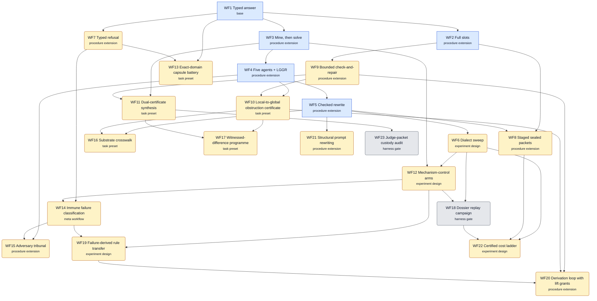

# Workflow DAG: WF1–WF23

AuthorityEffect: None. This folder describes workflow designs and their
sources. It adds no measured result.

**WF1–WF5 are implemented** (`pfp.workflows`, offline-verified).
**WF6–WF23 are proposals.** They were derived on 2026-11-05 by reading
the retained pilot estate of the sibling research repository (`pilot_0000000`
through `pilot_0000203` and its auxiliary folders: the certified cost ladder,
the commit-reveal challenge folders, the ACSet rewriting pilots and the
judge-packet audit). No model was called to make this graph. A proposal node
records a procedure, its mathematics, its host check and the evidence the
pilots hold; it is not a runner and it is not a performance claim. Most
pilots from 52 to 187 are planned capsules that were never dispatched, and
each node's `source_evidence` says so.

| File | What it is |
| --- | --- |
| [`workflow_dag.json`](workflow_dag.json) | Machine-readable graph (`pfp.workflow-dag.v1`): nodes, edges, process, mathematics, host check, team, goal and boost |
| [`workflow_dag.mmd`](workflow_dag.mmd) | The same graph as Mermaid source |
| [`workflow_dag.svg`](workflow_dag.svg) | A rendered, layered drawing |
| [`ORCHESTRATION.md`](ORCHESTRATION.md) | How goal, team and boost work for every node, and which model tier does what |

An edge `A → B` means B reuses A's procedure or acceptance rule as a step, so
A should be understood and working first. The graph is acyclic: every node's
dependencies appear before it in `workflow_dag.json`.

## Structure: one base and its extensions

The 2026-11-05 research committee
([report](../../docs/research/2026-11-05_committee_report.md)) found about six
real procedures behind the 23 nodes. Each node now has a `kind`:

| Kind | Meaning | Nodes |
| --- | --- | --- |
| base | The typed task turn: frozen task, one typed reply, independent host check, replay, accounting. | WF1 |
| procedure extension | Adds one step or contract to the base (or to another extension). A real procedure. | WF2, WF3, WF4, WF5, WF7, WF8, WF9, WF15, WF20, WF21 |
| task preset | The same procedure with a different task family and checker. Kept as a named preset, not a new procedure; merge_into names the procedure it runs. | WF10, WF11, WF13, WF16, WF17 |
| experiment design | Wraps any workflow to compare arms (sweeps, held-out transfer, cost ladders). merge_into 'Sweep' marks designs that are one sweep with different arm sets. | WF6, WF12, WF19, WF22 |
| meta workflow | Acts on prompts or detectors rather than on one task (immune lifecycle, prompt evolution). | WF14 |
| harness gate | Required on every run (seal chain, replay, custody audit); not a research node. | WF18, WF23 |

Many apparent workflows are **settings**: task family, checker, dialect,
rung, model, temperature, antibodies, stage count, attempt limit, replicate
count, carrier alphabet and arm template. They vary a run; they do not make a
new workflow. `merge_into` names where a node is expected to fold in.

## The families

| WF | Family | Kind | Builds on | Source in the pilot estate | Team pattern | Model tiers by role |
| --- | --- | --- | --- | --- | --- | --- |
| WF1 | Typed answer (implemented) | base | — | WF1–WF5 runs | `solo` | sonnet: coder |
| WF2 | Full slots (implemented) | procedure extension | WF1 | WF1–WF5 runs | `solo` | sonnet: coder |
| WF3 | Mine, then solve (implemented) | procedure extension | WF1 | WF1–WF5 runs | `relay` | sonnet: coder; opus: miner |
| WF4 | Five agents + LGGR (implemented) | procedure extension | WF3 | WF1–WF5 runs | `parallel_isolated_then_global` | sonnet: coder; opus: miner |
| WF5 | Checked rewrite (implemented) | procedure extension | WF4 | WF1–WF5 runs | `parallel_isolated_then_global` | sonnet: coder; opus: miner |
| WF6 | Dialect sweep | experiment design → Sweep | WF5 | 0000000-0000019 | `sweep_with_shared_judge` | sonnet: coder; opus: deep_researcher |
| WF7 | Typed refusal | procedure extension | WF1 | 0000003, 0000007, 0000011, 0000015, 0000019, 0000034, 0000175 | `red_team_pair` | sonnet: coder; fable: adversary |
| WF8 | Staged sealed packets | procedure extension | WF2, WF5 | 0000001-0000025, 0000033 | `relay` | sonnet: coder; opus: deep_researcher |
| WF9 | Bounded check-and-repair | procedure extension | WF2 | 0000002, 0000006, 0000010, 0000026, 0000049, 0000055, 0000062, 0000096 | `proposer_with_residual_feedback` | sonnet: coder |
| WF10 | Local-to-global obstruction certificate | task preset → WF4 | WF4, WF9 | 0000029, 0000039-0000045, 0000051, 0000056-0000064, 0000083 | `parallel_isolated_then_global` | sonnet: coder; opus: deep_researcher; fable: adversary |
| WF11 | Dual-certificate synthesis | task preset → WF1 | WF3, WF9 | 0000027, 0000053, 0000054, 0000095, 0000115-0000124, 0000171, 0000180, c051, c052, c053, c054, c055, c059 | `research_cell` | sonnet: coder; opus: deep_researcher; fable: adversary |
| WF12 | Mechanism-control arms | experiment design → Sweep | WF6, WF3 | 0000052 | `sweep_with_shared_judge` | sonnet: coder; opus: deep_researcher; fable: adversary |
| WF13 | Exact-domain capsule battery | task preset → WF1 | WF1, WF7 | 0000065-0000114, 0000177, 0000176, 0000178, 0000187 | `solo` | sonnet: coder; opus: deep_researcher |
| WF14 | Immune failure classification | meta workflow | WF7, WF12 | 0000125-0000134 | `red_team_pair` | sonnet: coder; fable: adversary |
| WF15 | Adversary tribunal | procedure extension | WF4, WF14 | 0000035, 0000135-0000144 | `tribunal` | sonnet: coder; opus: defender; fable: prosecutor |
| WF16 | Substrate crosswalk | task preset → WF5 | WF5, WF10 | 0000145-0000169 | `research_cell` | sonnet: coder; opus: deep_researcher; fable: adversary |
| WF17 | Witnessed-difference programme | task preset → WF10 | WF10, WF11 | 0000170-0000187 | `research_cell` | sonnet: coder; opus: deep_researcher; fable: adversary |
| WF18 | Dossier replay campaign | harness gate | WF6, WF12 | 0000188-0000191 | `sweep_with_shared_judge` | sonnet: coder; opus: deep_researcher |
| WF19 | Failure-derived rule transfer | experiment design | WF12, WF14 | 0000192-0000198 | `research_cell` | sonnet: coder; opus: deep_researcher; fable: adversary |
| WF20 | Derivation loop with lift grants | procedure extension → WF9 | WF9, WF10, WF19 | 0000199-0000203 | `research_cell` | sonnet: coder; opus: deep_researcher; fable: adversary |
| WF21 | Structural prompt rewriting | procedure extension → WF5 | WF5 | 0000028, 0000030, 0000050, acset_prompt_rewriting, acset_cochain_rewriting | `red_team_pair` | sonnet: coder; fable: adversary |
| WF22 | Certified cost ladder | experiment design → Sweep | WF6, WF8, WF18 | certified_ladder | `sweep_with_shared_judge` | sonnet: coder; opus: deep_researcher; fable: adversary |
| WF23 | Judge-packet custody audit | harness gate | WF11 | judge_packet_audit | `red_team_pair` | sonnet: coder; fable: adversary |

Pilot numbers are directory numbers in the source estate; `c051`–`c059` are
its commit-reveal challenge folders. The process and mathematics of each
family are summarised in
[Paper 034](../../papers/034_pfp_workflow_dag_process_and_mathematics/paper.md).

## Goal and boost per family

| WF | Goal | Boost: trigger → action (limit) |
| --- | --- | --- |
| WF1 | One schema-valid answer that the host check accepts, or a typed refusal. | host check rejects → none on the base path; WF9 adds bounded repair (0) |
| WF2 | A complete slot record plus an accepted answer. | missing slot → none on the base path (0) |
| WF3 | Useful frozen guidance, then an accepted answer. | guidance screen rejects → none on the base path (0) |
| WF4 | Five isolated answers whose local checks pass and which agree globally. | global disagreement → none on the base path (0) |
| WF5 | A rewrite that preserves the protected query, then a WF4 pass. | preservation check fails → stop; never solve an unpreserved task (0) |
| WF6 | Measure, item by item, which presentation of the same task the host accepts more often, without changing the task. | a dialect fails preservation → opus proposes a corrected rewrite from the preservation residual; recheck before any dispatch (1) |
| WF7 | Return the correct refusal code whenever the premises do not determine an answer. | bluff detected → fable adds the variant to the negative-control bank; no retry on the same item (0) |
| WF8 | Each stage produces a sealed, typed output; the final answer checks. | a stage receipt fails → rerun that stage once with opus and the receipt residual; earlier seals are reused (1) |
| WF9 | An accepted reply within L attempts, or a recorded stop at the limit. | two rejections in a row → final attempt goes to opus with the full residual history (1) |
| WF10 | A checked gluing witness or a checked obstruction class for the declared cover. | local checks pass but the global check fails → opus receives the coboundary residual and proposes either a repair (WF9) or an obstruction certificate (1) |
| WF11 | A frozen solver whose every output carries a certificate the judge accepts on hidden cases. | a certificate is rejected on public cases → opus reads the rejected certificate and the checker message, proposes one patch; sonnet applies it (2) |
| WF12 | An arm comparison on a fixed carrier whose only difference is the mechanism note. | leak found → rebuild the carrier; discard affected runs (0) |
| WF13 | One checked answer or refusal per domain capsule. | checker rejects → one opus attempt with the checker message (1) |
| WF14 | Detectors that catch the recorded failures and never fire on the sealed self panel. | a detector fires on Self → discard it; opus may propose one narrower detector (1) |
| WF15 | A verdict that the finite check supports, with both sides frozen first. | both submissions fail the check → one fresh opus round per side with the checker output (1) |
| WF16 | A translation that preserves every declared relation, with alternatives recorded. | Lean or table check fails → opus repairs the encoding from the error (2) |
| WF17 | Each claimed difference has a checked witness and each equivalence a checked certificate. | countermodel found → claim is narrowed or withdrawn; opus restates it once (1) |
| WF18 | A replayable 5 x 5 + 5 campaign whose every grade reproduces from stored bytes. | replay grade differs → stop the campaign; investigate custody before any new call (0) |
| WF19 | A rule that improves held-out acceptance without new false positives. | rule shows no gain → one revised rule from opus; otherwise the rule is retired (1) |
| WF20 | Discharge the named obligations or stop with a typed record at the loop limit. | witness check fails twice → next loop starts from the adversary's counterexample (1) |
| WF21 | Rewrites that attach hints or encodings without touching protected bytes. | meaning-loss case found → add it as a refusal test (0) |
| WF22 | Decide each pre-registered hypothesis on this bank, at this rung, with this gate. | none: a ladder run never escalates mid-campaign → boosted arms are separate pre-registered arms (0) |
| WF23 | Show that every challenge packet is sealed and leak-free before any team runs it. | leak found → block the challenge until it is resealed (0) |

A limit of 0 means the family never escalates; a failure is recorded and the
run stops or moves to the next item.
